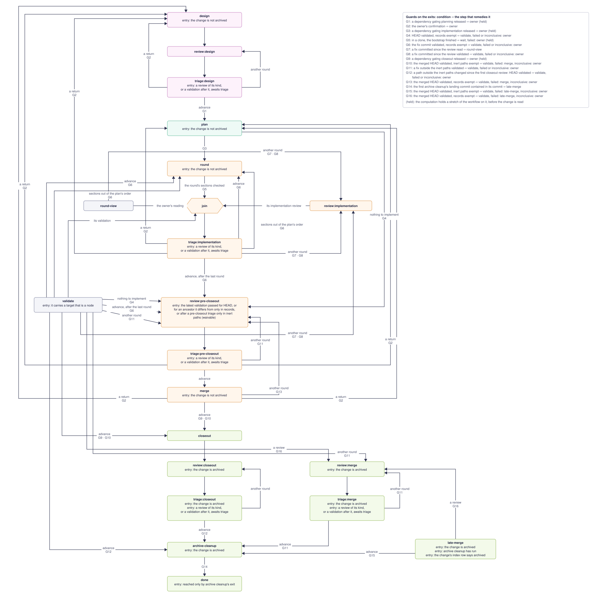
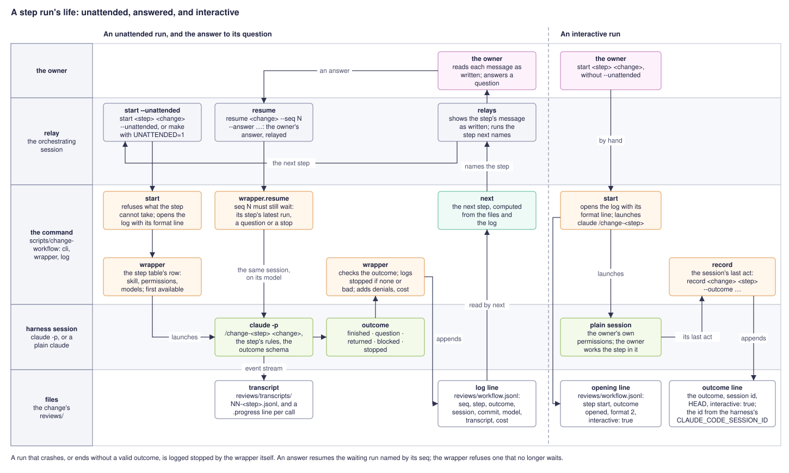
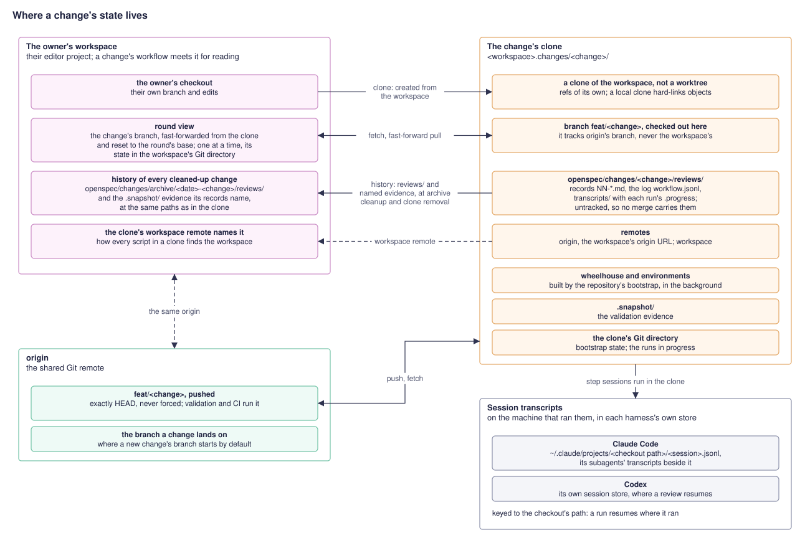
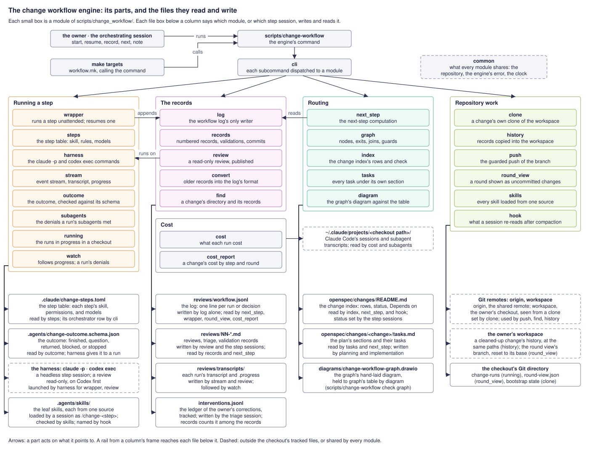

# The change workflow handbook

How to operate the change workflow: starting each step of an OpenSpec change,
letting one orchestrating session carry a change through its steps, reading a
round, directing and waiving, and reading the record of your corrections. It is
written for you, the repository's owner.

What the workflow does is its contract, the
[`change-workflow` specification](../openspec/specs/change-workflow/spec.md),
organized by its [`index.md`](../openspec/specs/change-workflow/index.md); how it
works and why, its [`README.md`](../openspec/specs/change-workflow/README.md). This
handbook cites a requirement by its id, such as CW-ab9h, where you need to know
what a step will do. What a change's work must contain — a design, a plan, a task
note, a closeout — is the workflow's guidance, under
[`docs/guidance/workflow/`](guidance/workflow/README.md). A change's status, and what
it waits on, are in its row of the [change index](../openspec/changes/README.md).
How a repository fills the roles the workflow leaves to it — its validation parts,
its checks, its branches — is its own guidance's to state (CW-m4ps).



## Starting a step

Each step is a skill (CW-d8de). Start it by hand with its target, or let the
orchestrating session start each in turn ("Orchestrating a change", below). Start
each in a fresh session, so it reads the change's files rather than an earlier
session's memory, unless you continue an implementation session on purpose
("Continuing an implementation session", below).

| Step | Skill | Start it with |
|---|---|---|
| Design | `change-design` | `make design CHANGE=<change>` |
| Design review | `change-review` | `make review CHANGE=<change> KIND=design`, or `make design-review CHANGE=<change>` |
| Planning | `change-plan` | `make plan CHANGE=<change>`, once the design review's triage advances the change |
| Implementation | `change-implement` | `make implement CHANGE=<change> [SECTION=<n> \| SECTIONS=<n-m>]` |
| Implementation review | `change-review` | `make review CHANGE=<change> KIND=implementation` |
| Validation | `change-validate` | `make validate CHANGE=<change>` |
| Triage | `change-triage` | `make triage CHANGE=<change>` |
| Pre-closeout review | `change-review` | `make review CHANGE=<change> KIND=pre-closeout` |
| Merge | `change-merge` | `make merge CHANGE=<change> [FROM=<branch>]` |
| Closeout | `change-closeout` | `make closeout CHANGE=<change>` |
| Closeout review | `change-review` | `make review CHANGE=<change> KIND=closeout` |
| Merge review | `change-review` | `make review CHANGE=<change> KIND=merge`, when the merge after the archive names it |
| Archive cleanup | `change-archive-cleanup` | `make archive-cleanup CHANGE=<change>` |
| Orchestration | `change-orchestrate` | `make orchestrate CHANGE=<change>` |

What each step writes and commits is in its skill and in the companion's
[A step run's life](../openspec/specs/change-workflow/README.md#a-step-runs-life).

Every step but the review opens an interactive Claude Code session. Add
`UNATTENDED=1` to run it headless instead, held to its step's permissions and run on
its step's models (CW-qu42, CW-ebmo); it ends with an outcome logged to the change's
workflow log (CW-1a4d). `make plan` unattended resumes the design step's session
([Steps run headless and resume with the owner's answers](../openspec/specs/change-workflow/README.md#steps-run-headless-and-resume-with-the-owners-answers));
add `FRESH=1` for a fresh one. The review always runs unattended, since an
interactive review would record nothing (CW-mzyz).



A step you run interactively records its own outcome as its last act (CW-mzyz,
CW-gnqh):

```text
scripts/change-workflow record <change> <step> --outcome '<the outcome, as JSON>'
```

It reads the session's id from `CLAUDE_CODE_SESSION_ID` (`printenv
CLAUDE_CODE_SESSION_ID` shows it), or takes `--session <id>`. If you close an
interactive session before it records, the next-step computation names its step
again: resume that session, or record its outcome yourself, naming the closed
session with `--session`.

A step that finds the change in the wrong state refuses and says why: design,
planning, and implementation refuse an archived change, and the steps after the
archive one that is not (CW-1iaz, CW-xo82). Steps that commit push each commit
through the guarded push (CW-pehu, CW-59c7); a pushed branch starts nothing.

## Orchestrating a change

`make orchestrate CHANGE=<change>` opens one Claude Code session that carries the
change through its steps: it runs the step the next-step computation names, each
unattended, shows you each step's message as written, and sends your reply back as
written (CW-5jlj, CW-yvo1). It forms no view of a finding or a design question, and
writes no feature work of its own accord (CW-op72). It stops for you at the design
discussion's questions, your reading of each implementation round, the triage
discussion, and anything no rule settles — an environmental remedy, a denial that
needs a rule, a proposed return, a stopped step (CW-9pbk); every other step follows
without asking.

**Starting and resuming.** The session keeps no state of its own (CW-ms3j), so
resuming a change is running `make orchestrate` again. `make change-next
CHANGE=<change>` prints the same computation in plain form: the step, its reason,
and, for a run waiting on you, its `seq` and what it asks.

**The cadence.** You settle the change's implementation cadence in its design: how
many sessions implement the work and how much each round covers before it is
reviewed (CW-al17). A change planned with no cadence is asked about once per round
(CW-v6nj).

**Following a running step.** The session says when it starts a long unattended
turn (CW-o9hd). `make change-watch CHANGE=<change>` follows each step's progress in another
terminal, one line per tool call. Run it from your workspace; a change worked in its
own clone is followed in the clone.

**Answering and taking over.** A step that asks ends its turn with a question; your
answer, relayed by the orchestrating session, resumes the same session (CW-xgq3).
Between turns you can take a step over with `claude --resume <session>`, the
session id on its log line, run in the checkout the step ran in, since a session is
keyed by its checkout's path. Hand back when done, and never resume a session while
the orchestrating session does; it reads the change's files again once you hand
back. When you closed an interactive step before it recorded, tell the
orchestrating session: it starts nothing for that step and gives you the command to
resume or record it, which you run (CW-o9hd).

**Directing a change.** You can send a change to any node of the graph outside the
exits its steps take — another review, a validation before a step, a step past a
guard that is not met, a confirmed return (CW-jtsl). Tell the orchestrating session,
which records your direction:

```text
scripts/change-workflow note <change> orchestrator --by owner --next validate --target closeout --decision "validate HEAD before closeout" --reason "<why, and what it skips>"
```

`--next` names the step, `--kind` a review's kind or the kind of review a triage
triages, `--sections` sections out of the plan's order, and `--target` what a
validation is for; `--resolves` names a run the direction settles, such as a return
it confirms. The computation names the directed step until a run of it is logged
(CW-zcx8). A direction checks no exit guard, so give the reason what it skips; it is
refused at an entry guard that cannot be waived, such as design of an archived change
(CW-uhdy).

**Merging the landing branch again after the archive.** Once archive cleanup has
reached `done`, the change's branch merges its landing branch again only on your
word (CW-m4qe). Tell the orchestrating session, which records:

```text
scripts/change-workflow note <change> orchestrator --by owner --next late-merge --decision "merge the landing branch after the archive" --reason "<your words>"
```

Restore a row you pruned from the change index, as archive cleanup left it, before
you direct the merge.

**Interrupting a running step.** The orchestrating session stays free while a step
runs, so you can reach it mid-step; on your word it stops the run (CW-k2rv):

```text
scripts/change-workflow stop <change> [--step <step>]
```

Name the step when validation and a review run side by side. A stop commits nothing
(CW-w4ne), and the session records your interrupt as your decision:

```text
scripts/change-workflow note <change> orchestrator --by owner --decision "interrupt <step>" --reason "<your words>"
```

Then say how to recover it: resumed with your words, rerun, or resolved with
`--resolves` and the change directed elsewhere.

**Revisiting a default acceptance.** You can revisit a finding a triage accepted by
default, or the advancing exit it took ("Default acceptance", below). Before its
fixes, answer the triage's last question with your disposition. After the triage
finished (CW-r8vz), the orchestrating session, on your word:

1. stops the step started after the triage, if one is running;
2. records your direction naming the triage's run:

   ```text
   scripts/change-workflow note <change> orchestrator --by owner --resumes <triage-seq> --decision "revisits 04 F5" --reason "<your words>"
   ```

3. resumes that triage with your words, `scripts/change-workflow resume <change>
   --seq <triage-seq> --answer "<your words>"`: the triage amends its fix in a new
   commit, logs the revisit in the ledger, and names its exit again;
4. then resolves the stopped step with `--resolves`. Resolved before the resume,
   the computation would name the first triage's exit again until the resumed
   triage ends.

The direction takes no `--next`, since the resumed triage names the exit, and one
resume spends it. Once archive cleanup has reached `done`, a revisit belongs on the
pull request.

**Converting a change's records.** A change whose records predate the log's current
format is brought to you with the conversion (CW-qj77):

```text
scripts/change-workflow convert <change>
```

Run it between steps, never while one runs. Alone, it writes nothing: it shows the
direction it proposes and every review its conversion line will name, flagging each
no recorded triage outcome names. `--confirm` writes it, attesting that each flagged
triage finished; `--next`, with `--kind`, `--sections`, and `--target` as `note`
takes them, gives your direction in the proposal's place; `--confirm --decline`
declines a pending return it proposes to confirm. If you will not attest a flagged
triage, write nothing: let its own session finish and record its outcome, then run
the command again.

**The step table and the models.** `.claude/change-steps.toml` gives each step its
skill and its allow and deny rules; `.agents/workflow.toml` gives each step's models
and the orchestrating session's. No step edits either: each changes as a tracked
edit you commit, or the orchestrating session commits on your word in the change's
clone (CW-z5me, CW-drf6). The orchestrating session reads each run's denials
(`scripts/change-workflow denials <change> <seq>`) and proposes the narrowest rule
for a gap (CW-vdqj), and the engine refuses a step's models naming two of one vendor
(CW-zq4h).

**Granting a rule for one run.** A rule you grant reaches one run and is never added
to the table (CW-tl5v). A fresh run takes it through its target, several rules
separated by `;`:

```text
make validate CHANGE=<change> UNATTENDED=1 ALLOW='Bash(gh run download *);Bash(gh run view *)'
```

A resumed run takes it as `--allow` on `scripts/change-workflow resume`. A grant
commits nothing, so it recovers a stop met between a round's sections being
committed and its triage, when no table edit may be committed (CW-bsmk). A deny rule is never
granted.

**Commits.** Each step that writes tracked work commits and pushes it; validation
and review commit nothing (CW-pehu). A stopped run leaves its work uncommitted for
its resume (CW-ajo9), or, on your word, for the orchestrating session to commit to a
separate work-in-progress branch. Work left uncommitted after a step finished is
that step's defect, which the orchestrating session brings to you (CW-bsmk).

**The merge before closeout.** Once the pre-closeout triage advances the change,
the merge brings the branch it lands on into the change's branch (CW-hdxi). `make
merge` merges `FROM=<branch>` when you give one, and otherwise the branch the last
finished merge recorded, else the one its clone recorded (CW-s3ju); a change with
none, such as one worked in your workspace with no clone and no merge yet, needs
`FROM`. The merge closes out after a passing validation of the merged `HEAD` without
asking; another pre-closeout review, or closeout without that validation, is yours to
confirm (CW-a6ow).

**The merge after the archive.** When the landing branch has moved by archive
cleanup, cleanup's first exit names the merge after the archive, which runs without
asking (CW-5vkd); after the pull request opens, it runs only on your direction
(above). It keeps the change archived (CW-g3zn) and judges for itself whether its
resolutions need a merge review (CW-x9tb). It declares no return (CW-m4qe): where
both sides cannot hold, it asks you, leaving the merge in progress, and you resolve
it as you direct, land the change and follow up in a new change, or take it off the
workflow
([The owner is interrupted only for judgement](../openspec/specs/change-workflow/README.md#the-owner-is-interrupted-only-for-judgement)).

**Merging the landing branch at other times.** On your word, the orchestrating
session merges the landing branch into the change's branch between steps — never
while a round view is open, nor between a round's sections being committed and that
round's triage (CW-bsmk). It resolves conflicts in the change index, change
documents, the step table, and skills itself, and brings a conflict in code to you
(CW-tax4). One you leave to implementation goes, once your decision is recorded, to
an implementation run with no sections:

```text
make implement CHANGE=<change> UNATTENDED=1 ARGUMENTS='resolve the merge conflicts in <files>'
```

While the merge is in progress, `make change-next`, run in the checkout holding it,
names you (CW-tax4).

**Continuing an implementation session.** An implementation run starts a fresh
session unless you send the work to an earlier one (CW-0ia3): the next section to a
session small enough to carry it, or a fix to the session that made the edits.
The orchestrating session does so only on your word, naming the session from its
run's log line:

```text
make implement CHANGE=<change> UNATTENDED=1 SECTIONS=8B SESSION_ID=<session>
```

**A run's earlier outcomes.** A session can take another turn after it reported;
the orchestrating session shows you each earlier turn's message too (CW-1a4d).

**Reading the cost.** `make change-cost CHANGE=<change>` totals the change's
unattended runs by step, by round, and by whether a run opened its session, missed
the prompt cache, or read it (CW-u7da). Dollars a run could not be told from its
session's other turns are marked partial. The figures are the harness's list prices.

## A change in its own clone

Each change can be worked in a clone of your workspace of its own, so several
changes run at once without moving each other's branch (CW-yib2): your workspace
meets a change's workflow only when you read one of its rounds. Clones live beside
the workspace, one per change under `<workspace>.changes/<change>/`, holding the
change's branch, its records, its environments, its validation evidence, and its
step sessions.



**Creating it.** `make orchestrate CHANGE=<change>`, started in the workspace,
creates the clone when no checkout holds the change's branch (CW-4x66), by running
`make change-clone CHANGE=<change> [BRANCH=feat/<change>]`; give `FROM=<branch>`
for a change landing on a branch other than the one your workspace has checked out,
since the clone records that branch as the one the change lands on (CW-s3ju). You
can run it by hand. It is safe to run again: it finishes a clone left incomplete,
restarts a failed bootstrap, and refuses, deleting nothing, a directory that is not a
clone of the workspace, has another branch checked out, or has uncommitted changes
(CW-8jyb).

**The bootstrap.** The clone's bootstrap runs in the background; design and
planning go on meanwhile, and implementation and validation wait for it (CW-8npg).
A failed bootstrap comes to you naming its log, almost always for a reason in the
environment, and is never retried by itself: `make change-clone CHANGE=<change>`
restarts it.

**Running steps.** From the clone on, the orchestrating session drives every step
in the clone, `make -C <clone> <step> CHANGE=<change> UNATTENDED=1`, so the log,
the transcripts, and the step sessions are the clone's (CW-yib2). To take a step over, resume
its session from the clone: `cd <clone> && claude --resume <session>`.

**Reading a round.** Once a round's sections are committed, validation and the
implementation review start in the clone, and you read the round in your workspace
beside them (CW-4svs). `make round-view CHANGE=<change>`, run in the workspace,
checks out the change's branch, fast-forwarded from the clone, and resets it to the
round's base, so the round shows as uncommitted changes (CW-aoby). It refuses a
dirty workspace, naming the files, an unattended run in progress there, another
change's open view, and a branch that has diverged from the clone's or holds a
commit of yours triage has not pulled. Run again while the view is open, it moves
the view to the branch's new head over the same base, to follow triage's fixes,
unless you have edits or commits in the view (CW-rgws). `make round-done` returns
the branch to the round's head and the workspace to where it was, staying on the
branch when you have uncommitted edits, which it leaves for you (CW-n44s).

A commit you make on the branch during the view — your editor's "commit all"
included — is carried onto the round's head when the view closes, each holding
exactly the paths it changed, with its author and message; `make round-done` prints
each beside its replacement, and drops one that holds nothing beyond the round.
Where the round also changed a path, your commit must hold every change the round
made to it (CW-uq5q, CW-gd24): `make round-done` refuses, moving nothing, and names
the file and the way back — `git reset --mixed <head>`, then commit again on the
round's head. Triage pulls your commits into the clone, fast-forward only, and
presents each as one of your points on the round (CW-te38).

When a round's triage names another implementation review over a fix it committed,
read the fix the same way before the repeat pass is triaged (CW-9mrq): `make
round-view CHANGE=<change> BASE=<commit>`, over the commit that triage's review
read, which `make change-next` names as `base`. Under orchestration the
orchestrating session opens and closes the view and saves your notes
([The owner reads a round in their own workspace](../openspec/specs/change-workflow/README.md#the-owner-reads-a-round-in-their-own-workspace)).

**History and removal.** A change's records and evidence are untracked, so no merge
carries them out of its clone. Archive cleanup, as its last act, copies them into
your workspace (CW-hak6), so your workspace holds the history of every cleaned-up
change, and `scripts/change-workflow find --records <change>` finds it (CW-c3he).
Once the change has merged, remove its clone with `make change-clone-remove
CHANGE=<change>` in your workspace (CW-xx5f), giving `BASE=<branch>` when the clone
recorded no landing branch. It refuses while a run or the bootstrap is in progress in
the clone; otherwise it copies the history again, then deletes the clone only when
that history is all in your workspace, the branch is merged into its landing branch
on its upstream's remote — a squash or rebase merge counts when merging the branch
again would change nothing — and the clone holds no unpushed commit, no uncommitted
change, and no stash. Otherwise it names each problem and deletes nothing. Archive
cleanup never removes the clone, since the pull request may need another round
(CW-xx5f).

**A change worked in the workspace.** A change can still be worked in your workspace
with no clone, its branch checked out there. Its round view resets that branch in
place, so you read the round before validation and the review start, and while the
view is open those steps refuse to start (CW-78ul); close it with `make round-done`.
The view is not refreshed.

**Moving a change already under way into a clone.** A change whose records are in
the workspace is not cloned automatically, since a clone copies only what Git
tracks; the orchestrating session brings it to you with two routes (CW-4x66): check
out its branch in the workspace and go on there, or move it into a clone by hand:

1. Settle any run waiting on an answer, in the workspace, since its session is keyed
   to the workspace's path.
2. Merge the branch the change lands on into the change's branch, so its tooling
   knows clones.
3. Run `make change-clone CHANGE=<change>` in the workspace.
4. Copy the change's `reviews/`, and the validation evidence its records name, to
   the same paths in the clone; check with `diff -r` that the copies are identical,
   then remove the workspace's.

## Reviews

`make review CHANGE=<change> KIND=<kind>` runs the reviewer read-only on the
configuration's review models, in their order (CW-ebmo), and publishes its answer
only once it has the review format (CW-r9d2). A review continues the previous
reviewer's session of the same kind on the same harness (CW-2nb2, CW-clhl);
`FRESH=1` starts a new one. For one run you may also give:

- `REVIEW_BASE=<branch>`, the branch the diff is taken against, by default the one
  the change's clone recorded as its landing branch; a review other than the design's
  refuses with neither.
- `REVIEW_MODEL=<model>` and `REVIEW_EFFORT=<effort>`, your choice of reviewer
  outside the models' policy (CW-d1sm): a `claude-` model runs on Claude and any
  other on Codex, with no fallback, and the run is marked as an override. The
  orchestrating session never sets them.
- `UNVALIDATED=1`, for a pre-closeout review, which otherwise refuses until the
  latest validation passed and names `HEAD` or a records-only ancestor (CW-gqav).
  Your direction to the pre-closeout review overrides it too.

A review run elsewhere — in a browser session, by another tool — is pasted into
triage, which saves it as the next record, `NN-<kind>-external.md`, and triages it
(CW-mzyz, CW-t2lw).

Before an implementation round is triaged you read it ("Reading a round", above),
and your notes on the round go to triage with its review and validation (CW-qtxb,
CW-rb5n).

### Default acceptance

Triage accepts by default a review finding that meets every condition of the default
rule (CW-d5ac), rather than putting it to you on its own; every other finding is
discussed with you, one per message, and disposed of only by your word (CW-neua).
The default acceptances reach you in one table, under "Accepted by default", with the
triage's last question, or in its final report when it asks nothing (CW-t9bx):

```markdown
#### Accepted by default

| Finding | Severity | The finding | Outcome |
|---|---|---|---|
| 04 F5 | should | design.md cites a companion heading that was renamed | edit: cite `#current-limits` |
```

A revisit in reply to that question is an ordinary disposition, made before any fix.
Advancing is the default exit: a triage recommending it takes it without asking and
reports it beside the table, while a recommendation of another round is argued and
asked (CW-9pbk). A revisit after the fixes resumes the finished triage
("Revisiting a default acceptance", above).

A change's reviews, triage files, workflow log, and transcripts are kept in its
`reviews/` directory, untracked, numbered in the order they were produced
([Reviews are files](../openspec/specs/change-workflow/README.md#reviews-are-files));
`scripts/change-workflow log <change>` prints its workflow log.

## Waivers

A step that meets a guard you may waive recommends a waiver only when a written
criterion holds, naming the criterion and its evidence (CW-q3dm); with none holding
it recommends none. Only you waive, and a waiver a step recommended is a ledger line
whether you take it or not (CW-n6wy). The merge before closeout judges whether its
own validation may be waived and asks you to confirm (CW-a6ow).

Waiving a guard is a direction past it. The merge after the archive's waiver of its
validation is your direction to the exit the merge named (CW-x9tb), recorded with
the merge's run:

```text
scripts/change-workflow note <change> orchestrator --by owner --resolves <merge-seq> --next review --kind merge --decision "the merge review without validating the merged HEAD" --reason "<your words>"
```

with `--next archive-cleanup` and no `--kind` when the merge named archive cleanup,
or when you skip both, saying so in the reason.

**Waiving parts of validation.** Any part of validation may be waived, by you alone:
a waived part is an omission of evidence, recorded as `waived` and counted in no
result (CW-e7lm). A waiver for later validations is your decision in the change's
workflow log, naming the parts and the condition; under orchestration the
orchestrating session records it, and otherwise you do:

```text
scripts/change-workflow note <change> orchestrator --by owner --decision "waive the deployment part of validation for the rest of this change, while nothing it touches affects the services it deploys" --reason "<your words>"
```

Validation runs a waived part anyway, saying the waiver lapsed, when the commits
since the last validation that ran it include a merge or the condition no longer
holds.

## The ledger

`interventions.jsonl`, beside the change's other files and tracked, records each
time you corrected course: decided otherwise than the agent proposed, or added
context or a condition that changes the work (CW-zidp). A disposition that accepts
the agent's proposal is recorded only in the triage file (CW-xe8m), except a
recommended waiver (CW-n6wy). A revisit of a default acceptance is marked as one
(CW-v1rk). Read together, a change's ledgers show where the guidance or the skills
fell short, which is what a guidance review reads them for (CW-g6ua); the line's
shape is the companion's
[The intervention ledger](../openspec/specs/change-workflow/README.md#the-intervention-ledger).

## The engine's command

Everything the engine does is reached through `scripts/change-workflow` (CW-r3ka);
the make targets are thin calls of it, a convenience outside its public surface
(CW-h8vm). Its subcommands, and which another party may rely on, are the companion's
[The command and its tiers](../openspec/specs/change-workflow/README.md#the-command-and-its-tiers).


