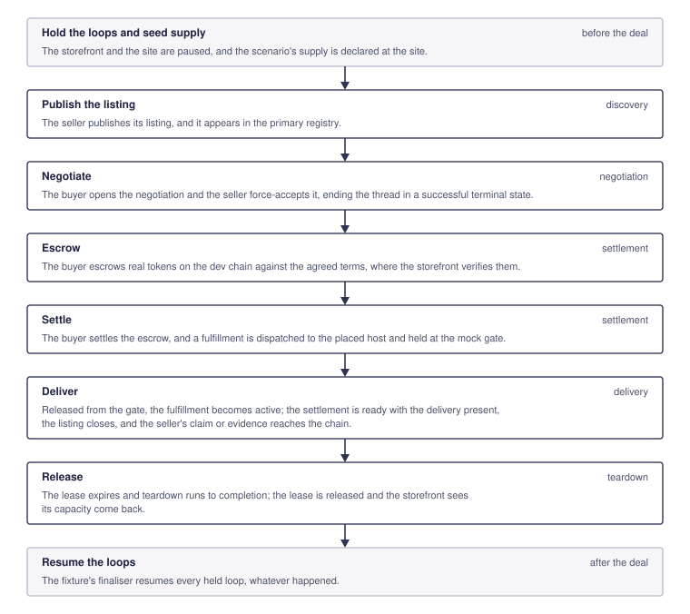
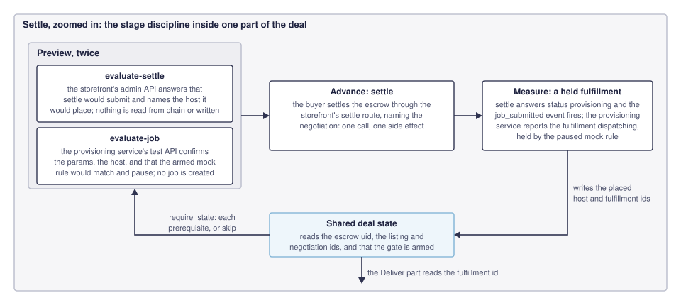

# Testing Strategy

This document describes this repository's tests: where each level runs, its
end-to-end lanes, the canonical compute deal they run, and the doubles they run
against. The levels, what each may prove, and the rules for writing tests are the
engineering guidance: [`test-levels.md`](../guidance/engineering/test-levels.md),
[`testing.md`](../guidance/engineering/testing.md), and the files beside them in
[`docs/guidance/engineering/`](../guidance/engineering/README.md); what a test here
must hold — its placement, its determinism, what a deal scenario proves, its
doubles, its gates and render tests — is the testing guidance under
[`docs/guidance/repository/`](../guidance/repository/README.md).
How one capability's tests divide its behaviour between the levels is that
capability's `testing.md`, beside its specification under `openspec/specs/`
([`openspec/README.md`, "Documentation placement"](../../openspec/README.md#documentation-placement)).

Read this alongside `docs/development/ARCHITECTURE.md` (system shape)
and `openspec/README.md` (documentation placement).

## Four-Level Hierarchy

The four levels and their jurisdiction are
[`test-levels.md`](../guidance/engineering/test-levels.md). Below, each level's
tests as this repository places and writes them.

### 1. Unit Tests

Where a package's unit tests sit, and the seams they take their doubles through,
are [`test-placement.md`](../guidance/repository/test-placement.md#unit-tests).

### 2. Integration Tests

What a service's and a kit library's integration tests drive, and where they sit,
are [`test-placement.md`](../guidance/repository/test-placement.md#integration-tests);
the seams they synchronize on, and the pause and step controls of the services' timer
loops, are [`deterministic-tests.md`](../guidance/repository/deterministic-tests.md).

### 3. Smoke Tests (Deployment Validation)

**Current location:** `e2e-tests/tests/smoke/`, run as Helm test hooks
in Kubernetes (`helm/templates/tests/`, per-chart `templates/tests/`
directories).

The provisioning smoke checks carry two markers: `provisioning_readonly` for
reads of health, system status, hosts, and host connectivity, and
`provisioning_security` for authentication enforcement, which sends an
unsigned read to a protected route and expects 401 or 403, so it needs no
administrator credential. The provisioning chart's test hook selects
`provisioning_readonly or provisioning_security`, and its render test holds
the hook to that expression.

### 4. System Integration Tests (End-to-End)

**Current location:** `e2e-tests/tests/e2e/`. How a scenario is written is
[`system-tests.md`](../guidance/engineering/system-tests.md); what every scenario
here must hold — a complete deal per domain, the discipline each follows, the two
kinds of scenario — is [`deal-scenarios.md`](../guidance/repository/deal-scenarios.md).

Three diagrams carry the scenarios. The first, beside the rule it draws in
[`deal-scenarios.md`, "The discipline every scenario follows"](../guidance/repository/deal-scenarios.md#the-discipline-every-scenario-follows),
draws the discipline every complete-deal scenario follows, whatever its domain. The
two below apply that discipline to the compute family's canonical deal, part by part,
as the worked example, and zoom into one of those parts to show the discipline
inside a single box. Each diagram's source is the `.drawio` file named under it
in [`diagrams/`](diagrams/); the SVG beside each is its export and also opens
in draw.io.

#### The canonical compute deal

The compute family's canonical deal settles through Alkahest on the dev chain.
The pipeline's lanes deliver it through the provisioning mock profile; the
[real-provisioning lane](#the-real-provisioning-lane) delivers it through a real
KVM host. The diagram draws it part by part, from holding the loops to resuming
them. Each box is one part of the deal, its preview, advance, and measurement
folded into a sentence or two, and the tag at its right is the deal stage the
shared state records for it. The bare-metal lane runs a second deal on the freed
host before its loops resume.

Source: [`diagrams/e2e-compute-deal.drawio`](diagrams/e2e-compute-deal.drawio).

Every stage the compute domains run identically comes from one definition, in
`e2e-tests/tests/e2e/roles/helpers/compute_deal_stages.py`. Those stages are
not named `Test*`, so pytest collects them only where a domain's scenario
module subclasses them, with an empty body, in its run order. A shared stage's
body is therefore defined once and runs in every compute lane; a stage whose
body would differ stays each domain's own, inserted between the shared ones
(VM's listing creation and claim, bare metal's publication, evidence, and
second-deal stages). What differs reaches a shared stage two ways: fixtures
every compute conftest provides under one set of names supply who is calling,
and each domain's `ComputeDealDriver`
(`e2e-tests/tests/e2e/roles/scenarios/vms/compute_deal_driver.py`,
`e2e-tests/tests/e2e/roles/scenarios/bare_metal/compute_deal_driver.py`)
supplies supply seeding, provision terms, the settlement preview's expectations,
the settlement's dispatch, the delivery assertions, the lease view, and the
re-reservation of released supply.
Negotiation has no driver hook: a compute domain that negotiates differently is
resolved in its storefront composition.

A shared stage never depends on the mock profile. Holding a provisioning job at
a mock rule's gate, releasing it, evaluating the rule, and confirming the mock
profile are mock gates: each is a mock-lane stage of its own (`MockLaneStage`),
which only a lane delivering through the mock profile declares, between the
shared stages it surrounds. A mock driver supplies the gates through a second
part, `MockGates`, which a real driver does not implement. A stage that would
both advance the deal and touch a gate is split at the gate, so its gate-free
part stays shared: the escrow apart from arming the create gate, the advance to
`active` apart from releasing and draining the create job, the lease expiry
apart from arming the teardown gate, and teardown's completion apart from
releasing and draining the teardown job, as
[`test-doubles.md`, "Shared stages never depend on a double"](../guidance/engineering/test-doubles.md#shared-stages-never-depend-on-a-double)
requires. Settlement submits only once the
lane's last check before it has passed: the mock rule's evaluation in a mock
lane, the check of the previewed host in the real lane.

`e2e-tests/tests/unit/test_compute_deal_stages.py` checks the stage set from
source: a mock lane subclasses every stage once, in definition order, with an
empty body; the real lane runs every shared stage in that order and no mock-lane
stage; no shared stage names a mock gate or the mock test client; and every
state field has one producer that runs before any stage reads it.

A compute buyer purchase — a deal bought through the shipped buyer CLI,
`market buy` or `market bare-metal buy`, in `arkhai.payments.v1` — runs the same
stages from fulfillment onwards. Convergence to active, settlement readiness,
the lease record, the lease's ending, and teardown completion are keyed on the
deal's settlement reference, which an earlier stage writes: the Alkahest escrow,
written by the canonical deal's settlement, or the payments negotiation, written
by the purchase. Every storefront's settle wait resolves a deal by either
([settlement servicing](../../openspec/specs/settlement-servicing/spec.md)), so
settlement readiness keeps one body. Each shared stage reads the inputs it
checks from state an earlier stage wrote independently of the lease it checks:
the expected host from the Alkahest settlement preview or from the purchase
driver's declared host — the one host the scenario registered enabled for its
resource, or a real target's host — and the teardown's fulfillment from
whichever ending ran. How a lease ends is shared only among scenarios that end
the same way. The expiry stages back-date the lease, step one lease-watchdog
cycle, and advance convergence to tearing down; the Alkahest set and the VM
purchase run them. The bare-metal purchases end by the buyer's
`market bare-metal end` in a stage of their own, which ends in the state
teardown completion starts from.

The purchase's own stages are defined once, in
`e2e-tests/tests/e2e/roles/helpers/buyer_purchase_stages.py`, and declared by
each purchase module in order as the canonical deal's are. They read the payer's
balance, discover the listing and its payments option, buy through the CLI,
correlate the run's events to one paid deal, and check the payment records: the
transaction is bound to its Agreement, its receipt covers that mandate, its
snapshot names the configured payer and payee with gross equal to the
Agreement's price, and the payer's available balance, read through the payments
kit with the buyer's own token, fell by exactly the scenario's own debits. The
purchase command runs in the background from the buy on, because `market buy`
polls its settlement until delivery while fulfillment convergence is held and
later stages step it. Each domain's purchase driver
(`e2e-tests/tests/e2e/roles/scenarios/vms/purchase_driver.py`,
`e2e-tests/tests/e2e/roles/scenarios/bare_metal/purchase_driver.py`) supplies its
command and arguments, its declared host, and its teardown.
`e2e-tests/tests/unit/test_buyer_purchase_stages.py` holds every purchase module
to the stage order.

Each compute lane runs one buyer purchase against its payments double. VM's
`e2e_vm_payment_purchase` lists a resource, host, and pool of its own, since a
listing's binding to its resource outlives the listing, and ends its lease by
expiry. Bare metal's is `e2e_bare_metal_payment_deal`, which inserts its own
re-drive and seller refund between the shared stages.

Each compute lane also runs one recurring purchase, VM's
`e2e_vm_recurring_purchase` and bare metal's `e2e_bare_metal_recurring_purchase`,
as lane-double evidence. A default buyer buys a recurring on-demand option
through the shipped `buy` and approves its one-rate-part mandate; the lane's
storefront configuration alone declares rate servicing for `charged` and
`returned`, and end service, which services no rate deal, refuses the commit.
The modules run the purchase stages through the buy, then those of
`e2e-tests/tests/e2e/roles/helpers/recurring_purchase_stages.py`: the approved
mandate and the payer's reservation, the refused commit with nothing reserved at
the site by delivery or started at the payments double (an acceptance hold the
domain placed at negotiation lapses at its TTL), the per-period price, setup charge,
initial reserve and maximum end the buy's stderr shows (that the buyer prints
them before its settlement stage approves is each buyer's own test, not the
lane's), the
buyer's own `end`, whose payer's stop the storefront records as the deal's end
with no filing, and the payer's balance restored. Nothing is delivered, so
neither waits for the delivery deadline.
`e2e-tests/tests/unit/test_recurring_purchase_stages.py` holds both modules to
that order.

Settlement by introduction is defined once the same way, in
`e2e-tests/tests/e2e/roles/helpers/introduction_stages.py`: disclosure of the
retention window before any contact is given, backed and unbacked supply
discovered together under one rate bound, the reveal into the buyer's own sink,
and seller-side delivery read back from the lane's Mailpit. VM's
`e2e_vm_introduction` and bare metal's `e2e_bare_metal_unbacked_introduction`
subclass those stages in order and insert their own between them; each
domain's `IntroductionDriver`
(`e2e-tests/tests/e2e/roles/scenarios/vms/introduction_driver.py`,
`e2e-tests/tests/e2e/roles/scenarios/bare_metal/introduction_driver.py`) seeds
the supply and speaks its CLI verbs, and only stages write the shared
`IntroductionState`. `e2e-tests/tests/unit/test_introduction_stages.py` holds
each domain to the shared stages and fields.

#### One part, zoomed in

Settle has the fullest shape of any part, so it is the one drawn open, as a
mock lane runs it. It previews twice, through the storefront's evaluate-settle
and, in a mock-lane stage, the provisioning service's evaluate-job, advances
with one settle call, and measures a fulfillment dispatched and not yet
converged. The real lane previews the same settlement and checks, in place of
evaluate-job, that the previewed host is its target. What the part reads from
and writes to the shared deal state is what ties it to the parts before and
after: `require_state` on the escrow, listing, negotiation, and the passed
preflight on the way in, and the placed host and fulfillment ids on the way
out, the latter read next by the deliver part. Every other box in the deal
diagram opens the same way, with its own previews, advance, and measurement.

Source: [`diagrams/e2e-settle-zoom.drawio`](diagrams/e2e-settle-zoom.drawio).

The pipeline runs one lane per market domain, each as its own job, so each
failure's logs stand alone and one domain's failure never hides another's
evidence. The native Ansible gate is a pipeline job beside the lanes, not a
lane, since it composes no stack
([`ansible-gates.md`](../guidance/repository/ansible-gates.md#syntax-and-native-checks)). Each lane builds only the images its stack runs
(`make build-e2e-<lane>`) and brings up only its own services, as a compose
project of its own:

- **VM lane** (`make -C e2e-tests test-e2e-vm`): Bob's and Alice's storefronts
  and provisioning authorities, the two VM registries, and the dev chain. After
  the canonical deal and a buyer's surrender, its typed-client deal runs two
  deals on the freed capacity: one whose Agreement starts later, committed at
  settlement and dispatched only by a resume-pass step once its start is
  reached, and one whose lapsed hold leaves its settlement placement no
  capacity, which ends as the seller's failure with nothing dispatched.
- **Bare-metal lane** (`make -C e2e-tests test-e2e-bare-metal`): one site
  trusting the bare-metal storefront, a bare-metal registry, and the dev chain.
  Its publication scenario declares pools and whole-host capacity through the
  site's operator clients, steps publication, and follows one listing through
  discovery, withdrawal, and reinstatement at the registry. Its mock-provisioned
  deal runs the canonical compute deal for one whole host, stage for stage with
  VM's, stepping the storefront's `delivery-recovery` cycle after dispatch and
  after readiness, as a restart would; then a second deal on the freed host
  whose buyer teardown, sent twice, returns one operation and releases capacity
  once; then a third whose machine is taken before settlement, which ends as
  the seller's failure with nothing reserved. Its separate
  `e2e_bare_metal_payment_deal` scenario is the lane's
  [buyer purchase](#the-canonical-compute-deal): a wallet-free profiled buyer
  buys one fixed-term USD/6 purchase through `market bare-metal buy` on the
  shared purchase stages, then receipt-gated mock access, readiness read through
  the storefront's settle wait on the negotiation, same-transaction and
  same-fulfillment re-drive through the canonical lifecycle `commit`, the
  buyer's `market bare-metal end`, then the seller's separate refund of the
  still-held payment and restored whole-host capacity. Unless the last stage
  recorded the deal ended, the module's cleanup opens any mock gate still
  closed, finds the purchase in the buyer's run log, refunds it if the log
  records the payment approved — retrying for a bounded time while the seller
  has not yet verified it or a service is unavailable — then releases a host it
  finds after the refund, reporting one it cannot read or tear down; a refund
  that still fails fails the run with the negotiation and transaction for an
  operator. Each cleanup step is attempted even after an earlier one fails, and
  the module's holds are released last.
  It settles against the lane's payments double; no real SSH claim is made. Its `e2e_bare_metal_unbacked_introduction` scenario is the compute
  family's introduction scenario on bare metal: the site's operator declares a
  whole machine in a capacity-backed pool naming its host, one in an unbacked
  pool naming none, each at an asking rate, and one in a backed pool stating no
  rate, and a storefront pool override offers the unbacked pool by
  introduction alone. A rate-bounded `market bare-metal list` returns the backed
  and unbacked listings together and leaves out the rateless one, a
  `capacity_backing=unbacked` query returns only the unbacked one, and the
  unbacked listing publishes `capacity_backing: unbacked`, no host fields, no
  `access_methods`, and only `contact-exchange.v1`. The buyer reveals the
  introduction through the CLI into its own file sink, the storefront mails the
  buyer's contact to the seller through the lane's Mailpit, and the deal's
  fulfillment status route answers 404. Its `e2e_bare_metal_introduction`
  scenario discloses the retention window before commitment, reveals
  introductions through the production buyer transport, and ends with the
  operator's deletion of one. No stage waits for the window to pass: the held
  retention sweep is proven where its clock can be driven, by the storefronts'
  integration tests (`domains/bare_metal/storefront/tests/test_http_introductions.py`,
  `domains/vms/storefront/tests/integration/test_introduction_retention.py`).
- **API-credit lane** (`make -C e2e-tests test-e2e-apicredits`): the credits
  registry, service, storefront, and gated sample app, a compute-schema registry
  of the lane's own that the credits deal's discovery is routed away from, and
  the dev chain. The lane's overlay (`compose.apicredits-lane.yml`) runs the
  sample app with no verify cache, so every request re-verifies its key and a
  top-up is visible to the next request; the cache's own behaviour, including no
  service call on a key known to be exhausted, is proven by the middleware
  conformance trace.

Each lane also runs the payments double and the mediation double
(`compose.payments-double.yml`): its payment storefront — Bob, the bare-metal
storefront, the credits storefront — settles against the first, and the lane's
registries recommend the second as the dispute authority every payment deal
names; see [Private Service Dependencies](#private-service-dependencies). The
VM lane also runs six dispute controls scenarios, each on its own deal, that
program both doubles through their controls
([`e2e-tests/README.md`, "VM dispute controls"](../../e2e-tests/README.md#vm-dispute-controls)).
What a lane target names, and where every value its stack reads comes from, is
[`compose-stacks.md`](../guidance/repository/compose-stacks.md#a-lane-target-names-only-its-files-its-project-and-its-mode).

The compute lanes' provisioning services run their mock profile because the
run selects it: `PROVISIONING_MODE` (`mock` or `real`, default `mock`) is
checked and exported to Compose by each lane target in `e2e-tests/Makefile`, and
each overlay places it last in the provisioning service's profiles
(`docker,<site>,${PROVISIONING_MODE:-mock}`); no storefront reads it. Under the `mock` profile each compute adapter
runs its jobs through a mock executor of its own, resolved by the same
`(offering_mode, action)` table as its real one, and the playbook output the
mock returns is parsed by the adapter's real result path. The rule and gate
mechanism is shared
(`provisioning/compute/src/compute_provisioning/jobs/executor_mock.py`); each
adapter mounts its rules and job dry run under its own prefix, VM's at
`/test/mock-rules` and `/test/evaluate-job` and bare metal's at
`/test/bare-metal/mock-rules` and `/test/bare-metal/evaluate-job`, beside the
shared `/test/jobs/*` routes. None of them is mounted outside the mock profile.
What a mock prints by default is
[`lane-doubles.md`, "A mock's default output"](../guidance/repository/lane-doubles.md#a-mocks-default-output).

`make -C e2e-tests test-e2e` runs the three in turn, taking each stack down
before the next, because every stack names its chain container `anvil` and
publishes fixed host ports.

Pre-review validation also runs the scenarios the default Helm charts can serve
(`HELM_SCENARIOS` in `scripts/validate_slice.py`) against a Helm release, in the
change's own namespace
([`market-change-workflow`'s "The change's namespace"](../../openspec/specs/market-change-workflow/README.md#the-changes-namespace)).
They run as a pod inside that
namespace, the e2e-tests chart's `<release>-e2e-tests-e2e-scenarios` Helm test
hook, rendered when `scenarios.markers` is set: it runs the change's own
`e2e-tests` image with the release's `test-config` ConfigMap under the `helm`
profile, the deal test pod's environment and mounts, and reaches every service by
its in-cluster name, as a lane's scenarios do on their compose network, so no local
port is involved. Validation runs it alone (`helm test --filter name=<pod>`) and
counts it as passed only on the pod's own exit status of 0, since `helm test`
passes when its filter matches no test. A scenario on that list reads only what the
`e2e-tests` image copies — `src`, `tests`, `config`, `conftest.py`, and
`settings.toml` — never a file from the checkout. Every other pipeline scenario is
reported as not run against Helm.

After the scenario pod, validation runs every storefront payments-check test pod
the release's hooks render (`helm get hooks`, each pod named
`<release>-…-payments-check`), then every mediation-check test pod
(`<release>-…-mediation-check`), each as its own step and likewise counted as
passed only on its own exit status of 0; a pod with no exit status is stopped.
Each pod's log is kept as evidence beside the scenario pod's, and a release
that renders no check pod of a kind is warned, never passed. The payments-check
pod runs the storefront's `check-payments` against the release's payments
double, so it shows the storefront's CA mount, derived `ca_bundle_path`, overlay
key and service URL working together. The mediation-check pod runs the VM
storefront's `check-mediation --origin` against the release's mediation double,
so it shows the dispute credential copied into the runtime overlay, its
rewritten `ca_bundle_path`, the Service name and the token working together; it
asserts nothing about the read's answer. The release serves no payment or
dispute scenario.

A mock-provisioned deal proves the services compose into a working deal, not
that a real resource was delivered. Bare metal's release-qualified deal
(`e2e_bare_metal_deal`) needs a real whole host to grant and revoke access on,
which the pipeline never has, so no lane selects it: real access and its
revocation remain a separate protected lane's evidence. It uses the shared
SSH helper with the operator's read-only known-hosts file; each access probe is
one fresh process, and only public-key authentication refusal proves revocation.
Transport failure is an unsuccessful observation. VM's real delivery is
proven the same way, outside every lane, by
[the real-provisioning lane](#the-real-provisioning-lane).

The VM multi-registry scenario seeds Bob's and Alice's separate provisioning
authorities through typed administration clients and refreshes both site
projections before listing creation. It checks Bob's publication to two
registries, Alice's publication to one, production buyer discovery retaining
one record per independent registry authority, ordinary discovery with an
unavailable endpoint, and independent negotiations. Registry footprint checks
use the typed registry client; the scenario does not establish that multiple
storefronts can share a site authority. Resource-query and explain preparation
have separate fail-closed behavior.

`make run-e2e` dispatches the lanes in GitHub Actions on the current branch
through an authenticated `gh` CLI, and `make fetch-e2e-logs` waits for the run and
downloads its diagnostics
([`e2e-tests/README.md`, "End-to-end lanes"](../../e2e-tests/README.md#end-to-end-lanes)
gives the steps). Without `E2E_RUN_ID`, `make fetch-e2e-logs` selects the newest
run on the current branch whose head commit is local `HEAD` (or `E2E_COMMIT`),
among the 100 most recent workflow runs, and waits up to three minutes for a
just-dispatched run to be listed. Matching the commit is what makes it safe
straight after `make run-e2e`: the new run may not be listed yet, and the branch's
previous run tested a different commit. `E2E_COMMIT` may be a short ID or a ref.
With `E2E_AFTER_RUN` naming a run ID, it takes only a later run, so a commit's
earlier run is not taken while its new one is still unlisted. Logs live under `.snapshot/e2e-logs/<run-id>/`:
`actions.log`, `e2e-vm-logs/compose-logs.txt`,
`e2e-bare-metal-logs/compose-logs.txt`, and
`e2e-apicredits-logs/compose-logs.txt`. `E2E_LOG_DIR` overrides the root
directory.
Each successful fetch also creates `<run-id>.zip` beside the run directory,
containing that directory and its logs. Repeated fetches replace the ZIP.
An unavailable artifact is reported without discarding other logs. A successful
fetch means diagnostics were retrieved; it does not mean the tests passed.

#### Release-image mode

A locally verifiable scenario also runs on a release candidate's images, as part of
the deployment's release validation, which runs every lane this way. Images do not
rebuild to the same digest, so a lane that built its own release images would test
other bytes. With `RELEASE_IMAGES=1` and `IMAGE_SUFFIX=-<rev9>`, a lane target runs the
release images `make -C e2e-tests pull-release-images` pulled and tagged
`arkhai:<local><IMAGE_SUFFIX>`, and builds only the wheels, dev-env, the test image and
its non-release images. Each lane's Compose files name a release image
`arkhai:<local>${IMAGE_SUFFIX:-}`, so one set of files serves both modes; in the
pipeline's build mode the suffix is empty and they name the bare tags. In this mode a
lane target, through `scripts/release_images.py`:

1. **checks**, before it tears down or builds anything, that each declared release image
   its Compose files run is present under the suffix, naming every missing one; it
   refuses an empty suffix, and a release image its Compose files run bare, which would
   run whatever holds the bare tag;
2. builds, then brings the stack up;
3. **records**, once the stack is up, each release image its running containers run in
   `.snapshot/e2e-release-images-<lane>.json`, by published name and manifest digest,
   read from the image's repo digest from a registry (one in the local `arkhai`
   repository names no registry and is not counted). It writes no record, and fails
   the lane, for an image with no such repo digest or two different ones, for a release
   image its Compose files run that no running container runs, and for a lane running
   none of the release candidate's images;
4. runs its scenarios.

Each lane records only the release images it runs; no lane runs
`frp-grant-admission`, which only the deployment's live tests run. The recorded value is
the image's own manifest digest under a registry's name, which shows neither a pull nor
that the registry holds it: the deployment's comparison of the records with the
manifests the release candidate's load pushed is what ties a lane to the release
candidate
([the release handbook, "Running the lanes on a release candidate's images"](../release-handbook.md#running-the-lanes-on-a-release-candidates-images)).
What a lane target names in this mode is
[`compose-stacks.md`](../guidance/repository/compose-stacks.md#a-lane-target-names-only-its-files-its-project-and-its-mode).

#### The real-provisioning lane

`e2e_vm_real_provisioning`
(`e2e-tests/tests/e2e/roles/scenarios/vms/test_real_provisioning_deal.py`) runs
the canonical compute deal against a provisioning service outside its mock
profile and a real KVM host, and proves what a mock-provisioned deal cannot: the
service's VM execution is not mocked; the create and teardown jobs ran on the
target host and succeeded; the buyer, with a key generated for the run and
negotiated in the deal, reaches the guest at the delivered access as the
delivered user and finds the negotiated vCPUs, memory within a stated tolerance,
and at least the negotiated disk; an unrelated key is refused for that user; and
once the lease expires and its capacity is released, a VM list job on the host
no longer names the guest and the delivered access no longer connects. It claims
nothing about the guest's other credentials, which a batch-mode SSH client never
tries. The guest's host key is trusted on first use for the run only, and a
later connection presenting another fails the run. Direct access uses forwarded
guest ports; relay access checks the relay address and the reservation's leased
port against the delivered endpoint. Released holdings retain their grant expiry;
the scenario does not require immediate port reuse during quarantine.

It is in no lane, because the pipeline has no host to provision on. It runs from
an operator's machine against a deployed stack's forwarded services, signing as
the `local` profile's principals, with `ACTIVE_PROFILES=local,real-provisioning-target`:
[`e2e-tests/README.md`](../../e2e-tests/README.md#real-vm-provisioning) gives the
steps, and [`VALIDATION_RUNBOOK.md`](VALIDATION_RUNBOOK.md#21-provide-real-compute-hosts)
the operator procedure around them. Its target is the `REAL_PROVISIONING_TARGET` section
of `config-real-provisioning-target.yml`, which an environment owner renders into
`e2e-tests/config/` beside the committed example, `config-real-provisioning-target.yml.example`,
and which Git ignores.
`e2e-tests/src/e2e_harness/real_provisioning_target.py` validates it before anything else.
Version 2 describes at most one host per domain, each with a connection,
access and sellable capacity. A VM host adds a listing shape fitting twice within
capacity; a bare-metal host adds its physical identity and verified SSH public
host key. Direct access names a public host, while relay access names only its
relay identifier. Unknown or foreign fields fail by name; version 1 is refused
with conversion instructions. A relayed run requires an enabled relay with a
configured token and active grant key before taking holds or registering supply.
The target contains no private key or relay secret.
Without the profile every stage skips naming it, and nothing is written to the
stack.

The lane registers its own supply from the target — a pool stating a GPU-less
shape, the host with its connection, and one declaration selling the whole
capacity — and publishes the target's smaller listing shape. It checks before
its holds are taken that the service reports its VM executor real. It runs every shared stage and no mock-lane stage, and
inserts its own: a check that the settlement preview chose the target host,
before settlement; a create-job poll after it; SSH access stages once the lease
is recorded; a teardown-job poll; and the VM-list and access-ended checks after
release. Where a mock lane releases a gate, the real lane waits for the real job
instead, found through the fulfillment's capacity reservation in the operator
job list and read by its status within a named bound. That poll is the one wait
the lane adds to the stage discipline, which otherwise waits only on a request a
stage made or for an instant the Agreement fixes; a failed or timed-out job
fails the stage with its logs. The shared stages compare the runner's clock
with the stack's — settlement is timed against the Agreement start, and the
lease's start and activation against settlement — so the operator's machine
keeps its clock synchronized with the stack's to within a second.

A rerun against the same stack reconciles rather than duplicates. The host's
connection is replaced where it differs and the declaration rewritten, and the
sole open listing on the scenario's resource is adopted, paused, rather than
created. Closed historical listings retain their bindings and are preserved.
Closed listings with no open one, several open listings, a listing of unknown
status, or an open listing of another shape fail naming them, for an operator to
recover; a closed binding does not authorize creating a replacement. The settle
stage waits for
the deal's own `job_submitted` event, filtered by its negotiation and counted
from a mark taken before settling, because an adopted listing's event log holds
earlier deals' events.

The lane keeps one SSH process printing a timestamp each second, with a five-second
maximum observed gap, while a second deal creates a guest and then expires it.
It requires the original session alive across both operations and checks management
connectivity before and after each create and teardown. Each guest uses its own
delivered port. A temporary reservation proves the second guest's shape is available
again while the first guest remains active. The first deal then follows ordinary
lease expiry and proves the whole host capacity is available again.

A run that fails after an accepted settlement is recovered by a module finaliser.
It tries both deals even if one recovery fails, expiring only their own leases
through the site, and advances the held workers, so the
provisioning service tears the guest down through its own lease lifecycle; it
then confirms the teardown job and the guest's absence. It takes any settlement
the storefront records, or whose dispatch it logs within a bound, as having
dispatched a fulfillment, unless the settlement's status shows a refund begun
before delivery. Where it cannot find the fulfillment or confirm the removal, it
fails naming the escrow, negotiation, fulfillment, reservation, jobs, guest, and
host. It never releases reservations fleet-wide, which would return the host's
capacity to the market while its guest may still run.

The opt-in `e2e_bare_metal_real_provisioning` scenario
(`e2e-tests/tests/e2e/roles/scenarios/bare_metal/test_real_provisioning_deal.py`)
uses the same canonical shared stages with a gate-free bare-metal driver. It
registers a backed relay-bound pool, the target's management connection and one
whole-machine declaration. Publication creates or reuses the open listing for
that machine and declared shape; the scenario never creates a listing directly.
The target's host key is validated and pinned before first SSH contact. Actual
grant/reclaim jobs, management continuity, negotiated-key access, unrelated-key
refusal, ordinary expiry/release, closed access and released/quarantined relay
holdings require a configured real host. The module belongs to no pipeline lane;
without its target it skips before any holds or supply writes. Unit and mock
pipeline results do not substitute for this physical qualification.

The real-provisioning modules and the qualification modules below share the
target's resource and adopt its sole compatible open listing, retaining closed
historical bindings. That listing offers a settlement option for each deal
mechanism the storefront composes and reports ready, Alkahest and Arkhai
payments. On VM
every module creates or adopts it through one helper
(`e2e-tests/tests/e2e/roles/scenarios/vms/composed_listing.py`); bare metal's
published options already are the composed mechanisms. Contact exchange settles
no deal and is stated on no compute listing. A module adopting the listing
requires it to offer the module's own mechanism, and otherwise fails naming the
listing and its options before any deal.

Three external-topology modules, also in no lane, make the runbook's
[owed observations](VALIDATION_RUNBOOK.md#observations-the-qualification-owes)
2, 4, 5, and 6 against the target and a payments target. Two extend the lanes'
buyer purchases; the third, observation 6's, makes no deal and runs after them on
the stack their purchases populated. The payments target is the runner's
`PAYMENTS` section, with `LANE_OWNED` unset so an unready target is a blocked skip. Without
either target they report a blocked skip before any hold or write.

VM payments listings take their declared delivery allowance from
`PAYMENTS.VM_DELIVERY_DEADLINE_SECONDS`, a positive integer number of seconds
(or a decimal integer string), defaulting to 300. Listing composition and the
purchase's option check use the same value; the buyer CLI waits at least that
long. The dispute window, `PAYMENTS.DISPUTE_WINDOW_SECONDS`, covers the allowance
plus the authority's minimum filing window
([`e2e-tests/README.md`, "Real-provisioning qualification"](../../e2e-tests/README.md#real-provisioning-qualification)
gives setting both). Existing immutable terms must match the run's inputs. This does not
extend an accepted Agreement, move a clock, or accept late delivery.

- `e2e_vm_qualification` (observation 2) buys two CPU-only guests through
  `market buy`, keeps an SSH heartbeat on the first across the second's create
  and teardown, reads the host's diagnostics before, during, and after through
  the VM operator job (`diagnose_host`, read through `HostDiagnostics`), and
  ends both leases by back-dating and stepped watchdog cycles.
- `e2e_bare_metal_qualification` (observations 4 and 5) runs the normal cycle,
  then the successor and refusal cycle, which needs the first cycle's consumed
  UID, each lease ended by the buyer's `market bare-metal end`. It checks no
  GPU.
- `e2e_real_provisioning_reapply` (observation 6) reapplies both hosts'
  canonical registrations, steps a publication cycle, and reads the consumed-UID
  history through the working-data operator route before and after. It holds the
  storefronts' loops and the VM site's timers and steps no bare-metal timer,
  since the service's state guards keep that site's convergence and watchdog
  from restoring anything a faulty reapply removed. Relay-port reconciliation
  runs ungated on both sites, so it compares each quarantined relay lease's whole
  record, release time included. The listing baseline includes closed history:
  every identity, state and pause must remain exactly as before, with no added
  or removed listing, rather than requiring that history contain only one row.

A module failing after the buyer approved a payment refunds it as the seller,
unless the module had begun ending that purchase, ends a delivered guest or host
through its lease's own expiry or reclaim, and names by negotiation and
transaction whatever it cannot refund or end.
[`e2e-tests/README.md`](../../e2e-tests/README.md#real-provisioning-qualification)
gives the steps.

Target version 2 accepts two optional inputs these modules read. A VM host's
`management_unit` names the operator's management client, a systemd service
unit, which the diagnostics report beside libvirtd and the buyer tunnel client.
Observation 2 requires that the management unit keep one invocation, stay
active, and add no restarts across the reads, and that libvirtd add no
restarts, report no failed result, and keep one invocation across the reads
taken while the first guest runs; libvirtd is socket-activated and may exit when
idle. A relay access's `admission_log` is an absolute harness-local path to a
copy of the relay's admission plugin log
([the log](../../tools/frp-grant-admission/README.md#the-log)), which the
deployment keeps current. For each delivered relayed lease the module requires a
verified `admit` line whose `jti` is the reservation and whose remote port and
`kid` are those the relay's lease record names
(`GET /api/v1/relays/{relay_id}/leases`). The key compared is the one that signed
the lease's latest grant, not the relay's active key, since a rotation keeps a
retired key's grants valid. Without either field the stage that needs it skips
naming the field, and each observation requiring that stage is unproven: the
management reads by observation 2, the admission check by observations 2, 4,
and 5.

## Private Service Dependencies

The tests keep a private service out, testing its client against a double, and the
doubles mirror their producers, as
[`lane-doubles.md`](../guidance/repository/lane-doubles.md) requires. Every lane runs
two: the payments double and the mediation double.

**The lane doubles' controls.** Both lane doubles serve one typed control
contract, `tools/lane-double-controls`, which the doubles and the end-to-end
harness import; its [README](../../tools/lane-double-controls/README.md) lists
the rules, routes and refusals. Its controls are deterministic steps
([`test-doubles.md`, "Controls are deterministic steps"](../guidance/engineering/test-doubles.md#controls-are-deterministic-steps)).
A transport fault abandons a started response, so SCM's clients see a transport
error, as they would a lost response, never an HTTP error status. A scenario
installs its rules through the `lane_double_rules` fixture
(`e2e-tests/tests/e2e/roles/helpers/lane_doubles.py`), whose finaliser deletes
them and fails naming any rule a case still waited on. A control no scenario
exercises is proven by its double's own suite through the typed client.

**The lanes' payments target.** Every end-to-end lane runs the payments double,
`tools/payments-lane-double`: an HTTPS service at `https://payments-double:8443`
over the payments kit's `PaymentsAuthority` engine, mirroring the payments
service's API, signing only `livemode: false` receipts, and holding only
labelled public development fixtures (its [README](../../tools/payments-lane-double/README.md)
says what it serves and claims). Its callers trust its committed lane CA through
their payments configuration's `ca_bundle_path`, never `SSL_CERT_FILE`. Each lane
target runs the runner under `ACTIVE_PROFILES=docker,payments-lane,<lane>-lane`
(`RUNNER_PROFILES` in `e2e-tests/Makefile`): `config-payments-lane.yml` holds the
double's target, receipt identity, fee policy, CA bundle path, accounts and the
buyer's credentials, and `config-<lane>-lane.yml` only what differs by lane — the
seller's marketplace credential, and in the bare-metal lane its price and
dispute window — Dynaconf merging the
`payments` section key by key. Unset, the runner runs under `docker` alone and
has no payments target. The runner's environment carries no payments value; the
lane CA reaches it as one mount. Tests hold every value a lane profile restates
to the fixture or identity file it comes from. Once the stack is up, each lane
runs its payment storefront's `check-payments` from the storefront's own
container, an authenticated read of the seller's balance at the double, and a
failed check fails lane setup by name before any scenario.

**The lanes' mediation target.** Every lane also runs the mediation double,
`tools/mediation-lane-double`, at `https://mediation-double:8443` under the same
lane CA: it reproduces the dispute authority's API mechanics and rules a case
only when a rule says so
([test-compatibility, "The in-lane mediation double"](../../openspec/specs/test-compatibility/architecture.md#the-in-lane-mediation-double);
its [README](../../tools/mediation-lane-double/README.md) states its deviation
from its producer). The lanes' registries recommend its identity, which sellers and
buyers take from the registry rather than from a `[[Dispute]]` entry of their
own. `config-payments-lane.yml`'s `mediation` section holds the target, its
identity, `lane_owned: true`, the CA bundle path, the buyer's token, the
variable the buyer's credential names it by, and the control token;
`e2e-tests/tests/e2e/roles/helpers/mediation.py` fails setup by name on an
unready lane-owned target and reports a blocked skip for an unready external
one, as the payments helper does. The harness writes the buyer's
`[[DisputeCredential]]`, with its `api_key_env` and `ca_bundle_path`, and hands
the buyer's token to each `market` process under that variable, never into the
runner's environment. Bob's storefront holds his dispute credential, with the
lane CA as its `ca_bundle_path`, in his secret overlay. The lanes run no
`check-mediation`: the VM payment scenario's case stages and the VM dispute
scenarios prove the storefront's mediation access, and the local release's Helm
test runs the check ([`chart-render-tests.md`](../guidance/repository/chart-render-tests.md#where-they-live-and-how-they-run)).

A payment scenario run against both lane-owned doubles logs the label *lane
doubles* with each double's installed contract hashes, read from its status
through the typed control client (the `lane_doubles_evidence` fixture); only a
hosted target yields live evidence.

**The payments helper.** Payment scenarios read their payments policy through
`e2e-tests/tests/e2e/roles/helpers/payments.py`. A blank PAYMENTS.SERVICE_URL
means no payments target is configured, and the scenario reports a blocked skip,
never an Alkahest fallback. With SERVICE_URL set, SERVICE_IDENTITY,
BUYER_ACCOUNT, BUYER_MARKETPLACE_CREDENTIAL and SELLER_MARKETPLACE_CREDENTIAL
are required, and a missing one fails the scenario by name before the target's
`/health` is checked (timeout 5 seconds, environment proxies disabled, trusting
CA_BUNDLE_PATH alone when it is set). An unready target is a blocked skip when
it is external and a failure naming its URL when the run marks it its own
(LANE_OWNED, as every lane profile does); LANE_OWNED with no SERVICE_URL fails
too. FEE_BPS defaults to 250; LIVEMODE, DEVELOPMENT_AUTH and LANE_OWNED default
to false and are read as strict booleans, and LIVEMODE is emitted explicitly in
buyer TOML. API_KEY_ENV is required without DEVELOPMENT_AUTH, and the two are
mutually exclusive. The buyer's token is the setting BUYER_API_KEY, never a
runner variable: the harness writes it into each `market` process's environment
under the variable API_KEY_ENV names, as the buyer's own provider reads it. The
helper serializes only the named payments table, its `ca_bundle_path` included,
not domain configuration or payer selection.
See [shared payment-scenario configuration](../../e2e-tests/README.md#shared-payment-scenario-configuration)
for an external run's setup.

**Current example:** complete deals settled through the Arkhai payments service are qualified by that service's own suite. Here, `kit/arkhai-payments` generates its models from the service's published schema and checks the published vectors, all vendored and identified by content hash in `kit/arkhai-payments/schema/SOURCE.md`: the current producer vectors through the strict models, signatures and transaction identities, and the historical vectors as raw transaction identities, receipt framing, signatures and attachment hashes only, which the current models refuse, as [`test-compatibility`'s "Payment Receipts in Tests"](../../openspec/specs/test-compatibility/testing.md#payment-receipts-in-tests) describes. Neither proves live service responses, provider funding or physical delivery.

## Offline Review Validation

Review validation packages a scoped wheelhouse rather than copying a
virtual environment or sharing a package cache, so an offline reviewer
can run each affected project's real `make test` target with network
and Python downloads disabled. The scope resolver accepts an explicit
project list or a review manifest, and otherwise maps a Git diff to
repository-owned project roots and applies impact-expansion rules from
there. Each project keeps its own locked third-party requirements rather
than being forced into one synthetic shared environment; the review environment
uses the wheelhouse's declared Python version
([`project-environments.md`](../guidance/repository/project-environments.md#the-interpreter-stays-configurable)).

**Current implementation:** `make review-wheelhouse` (scope preview via
`make review-wheelhouse-scope`, controlled by `REVIEW_PROJECTS`,
`REVIEW_SCOPE_FILE`, or `BASE_REF`), which rebuilds wheels, refreshes
scoped lockfiles (`scripts/uv_project.py lock`), and bundles the
result via `scripts/package-review-wheelhouse.sh`.
