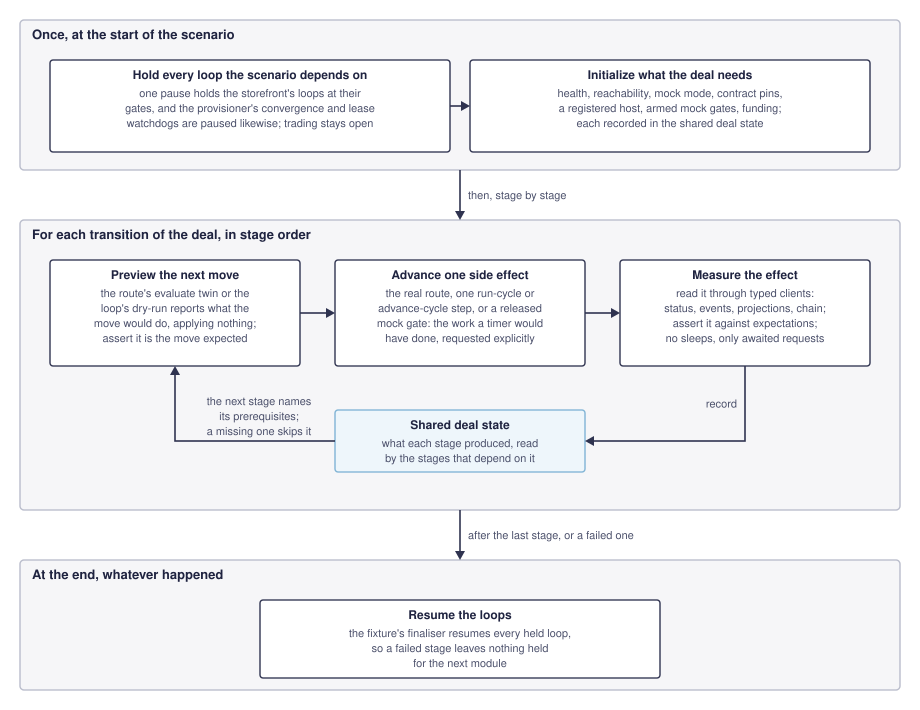
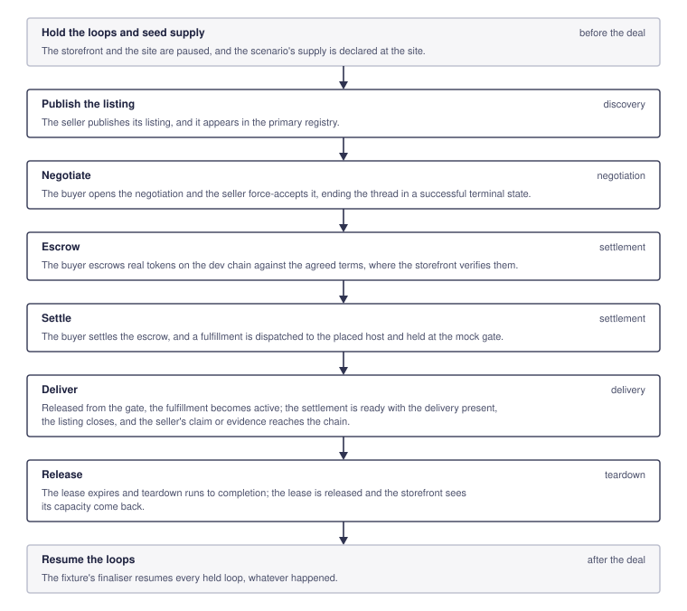
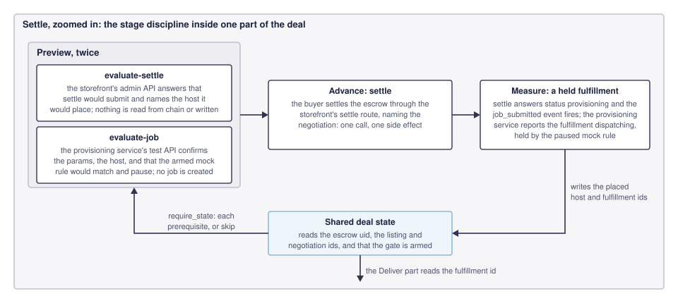

# Testing Strategy

This document defines the testing conventions for this repository. It
exists to give every contributor — human or AI — a consistent mental
model of what each test level is responsible for, what it is explicitly
not responsible for, and how the levels relate to each other. Put a new
test at the lowest level that can meaningfully prove the behavior in
question; see `AGENTS.md`'s "Tests and diagnostics" for the underlying
rule this document elaborates.

Read this alongside `docs/development/ARCHITECTURE.md` (system shape)
and `openspec/README.md` (documentation placement). This document
describes current testing practice, the same way `ARCHITECTURE.md`
describes current system architecture — it is not a changelog of how
testing conventions were introduced, and it should be corrected in place
when practice changes rather than accumulate historical commentary.

## Four-Level Hierarchy

### 1. Unit Tests

**What they cover:** A class or function in isolation. A unit test
instantiates one class, passes mocked collaborators for its injected
dependencies, and asserts on the return value or side effects of a
specific method.

**What they do not cover:** Orchestration. If a function's sole purpose
is to call other functions in sequence, that function does not have
meaningful unit tests — the correctness of the sequence is an
integration-test concern. The final abstraction before an external
boundary (a database write, a subprocess invocation, an HTTP call) is
similarly not meaningful to unit test in isolation; its behavior is
validated by integration tests against the real boundary or a
well-defined mock of it.

**Mocking convention:** Use `unittest.mock.MagicMock`/`AsyncMock` for
injected collaborators, passed in via the constructor. Do not patch
module-level imports — the dependency-injection composition pattern
used throughout this repository makes constructor injection the natural
seam; patching around it defeats the purpose of the seam and produces
tests that break when internal call structure changes even though
behavior didn't.

**Command-module convention:** a command module — a storefront's operator
commands or a domain's buyer commands — has no constructor: the framework calls
its module-level functions. It is its own composition root instead, and builds
its collaborators through module-level factory functions it defines, named for
what they provide; those factories are its one seam. A test replaces a factory
on the module that defines it and nothing else — no library name, no name the
module imports from another, no name inside core — because an import-style
change can silently undo such a patch, and the test then runs the real
collaborator. The bare-metal buyer CLI
(`domains/bare_metal/buyer/src/arkhai_bare_metal_buyer/cli.py`) has this shape:
its tests replace `fresh_identity`, `recovery_identity`, `registry_client`, and
`payment_approval`. The other CLIs' tests still replace library and imported
names; [`ROADMAP.md`](ROADMAP.md) records that gap.

**Composition-boundary convention:** When a role receives a versioned domain contract, unit tests should inject a distinct compatible object and assert object identity at each constructor boundary rather than patching the default resolver. Fail-closed cases belong at the composition root and must assert that persistence, network, and worker collaborators were not constructed. Existing integration tests remain responsible for public behavior and persisted-state parity.

**Negotiation-runtime convention:** Protocol invariants are tested once in
`kit/negotiation-runtime/tests/unit` with an in-memory recording repository and
injected opaque domain hooks. Those tests prove canonical-principal checks,
round and terminal ordering, transcript recovery, acceptance persistence, and
fail-before-effect behavior for recorded binding mismatches. Storefront tests
then prove only their domain adapters: term decoding, seller policy input,
accepted-artifact construction, and domain persistence/effect hooks. A domain
test must invoke `NegotiationRuntime`; reintroducing a local lifecycle helper
would test the duplication rather than the production composition.

### 2. Integration Tests

**What they cover:** End-to-end request → response paths with the full
application stack running (the real app, a real database, the DI
container wired) and a controlled mock only at the external I/O
boundary. Orchestration logic, background job processing, retry
behavior, and error propagation are validated here, not in unit tests.

**What they do not cover:** Every edge case of data transformation
logic — that belongs in unit tests. An integration test needs one
representative case per external-mock behavior, not exhaustive
parametrization.

**External boundary definition:** Any I/O that crosses a process
boundary — a subprocess invocation, a call to a service this codebase
doesn't own, a blockchain RPC call. Mock at the point this codebase's
own code wraps that boundary, not deeper.

**Library packages:** A kit library has no app. For a library, integration
means its public service API against a real embedded database, the
persistence boundary the library owns, with collaborators it does not own
injected. Such tests live in the library's `tests/integration`. They prove
durable behavior a unit test with mocked collaborators cannot: transaction
boundaries, locking, and independent-session concurrency. They do not
replace the in-process-app integration tests of a service that composes the
library, which remain the tests of that service's wire contract. A library
test that exercises a real database but still sits in `unit/` moves to
`integration/` when it is next touched.

**Test setup pattern:** Use `httpx.AsyncClient` with `ASGITransport`
against the real application instance, injected via the service's
canonical typed-client constructor (`FooClient(transport=...)`).
Override DI container providers for the specific collaborator being
mocked before the test and restore them after.

**Typed client contract verification — the "no raw calls" rule:**
Integration tests call a service's canonical typed client methods
directly against the in-process app, not raw HTTP. Route strings,
request body shapes, and response parsing are owned by the client;
happy-path tests should not construct requests by hand. If an API
renames a field or changes a route, the typed client should raise its
own client error and the test should fail immediately — a test that
builds its own request dict will not catch that, which is exactly the
kind of interservice mismatch that mocked-boundary unit tests cannot
catch either. This is the single most important rule for the layer
where real bugs are most often found in review: an integration test
that bypasses the typed client to make assertions easier has quietly
stopped testing the client contract at all.

Two narrow exceptions are permitted:

1. **Rejection-path tests** — testing server-side validation of inputs
   the typed client deliberately refuses to construct (asserting a 422
   on a malformed body the client's own request model would reject
   before it ever reached the HTTP layer). These verify the *server's*
   validation boundary, not the client's, and must only assert on
   status codes, never on response body field names, and must be
   clearly commented as rejection-path tests.
2. **Service-internal state setup** — inserting DB rows directly to
   establish precondition state that cannot be expressed through any
   HTTP API endpoint. This is not an HTTP call at all; it is standard
   test-setup, and should be preferred only when the state genuinely
   isn't reachable through an API — prefer creating precondition state
   through the HTTP API where feasible, so integration tests stay
   honest about what the API contract actually supports.

Any other use of a raw HTTP call in an integration test is a gap: either
add a method to the canonical client, or restructure the test. A comment
like "not yet a client method" is a deferred-debt marker, not a
permanent exemption.

**Sync/async client parity:** When a client package exposes both async
and sync variants, the owning service's unit suite should include a
small contract test comparing public method names and signatures across
both. A new client method must be added to both in the same change. This
guardrail belongs with the service's tests, not the client package,
because the service owns the contract-validation boundary — it does not
substitute for integration tests that exercise the methods through real
controller routes.

**Async test discipline — no sleeps:** Tests exercising a background
job-processing loop must never use `asyncio.sleep` or a bare timeout
race to wait for a side effect — this produces intermittent failures.
Use an explicit test seam instead: an injectable callback invoked at the
point the test needs to synchronize on (for example,
`AsyncJobQueue.__init__`'s `on_job_started: Optional[Callable[[str], None]]`,
`None` in production and zero-cost there), set an `asyncio.Event` from
the callback, and `await asyncio.wait_for(event.wait(), timeout=...)`
before proceeding. If no such seam exists yet where a test needs one,
adding it is the correct fix, not a sleep.

**Leave nothing held:** a test that holds a job at a mock rule's gate
(`pause_before_result`) ends that hold itself, by resuming the rule or by
cancelling the job, so the test is idempotent: it leaves no execution
parked for the next test, the next module, or a rerun, and holds no queue
slot. A job's status is not the evidence: a cancelled job is terminal the
moment the cancellation commits, while its execution may still be waiting.
Wait on the execution instead — `MockRuleSet.wait_until_released` for the
gate and `AsyncJobQueue.wait_until_idle` for the processing — and assert
the rule's `waiting` count is zero. Cancelling a held job must end its
execution without a resume; a mock whose cancellation leaves the run
waiting is a defect in the mock, not something to resume around.

**Pause the loop, then advance it explicitly:** the same discipline
applies to a service's own background lifecycle loops, where the seam is
an HTTP control rather than a callback. Each loop should offer a pause,
and an explicit single-step that works *while* paused, so a scenario
drives transitions instead of waiting for a timer. The stage discipline
diagram under [system integration tests](#4-system-integration-tests-end-to-end)
draws a scenario following this:

| Loop | Pause | Explicit step |
|---|---|---|
| Lease watchdog | `POST /api/v1/system/lease-watchdog/pause`, answering `paused` and `at_gate` (`WorkerPauseResponse`) | `POST /api/v1/system/check-leases` |
| Fulfillment convergence | `POST /api/v1/system/fulfillment-convergence/pause`, answering `paused` and `at_gate` (`WorkerPauseResponse`) | `POST /api/v1/system/fulfillment-convergence/advance-cycle` |
| VM storefront loops (`publication`, `capacity-events`, `site-projections`, `settlement-servicing`, `fulfillment-resume`, `negotiation-watchdog`, `introduction-retention` while contact exchange is enabled, and `alkahest-chain-probe` while an Alkahest section is configured) | `POST /api/v1/admin/lifecycle/pause`, which holds them all | `POST /api/v1/admin/lifecycle/<loop>/run-cycle`, previewed by `.../<loop>/dry-run` for `publication`, `capacity-events`, and `introduction-retention` |
| Bare-metal storefront loops (`publication`, `site-projections`, `settlement-servicing`, `negotiation-watchdog`, `payment-reconciliation` while Arkhai payments is composed, `introduction-retention` while contact exchange is enabled, and `alkahest-chain-probe` while Alkahest is composed) | `POST /api/v1/admin/lifecycle/pause`, which holds them all | `POST /api/v1/admin/lifecycle/<loop>/run-cycle`, previewed by `.../<loop>/dry-run` for `publication` and `introduction-retention`; the `bare-metal-storefront publish` command is a client of the `publication` step and its preview |
| API-credit storefront loops (`capacity-events`, `settlement-servicing`, `negotiation-watchdog`, `payment-reconciliation` while Arkhai payments is composed, `alkahest-chain-probe` while Alkahest is composed, and `listing-seed` while a seed listing is configured) | `POST /api/v1/admin/lifecycle/pause`, which holds them all | `POST /api/v1/admin/lifecycle/<loop>/run-cycle`, previewed by `.../capacity-events/dry-run` |

A provisioning worker's pause answers `at_gate` beside `paused`: a cycle that
began before the pause finishes first, so a caller that needs the worker held
repeats the pause until `at_gate` is true. A storefront's pause answers each
loop's gate state the same way. `alkahest-chain-probe` probes every configured
chain at each step, and settlement readiness reads only its last results, so a
held storefront judges Alkahest by the probe a stage last stepped.
`listing-seed` finishes once the configured seed listing exists and waits while
a dependency it needs cannot be reached.

Every storefront composes its loops onto the one kit loop controller in
`kit/storefront`, so the routes, response shapes, and the canonical
`StorefrontClient` methods are the same for every storefront. The storefront
loops hold no claim between cycles, so their `run-cycle` is a step: it runs
exactly the cycle the timer runs, through the same locked operation, whether or
not the loops are held, and records its outcome as the timer's cycle does.

A storefront whose source checks read held projections confirms a listing only
from a generation polled within its `[capacity].source_confirmation_seconds`. A
scenario that holds the loops keeps trading, so it steps `site-projections`
wherever a site changed before stepping publication or negotiating, and the
end-to-end lanes widen the window to an hour so a scenario's rounds are not
refused between steps.

A scenario that needs a shared service's timer held — a storefront's lifecycle loops,
provisioning's fulfillment convergence or lease watchdog — takes that lane's hold fixture
for the whole module with `usefixtures`, listed first so it is released last. A hold is
taken before the module's first stage and waits until each loop is at its gate, and is
released in a finaliser whatever the module's outcome. Stages assert a hold; they never
pause or resume a service themselves, and a source check enforces it.

The hold helpers are `storefront_loops_held`, `fulfillment_convergence_held`, and
`lease_watchdog_held` in `e2e-tests/tests/e2e/roles/helpers/compute_deal.py`; each
compute lane's `conftest.py` builds its fixtures of the same names on them, and the VM
lane adds `alice_loops_held` for Alice's storefront. A stage reads a hold back through
live system status (`assert_storefront_loops_held`, `assert_lease_watchdog_held`), so a
module that lost its hold fails rather than racing a timer. A lane's cleanup fixtures
are not autouse: pytest sets an autouse fixture up first and so finalises it after the
holds, so each module lists its cleanup after its holds, and the holds keep the timers
stopped while the cleanup runs. `e2e-tests/tests/unit/test_scenario_holds.py` refuses,
from source, any pause or resume call or route outside the hold helpers and the
conftests' hold fixtures, and `e2e-tests/tests/unit/test_scenario_cleanup_order.py`
reads the fixture order pytest resolves for every compute-lane scenario module and
refuses a hold released before the module's other cleanup. A module killed by `helm
test`'s timeout runs no finaliser, and only a restart clears its pause; modules in a
lane run serially.

Traps this has already sprung, worth checking for a new loop:

- **A loop with no pause is not paused.** Convergence ran a 30s timer
  with no gate while the scenario around it believed everything was
  stopped, so it claimed the same rows the test was explicitly
  advancing. "Everything is mocked, so nothing can take wall time" is
  true of the work and false of the coordination.
- **A "run one cycle" endpoint is not necessarily a step.** Convergence
  claims a row before polling its provider and, on a pending answer,
  deliberately keeps that claim so the lease spaces the next poll. A
  further cycle inside that lease reaches nothing, so any number of them
  is still zero advances. `advance-cycle` releases the caller's own
  claims first; `run-cycle` is the production cycle and does not. If a
  test needs several steps to make one transition, suspect the step
  rather than adding a sleep.
- **A loop that sleeps its interval is held late.** A loop gated at the
  top of each cycle but waiting with a plain sleep reaches its gate only
  when the sleep ends, so a pause landing in a 30-second interval outlasts
  the pause's 5-second bounded wait and reports the loop `pausing`. Every
  timer loop waits through the controller's `idle`, which returns on a pause
  request, and the kit runners refuse a gate without such a wait. The one
  kind of loop whose task gates itself is a fan-out — the per-site
  capacity-event pollers — whose children read their gates under each site's
  cursor lock. Test it with the real loop body and an interval far longer
  than the test waits. A test that needs a self-gating body runs it as a
  fan-out with no children.

### 3. Smoke Tests (Deployment Validation)

**What they cover:** Stateless, idempotent verification that a deployed
stack is wired correctly — services can reach each other, authentication
is enforced, health endpoints respond, expected routes exist.

**What they do not cover:** Service semantics. By the time a smoke test
runs, semantics have already been validated by integration tests. A
smoke test verifies that a health endpoint returns 200 and that a
protected endpoint returns 401 without valid credentials — it does not
submit a real job and poll for completion.

**Current location:** `e2e-tests/tests/smoke/`, run as Helm test hooks
in Kubernetes (`helm/templates/tests/`, per-chart `templates/tests/`
directories).

A smoke check that writes state belongs in an integration test instead. The
provisioning smoke checks carry two markers: `provisioning_readonly` for
reads of health, system status, hosts, and host connectivity, and
`provisioning_security` for authentication enforcement, which sends an
unsigned read to a protected route and expects 401 or 403, so it needs no
administrator credential. The provisioning chart's test hook selects
`provisioning_readonly or provisioning_security`, and its render test holds
the hook to that expression.

### 4. System Integration Tests (End-to-End)

**What they cover:** Cross-service contracts — scenarios that require
two or more services to interact over the network to produce a
meaningful result.

**What they do not cover:** Anything already covered by the three levels
above. These tests are expensive to run and brittle to maintain; they
should be minimal in count and cover only the cross-service contract,
not any one service's internal logic.

**Current location:** `e2e-tests/tests/e2e/`.

Every deployable domain owns one release-qualified complete-deal scenario:
discovery, negotiation, settlement, delivery, and domain-defined teardown.
The teardown observation follows the resource sold: VM capacity is released,
an API-credit grant is consumed until the authority returns HTTP 402, and a
bare-metal lease is released only when authenticated access is revoked and the
selected-site authority reports teardown. A health check or static Compose
render is not deal evidence.

Three diagrams carry the rest of this section. The first draws the discipline
every complete-deal scenario follows, whatever its domain. The second applies
that discipline to the compute family's canonical deal, part by part, as the
worked example. The third zooms into one of those parts to show the discipline
inside a single box. Each diagram's source is the `.drawio` file named under it
in [`diagrams/`](diagrams/); the SVG beside each is its export and also opens
in draw.io.

#### The discipline every scenario follows

A scenario asserts only on side effects it asked for. While a service's timer
loops run, an observation races them: a listing reconciled a second later reads
differently from one reconciled a second earlier, and waiting for the system to
settle cannot establish ordering even when it passes. So a scenario holds every
loop it depends on once, at the start, through the pause and step controls
under ["Pause the loop, then advance it explicitly"](#2-integration-tests), and
initializes what the deal needs. Then, for each transition, it previews the
move through the route's evaluate twin or the loop's dry run, advances exactly
one side effect, and measures that effect against expectations through typed
clients, with no sleeps: the only wait is on a request the stage made. What a
stage produced goes into the shared deal state for the stages that depend on
it, and whatever happened, the fixture's finaliser resumes the loops.



Source: [`diagrams/e2e-stage-discipline.drawio`](diagrams/e2e-stage-discipline.drawio).

The shared deal state is `DomainDealState`, from
`e2e-tests/tests/e2e/roles/helpers/domain_deal.py`, which the scenarios share
with exact event ordering, profiled buyer configuration, and the public client
helpers in `e2e-tests/tests/e2e/roles/buyer_cli.py`. The helpers keep domain
results opaque: they do not assume a VM listing, provisioning job, host field,
API key, Physical Resource, site, or teardown payload. A scenario supplies its
codecs and domain assertions instead of copying another domain's control flow.
A stage names each earlier result it depends on with `require_state`, one
exact producer/consumer field at a time. When an earlier stage or external
authority is unavailable, the dependent stage names that prerequisite and
remains blocked; it is never counted as a successful live deal.

#### The canonical compute deal

The compute family's canonical deal settles through Alkahest on the dev chain
and delivers through the provisioning mock profile. The diagram draws it part
by part, from holding the loops to resuming them. Each box is one part of the
deal, its preview, advance, and measurement folded into a sentence or two, and
the tag at its right is the deal stage the shared state records for it. The
bare-metal lane runs a second deal on the freed host before its loops resume.



Source: [`diagrams/e2e-compute-deal.drawio`](diagrams/e2e-compute-deal.drawio).

Every stage the compute domains run identically comes from one definition, in
`e2e-tests/tests/e2e/roles/helpers/compute_deal_stages.py`. Those stages are
not named `Test*`, so pytest collects them only where a domain's scenario
module subclasses them, with an empty body, in its run order. A shared stage's
body is therefore defined once and runs in every compute lane; a stage whose
body would differ stays each domain's own, inserted between the shared ones
(VM's listing creation and claim, bare metal's publication, evidence, and
second-deal stages). What differs reaches a shared stage two ways: fixtures
every compute conftest provides under one set of names supply who is calling,
and each domain's `ComputeDealDriver`
(`e2e-tests/tests/e2e/roles/scenarios/vms/compute_deal_driver.py`,
`e2e-tests/tests/e2e/roles/scenarios/bare_metal/compute_deal_driver.py`)
supplies supply seeding, provision terms, the mock rules and their release, the
settlement preview's expectations, the settlement's dispatch, the delivery
assertions, the lease view, and the re-reservation of released supply.
Negotiation has no driver hook: a compute domain that negotiates differently is
resolved in its storefront composition. `e2e-tests/tests/unit/test_compute_deal_stages.py`
checks the stage set from source: each domain subclasses every shared stage once,
in order, with an empty body, and every state field has one producer that runs
before any stage reads it.

Settlement by introduction is defined once the same way, in
`e2e-tests/tests/e2e/roles/helpers/introduction_stages.py`: disclosure of the
retention window before any contact is given, backed and unbacked supply
discovered together under one rate bound, the reveal into the buyer's own sink,
and seller-side delivery read back from the lane's Mailpit. VM's
`e2e_vm_introduction` and bare metal's `e2e_bare_metal_unbacked_introduction`
subclass those stages in order and insert their own between them; each
domain's `IntroductionDriver`
(`e2e-tests/tests/e2e/roles/scenarios/vms/introduction_driver.py`,
`e2e-tests/tests/e2e/roles/scenarios/bare_metal/introduction_driver.py`) seeds
the supply and speaks its CLI verbs, and only stages write the shared
`IntroductionState`. `e2e-tests/tests/unit/test_introduction_stages.py` holds
each domain to the shared stages and fields.

#### One part, zoomed in

Settle has the fullest shape of any part, so it is the one drawn open. The
stage previews twice, through the storefront's evaluate-settle and the
provisioning service's evaluate-job, advances with one settle call, and
measures a fulfillment dispatched and held at the mock gate. What it reads
from and writes to the shared deal state is what ties it to the parts before
and after: `require_state` on the escrow, listing, negotiation, and armed gate
on the way in, and the placed host and fulfillment ids on the way out, the
latter read next by the deliver part. Every other box in the deal diagram
opens the same way, with its own previews, advance, and measurement.



Source: [`diagrams/e2e-settle-zoom.drawio`](diagrams/e2e-settle-zoom.drawio).

The e2e test pod cannot import service internals — it uses typed
clients, explicit test controllers, and stage/event APIs over HTTP, the
same "no raw calls" discipline integration tests follow. Design new
observability seams for e2e-visible behavior accordingly.

The pipeline runs one lane per market domain, each as its own job, so each
failure's logs stand alone and one domain's failure never hides another's
evidence. Each lane builds only the images its stack runs
(`make build-e2e-<lane>`) and brings up only its own services, as a compose
project of its own:

- **VM lane** (`make -C e2e-tests test-e2e-vm`): Bob's and Alice's storefronts
  and provisioning authorities, the two VM registries, and the dev chain.
- **Bare-metal lane** (`make -C e2e-tests test-e2e-bare-metal`): one site
  trusting the bare-metal storefront, a bare-metal registry, and the dev chain.
  Its publication scenario declares pools and whole-host capacity through the
  site's operator clients, steps publication, and follows one listing through
  discovery, withdrawal, and reinstatement at the registry. Its mock-provisioned
  deal runs the canonical compute deal for one whole host, stage for stage with
  VM's, then a second deal on the freed host whose buyer teardown, sent twice,
  returns one operation and releases capacity once. Its separate
  `e2e_bare_metal_payment_deal` scenario uses a wallet-free profiled buyer for
  one fixed-term USD/6 purchase, receipt-gated mock access, same-transaction and
  same-fulfillment re-drive through `settle_agreement`, then seller refund and
  separate physical teardown with restored whole-host capacity. Unless the
  refund stage completed the deal's teardown, the module's cleanup finds the
  purchase in the buyer's run log, refunds it if the log records the payment
  approved — retrying for a bounded time while the seller has not yet verified
  it or a service is unavailable — then releases a host it finds after the
  refund, reporting one it cannot read or tear down; a refund that still fails
  fails the run with the negotiation and
  transaction for an operator. Each cleanup step is
  attempted even after an earlier one fails, and the module's holds are
  released last.
  Unconfigured payments remain a named blocked prerequisite; no real SSH claim
  is made. Its `e2e_bare_metal_unbacked_introduction` scenario is the compute
  family's introduction scenario on bare metal: the site's operator declares a
  whole machine in a capacity-backed pool naming its host, one in an unbacked
  pool naming none, each at an asking rate, and one in a backed pool stating no
  rate, and a storefront pool override offers the unbacked pool by
  introduction alone. A rate-bounded `market bare-metal list` returns the backed
  and unbacked listings together and leaves out the rateless one, a
  `capacity_backing=unbacked` query returns only the unbacked one, and the
  unbacked listing publishes `capacity_backing: unbacked`, no host fields, no
  `access_methods`, and only `contact-exchange.v1`. The buyer reveals the
  introduction through the CLI into its own file sink, the storefront mails the
  buyer's contact to the seller through the lane's Mailpit, and the deal's
  fulfillment status route answers 404.
- **API-credit lane** (`make -C e2e-tests test-e2e-apicredits`): the credits
  registry, service, storefront, and gated sample app, a compute-schema registry
  of the lane's own that the credits deal's discovery is routed away from, and
  the dev chain.

The compute lanes' provisioning services run their mock profile because the
run selects it: `PROVISIONING_MODE` (`mock` or `real`, default `mock`) is read
by each lane's environment target, which prints the stack's provisioning
profiles, never by a storefront. Under the `mock` profile each compute adapter
runs its jobs through a mock executor of its own, resolved by the same
`(offering_mode, action)` table as its real one, and the playbook output the
mock returns is parsed by the adapter's real result path. The rule and gate
mechanism is shared
(`provisioning/compute/src/compute_provisioning/jobs/executor_mock.py`); each
adapter mounts its rules and job dry run under its own prefix, VM's at
`/test/mock-rules` and `/test/evaluate-job` and bare metal's at
`/test/bare-metal/mock-rules` and `/test/bare-metal/evaluate-job`, beside the
shared `/test/jobs/*` routes. None of them is mounted outside the mock profile.

`make -C e2e-tests test-e2e` runs the three in turn, taking each stack down
before the next, because every stack names its chain container `anvil` and
publishes fixed host ports. A lane provides its own configuration, so a
scenario that finds a lane setting missing fails rather than skipping.

Pre-review validation also runs the scenarios the default Helm charts can serve
(`HELM_SCENARIOS` in `scripts/validate_slice.py`) against a Helm release, in the
change's own namespace ("Validation namespaces" in
`docs/development/DEPLOYMENT_AND_CONFIG.md`). They run as a pod inside that
namespace, the e2e-tests chart's `<release>-e2e-tests-e2e-scenarios` Helm test
hook, rendered when `scenarios.markers` is set: it runs the change's own
`e2e-tests` image with the release's `test-config` ConfigMap under the `helm`
profile, the deal test pod's environment and mounts, and reaches every service by
its in-cluster name, as a lane's scenarios do on their compose network, so no local
port is involved. Validation runs it alone (`helm test --filter name=<pod>`) and
counts it as passed only on the pod's own exit status of 0, since `helm test`
passes when its filter matches no test. A scenario on that list reads only what the
`e2e-tests` image copies — `src`, `tests`, `config`, `conftest.py`, and
`settings.toml` — never a file from the checkout. Every other pipeline scenario is
reported as not run against Helm.

A mock-provisioned deal proves the services compose into a working deal, not
that a real resource was delivered. Bare metal's release-qualified deal
(`e2e_bare_metal_deal`) needs a real whole host to grant and revoke access on,
which the pipeline never has, so no lane selects it: real access and its
revocation remain a separate protected lane's evidence.

The VM multi-registry scenario seeds Bob's and Alice's separate provisioning
authorities through typed administration clients and refreshes both site
projections before listing creation. It checks Bob's publication to two
registries, Alice's publication to one, production buyer discovery retaining
one record per independent registry authority, ordinary discovery with an
unavailable endpoint, and independent negotiations. Registry footprint checks
use the typed registry client; the scenario does not establish that multiple
storefronts can share a site authority. Resource-query and explain preparation
have separate fail-closed behavior.

To run the lanes in GitHub Actions, push the current branch and run
`make run-e2e` with an authenticated `gh` CLI on PATH. Then run
`make fetch-e2e-logs` to wait for the run and download its diagnostics. Without
`E2E_RUN_ID`, it selects the newest run on the current branch whose head commit is
local `HEAD` (or `E2E_COMMIT`), among the 100 most recent workflow runs, and waits
up to three minutes for a just-dispatched run to be listed. Matching the commit is
what makes it safe straight after `make run-e2e`: the new run may not be listed
yet, and the branch's previous run tested a different commit. `E2E_COMMIT` may be
a short ID or a ref. When the commit already has a run, pass the newest run ID seen
before dispatching as `E2E_AFTER_RUN`, so the earlier run is not taken while the
new one is still unlisted. Logs live under `.snapshot/e2e-logs/<run-id>/`:
`actions.log`, `e2e-vm-logs/compose-logs.txt`,
`e2e-bare-metal-logs/compose-logs.txt`, and
`e2e-apicredits-logs/compose-logs.txt`. `E2E_LOG_DIR` overrides the root
directory.
Each successful fetch also creates `<run-id>.zip` beside the run directory,
containing that directory and its logs. Repeated fetches replace the ZIP.
An unavailable artifact is reported without discarding other logs. A successful
fetch means diagnostics were retrieved; it does not mean the tests passed.

## Coverage Contract Between Levels

Each level has a defined jurisdiction. Duplicating coverage across
levels creates maintenance burden without a corresponding safety
benefit — a change should only need its assertions updated in one
place.

| Concern | Unit | Integration | Smoke | System |
|---|---|---|---|---|
| Data transformation / parsing logic | ✅ exhaustive | one happy path | ❌ | ❌ |
| Request/response model validation rules | ✅ exhaustive | ❌ | ❌ | ❌ |
| Orchestration / job lifecycle | ❌ | ✅ exhaustive | ❌ | ❌ |
| Retry / backoff arithmetic | ✅ | one case | ❌ | ❌ |
| Auth middleware enforcement | ❌ | ✅ | one case | ❌ |
| Client ↔ API contract | ❌ | ✅ | ❌ | ❌ |
| Service-to-service wiring | ❌ | ❌ | ✅ | ❌ |
| Cross-service business flow | ❌ | ❌ | ❌ | ✅ |

## Contract Fixtures

A **contract fixture** is a pair of functions — `build_*()` and
`validate_*()` — that define the canonical shape of a message at a
package boundary. They are shared between the producer's tests (which
call `validate_*` to assert real code emits the agreed shape) and the
consumer's tests (which call `build_*` to produce mock inputs of exactly
that shape). When the boundary changes, both sides break at once,
instead of the consumer silently mocking a shape the producer no longer
emits.

**When to add one:** A boundary earns a contract fixture when *both*
its producer and consumer have unit or integration tests. A
consumer-only mock with no corresponding producer test should stay as a
local inline value — a contract fixture without producer-side
enforcement just documents an agreement nothing actually checks.

**`build_*()`** constructs a minimal but complete canonical instance,
using keyword arguments with sensible defaults so a test can override
only the fields it cares about. Non-deterministic fields (timestamps,
generated IDs) get fixed sentinel values in `build_*` and range/type
assertions in `validate_*` — never equality checks, which produce
brittle failures when an incidental field shifts.

**`validate_*()`** asserts structural and semantic constraints on a
value produced by real code: field presence, type, and any invariant
the consumer depends on. It does not check incidental fields the
consumer ignores.

**Where they live — import direction always flows producer → consumer:**

- **Same-package boundary** (producer and consumer share a package):
  `tests/fixtures/<module>.py` within that package, importable as
  `tests.fixtures.<module>` by any test in the package. Example:
  `domains/vms/storefront/tests/fixtures/publication_cycle.py`.
- **Cross-package boundary** (the consumer is a separate, higher-level
  package): `src/<package_name>/fixtures/<module>.py` inside the
  producer's own source package. Because the producer is already
  installed as a wheel in consumer packages, this needs no path
  configuration — the import mirrors the client import it sits next to.
  Example: `core/storefront-client/src/storefront_client/fixtures/escrow.py`,
  imported as `from storefront_client.fixtures.escrow import build_claim_response`
  alongside `from storefront_client import SyncStorefrontClient`.

If the producer has no unit tests yet, create the `fixtures/` subpackage
anyway with dormant `validate_*` functions — they document the contract
and give a future producer test an immediate hook. Mark a dormant
validator's module docstring with which test file is expected to call
it once the producer gains coverage.

## Test File Layout

A service's tests split into `unit/` and `integration/` subdirectories
under its own `tests/` root, matching the four-level hierarchy above. A kit
library splits the same way, and its test target runs both directories.
Its `integration/` directory is a package, so a module there may share a
basename with one in `unit/`.
System-level tests live in the separate `e2e-tests` package, itself
split into `unit/` (its own helper logic), `smoke/`, and `e2e/`. A Helm
chart's render tests live in its own `tests/` directory (see "Chart Render
Tests").

## Pool Offering-Mode Enforcement

Pool offering-mode coverage follows the lowest-meaningful-level rule while
proving that no execution layer relies on another layer's earlier decision:

- `kit/resource-pools-contracts` unit tests own declaration shape, typed reads,
  membership, absent-as-empty behavior, the pool models' refusal of every
  malformed domain-neutral hint, and asking-rate structure. `kit/resource-pools`
  library integration tests own identical validation across individual and
  bulk administration against real persistence.
- `kit/site` unit tests own explicit claim identity and reservation admission.
  They assert that neither a VM-shaped resource nor any resource attribute
  supplies a missing mode, that an undeclared mode creates no hold, and that
  pool authorization remains independent of exclusive/shareable physical
  accounting.
- `kit/fulfillment` scheduler tests withdraw a declaration after reservation;
  orchestration tests withdraw it after provider input is prepared and assert
  no provider dispatch occurs.
- Provisioning migration tests cover fresh bootstrap, a `default` pool stored
  before offering modes (migration creates none), exact derivation from provider/playbook/delegate configuration,
  idempotent rerun, narrowing, INFO evidence, malformed drift, single-proof
  backfill, conflicting proof, unproved active rows, and terminal rows.
- Advertisement and backing declarations follow the same split.
  `kit/resource-pools-contracts` unit tests own declaration shape, both cross-tag
  rules, the pool models' refusal to build an invalid write, and the resolver's
  distinction between an absent and a malformed declaration. The
  `kit/resource-pools` library integration suite owns identical validation
  across individual and bulk administration, backing immutability, and the
  stored-declaration check.
  Provisioning integration tests own server-side refusal through the typed
  client — status and stored state only, per the rejection-path rule — plus the
  upgrade migration, the startup refusal, and every projected pool carrying both
  declarations. The API-credits service's integration suite owns its own
  migration and startup refusal.
- Provider and backing immutability follow the same split. `kit/resource-pools`
  unit tests own the pure stored-versus-proposed comparison; no database is
  needed to prove it. Its library integration suite owns preserved state on
  refused replace, patch and import, and the no-write equal-provider patch, using
  real persistence and a recording handler. Provisioning integration tests own
  the HTTP 400 and HTTP 422 statuses through the typed client — rejection-path
  bodies for malformed hints — and, against file-backed SQLite with the real
  importer, a refused startup document leaving its digest unchanged, the
  document-created default, interrupted first migration, and the VM provider
  identity upgrade. No deployed scenario is owed for these single-authority
  transactions.
- The deployed `e2e_pool_declared_modes` scenario sends an unsupported explicit
  mode for a real matching capacity resource and observes HTTP 409 plus no
  reservation row. It stops at the reservation boundary by design: provider
  failure would be evidence that admission occurred too late.

An executor-default inventory is part of closeout for changes to this boundary.
Search production compute contracts, persistence, dispatch, result, release,
site, storefront, and domain adapters for default arguments, `or` fallbacks,
and attribute-based inference; a passing focused suite alone cannot prove their
absence.

## Host Requirement Enforcement

The rule that a declaration naming no host cannot be admitted or placed where
the pool's provider needs one is rechecked at each layer, and each layer
proves its own check:

- `kit/resource-pools` unit tests own the predicate:
  - no requirement supplied;
  - a declared need;
  - a provider the requirement does not name;
  - a value that is not a `bool`.
- `kit/fulfillment` unit tests own the provider declaration, including a
  registry that refuses a provider declaring none.
- `kit/site` library integration tests own admission:
  - refusal with fall-through to a declaration naming a host;
  - no refusal without a requirement;
  - resize;
  - the assignment write.
- `kit/fulfillment` library integration tests own placement:
  - exclusion before policy, rebind, cursor, or assignment, on both the
    automatic and the constrained path;
  - refusal of an existing assignment that records no host.
- Provisioning unit tests own composition's refusal of a requirement that
  disagrees with the registered providers.
- Provisioning integration tests prove the deployed surface through the typed
  clients:
  - admission and scheduling refusals with the executor boundary asserted
    never reached;
  - dispatch to an unregistered host failing before any playbook, even with a
    configured inventory file naming the host.

## Multi-Domain Storefront Composition

The common shell owns a boundary matrix rather than duplicating complete domain
scenarios at every level:

- core storefront unit tests cover contribution discovery, duplicate/unknown
  rejection, exact-object registry resolution, immutable listing/thread
  bindings, lifecycle carriers, publication fan-out, and schema-opaque result
  dispatch;
- VM storefront tests cover installed contribution wiring, exact public
  `offering_mode`, configured source selection, negotiation/settlement
  adapters, selected-site capacity calls, restart recovery, and transactional
  legacy migration;
- bare-metal domain/storefront tests own only bare-metal codecs, publication
  semantics, and the production lifecycle hook supplied by that package;
- deployment tests render one combined image/command/database, both explicit
  registrations, disabled-domain absence, and secret canary exclusion;
- the system lanes observe a VM deal and a selected-site bare-metal deal, each
  in its own lane through mock-provisioned delivery, including result,
  teardown, and restored capacity; real bare-metal access and its revocation
  are the protected lane's evidence, which no mock-provisioned deal stands in
  for.

Every cross-swap test asserts the unselected policy, repository mutation,
capacity/provider call, result decoder, and teardown spy remain untouched.
Restart fixtures route from recorded bindings even when current publication
configuration changes. Migration tests compare source bytes on failed check or
write and prove the successful rerun idempotent.

## Marketplace Identity Verification

Identity tests follow the same lowest-meaningful-level rule while exercising
the security boundary from canonical bytes through composed roles:

Scheme-neutral behavior is exercised from one shared fixture matrix under both
Ed25519 and EIP-191 rather than by maintaining parallel feature suites. Tests
specific to normalization and cryptographic dispatch stay with the identity
plugins; tests that require a wallet or chain stay with the explicitly selected
EVM adapter. Arkhai payment composition coverage uses
Ed25519 with every wallet and chain setting absent, while focused EIP-191
integration coverage proves that selecting that scheme or an EVM effect does
not change the common marketplace contract.

Buyer profile tests treat metadata, provider access, and run ownership as
separate boundaries. The deterministic matrix covers create/import/select,
strict permissions and symlink rejection, exact-provider failures, generated
secret cleanup, dual-proof rotation, retention blockers, restart, retirement,
and deletion without inspecting a secret through a second path.

Run-log migration is an atomic multi-artifact transformation: populated v1/v2
runs become version 3 with stable profile UUID and canonical principal, every
candidate validates before activation, and a failure after an earlier
replacement restores the profile store and all run logs. An unresolved durable
manifest must fail startup rather than admit mixed identity precedence.

- Identity-kit unit and conformance fixtures cover strict Ed25519 and EIP-191
  principal normalization, byte-identical version 2 request/response and
  rotation vectors, field-by-field tamper rejection, timestamp skew, exact
  replay, changed reuse, and dual-proof bounded rotation.
- Authority integration tests use canonical typed clients against real
  applications and databases. They prove replay reservation precedes handler
  dispatch, exact principals and roles authorize, configured service-peer and
  site pins are enforced, signed responses are verified, and no body address,
  administrator key, private-key field, or missing-header fallback reaches a
  state mutation.
- Migration tests cover populated legacy state as well as fresh bootstrap and
  idempotent rerun. They assert stable publisher, listing, negotiation,
  obligation, fulfillment, and operation identifiers, explicit buyer run-log
  migration, complete rollback on malformed or conflicting owners, and
  startup/readiness rejection of drift or mixed signature versions.
- Composition tests exercise an Ed25519 Arkhai payment path with wallet, chain,
  RPC, balance, and gas configuration absent, and separately prove that a
  selected EVM effect resolves and validates only its adapter-owned inputs.
- Configuration and artifact tests use secret canaries to reject private
  material in public models, persistence, logs, rendered ConfigMaps,
  arguments, images, wheels, manifests, and fixtures. Payment tests use the
  installed payments kit's generated wire models and never import the
  payments service implementation. "Payment Receipts in Tests" below covers
  how they obtain signed receipts.
- VM and API-credit plugin conformance uses the same selected-primary and
  retained-principal recovery fixtures. Discovery rejects any plugin missing
  `core.resolved-buyer-identity.v1` before command registration.
- Secret-canary scans include profile JSON, run-log JSONL, human/JSON CLI
  output, exceptions/reprs, generated buyer TOML, Compose/Helm renders,
  ConfigMaps, wheels, images, and evidence. Credential values may appear only
  inside the selected provider boundary.
- A payment system scenario must cover publication, discovery, negotiation,
  approval, receipt-gated delivery, status, and recovery with Ed25519 and no
  wallet. Local controlled smoke evidence does not establish live ledger or
  physical access. Check readiness before a live run and report unavailable
  service or credential prerequisites rather than run against a down target.

## Payment Receipts in Tests

A seller delivers only after verifying a receipt that the payments service
signed for the exact mandate derived from the accepted Agreement. Proving that
gate below the system level needs a receipt for each test's own Agreement. The
published vectors cannot supply one: their receipt covers a fixed vector
mandate that no accepted Agreement derives.

Tests get receipts from the payments kit's fixture:

```python
receipt = build_signed_receipt(signer=SERVICE, mandate=accepted.mandate)
```

Tests and diagnostics never frame or sign a receipt themselves. Code like this
is a second framing implementation that nothing checks against the service:

```python
signature = service.sign(_frame(("arkhai.payments.receipt.v1", jcs_sha256(receipt))))
```

The fixture is trustworthy because it uses the same framing function as the
kit's verifier, and the kit's unit suite proves it reproduces the published
vector exactly:

```python
assert receipt_message(vector_body).hex() == vectors["receipt"]["message"]
assert sign_receipt(Ed25519Signer(vector_seed), vector_body) == vector_receipt
```

The fixture takes its signer as an argument and ships no key material.
Integration tests replace `PaymentsClient`, the code that wraps the payments
HTTP boundary, with a fake that serves fixture receipts. Each test varies one
property:

```python
payments.serve(build_signed_receipt(signer=SERVICE, mandate=accepted.mandate))   # delivers
payments.serve(build_signed_receipt(signer=IMPOSTOR, mandate=accepted.mandate))  # 409, no delivery
payments.serve(None)                                                              # 202 pending
```

A receipt's signed mode is one of those properties. `build_signed_receipt` signs in
the `livemode` it is given, default `False`, the mode of a test or development
service. `FakePaymentsClient`'s own `livemode` applies only to the receipts it signs
on approval; a receipt handed to `serve()` keeps the mode it was signed with. A stage
configured for one mode is tested with a receipt signed in the other:

```python
payments.serve(build_signed_receipt(signer=SERVICE, mandate=accepted.mandate, livemode=True))  # refused unless the role sets livemode
```

A fake may give the surrounding transaction snapshot a placeholder proof,
because sellers trust only the embedded receipt. A change that makes snapshot
state authoritative must first add a snapshot vector and fixture.

## Boundary-Change Validation

Moving or renaming a contract at a package boundary needs more than
relocated unit tests. Validate:

- package build and wheel contents;
- typing markers and static type checks where the contract moved;
- allowed dependency direction, including `TYPE_CHECKING` imports, with
  `make check-architecture` (see `AGENTS.md`'s "Package and dependency
  discipline"); write a package's own boundary test only for what that check
  cannot express, such as which module of a package may import what;
- old import removal, or an explicit, deliberate compatibility path;
- every changed consumer's unit and integration suites, not just the
  producer's;
- composition startup and duplicate-registration checks;
- deterministic, idempotent retry behavior;
- observable lifecycle events verified without arbitrary sleeps (see
  "Async test discipline" above).

The Python CI matrix always creates `.dist`, including for projects with no
internal dependencies. Jobs that consume repository-owned Python packages run
`make dist-ci` so the Make dependency graph, rather than the workflow, owns the
wheel inventory and build order.

## Chart Render Tests

A chart render test runs `helm template` against a chart with chosen values and
asserts on the manifests it produces, or on its refusal to produce them. It is a
static configuration test, like `e2e-tests/tests/unit/`'s image-pin and stack
checks: it needs Helm, not a cluster.

The supported Helm is the release pinned in
[`.github/workflows/tests.yml`](../../.github/workflows/tests.yml).
`helm/scripts/test-render.sh` prints `helm version --short` before its first
render, so each render log names the Helm it ran. The script does not enforce
the pin; a render step's result is recorded for the version it reports.

**What they cover:** what a deployment's manifests contain for a given set of
values — which documents render into a ConfigMap, which files mount, which
settings the chart derives — and which values the chart's schema refuses. This
is where a derived setting is checked against the thing it is derived from, so a
document that renders and mounts while its path is unset is caught before any
pod runs.

**What they do not cover:** whether a cluster accepts the manifests, whether the
service starts with them, or whether it then behaves. Deploying to the dev
cluster and the smoke and end-to-end tiers remain the evidence for those; a
passing render is not deployment evidence, just as it is not deal evidence.

**Where they live and how they run:**

- Umbrella-chart assertions are in `helm/scripts/test-render.sh`, run by
  `make -C helm test-render` and by the top-level `make test-deployment-packaging`.
  The umbrella's own Python render tests, such as the two-release topology's
  `helm/tests/test_release_topology.py`, live in `helm/tests/`, and
  `test-render.sh` runs them beside each chart's.
- A chart's own render tests are `helm/charts/<chart>/tests/test_render.py`. Call
  each from `test-render.sh` so that one target runs every render check; a test
  reachable only through its chart's own Makefile is easily never run.
- `make test` runs all of it, through `make test-deployment-packaging`, and all of it
  needs `helm` on `PATH`.
- `helm/charts/storefront/tests/test_render.py` also loads one rendered
  `storefront.json` with the storefront's own configuration loader, through the
  interpreter `STOREFRONT_PYTHON` names, runs the storefront's startup refusal over
  it, and derives the local release's Alkahest release conditions over its render;
  over the chart defaults' render the refusal names the missing settlement
  mechanism. `test-render.sh` sets it when the VM storefront environment exists
  (`make init-storefront`). `helm/charts/bare-metal-storefront/tests/test_render.py`
  does the same through `BARE_METAL_STOREFRONT_PYTHON`, which `test-render.sh` sets
  when `domains/bare_metal/storefront/.venv` exists (`make
  init-bare-metal-storefront`; both targets build the wheelhouse first, and `make
  init` runs both): bare metal's loader, startup
  refusal, clause compilation, and site binding over the example's rendered
  document, and the refusal over the defaults'. That shows a rendered configuration
  is publishable, not that the storefront starts on it, since the runtime also needs
  the credential, the overlay's wallet key, a writable database, and chain clients.
  Without its interpreter each check reports a skip. No CI job has both Helm and
  those environments, so in CI these checks do not run; run them locally before a
  change to a chart or a loader is reviewed.
- `helm/charts/storefront/tests/test_render.py` also asserts, over the defaults,
  the local release, every rendering fixture, and a second agent, that no VM
  storefront Deployment renders an init container or a `wait-for-` container and
  that each carries a `startupProbe` on `/health`, as the bare-metal chart's does:
  the storefront starts with its dependencies unreachable and reports them
  degraded.
- `helm/tests/test_release_topology.py` asserts, over both topology releases,
  that no Pod annotated `helm.sh/hook: test` carries all of any Deployment's
  `matchLabels` or any Service's selector — every test pod carries
  `app.kubernetes.io/component: test` and its release's instance label and lacks
  `app.kubernetes.io/name`, which every selector requires — and that each release
  renders exactly its expected test templates, so a test pod that stops rendering
  fails rather than leaving nothing to check.

**How to write one:**

- Use the standard library only. `test-render.sh` runs a plain `python3`, so pass
  values as a JSON file (JSON is YAML) and assert on the rendered text, rather
  than depending on a YAML parser. A document the chart renders as JSON, such as
  the storefront's `storefront.json`, can be read back with `json` and asserted
  on structurally.
- Assert related artifacts together. When the chart derives a setting from a
  value, assert the rendered artifact, its mount, and the derived setting in one
  helper, both present and all absent, so a test cannot pass with one of the
  three missing.
- For a schema refusal, assert a non-zero exit and that the error names the
  offending key; a render that fails for an unrelated reason must not count.
- Break the template once while writing the test (remove the mount, say) and
  confirm the test fails, then restore it.
- When the rendered artifact is a document a service parses, parse one rendered
  instance with the service's own parser as well. The render test proves the
  chart emits what it was given; only the parser proves the service accepts it.

**A values schema generated from typed models.** Each storefront chart's values
schema carries a definition generated from that storefront's typed configuration
models (`make helm-values-schema`, which runs each storefront's generator in its own
environment). The generator is `kit/config`'s, with its own unit tests over small
model sets; each storefront supplies only its sections, settlement registrations,
and discovered delivery sinks, and writes only its own chart's schema. Both
storefronts opt into the generator's `accepting_null` form: the definition accepts
`null` wherever it accepts a key, at every depth, including keys inside list
elements, so the chart can remove it before rendering. A refused key stays
refused as `null`; the transformation does not widen array item schemas to
accept null elements. Each storefront's drift test is its own unit test —
`domains/vms/storefront/tests/unit/test_values_schema.py` and
`domains/bare_metal/storefront/tests/test_values_schema.py` — so `make test` fails
when a model or settlement registration changes without regenerating; it runs in
the storefront's environment because the definition is built from the storefront's
models and installed sinks. The render tests then assert what the schema refuses
and accepts.

**Obtaining Helm where its download host is unreachable.** Helm's official
binaries are served from `get.helm.sh`. An environment that cannot reach it can
use a redistribution such as the npm package `helm-binary-linux`, which ships
one binary with no install scripts. Such a copy is unverified and may be an
older release: inspect the package before running it and keep it out of the
repository. The supported release is the one CI pins above; the render log
records whichever version actually ran.

## Cross-Language Contract Conformance

Where the same protocol has independent implementations in more than one
language, each implementation MUST reproduce one shared, data-driven
conformance trace rather than each maintaining its own hand-written
assertions of the same behavior. Keeping the trace in data, not in each
language's test code, is what makes "identical behavior across
languages" a checkable claim rather than an assumption.

**Current example:** the API-credits gating middleware's Python
(reference implementation), TypeScript, and Rust ports all replay
`domains/apicredits/middleware/conformance/session.json` — one recorded
session of requests against the gate, with each step asserting the
allow/deny decision, the deny body's machine-readable error code,
whether a `purchase` pointer is present, and call counts against the
stateful collaborators the step is meant to exercise (cache-hit
skipping, zero-calls-on-known-exhaustion). See
`domains/apicredits/middleware/conformance/README.md` for what each step
field asserts, and the runners at
`domains/apicredits/middleware/python/tests/conformance_runner.py`,
`domains/apicredits/middleware/typescript/test/conformanceRunner.ts`,
and `domains/apicredits/middleware/rust/tests/conformance.rs`.

## Private Service Dependencies

This repository is public, and every test target it runs in public CI or a public build MUST pass without credentials for a private repository, image or package. A scenario that needs a private service's internals (its source, images, development-mode auth, operator test funds, or ledger reads) lives in that service's repository, which may depend on SCM's public artifacts. SCM's own e2e may run against a service's public test deployment, readiness-gated: it reports the unmet prerequisite when no target is configured or reachable. Otherwise SCM tests the client side against the service's published contract (schemas and test vectors) and a test double at the client kit's boundary.

The API-credit payment scenario reads its payments policy through
`e2e-tests/tests/e2e/roles/helpers/payments.py`, which other payment scenarios
may reuse. A blank PAYMENTS.SERVICE_URL means no payments target is configured,
and the scenario reports a blocked skip, never an Alkahest fallback: that is
what the pipeline runs. With SERVICE_URL set, SERVICE_IDENTITY,
DISPUTE_AUTHORITY, BUYER_ACCOUNT, BUYER_MARKETPLACE_CREDENTIAL and
SELLER_MARKETPLACE_CREDENTIAL are required, and a missing one fails the
scenario by name before the target's `/health` is checked (timeout 5 seconds,
environment proxies disabled); an unready target is again a blocked skip.
FEE_BPS defaults to 250; LIVEMODE and DEVELOPMENT_AUTH default to false, are
read as strict booleans, and LIVEMODE is emitted explicitly in buyer TOML.
DEVELOPMENT_AUTH and API_KEY_ENV are mutually exclusive. The helper serializes
only the named payments table, not domain configuration or payer selection.
See [shared payment-scenario configuration](../../e2e-tests/README.md#shared-payment-scenario-configuration)
for environment and runner setup.

**Current example:** complete deals settled through the Arkhai payments service are qualified by that service's own suite. Here, `kit/arkhai-payments` checks conformance against the service's published vectors, vendored and identified by content hash in `kit/arkhai-payments/schema/SOURCE.md`.

## Offline Review Validation

Review validation packages a scoped wheelhouse rather than copying a
virtual environment or sharing a package cache, so an offline reviewer
can run each affected project's real `make test` target with network
and Python downloads disabled. The scope resolver accepts an explicit
project list or a review manifest, and otherwise maps a Git diff to
repository-owned project roots and applies impact-expansion rules from
there. Each project keeps its own locked third-party requirements rather
than being forced into one synthetic shared environment. A project's own
`Makefile` must keep its interpreter selection configurable so the
review environment can use the wheelhouse's declared Python version.

**Current implementation:** `make review-wheelhouse` (scope preview via
`make review-wheelhouse-scope`, controlled by `REVIEW_PROJECTS`,
`REVIEW_SCOPE_FILE`, or `BASE_REF`), which rebuilds wheels, refreshes
scoped lockfiles (`scripts/uv_project.py lock`), and bundles the
result via `scripts/package-review-wheelhouse.sh`.
