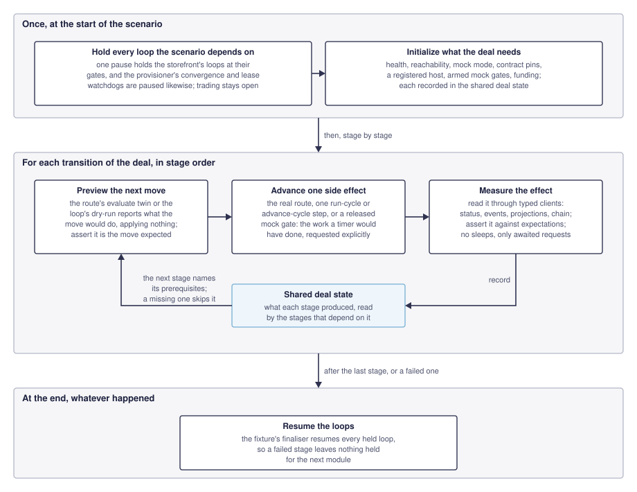
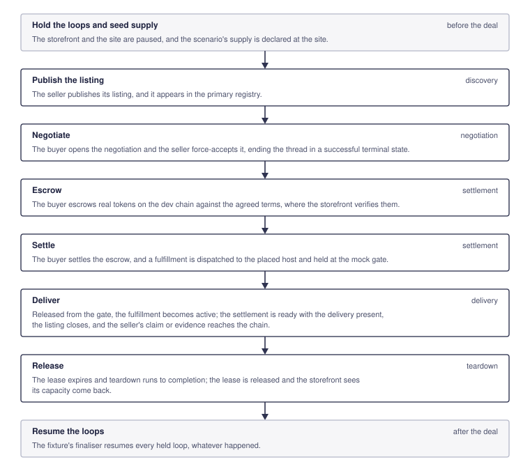
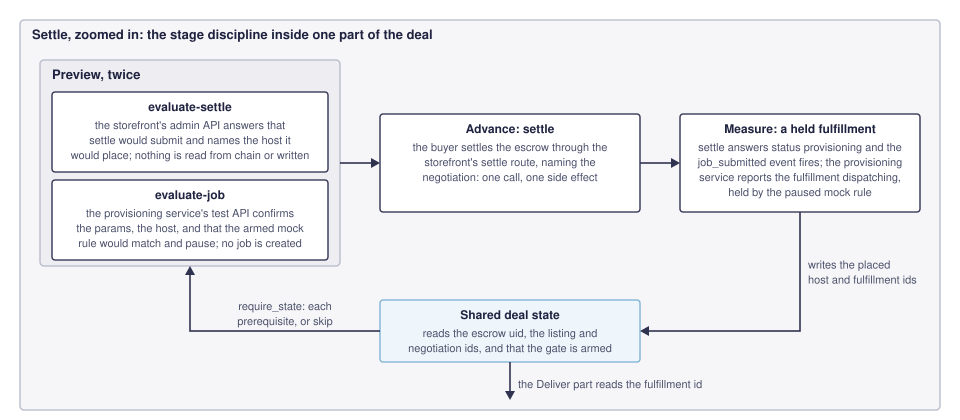

# Testing Strategy

This document defines the testing conventions for this repository. It
exists to give every contributor — human or AI — a consistent mental
model of what each test level is responsible for, what it is explicitly
not responsible for, and how the levels relate to each other. Put a new
test at the lowest level that can meaningfully prove the behavior in
question; see `AGENTS.md`'s "Tests and diagnostics" for the underlying
rule this document elaborates.

Read this alongside `docs/development/ARCHITECTURE.md` (system shape)
and `openspec/README.md` (documentation placement). This document
describes current testing practice, the same way `ARCHITECTURE.md`
describes current system architecture — it is not a changelog of how
testing conventions were introduced, and it should be corrected in place
when practice changes rather than accumulate historical commentary.

## Four-Level Hierarchy

### 1. Unit Tests

**What they cover:** A class or function in isolation. A unit test
instantiates one class, passes mocked collaborators for its injected
dependencies, and asserts on the return value or side effects of a
specific method.

**What they do not cover:** Orchestration. If a function's sole purpose
is to call other functions in sequence, that function does not have
meaningful unit tests — the correctness of the sequence is an
integration-test concern. The final abstraction before an external
boundary (a database write, a subprocess invocation, an HTTP call) is
similarly not meaningful to unit test in isolation; its behavior is
validated by integration tests against the real boundary or a
well-defined mock of it.

**Mocking convention:** Use `unittest.mock.MagicMock`/`AsyncMock` for
injected collaborators, passed in via the constructor. Do not patch
module-level imports — the dependency-injection composition pattern
used throughout this repository makes constructor injection the natural
seam; patching around it defeats the purpose of the seam and produces
tests that break when internal call structure changes even though
behavior didn't.

**Command-module convention:** a command module — a storefront's operator
commands or a domain's buyer commands — has no constructor: the framework calls
its module-level functions. It is its own composition root instead, and builds
its collaborators through module-level factory functions it defines, named for
what they provide; those factories are its one seam. A test replaces a factory
on the module that defines it and nothing else — no library name, no name the
module imports from another, no name inside core — because an import-style
change can silently undo such a patch, and the test then runs the real
collaborator. The bare-metal buyer CLI
(`domains/bare_metal/buyer/src/arkhai_bare_metal_buyer/cli.py`) has this shape:
its tests replace `fresh_identity`, `recovery_identity`, `registry_client`, and
`payment_approval`. The other CLIs' tests still replace library and imported
names; [`ROADMAP.md`](ROADMAP.md) records that gap.

**Composition-boundary convention:** When a role receives a versioned domain contract, unit tests should inject a distinct compatible object and assert object identity at each constructor boundary rather than patching the default resolver. Fail-closed cases belong at the composition root and must assert that persistence, network, and worker collaborators were not constructed. Existing integration tests remain responsible for public behavior and persisted-state parity.

**Negotiation-runtime convention:** Protocol invariants are tested once in
`kit/negotiation-runtime/tests/unit` with an in-memory recording repository and
injected opaque domain hooks. Those tests prove canonical-principal checks,
round and terminal ordering, transcript recovery, acceptance persistence, and
fail-before-effect behavior for recorded binding mismatches. Storefront tests
then prove only their domain adapters: term decoding, seller policy input,
accepted-artifact construction, and domain persistence/effect hooks. A domain
test must invoke `NegotiationRuntime`; reintroducing a local lifecycle helper
would test the duplication rather than the production composition.

### 2. Integration Tests

**What they cover:** End-to-end request → response paths with the full
application stack running (the real app, a real database, the DI
container wired) and a controlled mock only at the external I/O
boundary. Orchestration logic, background job processing, retry
behavior, and error propagation are validated here, not in unit tests.

**What they do not cover:** Every edge case of data transformation
logic — that belongs in unit tests. An integration test needs one
representative case per external-mock behavior, not exhaustive
parametrization.

**External boundary definition:** Any I/O that crosses a process
boundary — a subprocess invocation, a call to a service this codebase
doesn't own, a blockchain RPC call. Mock at the point this codebase's
own code wraps that boundary, not deeper.

**Library packages:** A kit library has no app. For a library, integration
means its public service API against a real embedded database, the
persistence boundary the library owns, with collaborators it does not own
injected. Such tests live in the library's `tests/integration`. They prove
durable behavior a unit test with mocked collaborators cannot: transaction
boundaries, locking, and independent-session concurrency. They do not
replace the in-process-app integration tests of a service that composes the
library, which remain the tests of that service's wire contract. A library
test that exercises a real database but still sits in `unit/` moves to
`integration/` when it is next touched.

**Registration and traffic are different proofs:** a test that a
connection, proxy, or route was admitted also carries traffic through
it. A peer can report a registration it cannot serve — a tunnel listed
as running whose remote port reaches nothing, an address delivered that
routes elsewhere — and only bytes sent end to end show the admission
did what it claims. The frps admission plugin's real-frp tests
(`tools/frp-grant-admission/tests/frp/`) hold to this: an admitted proxy
carries bytes from frps's remote port to a listener behind frpc, and a
proxy that outlives a reload carries traffic on a held connection and a
new one. Those tests are a third flavour of integration test, beside the
in-process and library ones: real external processes started by the
test, skipped in the default suite without their binaries and run in a
gate that fails on a skip, as the native Ansible checks are
([Ansible Syntax and Native Checks](#ansible-syntax-and-native-checks)).

**Test setup pattern:** Use `httpx.AsyncClient` with `ASGITransport`
against the real application instance, injected via the service's
canonical typed-client constructor (`FooClient(transport=...)`).
Override DI container providers for the specific collaborator being
mocked before the test and restore them after.

**Typed client contract verification — the "no raw calls" rule:**
Integration tests call a service's canonical typed client methods
directly against the in-process app, not raw HTTP. Route strings,
request body shapes, and response parsing are owned by the client;
happy-path tests should not construct requests by hand. If an API
renames a field or changes a route, the typed client should raise its
own client error and the test should fail immediately — a test that
builds its own request dict will not catch that, which is exactly the
kind of interservice mismatch that mocked-boundary unit tests cannot
catch either. This is the single most important rule for the layer
where real bugs are most often found in review: an integration test
that bypasses the typed client to make assertions easier has quietly
stopped testing the client contract at all.

Two narrow exceptions are permitted:

1. **Rejection-path tests** — testing server-side validation of inputs
   the typed client deliberately refuses to construct (asserting a 422
   on a malformed body the client's own request model would reject
   before it ever reached the HTTP layer). These verify the *server's*
   validation boundary, not the client's, and must only assert on
   status codes, never on response body field names, and must be
   clearly commented as rejection-path tests.
2. **Service-internal state setup** — inserting DB rows directly to
   establish precondition state that cannot be expressed through any
   HTTP API endpoint. This is not an HTTP call at all; it is standard
   test-setup, and should be preferred only when the state genuinely
   isn't reachable through an API — prefer creating precondition state
   through the HTTP API where feasible, so integration tests stay
   honest about what the API contract actually supports.

Any other use of a raw HTTP call in an integration test is a gap: either
add a method to the canonical client, or restructure the test. A comment
like "not yet a client method" is a deferred-debt marker, not a
permanent exemption.

**Sync/async client parity:** When a client package exposes both async
and sync variants, the owning service's unit suite should include a
small contract test comparing public method names and signatures across
both. A new client method must be added to both in the same change. This
guardrail belongs with the service's tests, not the client package,
because the service owns the contract-validation boundary — it does not
substitute for integration tests that exercise the methods through real
controller routes.

**Async test discipline — no sleeps:** Tests exercising a background
job-processing loop must never use `asyncio.sleep` or a bare timeout
race to wait for a side effect — this produces intermittent failures.
Use an explicit test seam instead: an injectable callback invoked at the
point the test needs to synchronize on (for example,
`AsyncJobQueue.__init__`'s `on_job_started: Optional[Callable[[str], None]]`,
`None` in production and zero-cost there), set an `asyncio.Event` from
the callback, and `await asyncio.wait_for(event.wait(), timeout=...)`
before proceeding. If no such seam exists yet where a test needs one,
adding it is the correct fix, not a sleep.

**Tests wait on events, never on durations:** a test does not spend the
time a scenario passes through. An interval, timeout, or deadline the code
under test waits out is driven in fake time, through the injected clock and
sleep or wait the code already takes or a seam added for it. A state the
test needs is signalled by the code reaching it, such as a thread arriving
at a lock, not assumed after a pause. A deadline the scenario is defined
by is asked as a deadline of now, and a lock the code must find held is
met with no busy timeout. Real time is spent only to prove a real
operating-system timeout, such as a subprocess killed at its limit, by one
test per boundary. The one standing exception is a real server a test
cannot replace with an in-process transport, whose library stops only at
its next poll: `socketserver`'s `serve_forever` is run with
`poll_interval=0.01`, and the storefronts' loopback uvicorn servers stop on
an event rather than at uvicorn's poll.

**Leave nothing held:** a test that holds a job at a mock rule's gate
(`pause_before_result`) ends that hold itself, by resuming the rule or by
cancelling the job, so the test is idempotent: it leaves no execution
parked for the next test, the next module, or a rerun, and holds no queue
slot. A job's status is not the evidence: a cancelled job is terminal the
moment the cancellation commits, while its execution may still be waiting.
Wait on the execution instead — `MockRuleSet.wait_until_released` for the
gate and `AsyncJobQueue.wait_until_idle` for the processing — and assert
the rule's `waiting` count is zero. Cancelling a held job must end its
execution without a resume; a mock whose cancellation leaves the run
waiting is a defect in the mock, not something to resume around.

**Pause the loop, then advance it explicitly:** the same discipline
applies to a service's own background lifecycle loops, where the seam is
an HTTP control rather than a callback. Each loop should offer a pause,
and an explicit single-step that works *while* paused, so a scenario
drives transitions instead of waiting for a timer. The stage discipline
diagram under [system integration tests](#4-system-integration-tests-end-to-end)
draws a scenario following this:

| Loop | Pause | Explicit step |
|---|---|---|
| Lease watchdog | `POST /api/v1/system/lease-watchdog/pause`, answering `paused` and `at_gate` (`WorkerPauseResponse`) | `POST /api/v1/system/check-leases` |
| Fulfillment convergence | `POST /api/v1/system/fulfillment-convergence/pause`, answering `paused` and `at_gate` (`WorkerPauseResponse`) | `POST /api/v1/system/fulfillment-convergence/advance-cycle` |
| VM storefront loops (`publication`, `capacity-events`, `site-projections`, `settlement-servicing`, `fulfillment-resume`, `negotiation-watchdog`, `introduction-retention` while contact exchange is enabled, and `alkahest-chain-probe` while an Alkahest section is configured) | `POST /api/v1/admin/lifecycle/pause`, which holds them all | `POST /api/v1/admin/lifecycle/<loop>/run-cycle`, previewed by `.../<loop>/dry-run` for `publication`, `capacity-events`, and `introduction-retention` |
| Bare-metal storefront loops (`publication`, `site-projections`, `settlement-servicing`, `negotiation-watchdog`, `payment-reconciliation` while Arkhai payments is composed, `introduction-retention` while contact exchange is enabled, and `alkahest-chain-probe` while Alkahest is composed) | `POST /api/v1/admin/lifecycle/pause`, which holds them all | `POST /api/v1/admin/lifecycle/<loop>/run-cycle`, previewed by `.../<loop>/dry-run` for `publication` and `introduction-retention`; the `bare-metal-storefront publish` command is a client of the `publication` step and its preview |
| API-credit storefront loops (`capacity-events`, `settlement-servicing`, `negotiation-watchdog`, `payment-reconciliation` while Arkhai payments is composed, `alkahest-chain-probe` while Alkahest is composed, and `listing-seed` while a seed listing is configured) | `POST /api/v1/admin/lifecycle/pause`, which holds them all | `POST /api/v1/admin/lifecycle/<loop>/run-cycle`, previewed by `.../capacity-events/dry-run` |

A provisioning worker's pause answers `at_gate` beside `paused`: a cycle that
began before the pause finishes first, so a caller that needs the worker held
repeats the pause until `at_gate` is true. A storefront's pause answers each
loop's gate state the same way. `alkahest-chain-probe` probes every configured
chain at each step, and settlement readiness reads only its last results, so a
held storefront judges Alkahest by the probe a stage last stepped.
`listing-seed` finishes once the configured seed listing exists and waits while
a dependency it needs cannot be reached.

Every storefront composes its loops onto the one kit loop controller in
`kit/storefront`, so the routes, response shapes, and the canonical
`StorefrontClient` methods are the same for every storefront. The storefront
loops hold no claim between cycles, so their `run-cycle` is a step: it runs
exactly the cycle the timer runs, through the same locked operation, whether or
not the loops are held, and records its outcome as the timer's cycle does.

A storefront whose source checks read held projections confirms a listing only
from a generation polled within its `[capacity].source_confirmation_seconds`. A
scenario that holds the loops keeps trading, so it steps `site-projections`
wherever a site changed before stepping publication or negotiating, and the
end-to-end lanes widen the window to an hour so a scenario's rounds are not
refused between steps.

Every scenario module a compute pipeline lane selects holds its lane's timers for the
whole module: the storefront's lifecycle loops, provisioning's fulfillment convergence,
and its lease watchdog, and in the VM lane also Alice's storefront loops, since her
publication cycle writes to registries other modules read. Holding every timer the
lane's stages can meet, rather than those an author judges a module depends on, is
what keeps a loop no one thought of from racing an observation. The module takes the
lane's hold fixtures with `usefixtures`, listed first so they are released last. A hold
is taken before the module's first stage and waits until each loop is at its gate, and
is released in a finaliser whatever the module's outcome. Stages assert a hold; they
never pause or resume a service themselves, and a source check enforces it. Two kinds
of module are outside the rule: one no lane selects, such as the real-host modules an
operator runs by hand, keeps the holds it has; and one under `scenarios/core/` reaches
only the dev chain and messages no storefront or provisioning service, so it takes
none.

With convergence held, a stage makes each transition convergence would make. A buy
scenario runs `market buy` in the background through `buy_to_ready`
(`e2e-tests/tests/e2e/roles/helpers/buy.py`): it waits for the buy's escrow and
settlement events and the storefront's dispatch, drains the mock job queue, advances
convergence to `active`, and waits for the buy to end `ready`. A foreground buy would
block on a convergence cycle no one steps. On any failure the helper terminates and
reaps the buy it started, so a failed stage leaves no buyer polling the stack.

The hold helpers are `storefront_loops_held`, `fulfillment_convergence_held`, and
`lease_watchdog_held` in `e2e-tests/tests/e2e/roles/helpers/compute_deal.py`; each
compute lane's `conftest.py` builds its fixtures of the same names on them, and the VM
lane adds `alice_loops_held` for Alice's storefront. A stage reads a hold back through
live system status (`assert_storefront_loops_held`, `assert_lease_watchdog_held`), so a
module that lost its hold fails rather than racing a timer. A lane's cleanup fixtures
are not autouse: pytest sets an autouse fixture up first and so finalises it after the
holds, so each module lists its cleanup after its holds, and the holds keep the timers
stopped while the cleanup runs. `e2e-tests/tests/unit/test_scenario_holds.py` refuses,
from source, any pause or resume call or route outside the hold helpers and the
conftests' hold fixtures, and `e2e-tests/tests/unit/test_scenario_cleanup_order.py`
reads the fixture order pytest resolves for every compute-lane scenario module and
refuses a hold released before the module's other cleanup.
`e2e-tests/tests/unit/test_scenario_lane_holds.py` reads each compute lane's marker
expression from `e2e-tests/Makefile`, where lane membership is written once, collects
the setup plan pytest resolves for it as the lane's own run collects, with skip marks
unevaluated so a module skipped where the check runs is still held to the rule, and
refuses a module missing one of its lane's holds, naming the module and the hold. A
module joining a lane, from any directory, comes under the rule with no second list to
update. A module killed by `helm
test`'s timeout runs no finaliser, and only a restart clears its pause; modules in a
lane run serially.

Traps this has already sprung, worth checking for a new loop:

- **A loop with no pause is not paused.** Convergence ran a 30s timer
  with no gate while the scenario around it believed everything was
  stopped, so it claimed the same rows the test was explicitly
  advancing. "Everything is mocked, so nothing can take wall time" is
  true of the work and false of the coordination.
- **A "run one cycle" endpoint is not necessarily a step.** Convergence
  claims a row before polling its provider and, on a pending answer,
  deliberately keeps that claim so the lease spaces the next poll. A
  further cycle inside that lease reaches nothing, so any number of them
  is still zero advances. `advance-cycle` releases the caller's own
  claims first; `run-cycle` is the production cycle and does not. If a
  test needs several steps to make one transition, suspect the step
  rather than adding a sleep.
- **A loop that sleeps its interval is held late.** A loop gated at the
  top of each cycle but waiting with a plain sleep reaches its gate only
  when the sleep ends, so a pause landing in a 30-second interval outlasts
  the pause's 5-second bounded wait and reports the loop `pausing`. Every
  timer loop waits through the controller's `idle`, which returns on a pause
  request, and the kit runners refuse a gate without such a wait. The one
  kind of loop whose task gates itself is a fan-out — the per-site
  capacity-event pollers — whose children read their gates under each site's
  cursor lock. Test it with the real loop body and an interval far longer
  than the test waits. A test that needs a self-gating body runs it as a
  fan-out with no children.

### 3. Smoke Tests (Deployment Validation)

**What they cover:** Stateless, idempotent verification that a deployed
stack is wired correctly — services can reach each other, authentication
is enforced, health endpoints respond, expected routes exist.

**What they do not cover:** Service semantics. By the time a smoke test
runs, semantics have already been validated by integration tests. A
smoke test verifies that a health endpoint returns 200 and that a
protected endpoint returns 401 without valid credentials — it does not
submit a real job and poll for completion.

**Current location:** `e2e-tests/tests/smoke/`, run as Helm test hooks
in Kubernetes (`helm/templates/tests/`, per-chart `templates/tests/`
directories).

A smoke check that writes state belongs in an integration test instead. The
provisioning smoke checks carry two markers: `provisioning_readonly` for
reads of health, system status, hosts, and host connectivity, and
`provisioning_security` for authentication enforcement, which sends an
unsigned read to a protected route and expects 401 or 403, so it needs no
administrator credential. The provisioning chart's test hook selects
`provisioning_readonly or provisioning_security`, and its render test holds
the hook to that expression.

### 4. System Integration Tests (End-to-End)

**What they cover:** Cross-service contracts — scenarios that require
two or more services to interact over the network to produce a
meaningful result.

**What they do not cover:** Anything already covered by the three levels
above. These tests are expensive to run and brittle to maintain; they
should be minimal in count and cover only the cross-service contract,
not any one service's internal logic.

**Current location:** `e2e-tests/tests/e2e/`.

Every deployable domain owns one release-qualified complete-deal scenario:
discovery, negotiation, settlement, delivery, and domain-defined teardown.
The teardown observation follows the resource sold: VM capacity is released,
an API-credit grant is consumed until the authority returns HTTP 402, and a
bare-metal lease is released only when authenticated access is revoked and the
selected-site authority reports teardown. A health check or static Compose
render is not deal evidence.

Three diagrams carry the rest of this section. The first draws the discipline
every complete-deal scenario follows, whatever its domain. The second applies
that discipline to the compute family's canonical deal, part by part, as the
worked example. The third zooms into one of those parts to show the discipline
inside a single box. Each diagram's source is the `.drawio` file named under it
in [`diagrams/`](diagrams/); the SVG beside each is its export and also opens
in draw.io.

#### The discipline every scenario follows

An end-to-end test proves a deterministic sequence of state changes — a sequence
diagram run repeatably — never wall-clock time. A timer left running is an
unscripted participant in that diagram, and a scenario whose duration a timer sets
measures the timer rather than the work.

A scenario asserts only on side effects it asked for. While a service's timer
loops run, an observation races them: a listing reconciled a second later reads
differently from one reconciled a second earlier, and waiting for the system to
settle cannot establish ordering even when it passes. So a scenario holds every
loop it depends on once, at the start, through the pause and step controls
under ["Pause the loop, then advance it explicitly"](#2-integration-tests), and
initializes what the deal needs. Then, for each transition, it previews the
move through the route's evaluate twin or the loop's dry run, advances exactly
one side effect, and measures that effect against expectations through typed
clients, with no sleeps: the only wait is on a request the stage made, or for
an instant the deal's Agreement fixes, such as its start, since no control
moves the wall clock (`wait_until` in
`e2e-tests/tests/e2e/roles/helpers/compute_deal_stages.py`); a stage waiting
for an instant then advances what acts on it explicitly. What a
stage produced goes into the shared deal state for the stages that depend on
it, and whatever happened, the fixture's finaliser resumes the loops.

A wait is legitimate only on an effect the stage's own request caused, bounded:
a stage event its request emits, or a message it sends off the request path,
such as the seller-side introduction mail the introduction stages read back from
the lane's Mailpit. Where one service reads another's state live, the stage
reads the effect once after its step rather than polling for it. A behaviour
defined by a window or interval elapsing, such as the introduction retention
sweep, is proven at a level that can drive the clock; no pipeline stage waits
for it.



Source: [`diagrams/e2e-stage-discipline.drawio`](diagrams/e2e-stage-discipline.drawio).

The shared deal state is `DomainDealState`, from
`e2e-tests/tests/e2e/roles/helpers/domain_deal.py`, which the scenarios share
with exact event ordering, profiled buyer configuration, and the public client
helpers in `e2e-tests/tests/e2e/roles/buyer_cli.py`. The helpers keep domain
results opaque: they do not assume a VM listing, provisioning job, host field,
API key, Physical Resource, site, or teardown payload. A scenario supplies its
codecs and domain assertions instead of copying another domain's control flow.
A stage names each earlier result it depends on with `require_state`, one
exact producer/consumer field at a time. When an earlier stage or external
authority is unavailable, the dependent stage names that prerequisite and
remains blocked; it is never counted as a successful live deal.

#### The canonical compute deal

The compute family's canonical deal settles through Alkahest on the dev chain.
The pipeline's lanes deliver it through the provisioning mock profile; the
[real-provisioning lane](#the-real-provisioning-lane) delivers it through a real
KVM host. The diagram draws it part by part, from holding the loops to resuming
them. Each box is one part of the deal, its preview, advance, and measurement
folded into a sentence or two, and the tag at its right is the deal stage the
shared state records for it. The bare-metal lane runs a second deal on the freed
host before its loops resume.



Source: [`diagrams/e2e-compute-deal.drawio`](diagrams/e2e-compute-deal.drawio).

Every stage the compute domains run identically comes from one definition, in
`e2e-tests/tests/e2e/roles/helpers/compute_deal_stages.py`. Those stages are
not named `Test*`, so pytest collects them only where a domain's scenario
module subclasses them, with an empty body, in its run order. A shared stage's
body is therefore defined once and runs in every compute lane; a stage whose
body would differ stays each domain's own, inserted between the shared ones
(VM's listing creation and claim, bare metal's publication, evidence, and
second-deal stages). What differs reaches a shared stage two ways: fixtures
every compute conftest provides under one set of names supply who is calling,
and each domain's `ComputeDealDriver`
(`e2e-tests/tests/e2e/roles/scenarios/vms/compute_deal_driver.py`,
`e2e-tests/tests/e2e/roles/scenarios/bare_metal/compute_deal_driver.py`)
supplies supply seeding, provision terms, the settlement preview's expectations,
the settlement's dispatch, the delivery assertions, the lease view, and the
re-reservation of released supply.
Negotiation has no driver hook: a compute domain that negotiates differently is
resolved in its storefront composition.

A shared stage never depends on the mock profile. Holding a provisioning job at
a mock rule's gate, releasing it, evaluating the rule, and confirming the mock
profile are mock gates: each is a mock-lane stage of its own (`MockLaneStage`),
which only a lane delivering through the mock profile declares, between the
shared stages it surrounds. A mock driver supplies the gates through a second
part, `MockGates`, which a real driver does not implement. A stage that would
both advance the deal and touch a gate is split at the gate, so its gate-free
part stays shared: the escrow apart from arming the create gate, the advance to
`active` apart from releasing and draining the create job, the lease expiry
apart from arming the teardown gate, and teardown's completion apart from
releasing and draining the teardown job. A gate answered by a real driver with a
no-op would report a hold that never happened, and a shared assertion would hold
under one driver and be vacuous under another. Settlement submits only once the
lane's last check before it has passed: the mock rule's evaluation in a mock
lane, the check of the previewed host in the real lane.

`e2e-tests/tests/unit/test_compute_deal_stages.py` checks the stage set from
source: a mock lane subclasses every stage once, in definition order, with an
empty body; the real lane runs every shared stage in that order and no mock-lane
stage; no shared stage names a mock gate or the mock test client; and every
state field has one producer that runs before any stage reads it.

A compute buyer purchase — a deal bought through the shipped buyer CLI,
`market buy` or `market bare-metal buy`, in `arkhai.payments.v1` — runs the same
stages from fulfillment onwards. Convergence to active, settlement readiness,
the lease record, the lease's ending, and teardown completion are keyed on the
deal's settlement reference, which an earlier stage writes: the Alkahest escrow,
written by the canonical deal's settlement, or the payments negotiation, written
by the purchase. Every storefront's settle wait resolves a deal by either
([settlement servicing](../../openspec/specs/settlement-servicing/spec.md)), so
settlement readiness keeps one body. Each shared stage reads the inputs it
checks from state an earlier stage wrote independently of the lease it checks:
the expected host from the Alkahest settlement preview or from the purchase
driver's declared host — the one host the scenario registered enabled for its
resource, or a real target's host — and the teardown's fulfillment from
whichever ending ran. How a lease ends is shared only among scenarios that end
the same way. The expiry stages back-date the lease, step one lease-watchdog
cycle, and advance convergence to tearing down; the Alkahest set and the VM
purchase run them. The bare-metal purchases end by the buyer's
`market bare-metal teardown` in a stage of their own, which ends in the state
teardown completion starts from.

The purchase's own stages are defined once, in
`e2e-tests/tests/e2e/roles/helpers/buyer_purchase_stages.py`, and declared by
each purchase module in order as the canonical deal's are. They read the payer's
balance, discover the listing and its payments option, buy through the CLI,
correlate the run's events to one paid deal, and check the payment records: the
transaction is bound to its Agreement, its receipt covers that mandate, its
snapshot names the configured payer and payee with gross equal to the
Agreement's price, and the payer's available balance, read through the payments
kit with the buyer's own token, fell by exactly the scenario's own debits. The
purchase command runs in the background from the buy on, because `market buy`
polls its settlement until delivery while fulfillment convergence is held and
later stages step it. Each domain's purchase driver
(`e2e-tests/tests/e2e/roles/scenarios/vms/purchase_driver.py`,
`e2e-tests/tests/e2e/roles/scenarios/bare_metal/purchase_driver.py`) supplies its
command and arguments, its declared host, and its teardown.
`e2e-tests/tests/unit/test_buyer_purchase_stages.py` holds every purchase module
to the stage order.

Each compute lane runs one buyer purchase against its payments double. VM's
`e2e_vm_payment_purchase` lists a resource, host, and pool of its own, since a
listing's binding to its resource outlives the listing, and ends its lease by
expiry. Bare metal's is `e2e_bare_metal_payment_deal`, which inserts its own
re-drive and seller refund between the shared stages.

Settlement by introduction is defined once the same way, in
`e2e-tests/tests/e2e/roles/helpers/introduction_stages.py`: disclosure of the
retention window before any contact is given, backed and unbacked supply
discovered together under one rate bound, the reveal into the buyer's own sink,
and seller-side delivery read back from the lane's Mailpit. VM's
`e2e_vm_introduction` and bare metal's `e2e_bare_metal_unbacked_introduction`
subclass those stages in order and insert their own between them; each
domain's `IntroductionDriver`
(`e2e-tests/tests/e2e/roles/scenarios/vms/introduction_driver.py`,
`e2e-tests/tests/e2e/roles/scenarios/bare_metal/introduction_driver.py`) seeds
the supply and speaks its CLI verbs, and only stages write the shared
`IntroductionState`. `e2e-tests/tests/unit/test_introduction_stages.py` holds
each domain to the shared stages and fields.

#### One part, zoomed in

Settle has the fullest shape of any part, so it is the one drawn open, as a
mock lane runs it. It previews twice, through the storefront's evaluate-settle
and, in a mock-lane stage, the provisioning service's evaluate-job, advances
with one settle call, and measures a fulfillment dispatched and not yet
converged. The real lane previews the same settlement and checks, in place of
evaluate-job, that the previewed host is its target. What the part reads from
and writes to the shared deal state is what ties it to the parts before and
after: `require_state` on the escrow, listing, negotiation, and the passed
preflight on the way in, and the placed host and fulfillment ids on the way
out, the latter read next by the deliver part. Every other box in the deal
diagram opens the same way, with its own previews, advance, and measurement.



Source: [`diagrams/e2e-settle-zoom.drawio`](diagrams/e2e-settle-zoom.drawio).

The e2e test pod cannot import service internals — it uses typed
clients, explicit test controllers, and stage/event APIs over HTTP, the
same "no raw calls" discipline integration tests follow. Design new
observability seams for e2e-visible behavior accordingly.

The pipeline runs one lane per market domain, each as its own job, so each
failure's logs stand alone and one domain's failure never hides another's
evidence. The native Ansible gate is a pipeline job beside the lanes, not a
lane, since it composes no stack ([Ansible Syntax and Native
Checks](#ansible-syntax-and-native-checks)). Each lane builds only the images its stack runs
(`make build-e2e-<lane>`) and brings up only its own services, as a compose
project of its own:

- **VM lane** (`make -C e2e-tests test-e2e-vm`): Bob's and Alice's storefronts
  and provisioning authorities, the two VM registries, and the dev chain. After
  the canonical deal and a buyer's surrender, its typed-client deal runs two
  deals on the freed capacity: one whose Agreement starts later, committed at
  settlement and dispatched only by a resume-pass step once its start is
  reached, and one whose lapsed hold leaves its settlement placement no
  capacity, which ends as the seller's failure with nothing dispatched.
- **Bare-metal lane** (`make -C e2e-tests test-e2e-bare-metal`): one site
  trusting the bare-metal storefront, a bare-metal registry, and the dev chain.
  Its publication scenario declares pools and whole-host capacity through the
  site's operator clients, steps publication, and follows one listing through
  discovery, withdrawal, and reinstatement at the registry. Its mock-provisioned
  deal runs the canonical compute deal for one whole host, stage for stage with
  VM's, stepping the storefront's `delivery-recovery` cycle after dispatch and
  after readiness, as a restart would; then a second deal on the freed host
  whose buyer teardown, sent twice, returns one operation and releases capacity
  once; then a third whose machine is taken before settlement, which ends as
  the seller's failure with nothing reserved. Its separate
  `e2e_bare_metal_payment_deal` scenario is the lane's
  [buyer purchase](#the-canonical-compute-deal): a wallet-free profiled buyer
  buys one fixed-term USD/6 purchase through `market bare-metal buy` on the
  shared purchase stages, then receipt-gated mock access, readiness read through
  the storefront's settle wait on the negotiation, same-transaction and
  same-fulfillment re-drive through the canonical lifecycle `commit`, the
  buyer's `market bare-metal teardown`, then the seller's separate refund of the
  still-held payment and restored whole-host capacity. Unless the last stage
  recorded the deal ended, the module's cleanup opens any mock gate still
  closed, finds the purchase in the buyer's run log, refunds it if the log
  records the payment approved — retrying for a bounded time while the seller
  has not yet verified it or a service is unavailable — then releases a host it
  finds after the refund, reporting one it cannot read or tear down; a refund
  that still fails fails the run with the negotiation and transaction for an
  operator. Each cleanup step is attempted even after an earlier one fails, and
  the module's holds are released last.
  It settles against the lane's payments double; no real SSH claim is made. Its `e2e_bare_metal_unbacked_introduction` scenario is the compute
  family's introduction scenario on bare metal: the site's operator declares a
  whole machine in a capacity-backed pool naming its host, one in an unbacked
  pool naming none, each at an asking rate, and one in a backed pool stating no
  rate, and a storefront pool override offers the unbacked pool by
  introduction alone. A rate-bounded `market bare-metal list` returns the backed
  and unbacked listings together and leaves out the rateless one, a
  `capacity_backing=unbacked` query returns only the unbacked one, and the
  unbacked listing publishes `capacity_backing: unbacked`, no host fields, no
  `access_methods`, and only `contact-exchange.v1`. The buyer reveals the
  introduction through the CLI into its own file sink, the storefront mails the
  buyer's contact to the seller through the lane's Mailpit, and the deal's
  fulfillment status route answers 404. Its `e2e_bare_metal_introduction`
  scenario discloses the retention window before commitment, reveals
  introductions through the production buyer transport, and ends with the
  operator's deletion of one. No stage waits for the window to pass: the held
  retention sweep is proven where its clock can be driven, by the storefronts'
  integration tests (`domains/bare_metal/storefront/tests/test_http_introductions.py`,
  `domains/vms/storefront/tests/integration/test_introduction_retention.py`).
- **API-credit lane** (`make -C e2e-tests test-e2e-apicredits`): the credits
  registry, service, storefront, and gated sample app, a compute-schema registry
  of the lane's own that the credits deal's discovery is routed away from, and
  the dev chain. The lane's overlay (`compose.apicredits-lane.yml`) runs the
  sample app with no verify cache, so every request re-verifies its key and a
  top-up is visible to the next request; the cache's own behaviour, including no
  service call on a key known to be exhausted, is proven by the middleware
  conformance trace.

Each lane also runs the payments double (`compose.payments-double.yml`), which
its payment storefront — Bob, the bare-metal storefront, the credits storefront
— settles against; see [Private Service Dependencies](#private-service-dependencies).
A lane target names only its Compose files, its project, and the run's
provisioning mode: every value its stack reads is in a committed overlay,
registry or site profile, or secret overlay, and the runner takes the lane's
committed profiles (`RUNNER_PROFILES`).

The compute lanes' provisioning services run their mock profile because the
run selects it: `PROVISIONING_MODE` (`mock` or `real`, default `mock`) is
checked and exported to Compose by each lane target in `e2e-tests/Makefile`, and
each overlay places it last in the provisioning service's profiles
(`docker,<site>,${PROVISIONING_MODE:-mock}`); no storefront reads it. Under the `mock` profile each compute adapter
runs its jobs through a mock executor of its own, resolved by the same
`(offering_mode, action)` table as its real one, and the playbook output the
mock returns is parsed by the adapter's real result path. The rule and gate
mechanism is shared
(`provisioning/compute/src/compute_provisioning/jobs/executor_mock.py`); each
adapter mounts its rules and job dry run under its own prefix, VM's at
`/test/mock-rules` and `/test/evaluate-job` and bare metal's at
`/test/bare-metal/mock-rules` and `/test/bare-metal/evaluate-job`, beside the
shared `/test/jobs/*` routes. None of them is mounted outside the mock profile.

A mock's default output is what the shipped configuration prints for the job:
the role's `debug: var:` fact in the YAML result format, then the `debug: msg:`
JSON copy the shared fact reader reads, rendered from the job's own parameters
— its guest or host, its tenant account, its action, and booleans where the
role prints booleans. So a mock lane exercises the same reader and the same
linkage between a fact and its job as a real run, and a fact naming another
guest or tenant yields no delivery evidence there too. The VM scenarios arm no
create output of their own; every create reads that default. A test that needs
an output the role would not print for its job states it in a rule and keeps
to the codec's or provider's level.

`make -C e2e-tests test-e2e` runs the three in turn, taking each stack down
before the next, because every stack names its chain container `anvil` and
publishes fixed host ports. A lane provides its own configuration, so a
scenario that finds a lane setting missing fails rather than skipping.

Pre-review validation also runs the scenarios the default Helm charts can serve
(`HELM_SCENARIOS` in `scripts/validate_slice.py`) against a Helm release, in the
change's own namespace ("Validation namespaces" in
`docs/development/DEPLOYMENT_AND_CONFIG.md`). They run as a pod inside that
namespace, the e2e-tests chart's `<release>-e2e-tests-e2e-scenarios` Helm test
hook, rendered when `scenarios.markers` is set: it runs the change's own
`e2e-tests` image with the release's `test-config` ConfigMap under the `helm`
profile, the deal test pod's environment and mounts, and reaches every service by
its in-cluster name, as a lane's scenarios do on their compose network, so no local
port is involved. Validation runs it alone (`helm test --filter name=<pod>`) and
counts it as passed only on the pod's own exit status of 0, since `helm test`
passes when its filter matches no test. A scenario on that list reads only what the
`e2e-tests` image copies — `src`, `tests`, `config`, `conftest.py`, and
`settings.toml` — never a file from the checkout. Every other pipeline scenario is
reported as not run against Helm.

After the scenario pod, validation runs every storefront payments-check test pod
the release's hooks render (`helm get hooks`, each pod named
`<release>-…-payments-check`), each as its own step and likewise counted as
passed only on its own exit status of 0; a pod with no exit status is stopped.
Each pod's log is kept as evidence beside the scenario pod's, and a release
that renders no check pod is warned, never passed. The check pod runs the
storefront's `check-payments` against the release's payments double, so it
shows the storefront's CA mount, derived `ca_bundle_path`, overlay key and
service URL working together; the release serves no payment scenario.

A mock-provisioned deal proves the services compose into a working deal, not
that a real resource was delivered. Bare metal's release-qualified deal
(`e2e_bare_metal_deal`) needs a real whole host to grant and revoke access on,
which the pipeline never has, so no lane selects it: real access and its
revocation remain a separate protected lane's evidence. It uses the shared
SSH helper with the operator's read-only known-hosts file; each access probe is
one fresh process, and only public-key authentication refusal proves revocation.
Transport failure is an unsuccessful observation. VM's real delivery is
proven the same way, outside every lane, by
[the real-provisioning lane](#the-real-provisioning-lane).

The VM multi-registry scenario seeds Bob's and Alice's separate provisioning
authorities through typed administration clients and refreshes both site
projections before listing creation. It checks Bob's publication to two
registries, Alice's publication to one, production buyer discovery retaining
one record per independent registry authority, ordinary discovery with an
unavailable endpoint, and independent negotiations. Registry footprint checks
use the typed registry client; the scenario does not establish that multiple
storefronts can share a site authority. Resource-query and explain preparation
have separate fail-closed behavior.

To run the lanes in GitHub Actions, push the current branch and run
`make run-e2e` with an authenticated `gh` CLI on PATH. Then run
`make fetch-e2e-logs` to wait for the run and download its diagnostics. Without
`E2E_RUN_ID`, it selects the newest run on the current branch whose head commit is
local `HEAD` (or `E2E_COMMIT`), among the 100 most recent workflow runs, and waits
up to three minutes for a just-dispatched run to be listed. Matching the commit is
what makes it safe straight after `make run-e2e`: the new run may not be listed
yet, and the branch's previous run tested a different commit. `E2E_COMMIT` may be
a short ID or a ref. When the commit already has a run, pass the newest run ID seen
before dispatching as `E2E_AFTER_RUN`, so the earlier run is not taken while the
new one is still unlisted. Logs live under `.snapshot/e2e-logs/<run-id>/`:
`actions.log`, `e2e-vm-logs/compose-logs.txt`,
`e2e-bare-metal-logs/compose-logs.txt`, and
`e2e-apicredits-logs/compose-logs.txt`. `E2E_LOG_DIR` overrides the root
directory.
Each successful fetch also creates `<run-id>.zip` beside the run directory,
containing that directory and its logs. Repeated fetches replace the ZIP.
An unavailable artifact is reported without discarding other logs. A successful
fetch means diagnostics were retrieved; it does not mean the tests passed.

#### Locally verifiable and external-topology scenarios

End-to-end scenarios come in two kinds, each with its own coverage. A *locally
verifiable* scenario runs against this repository's own stack — a lane's Compose
project or a Helm release — with provisioning in its mock profile and the
payments service replaced by the in-lane double. It runs on every pipeline run
and proves that the services compose into a working deal. An
*external-topology* scenario needs services or hosts this repository does not
deploy, such as a hosted payments target or a real host. It runs only where a
deployment supplies them, and it is the only evidence for what they bring: real
delivery, access, and revocation on a host, and a payments target's records.

An external-topology scenario that makes a deal minimally extends a locally
verifiable one. It subclasses that scenario's shared stages wherever their bodies
agree and adds only the stages its external parts require, so the path both kinds
run is proven on every pipeline run and the external run adds only what no lane
can observe. The real-provisioning qualification modules for observations 2, 4
and 5 extend the lanes' buyer purchases this way
([the real-provisioning lane](#the-real-provisioning-lane)). An external-topology
scenario that makes no deal extends nothing: it follows the deal scenarios on the
same stack and names them, as observation 6's module follows the other two.
Setup or teardown that needs knowledge this repository lacks — funding a payer
account at a payment provider's sandbox, providing the hosts — is the
deployment's topology.
No scenario performs it. An absent target is a blocked skip, and a stage whose
input the target does not name skips naming that field.

Evidence from an external-topology run is supplied by whoever deploys the
topology. The scenarios assert, and log the identifiers each stage reads — the
buyer run, Agreement, transaction, reservation, jobs, relay port, and grant. The
deployment's operator presents the outcome as a free-form summary it has
sanitized. Raw logs and records stay in the operator's restricted storage and
never enter this repository, and no record format is defined.

A qualification module's outcome is per observation, not per module, because a
pytest run that passes with a skipped stage has not run every check an
observation requires. An observation is *made* when every stage requiring it
passed, *failed* when one failed, and *unproven* when none failed and one skipped
naming a prerequisite, which the outcome names. A stage the run did not collect
counts as not run, so deselecting a stage cannot make an observation. Every stage
of a qualification module requires the module's observations, or its cycle's in
a module run once per cycle, unless the stage narrows that to fewer; the module
logs each observation's outcome after its last stage
(`e2e-tests/tests/e2e/roles/helpers/qualification.py`).

Neither kind waits out the wall clock for a state it can step to. A VM lease's
end is reached by moving its agreed end into the past and stepping one
lease-watchdog cycle with the watchdog held, which runs exactly the service code
a wall-clock expiry runs. That is how "Tests wait on events, never on durations"
([Integration Tests](#2-integration-tests)) applies to a lease's end; lease
durations stay fixed.

#### The real-provisioning lane

`e2e_vm_real_provisioning`
(`e2e-tests/tests/e2e/roles/scenarios/vms/test_real_provisioning_deal.py`) runs
the canonical compute deal against a provisioning service outside its mock
profile and a real KVM host, and proves what a mock-provisioned deal cannot: the
service's VM execution is not mocked; the create and teardown jobs ran on the
target host and succeeded; the buyer, with a key generated for the run and
negotiated in the deal, reaches the guest at the delivered access as the
delivered user and finds the negotiated vCPUs, memory within a stated tolerance,
and at least the negotiated disk; an unrelated key is refused for that user; and
once the lease expires and its capacity is released, a VM list job on the host
no longer names the guest and the delivered access no longer connects. It claims
nothing about the guest's other credentials, which a batch-mode SSH client never
tries. The guest's host key is trusted on first use for the run only, and a
later connection presenting another fails the run. Direct access uses forwarded
guest ports; relay access checks the relay address and the reservation's leased
port against the delivered endpoint. Released holdings retain their grant expiry;
the scenario does not require immediate port reuse during quarantine.

It is in no lane, because the pipeline has no host to provision on. It runs from
an operator's machine against a deployed stack's forwarded services, signing as
the `local` profile's principals, with `ACTIVE_PROFILES=local,real-provisioning-target`:
[`e2e-tests/README.md`](../../e2e-tests/README.md#real-vm-provisioning) gives the
steps, and [`VALIDATION_RUNBOOK.md`](VALIDATION_RUNBOOK.md#21-provide-a-kvm-host)
the operator procedure around them. Its target is the `REAL_PROVISIONING_TARGET` section
of `config-real-provisioning-target.yml`, which an environment owner renders into
`e2e-tests/config/` beside the committed example, `config-real-provisioning-target.yml.example`,
and which Git ignores.
`e2e-tests/src/e2e_harness/real_provisioning_target.py` validates it before anything else.
Version 2 describes at most one host per domain, each with a connection,
access and sellable capacity. A VM host adds a listing shape fitting twice within
capacity; a bare-metal host adds its physical identity and verified SSH public
host key. Direct access names a public host, while relay access names only its
relay identifier. Unknown or foreign fields fail by name; version 1 is refused
with conversion instructions. A relayed run requires an enabled relay with a
configured token and active grant key before taking holds or registering supply.
The target contains no private key or relay secret.
Without the profile every stage skips naming it, and nothing is written to the
stack.

The lane registers its own supply from the target — a pool stating a GPU-less
shape, the host with its connection, and one declaration selling the whole
capacity — and publishes the target's smaller listing shape. It checks before
its holds are taken that the service reports its VM executor real. It runs every shared stage and no mock-lane stage, and
inserts its own: a check that the settlement preview chose the target host,
before settlement; a create-job poll after it; SSH access stages once the lease
is recorded; a teardown-job poll; and the VM-list and access-ended checks after
release. Where a mock lane releases a gate, the real lane waits for the real job
instead, found through the fulfillment's capacity reservation in the operator
job list and read by its status within a named bound. That poll is the one wait
the lane adds to the stage discipline, which otherwise waits only on a request a
stage made or for an instant the Agreement fixes; a failed or timed-out job
fails the stage with its logs. The shared stages compare the runner's clock
with the stack's — settlement is timed against the Agreement start, and the
lease's start and activation against settlement — so the operator's machine
keeps its clock synchronized with the stack's to within a second.

A rerun against the same stack reconciles rather than duplicates. The host's
connection is replaced where it differs and the declaration rewritten, and the
sole open listing on the scenario's resource is adopted, paused, rather than
created. Closed historical listings retain their bindings and are preserved.
Closed listings with no open one, several open listings, a listing of unknown
status, or an open listing of another shape fail naming them, for an operator to
recover; a closed binding does not authorize creating a replacement. The settle
stage waits for
the deal's own `job_submitted` event, filtered by its negotiation and counted
from a mark taken before settling, because an adopted listing's event log holds
earlier deals' events.

The lane keeps one SSH process printing a timestamp each second, with a five-second
maximum observed gap, while a second deal creates a guest and then expires it.
It requires the original session alive across both operations and checks management
connectivity before and after each create and teardown. Each guest uses its own
delivered port. A temporary reservation proves the second guest's shape is available
again while the first guest remains active. The first deal then follows ordinary
lease expiry and proves the whole host capacity is available again.

A run that fails after an accepted settlement is recovered by a module finaliser.
It tries both deals even if one recovery fails, expiring only their own leases
through the site, and advances the held workers, so the
provisioning service tears the guest down through its own lease lifecycle; it
then confirms the teardown job and the guest's absence. It takes any settlement
the storefront records, or whose dispatch it logs within a bound, as having
dispatched a fulfillment, unless the settlement's status shows a refund begun
before delivery. Where it cannot find the fulfillment or confirm the removal, it
fails naming the escrow, negotiation, fulfillment, reservation, jobs, guest, and
host. It never releases reservations fleet-wide, which would return the host's
capacity to the market while its guest may still run.

The opt-in `e2e_bare_metal_real_provisioning` scenario
(`e2e-tests/tests/e2e/roles/scenarios/bare_metal/test_real_provisioning_deal.py`)
uses the same canonical shared stages with a gate-free bare-metal driver. It
registers a backed relay-bound pool, the target's management connection and one
whole-machine declaration. Publication creates or reuses the open listing for
that machine and declared shape; the scenario never creates a listing directly.
The target's host key is validated and pinned before first SSH contact. Actual
grant/reclaim jobs, management continuity, negotiated-key access, unrelated-key
refusal, ordinary expiry/release, closed access and released/quarantined relay
holdings require a configured real host. The module belongs to no pipeline lane;
without its target it skips before any holds or supply writes. Unit and mock
pipeline results do not substitute for this physical qualification.

The real-provisioning modules and the qualification modules below share the
target's resource and adopt its sole compatible open listing, retaining closed
historical bindings. That listing offers a settlement option for each deal
mechanism the storefront composes and reports ready, Alkahest and Arkhai
payments. On VM
every module creates or adopts it through one helper
(`e2e-tests/tests/e2e/roles/scenarios/vms/composed_listing.py`); bare metal's
published options already are the composed mechanisms. Contact exchange settles
no deal and is stated on no compute listing. A module adopting the listing
requires it to offer the module's own mechanism, and otherwise fails naming the
listing and its options before any deal.

Three external-topology modules, also in no lane, make the runbook's
[owed observations](VALIDATION_RUNBOOK.md#observations-the-qualification-owes)
2, 4, 5, and 6 against the target and a payments target. Two extend the lanes'
buyer purchases; the third, observation 6's, makes no deal and runs after them on
the stack their purchases populated. The payments target is the runner's
`PAYMENTS` section, with `LANE_OWNED` unset so an unready target is a blocked skip. Without
either target they report a blocked skip before any hold or write.

VM payments listings take their declared delivery allowance from
`PAYMENTS.VM_DELIVERY_DEADLINE_SECONDS`, a positive integer number of seconds
(or a decimal integer string), defaulting to 300. Listing composition and the
purchase's option check use the same value; the buyer CLI waits at least that
long. Set the allowance before publishing an offer, with
`PAYMENTS.DISPUTE_WINDOW_SECONDS` covering it plus the authority's minimum filing
window. Existing immutable terms must match the run's inputs. This does not
extend an accepted Agreement, move a clock, or accept late delivery.

- `e2e_vm_qualification` (observation 2) buys two CPU-only guests through
  `market buy`, keeps an SSH heartbeat on the first across the second's create
  and teardown, reads the host's diagnostics before, during, and after through
  the VM operator job (`diagnose_host`, read through `HostDiagnostics`), and
  ends both leases by back-dating and stepped watchdog cycles.
- `e2e_bare_metal_qualification` (observations 4 and 5) runs the normal cycle,
  then the successor and refusal cycle, which needs the first cycle's consumed
  UID, each lease ended by the buyer's `market bare-metal teardown`. It checks no
  GPU.
- `e2e_real_provisioning_reapply` (observation 6) reapplies both hosts'
  canonical registrations, steps a publication cycle, and reads the consumed-UID
  history through the working-data operator route before and after. It holds the
  storefronts' loops and the VM site's timers and steps no bare-metal timer,
  since the service's state guards keep that site's convergence and watchdog
  from restoring anything a faulty reapply removed. Relay-port reconciliation
  runs ungated on both sites, so it compares each quarantined relay lease's whole
  record, release time included. The listing baseline includes closed history:
  every identity, state and pause must remain exactly as before, with no added
  or removed listing, rather than requiring that history contain only one row.

A module failing after the buyer approved a payment refunds it as the seller,
unless the module had begun ending that purchase, ends a delivered guest or host
through its lease's own expiry or reclaim, and names by negotiation and
transaction whatever it cannot refund or end.
[`e2e-tests/README.md`](../../e2e-tests/README.md#real-provisioning-qualification)
gives the steps.

Target version 2 accepts two optional inputs these modules read. A VM host's
`management_unit` names the operator's management client, a systemd service
unit, which the diagnostics report beside libvirtd and the buyer tunnel client.
Observation 2 requires that the management unit keep one invocation, stay
active, and add no restarts across the reads, and that libvirtd add no
restarts, report no failed result, and keep one invocation across the reads
taken while the first guest runs; libvirtd is socket-activated and may exit when
idle. A relay access's `admission_log` is an absolute harness-local path to a
copy of the relay's admission plugin log
([the log](../../tools/frp-grant-admission/README.md#the-log)), which the
deployment keeps current. For each delivered relayed lease the module requires a
verified `admit` line whose `jti` is the reservation and whose remote port and
`kid` are those the relay's lease record names
(`GET /api/v1/relays/{relay_id}/leases`). The key compared is the one that signed
the lease's latest grant, not the relay's active key, since a rotation keeps a
retired key's grants valid. Without either field the stage that needs it skips
naming the field, and each observation requiring that stage is unproven: the
management reads by observation 2, the admission check by observations 2, 4,
and 5.

## Coverage Contract Between Levels

Each level has a defined jurisdiction. Duplicating coverage across
levels creates maintenance burden without a corresponding safety
benefit — a change should only need its assertions updated in one
place.

| Concern | Unit | Integration | Smoke | System |
|---|---|---|---|---|
| Data transformation / parsing logic | ✅ exhaustive | one happy path | ❌ | ❌ |
| Request/response model validation rules | ✅ exhaustive | ❌ | ❌ | ❌ |
| Orchestration / job lifecycle | ❌ | ✅ exhaustive | ❌ | ❌ |
| Retry / backoff arithmetic | ✅ | one case | ❌ | ❌ |
| Auth middleware enforcement | ❌ | ✅ | one case | ❌ |
| Client ↔ API contract | ❌ | ✅ | ❌ | ❌ |
| Service-to-service wiring | ❌ | ❌ | ✅ | ❌ |
| Cross-service business flow | ❌ | ❌ | ❌ | ✅ |

## Contract Fixtures

A **contract fixture** is a pair of functions — `build_*()` and
`validate_*()` — that define the canonical shape of a message at a
package boundary. They are shared between the producer's tests (which
call `validate_*` to assert real code emits the agreed shape) and the
consumer's tests (which call `build_*` to produce mock inputs of exactly
that shape). When the boundary changes, both sides break at once,
instead of the consumer silently mocking a shape the producer no longer
emits.

**When to add one:** A boundary earns a contract fixture when *both*
its producer and consumer have unit or integration tests. A
consumer-only mock with no corresponding producer test should stay as a
local inline value — a contract fixture without producer-side
enforcement just documents an agreement nothing actually checks.

**`build_*()`** constructs a minimal but complete canonical instance,
using keyword arguments with sensible defaults so a test can override
only the fields it cares about. Non-deterministic fields (timestamps,
generated IDs) get fixed sentinel values in `build_*` and range/type
assertions in `validate_*` — never equality checks, which produce
brittle failures when an incidental field shifts.

**`validate_*()`** asserts structural and semantic constraints on a
value produced by real code: field presence, type, and any invariant
the consumer depends on. It does not check incidental fields the
consumer ignores.

**Where they live — import direction always flows producer → consumer:**

- **Same-package boundary** (producer and consumer share a package):
  `tests/fixtures/<module>.py` within that package, importable as
  `tests.fixtures.<module>` by any test in the package. Example:
  `domains/vms/storefront/tests/fixtures/publication_cycle.py`.
- **Cross-package boundary** (the consumer is a separate, higher-level
  package): `src/<package_name>/fixtures/<module>.py` inside the
  producer's own source package. Because the producer is already
  installed as a wheel in consumer packages, this needs no path
  configuration — the import mirrors the client import it sits next to.
  Example: `core/storefront-client/src/storefront_client/fixtures/escrow.py`,
  imported as `from storefront_client.fixtures.escrow import build_claim_response`
  alongside `from storefront_client import SyncStorefrontClient`.

If the producer has no unit tests yet, create the `fixtures/` subpackage
anyway with dormant `validate_*` functions — they document the contract
and give a future producer test an immediate hook. Mark a dormant
validator's module docstring with which test file is expected to call
it once the producer gains coverage.

## Test File Layout

A service's tests split into `unit/` and `integration/` subdirectories
under its own `tests/` root, matching the four-level hierarchy above. A kit
library splits the same way, and its test target runs both directories.
Its `integration/` directory is a package, so a module there may share a
basename with one in `unit/`.
System-level tests live in the separate `e2e-tests` package, itself
split into `unit/` (its own helper logic), `smoke/`, and `e2e/`. A Helm
chart's render tests live in its own `tests/` directory (see "Chart Render
Tests").

## Migration Tests

Each stateful service's migration chain is proven at the lowest level that can
show it, against real SQLite files and never a mocked connection
([`deployment-state`, "Migration and initialization boundary"](../../openspec/specs/deployment-state/architecture.md#migration-and-initialization-boundary)):

- **The engine.** `kit/schema-migrations`' unit tests classify every result from
  tables and recorded IDs and render each refusal; its library integration tests
  run the engine over real files through both adapters — a fresh chain, a rerun,
  adoption without running the baselines, ahead and unsupported databases refused
  unchanged, a migration failing after DDL leaving no trace under every
  transaction control, the read-only check creating no file — and prove that
  `schema_snapshot` sees what a schema comparison must and ignores how a column
  was added.
- **The floor fixture.** Each service whose chain adopts a release's databases
  commits that release's schema under its `tests/fixtures/v0_3_0_floor/`:
  `schema.json` (the snapshot), the release's recorded IDs or revision, and
  `ddl.sql`, generated by running the release's published packages on a fresh
  database, as each fixture's README states. A fixture is regenerated only to
  correct it against its release, or for a new floor
  ([`RELEASING.md`](RELEASING.md#cutting-a-release)).
- **The chain.** Each service's `tests/integration/test_migration_chain.py` (the
  registry's `test_migrations.py`) shows that the baselines alone reproduce the
  fixture's snapshot exactly; that a database built from `ddl.sql` with the floor
  IDs is adopted, applying exactly the later migrations and keeping its rows, and
  ends with the same snapshot and ledger as a fresh database; that a rerun changes
  no byte; that a database missing a floor ID, or holding tables with no ledger,
  is refused unchanged; and each later migration's rewrite. A test of a single
  later migration starts from a `ddl.sql` database, the real upgrade path.
- **The command and the startup check.** Each service's command is driven
  through its entry point with its settings in the loader's environment layer:
  `--check` exits unsuccessfully on a behind or missing database, listing what
  differs and changing nothing; the command refuses an ahead database; two
  configurations differing in anything but the database location and log level
  give one schema and one set of rows; and the command imports none of the
  application's configuration. The startup check is proven at the function the
  application's startup calls, refusing each state with the command's name, and
  through the application's own startup for an absent database.
- **The store-open test.** Each storefront's `tests/integration/test_store_open.py`
  starts the real application over a database its chain migrated, opens every
  store it composes, and asserts the `schema_snapshot` before and after are
  equal, so a table created when a store opens fails it.
- **The init containers.** Each chart's render test asserts its one migration
  init container ("Chart Render Tests").

A service's migration test with no application — a real component against real
storage — is library integration in the sense of the Integration Tests section,
though the component is a service's chain rather than a kit library. A test that
needs a migrated database for another subject migrates it through the service's
chain, or, in a kit, through the kit's own baseline; a test that builds its
tables with `create_all` instead proves nothing about the chain's schema.
The end-to-end lanes start every service through its migration phase on a fresh
database, so a passing pipeline shows each chain builds a schema its service runs
on; adoption of a release's databases is proven only by the chain tests, since no
lane holds one.

## Pool Offering-Mode Enforcement

Pool offering-mode coverage follows the lowest-meaningful-level rule while
proving that no execution layer relies on another layer's earlier decision:

- `kit/resource-pools-contracts` unit tests own declaration shape, typed reads,
  membership, absent-as-empty behavior, the pool models' refusal of every
  malformed domain-neutral hint, and asking-rate structure. `kit/resource-pools`
  library integration tests own identical validation across individual and
  bulk administration against real persistence.
- `kit/site` unit tests own explicit claim identity and reservation admission.
  They assert that neither a VM-shaped resource nor any resource attribute
  supplies a missing mode, that an undeclared mode creates no hold, and that
  pool authorization remains independent of exclusive/shareable physical
  accounting.
- `kit/fulfillment` scheduler tests withdraw a declaration after reservation;
  orchestration tests withdraw it after provider input is prepared and assert
  no provider dispatch occurs.
- Advertisement and backing declarations follow the same split.
  `kit/resource-pools-contracts` unit tests own declaration shape, both cross-tag
  rules, the pool models' refusal to build an invalid write, and the resolver's
  distinction between an absent and a malformed declaration. The
  `kit/resource-pools` library integration suite owns identical validation
  across individual and bulk administration, backing immutability, and the
  stored-declaration check.
  Provisioning integration tests own server-side refusal through the typed
  client — status and stored state only, per the rejection-path rule — plus the
  startup refusal and every projected pool carrying both declarations. The
  API-credits service's integration suite owns its own startup refusal.
- Provider and backing immutability follow the same split. `kit/resource-pools`
  unit tests own the pure stored-versus-proposed comparison; no database is
  needed to prove it. Its library integration suite owns preserved state on
  refused replace, patch and import, and the no-write equal-provider patch, using
  real persistence and a recording handler. Provisioning integration tests own
  the HTTP 400 and HTTP 422 statuses through the typed client — rejection-path
  bodies for malformed hints — and, against file-backed SQLite with the real
  importer, a refused startup document leaving its digest unchanged and the
  document-created default. No deployed scenario is owed for these single-authority
  transactions.
- The deployed `e2e_pool_declared_modes` scenario sends an unsupported explicit
  mode for a real matching capacity resource and observes HTTP 409 plus no
  reservation row. It stops at the reservation boundary by design: provider
  failure would be evidence that admission occurred too late.

An executor-default inventory is part of closeout for changes to this boundary.
Search production compute contracts, persistence, dispatch, result, release,
site, storefront, and domain adapters for default arguments, `or` fallbacks,
and attribute-based inference; a passing focused suite alone cannot prove their
absence.

## Host Requirement Enforcement

The usable-host rule — where the pool is backed and its provider needs a host, a
declaration is offered only when it names a registered, enabled host — is
rechecked at each layer, and each layer proves its own check. Below the
provisioning service a "disabled" or "unregistered" host is an id a fake
`DeliverableHosts` report leaves out, one case to the layer; that the host
authority leaves both out is proved where it lives.

- `kit/resource-pools` unit tests own the predicates:
  - `pool_needs_host`: no requirement supplied, a declared need, a provider the
    requirement does not name, a value that is not a `bool`;
  - `declaration_has_usable_host`: a host in the report, a host absent from it,
    no host named, an empty report, an unbacked pool, a provider needing no
    host, no requirement, and a requirement with no report.
- `kit/fulfillment` unit tests own the provider declaration, including a
  registry that refuses a provider declaring none.
- `kit/site` library integration tests own admission and the offered read:
  - probe, reserve, and resize refusing a declaration with no usable host, with
    fall-through to one that has one, and matching it again once its host
    returns to the report;
  - the rebind recheck refusing such a destination with the debit and the
    capacity version unchanged;
  - no refusal without a requirement, and named hosts usable with no report;
  - one report read per decision, in the decision's own session, and, on a
    file-backed database, a write from another connection held off for the
    whole decision;
  - the offered read and the snapshot reporting a declaration with no usable
    host not enabled, an unbacked pool's or a pool delivering no mode keeping
    its own `enabled`, the operator's listing keeping the stored `enabled`, and
    the capacity version unchanged.
- `kit/site` unit tests own the projections' input: both are built from the
  offered read, and the capacity-bucket projection's revision and digest
  advance when only offered state changes.
- `kit/fulfillment` library integration tests own placement:
  - exclusion before policy, rebind, cursor, or assignment, on both the
    automatic and the constrained path;
  - a pool-scoped hold whose own backing lost its host re-placed elsewhere, or
    refused with no other candidate;
  - an existing assignment on a disabled host returned unchanged, and refusal
    of an existing assignment that records no host;
  - one report read per scheduling transaction, in its session, and none with
    no requirement.
- Provisioning library integration tests own the host authority's report: a
  disabled host leaves it and returns on enable, an unregistered id is never in
  it, and it reads the caller's own uncommitted disable.
- Provisioning unit tests own composition: refusal of a requirement that
  disagrees with the registered providers; the ledger and the scheduling unit
  of work receiving the host authority as the same report; and a declaration
  handed in not enabled projecting not enabled, with its bare-metal view
  unavailable.
- Provisioning integration tests prove the deployed surface through the typed
  clients:
  - admission and scheduling refusals with the executor boundary asserted
    never reached;
  - a host disabled through the family client making probe and reserve answer
    no capacity and a constrained schedule answer `no_eligible_resource`,
    projecting the declaration not enabled in the resource-pool projection, its
    bare-metal view unavailable, leaving it out of the capacity buckets and the
    snapshot, keeping the operator's listing, and leaving the capacity version
    unchanged, each restored on enable; an unregistered host likewise until it
    is registered; an unbacked pool's declaration unaffected; and an existing
    assignment on a disabled host returned by a retry, its create waiting at
    dispatch until the host is enabled;
  - dispatch to an unregistered host failing before any playbook, even after a
    host definitions document naming the host was submitted and refused.
- End to end, `e2e_bare_metal_publication`'s host stages prove the storefront
  half: disabling the advertised resource's host closes its listing as a
  withdrawn source after one site-projection and one publication cycle, and
  enabling it reopens the same listing id. Every lane registers each host a
  backed declaration names before declaring it, through the shared
  `register_e2e_host` helper.

## Multi-Domain Storefront Composition

The common shell owns a boundary matrix rather than duplicating complete domain
scenarios at every level:

- core storefront unit tests cover contribution discovery, duplicate/unknown
  rejection, exact-object registry resolution, immutable listing/thread
  bindings, lifecycle carriers, publication fan-out, and schema-opaque result
  dispatch;
- VM storefront tests cover installed contribution wiring, exact public
  `offering_mode`, configured source selection, negotiation/settlement
  adapters, selected-site capacity calls, and restart recovery;
- bare-metal domain/storefront tests own only bare-metal codecs, publication
  semantics, and the production lifecycle hook supplied by that package;
- deployment tests render one combined image/command/database, both explicit
  registrations, disabled-domain absence, and secret canary exclusion;
- the system lanes observe a VM deal and a selected-site bare-metal deal, each
  in its own lane through mock-provisioned delivery, including result,
  teardown, and restored capacity; real bare-metal access and its revocation
  are the protected lane's evidence, which no mock-provisioned deal stands in
  for.

Every cross-swap test asserts the unselected policy, repository mutation,
capacity/provider call, result decoder, and teardown spy remain untouched.
Restart fixtures route from recorded bindings even when current publication
configuration changes.

## Marketplace Identity Verification

Identity tests follow the same lowest-meaningful-level rule while exercising
the security boundary from canonical bytes through composed roles:

Scheme-neutral behavior is exercised from one shared fixture matrix under both
Ed25519 and EIP-191 rather than by maintaining parallel feature suites. Tests
specific to normalization and cryptographic dispatch stay with the identity
plugins; tests that require a wallet or chain stay with the explicitly selected
EVM adapter. Arkhai payment composition coverage uses
Ed25519 with every wallet and chain setting absent, while focused EIP-191
integration coverage proves that selecting that scheme or an EVM effect does
not change the common marketplace contract.

Buyer profile tests treat metadata, provider access, and run ownership as
separate boundaries. The deterministic matrix covers create/import/select,
strict permissions and symlink rejection, exact-provider failures, generated
secret cleanup, dual-proof rotation, retention blockers, restart, retirement,
and deletion without inspecting a secret through a second path.

Run-log migration is an atomic multi-artifact transformation: populated v1/v2
runs become version 3 with stable profile UUID and canonical principal, every
candidate validates before activation, and a failure after an earlier
replacement restores the profile store and all run logs. An unresolved durable
manifest must fail startup rather than admit mixed identity precedence.

- Identity-kit unit and conformance fixtures cover strict Ed25519 and EIP-191
  principal normalization, byte-identical version 2 request/response and
  rotation vectors, field-by-field tamper rejection, timestamp skew, exact
  replay, changed reuse, and dual-proof bounded rotation.
- Authority integration tests use canonical typed clients against real
  applications and databases. They prove replay reservation precedes handler
  dispatch, exact principals and roles authorize, configured service-peer and
  site pins are enforced, signed responses are verified, and no body address,
  administrator key, private-key field, or missing-header fallback reaches a
  state mutation.
- Migration tests cover explicit buyer run-log migration and startup/readiness
  rejection of drift or mixed signature versions.
- Composition tests exercise an Ed25519 Arkhai payment path with wallet, chain,
  RPC, balance, and gas configuration absent, and separately prove that a
  selected EVM effect resolves and validates only its adapter-owned inputs.
- Configuration and artifact tests use secret canaries to reject private
  material in public models, persistence, logs, rendered ConfigMaps,
  arguments, images, wheels, manifests, and fixtures. Payment tests use the
  installed payments kit's generated wire models and never import the
  payments service implementation. "Payment Receipts in Tests" below covers
  how they obtain signed receipts.
- VM and API-credit plugin conformance uses the same selected-primary and
  retained-principal recovery fixtures. Discovery rejects any plugin missing
  `core.resolved-buyer-identity.v1` before command registration.
- Secret-canary scans include profile JSON, run-log JSONL, human/JSON CLI
  output, exceptions/reprs, generated buyer TOML, Compose/Helm renders,
  ConfigMaps, wheels, images, and evidence. Credential values may appear only
  inside the selected provider boundary.
- A payment system scenario must cover publication, discovery, negotiation,
  approval, receipt-gated delivery, status, and recovery with Ed25519 and no
  wallet. Local controlled smoke evidence does not establish live ledger or
  physical access. Check readiness before a live run and report unavailable
  service or credential prerequisites rather than run against a down target.

## Accepted Arkhai purchase qualification

For external physical qualification, use the shipped ordinary buyer CLI to exercise discovery, negotiation, signed TEST payment, delivery, and ordinary teardown. Collect independent lifecycle observations through the supported typed operator clients; do not import a payment-specific full-deal driver merely to obtain operator visibility. Keep buyer credentials separate from operator credentials. Bind source and selected artifacts/configuration to the run and correlate the accepted Agreement, funding evidence, receipt, rental debit, reservation, fulfillment, jobs, delivered access, and teardown observations in restricted evidence. Public summaries omit credentials, private service records, and raw deployment data.

Require actual paid-buyer journeys for claims about tenant identity, negotiated privilege, grant admission, GPU work, delivery, ordinary teardown, fresh access denial, and capacity restoration. A supplemental network-policy probe is admissible only from an actual operator-only CPU guest on the same paid deployment, using the pinned guest base, its actual default bridge and virtio NIC, and the loaded policy structure. It may establish only the finite selectors observed on that path; it establishes none of the paid tenant identity, credential, privilege, grant, GPU, payment, delivery, or lifecycle facts and does not prove universal isolation. A namespace-only probe is not a substitute for this guest-path evidence. Published vectors, local component tests, and controlled smokes are narrower evidence. Record unrun markers as unrun: an equivalent ordinary-buyer method does not mean an older named test marker executed.

## Payment Receipts in Tests

A seller delivers only after verifying a receipt that the payments service
signed for the exact mandate derived from the accepted Agreement. Proving that
gate below the system level needs a receipt for each test's own Agreement. The
published vectors cannot supply one: their receipt covers a fixed vector
mandate that no accepted Agreement derives.

Tests get receipts from the payments kit's fixture:

```python
receipt = build_signed_receipt(signer=SERVICE, mandate=accepted.mandate)
```

Tests and diagnostics never frame or sign a receipt themselves. Code like this
is a second framing implementation that nothing checks against the service:

```python
signature = service.sign(_frame(("arkhai.payments.receipt.v1", jcs_sha256(receipt))))
```

The fixture is trustworthy because it uses the same framing function as the
kit's verifier, and that framing is pinned by the producer's own vectors. The
kit vendors two vector publications. The current producer vectors' receipt passes the
strict models and verifies. The historical vectors are a separate raw-framing
regression whose receipt the current models refuse. The framing and the
signature cover a receipt's JSON whatever its parts say, so the kit's unit
suite reproduces each publication's message and signature from its raw
published body, byte for byte, and then signs and verifies a receipt for a
mandate the marketplace derives through the same framing:

```python
assert receipt_message(vector_body).hex() == vectors["receipt"]["message"]
assert signer.sign(receipt_message(vector_body)) == vector_signature
assert sign_receipt(SERVICE, derived_body) == build_signed_receipt(signer=SERVICE, mandate=mandate)
```

The fixture exists to supply receipts for mandates the marketplace derives.
`kit/arkhai-payments/schema/SOURCE.md` records the schema's and both vector
publications' content hashes and how to select newer ones.

The fixture takes its signer as an argument and ships no key material.
Integration tests replace `PaymentsClient`, the code that wraps the payments
HTTP boundary, with a fake that serves fixture receipts. Each test varies one
property:

```python
payments.serve(build_signed_receipt(signer=SERVICE, mandate=accepted.mandate))   # delivers
payments.serve(build_signed_receipt(signer=IMPOSTOR, mandate=accepted.mandate))  # 409, no delivery
payments.serve(None)                                                              # 202 pending
```

A receipt's signed mode is one of those properties. `build_signed_receipt` signs in
the `livemode` it is given, default `False`, the mode of a test or development
service. `FakePaymentsClient`'s own `livemode` applies only to the receipts it signs
on approval; a receipt handed to `serve()` keeps the mode it was signed with. A stage
configured for one mode is tested with a receipt signed in the other:

```python
payments.serve(build_signed_receipt(signer=SERVICE, mandate=accepted.mandate, livemode=True))  # refused unless the role sets livemode
```

A snapshot consumed as authority state needs its own verified proof, mode,
deal/mandate/receipt binding and nonregressing event sequence. The payments kit
owns snapshot vectors, `sign_snapshot` and the shared clock-injected
`PaymentsAuthority` fixture engine. `FakePaymentsClient` uses that engine rather
than reimplementing billing; a receipt-only fixture proves only the receipt gate,
not part-state observation. The mediation kit independently owns claim framing,
both signature-scheme vectors and ruling traces. Neither fixture qualifies a
deployed authority or monetary ruling execution. See
[lifecycle contract evidence](../../openspec/specs/test-compatibility/architecture.md#lifecycle-contract-evidence).

## Boundary-Change Validation

Moving or renaming a contract at a package boundary needs more than
relocated unit tests. Validate:

- package build and wheel contents;
- typing markers and static type checks where the contract moved;
- allowed dependency direction, including `TYPE_CHECKING` imports, with
  `make check-architecture` (see `AGENTS.md`'s "Package and dependency
  discipline"); write a package's own boundary test only for what that check
  cannot express, such as which module of a package may import what;
- old import removal, or an explicit, deliberate compatibility path;
- every changed consumer's unit and integration suites, not just the
  producer's;
- composition startup and duplicate-registration checks;
- deterministic, idempotent retry behavior;
- observable lifecycle events verified without arbitrary sleeps (see
  "Async test discipline" above).

CI's test matrix runs `make test` as a change's validation runs it locally: one
job per target `make test` is made of, each running that target after `make
dist-ci`, so the Make dependency graph, rather than the workflow, owns the wheel
inventory, the build order, and how each suite is invoked. A suite passes in CI
exactly when it passes under `make test`; `scripts/tests/test_tests_workflow.py`
holds the matrix to `make test`'s targets. The jobs set
`_TYPER_FORCE_DISABLE_TERMINAL`, because Typer forces Rich's terminal styling
whenever `GITHUB_ACTIONS` is set, which a local run never sees.

## Ansible Syntax and Native Checks

The roles reach most of their task files through `include_tasks`, which
`ansible-playbook --syntax-check` does not follow, so checking a role's own
playbook leaves those files unparsed. Each such role has a parse-only playbook
that imports its task files through `import_role` instead, in the role's
context: `vm-management-task-files.yaml` and `vm-setup-task-files.yaml` in the
VM IaC tree. Parsing is where some errors only show: Ansible splits a free-form
`shell: |` string as module arguments, so an unbalanced quote, an apostrophe in a
bash comment included, fails the whole task file as it loads, though bash would
run the script. A syntax check templates nothing and executes nothing.

A parse-only playbook's first task refuses to run and is tagged `always`, since
the tasks it imports keep their own tags and some carry `always`: under any
`--tags` selection the refusal still runs first. An operator's explicit
`--skip-tags always` or `--start-at-task` passes over it, which nothing in a play
can refuse.

`domains/vms/provisioning/iac/scripts/validate_playbooks.sh` syntax-checks every playbook the VM IaC tree
ships from one list, which a structure test holds equal to the playbooks
present; `make validate-playbooks` runs it. Tests that run shipped tasks through
real `ansible-playbook` are library integration: the VM suite renders both create
facts, exercises its family-role call boundary, and runs the host diagnostics
task file against faked `systemctl` and `virsh`, and the family suite runs its
installer and authenticated status wait against controlled local file and HTTP
boundaries. Native tests skip in the default suite without supported Ansible;
the family HTTP tests also require the `ansible.posix.json` callback.

`make test-provisioning-iac-native` runs the native suites and syntax checks from
the built provisioning image's packaged IaC trees, with no network but loopback.
A missing image, supported Ansible or required callback, no native test, or a
skipped native test fails the gate. Both domains' playbooks are parsed with their
own configuration and with the shared service configuration and image role path.
The shared configuration contains no domain path. A structure test holds the VM
gate's list of native modules to every module defining its skip guard, and the VM
gate runs its few native tests in series. The compute family's gate
(`provisioning/compute/iac/scripts/native_gate_runner.py`) runs each native test
in its own interpreter, as many at once as the host has CPUs, so no test's
working directory, environment, or umask reaches another; it prints each test's
output whole under the test's id as the test ends, then a summary of what ran,
failed, and skipped.

The end-to-end pipeline runs this gate as its own job, `native-ansible-gate`,
beside the domain lanes: it builds only the wheels and the provisioning image
(`make build-e2e-native-gate`), composes no stack, and leaves its output in the
job log.

The bounded bare-metal working-data helper has its own evidence boundaries.
`make -C domains test-bare-metal-iac` exercises its unit and library-integration behavior;
`make build-provisioning` followed by `make test-bare-metal-iac-native`
executes native account, filesystem and IPC behavior in a disposable isolated
environment and fails on missing prerequisites or skips. Neither gate proves
that an image contains the intended assets, that the role is active in a
deployment, or that a real lease is reclaimed. A deployed qualification must additionally observe an actual lease through
cleanup and successor access; the real-provisioning marker by itself does not
qualify bounded cleanup. A valid older copy of the host ledger is
not locally distinguishable from current state; operational rollback response
is quarantine pending history verification or host decommission, not a passing
rollback test. A rejected cleanup retains capacity; normal same-job retry is
distinct from terminal failed-job recovery or force-release.

## Chart Render Tests

A chart render test runs `helm template` against a chart with chosen values and
asserts on the manifests it produces, or on its refusal to produce them. It is a
static configuration test, like `e2e-tests/tests/unit/`'s image-pin and stack
checks: it needs Helm, not a cluster.

The supported Helm is the release pinned in
[`.github/workflows/tests.yml`](../../.github/workflows/tests.yml).
`helm/scripts/test-render.sh` prints `helm version --short` before its first
render, so each render log names the Helm it ran. The script does not enforce
the pin; a render step's result is recorded for the version it reports.

**What they cover:** what a deployment's manifests contain for a given set of
values — which documents render into a ConfigMap, which files mount, which
settings the chart derives — and which values the chart's schema refuses. This
is where a derived setting is checked against the thing it is derived from, so a
document that renders and mounts while its path is unset is caught before any
pod runs.

**What they do not cover:** whether a cluster accepts the manifests, whether the
service starts with them, or whether it then behaves. Deploying to the dev
cluster and the smoke and end-to-end tiers remain the evidence for those; a
passing render is not deployment evidence, just as it is not deal evidence.

**Where they live and how they run:**

- Umbrella-chart assertions are in `helm/scripts/test-render.sh`, run by
  `make -C helm test-render` and by the top-level `make test-deployment-packaging`.
  The umbrella's own Python render tests, such as the two-release topology's
  `helm/tests/test_release_topology.py`, live in `helm/tests/`, and
  `test-render.sh` runs them beside each chart's.
- A chart's own render tests are `helm/charts/<chart>/tests/test_render.py`. Call
  each from `test-render.sh` so that one target runs every render check; a test
  reachable only through its chart's own Makefile is easily never run.
- `make test` runs all of it, through `make test-deployment-packaging`, and all of it
  needs `helm` on `PATH`.
- `helm/charts/storefront/tests/test_render.py` also loads one rendered
  `storefront.json` with the storefront's own configuration loader, through the
  interpreter `STOREFRONT_PYTHON` names, runs the storefront's startup refusal over
  it, and derives the local release's Alkahest release conditions over its render;
  over the chart defaults' render the refusal names the missing settlement
  mechanism. `test-render.sh` sets it when the VM storefront environment exists
  (`make init-storefront`). `helm/charts/bare-metal-storefront/tests/test_render.py`
  does the same through `BARE_METAL_STOREFRONT_PYTHON`, which `test-render.sh` sets
  when `domains/bare_metal/storefront/.venv` exists (`make
  init-bare-metal-storefront`; both targets build the wheelhouse first, and `make
  init` runs both): bare metal's loader, startup
  refusal, clause compilation, and site binding over the example's rendered
  document, and the refusal over the defaults'. That shows a rendered configuration
  is publishable, not that the storefront starts on it, since the runtime also needs
  the credential, the overlay's wallet key, a writable database, and chain clients.
  Without its interpreter each check reports a skip. No CI job has both Helm and
  those environments, so in CI these checks do not run; run them locally before a
  change to a chart or a loader is reviewed.
- `helm/charts/storefront/tests/test_render.py` also asserts, over the defaults,
  the local release, every rendering fixture, and a second agent, that each VM
  storefront Deployment renders exactly one init container — `migrate`, running
  `market-storefront-migrate` alone from the application's image and environment
  over the data volume, without `entrypoint.sh` or ZeroTier — and no `wait-for-`
  container, and that each carries a `startupProbe` on `/health`, as the
  bare-metal chart's test asserts of `bare-metal-storefront-migrate`: the
  storefront migrates its own database first, then starts with its dependencies
  unreachable and reports them degraded.
- `helm/charts/registry/tests/test_render.py` asserts, over the defaults, with
  persistence disabled, with another mount path, and with a secret profile, that
  the registry Deployment renders exactly one init container running
  `registry-migrate` from the application's image, with its environment and
  profile mounts but not its signer credential, over the application's data
  volume, and that the application container states its own command; in the
  umbrella with the `api-credits-registry` alias enabled both instances render the
  same, and with it disabled nothing of the alias renders.
  `helm/charts/provisioning/tests/test_render.py` asserts the same of
  `compute-provisioning-migrate`.
- `helm/tests/test_release_topology.py` asserts, over both topology releases,
  that no Pod annotated `helm.sh/hook: test` carries all of any Deployment's
  `matchLabels` or any Service's selector — every test pod carries
  `app.kubernetes.io/component: test` and its release's instance label and lacks
  `app.kubernetes.io/name`, which every selector requires — and that each release
  renders exactly its expected test templates, so a test pod that stops rendering
  fails rather than leaving nothing to check.
- Both storefront charts' render tests assert the payments interface: the CA
  bundle option (`caBundle`) mounted from a ConfigMap or a Secret together with
  the `ca_bundle_path` it derives into the rendered configuration, neither
  rendered without it, and the option refused without a payments section; the
  values schema refusing in public `config` the payments `api_key`, its
  `api_key_env`, and every `[[DisputeCredential]]` entry; a payments-only
  storefront rendering with nothing for its removed settings; and the
  payments-check test pod running the storefront's own command with the
  Deployment's image, environment, and configuration mounts but no data volume,
  probes, or ZeroTier device, rendered only with payments and an account.
  `helm/charts/payments-lane-double/tests/test_render.py` asserts the double is
  off by default, runs once behind the Service `payments-double` in the local
  release and not at all in the bare-metal release, and serves a named TLS
  Secret over the image's files.
- `helm/tests/test_release_topology.py` also holds the local release's payments
  values to the double's committed fixtures, and asserts the registry chart
  renders its settings as the profile `config-production.env`, sets only
  `CONFIG_DIRECTORY` and `ACTIVE_PROFILES` in the pod environment, layers a
  `secretProfile` after it, and refuses the retired `auth.*KeySecret` values
  naming `secretProfile`. Through the interpreter `REGISTRY_PYTHON` names, which
  `test-render.sh` sets when `core/registry/.venv` exists, it loads the rendered
  profile with the registry's own loader; without it that check reports a skip.
- Release tooling (`make test-release-tooling`) reads back the secret overlays
  `topology-secrets` writes: the seller payments key in each storefront's
  runtime overlay, and Bob's `[[DisputeCredential]]` equal to his Compose
  secret overlay's (`scripts/tests/test_change_build_and_helm_targets.py`).

**How to write one:**

- Use the standard library only. `test-render.sh` runs a plain `python3`, so pass
  values as a JSON file (JSON is YAML) and assert on the rendered text, rather
  than depending on a YAML parser. A document the chart renders as JSON, such as
  the storefront's `storefront.json`, can be read back with `json` and asserted
  on structurally.
- Assert related artifacts together. When the chart derives a setting from a
  value, assert the rendered artifact, its mount, and the derived setting in one
  helper, both present and all absent, so a test cannot pass with one of the
  three missing.
- For a schema refusal, assert a non-zero exit and that the error names the
  offending key; a render that fails for an unrelated reason must not count.
- Break the template once while writing the test (remove the mount, say) and
  confirm the test fails, then restore it.
- When the rendered artifact is a document a service parses, parse one rendered
  instance with the service's own parser as well. The render test proves the
  chart emits what it was given; only the parser proves the service accepts it.

**A values schema generated from typed models.** Each storefront chart's values
schema carries a definition generated from that storefront's typed configuration
models (`make helm-values-schema`, which runs each storefront's generator in its own
environment). The generator is `kit/config`'s, with its own unit tests over small
model sets; each storefront supplies only its sections, settlement registrations,
and discovered delivery sinks, and writes only its own chart's schema. Both
storefronts opt into the generator's `accepting_null` form: the definition accepts
`null` wherever it accepts a key, at every depth, including keys inside list
elements, so the chart can remove it before rendering. A refused key stays
refused as `null`; the transformation does not widen array item schemas to
accept null elements. Each storefront's drift test is its own unit test —
`domains/vms/storefront/tests/unit/test_values_schema.py` and
`domains/bare_metal/storefront/tests/test_values_schema.py` — so `make test` fails
when a model or settlement registration changes without regenerating; it runs in
the storefront's environment because the definition is built from the storefront's
models and installed sinks. The render tests then assert what the schema refuses
and accepts.

**Obtaining Helm where its download host is unreachable.** Helm's official
binaries are served from `get.helm.sh`. An environment that cannot reach it can
use a redistribution such as the npm package `helm-binary-linux`, which ships
one binary with no install scripts. Such a copy is unverified and may be an
older release: inspect the package before running it and keep it out of the
repository. The supported release is the one CI pins above; the render log
records whichever version actually ran.

## Cross-Language Contract Conformance

Where the same protocol has independent implementations in more than one
language, each implementation MUST reproduce one shared, data-driven
conformance trace rather than each maintaining its own hand-written
assertions of the same behavior. Keeping the trace in data, not in each
language's test code, is what makes "identical behavior across
languages" a checkable claim rather than an assumption.

**Current example:** the API-credits gating middleware's Python
(reference implementation), TypeScript, and Rust ports all replay
`domains/apicredits/middleware/conformance/session.json` — one recorded
session of requests against the gate, with each step asserting the
allow/deny decision, the deny body's machine-readable error code,
whether a `purchase` pointer is present, and call counts against the
stateful collaborators the step is meant to exercise (cache-hit
skipping, zero-calls-on-known-exhaustion). See
`domains/apicredits/middleware/conformance/README.md` for what each step
field asserts, and the runners at
`domains/apicredits/middleware/python/tests/conformance_runner.py`,
`domains/apicredits/middleware/typescript/test/conformanceRunner.ts`,
and `domains/apicredits/middleware/rust/tests/conformance.rs`.

## Private Service Dependencies

This repository is public, and every test target it runs in public CI or a public build MUST pass without credentials for a private repository, image or package. A scenario that needs a private service's internals (its source, images, development-mode auth, operator test funds, or ledger reads) lives in that service's repository, which may depend on SCM's public artifacts. SCM's own e2e may run against a service's public test deployment, readiness-gated: it reports the unmet prerequisite when no target is configured or reachable. Otherwise SCM tests the client side against the service's published contract (schemas and test vectors) and a test double at the client kit's boundary.

A double of a private service mirrors its producer's API — routes,
authentication, admission, read authorization, idempotency and error codes —
unless there is a compelling reason to deviate, and states the deviation; a
double that answers differently proves only that the client agrees with the
double. Where it wraps a kit's engine it serves what that engine serves, and it
narrows its claims rather than its behaviour.

**The lanes' payments target.** Every end-to-end lane runs the payments double,
`tools/payments-lane-double`: an HTTPS service at `https://payments-double:8443`
over the payments kit's `PaymentsAuthority` engine, mirroring the payments
service's API, signing only `livemode: false` receipts, and holding only
labelled public development fixtures (its [README](../../tools/payments-lane-double/README.md)
says what it serves and claims). Its callers trust its committed lane CA through
their payments configuration's `ca_bundle_path`, never `SSL_CERT_FILE`. Each lane
target runs the runner under `ACTIVE_PROFILES=docker,payments-lane,<lane>-lane`
(`RUNNER_PROFILES` in `e2e-tests/Makefile`): `config-payments-lane.yml` holds the
double's target, receipt identity, fee policy, CA bundle path, accounts and the
buyer's credentials, and `config-<lane>-lane.yml` only what differs by lane — the
seller's marketplace credential, and in the bare-metal lane its price and
dispute window — Dynaconf merging the
`payments` section key by key. Unset, the runner runs under `docker` alone and
has no payments target. The runner's environment carries no payments value; the
lane CA reaches it as one mount. Tests hold every value a lane profile restates
to the fixture or identity file it comes from. Once the stack is up, each lane
runs its payment storefront's `check-payments` from the storefront's own
container, an authenticated read of the seller's balance at the double, and a
failed check fails lane setup by name before any scenario.

The lanes' registries recommend one pinned dispute authority nobody can answer —
its origin under `.invalid`, its record key without a usable private half, its
account without a token at the double — which sellers and buyers take from the
registry rather than from a `[[Dispute]]` entry of their own. The VM payment
scenario's case and refund stages need an authority that accepts a filed case,
`MEDIATION.SERVICE_URL`, blank by default, and report a blocked skip naming it;
its commit and servicing stages run against the double.

**The payments helper.** Payment scenarios read their payments policy through
`e2e-tests/tests/e2e/roles/helpers/payments.py`. A blank PAYMENTS.SERVICE_URL
means no payments target is configured, and the scenario reports a blocked skip,
never an Alkahest fallback. With SERVICE_URL set, SERVICE_IDENTITY,
BUYER_ACCOUNT, BUYER_MARKETPLACE_CREDENTIAL and SELLER_MARKETPLACE_CREDENTIAL
are required, and a missing one fails the scenario by name before the target's
`/health` is checked (timeout 5 seconds, environment proxies disabled, trusting
CA_BUNDLE_PATH alone when it is set). An unready target is a blocked skip when
it is external and a failure naming its URL when the run marks it its own
(LANE_OWNED, as every lane profile does); LANE_OWNED with no SERVICE_URL fails
too. FEE_BPS defaults to 250; LIVEMODE, DEVELOPMENT_AUTH and LANE_OWNED default
to false and are read as strict booleans, and LIVEMODE is emitted explicitly in
buyer TOML. API_KEY_ENV is required without DEVELOPMENT_AUTH, and the two are
mutually exclusive. The buyer's token is the setting BUYER_API_KEY, never a
runner variable: the harness writes it into each `market` process's environment
under the variable API_KEY_ENV names, as the buyer's own provider reads it. The
helper serializes only the named payments table, its `ca_bundle_path` included,
not domain configuration or payer selection.
See [shared payment-scenario configuration](../../e2e-tests/README.md#shared-payment-scenario-configuration)
for an external run's setup.

**Current example:** complete deals settled through the Arkhai payments service are qualified by that service's own suite. Here, `kit/arkhai-payments` generates its models from the service's published schema and checks the published vectors, all vendored and identified by content hash in `kit/arkhai-payments/schema/SOURCE.md`: the current producer vectors through the strict models, signatures and transaction identities, and the historical vectors as raw transaction identities, receipt framing, signatures and attachment hashes only, which the current models refuse, as "Payment Receipts in Tests" describes. Neither proves live service responses, provider funding or physical delivery.

## Offline Review Validation

Review validation packages a scoped wheelhouse rather than copying a
virtual environment or sharing a package cache, so an offline reviewer
can run each affected project's real `make test` target with network
and Python downloads disabled. The scope resolver accepts an explicit
project list or a review manifest, and otherwise maps a Git diff to
repository-owned project roots and applies impact-expansion rules from
there. Each project keeps its own locked third-party requirements rather
than being forced into one synthetic shared environment. A project's own
`Makefile` must keep its interpreter selection configurable so the
review environment can use the wheelhouse's declared Python version.

**Current implementation:** `make review-wheelhouse` (scope preview via
`make review-wheelhouse-scope`, controlled by `REVIEW_PROJECTS`,
`REVIEW_SCOPE_FILE`, or `BASE_REF`), which rebuilds wheels, refreshes
scoped lockfiles (`scripts/uv_project.py lock`), and bundles the
result via `scripts/package-review-wheelhouse.sh`.
