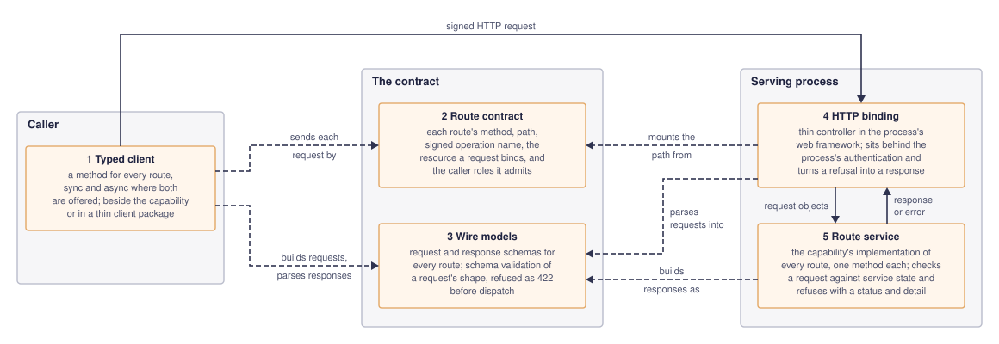

# Implementation

How production code is written: what it guards against, what it builds rather than
reuses, how a service's layers divide the work, which party decides, and how a
long-running worker is driven by hand.

## No speculative guard code

Production code adds no refusal, warning, probe, or hardening for a case nobody can
describe, or that no integration or end-to-end test could deliberately trigger: such
a guard is code no test defends.

## Prefer an existing library

Use an existing open-source library wherever one meets the requirements, and build
your own only when none does.

## Generic infrastructure is a standalone component

Generic infrastructure that is not specific to the system's domain does not belong
in a domain package. Having to build it at all is a warning sign, accepted only when
no existing software fits ([Prefer an existing library](#prefer-an-existing-library));
when it is built, it is a standalone component. Such a component publishes its
interface — a specification, a test vector, a pins file — and domain code conforms
to it, and may check its own copies against it: the consumer reads the producer, and
the component never reads domain code or names a domain concept.

## Composition from one component

Where two parts of a system handle one concern differently and nothing their own
requirements state calls for the difference, one behaviour is chosen for both and
composed from a component both use, rather than patching the part that showed the
defect. Two importers that each give up on a failed upload in their own way, for
example, share one retry policy from the library both import; each keeps only what
its own source needs, such as its file format.

## Thin controllers

Within a service, controllers stay thin: routing, request and response schemas, and
translating errors into responses. Business rules, orchestration, and I/O
composition live in the service layer beneath them.

## Route contracts and their HTTP binding

A capability that serves HTTP routes is split into five pieces. The component that
owns the capability owns the wire models, the route contract, and the route service:

1. **Typed client**: a method for every route, sync and async where both are
   offered, built on the route contract. It may live beside the capability or in a
   thin client package of its own that depends only on the models and the contract,
   so a caller does not install the capability's service code to call it.
2. **Route contract**: each route's method, path, signed operation name, the
   resource a request binds, and the caller roles it admits. Request authentication
   and the typed client both bind requests from it, so the two cannot disagree.
3. **Wire models**: the request and response schemas, with the validation that
   refuses a malformed request before dispatch.
4. **HTTP binding**: the thin controller that maps each route to its route service,
   turns the route-service error into a response, and sits behind the process's
   authentication. It belongs to whatever composes the process that serves the
   routes.
5. **Route service**: a framework-free class over the capability's collaborators
   that validates and performs each route and shapes its response. It reports a
   refusal as an error carrying a status code and detail, and it imports no web
   framework.

The diagram below follows one request through the five pieces. The route contract
and the wire models stand between the caller and the serving process because the
typed client on one side and the binding and route service on the other are built
from them, so a client and the service it calls cannot disagree about a route. Solid
arrows follow one request; a dashed arrow points from a piece to the contract piece
it is built from. The diagram's source is
[`route-contract-pattern.drawio`](route-contract-pattern.drawio), beside its export.

A request is checked in the order of what it takes to judge it. What the request
establishes by itself is validated by its wire models, so a typed caller and the
server refuse it before dispatch or database work, as HTTP 422. Checks that need the
composed service — registered providers, provider-owned configuration — or stored
state — immutable fields — belong to the route service and refuse through its own
error. A comparison of stored and proposed state is one pure function shared by
every write path that needs it, individual and bulk alike, rather than repeated per
adapter. The order is a default, not a ranking of messages: a path is not
reordered, nor a lookup added, only to report a different error first.

## Deciding which party is authoritative

Where two components could each decide something, authority follows what each can
see and what each controls, judged as if they were separate businesses that
disagree: the authority is the party that can make its answer stick. Either party
can refuse more than the other would; neither can make the other accept. A rule one
party declares but does not enforce where it decides is therefore advisory to the
other, whatever its wording; a rule that must bind every party acting for it belongs
where it decides, over what a request carries. A warehouse that never sees an
order's price, for example, cannot refuse an order on price, while a shop cannot
make the warehouse ship stock it does not hold; the shop mirrors the warehouse's
limits early only to avoid promising what the warehouse will refuse.

The same judgement applies to what crosses a wire between parties. Anything a
counterparty can send is handled on its own terms, whatever client produced it: a
party cannot rely on the counterparty running a particular client, or on that
client filling a field sensibly. An input a party needs is derived by that party
rather than taken from the other's message, and a message missing what it must carry
is refused at the point that acts on it, rather than read as asking for less.

## Operator lifecycle controls

A long-running lifecycle worker may expose authenticated one-cycle controls when
deterministic recovery, testability, or diagnosing a reported problem requires them.
A manual cycle invokes the same production handler as the timer-driven worker; it
never implements alternate lifecycle transitions. Diagnostic responses are bounded
and may expose aggregate state counts, claim ages, and failure counts, but not
credentials or unbounded provider payloads. A test drives such a worker through these
controls ([Test seams](test-seams.md#pause-the-loop-then-advance-it-explicitly)).
