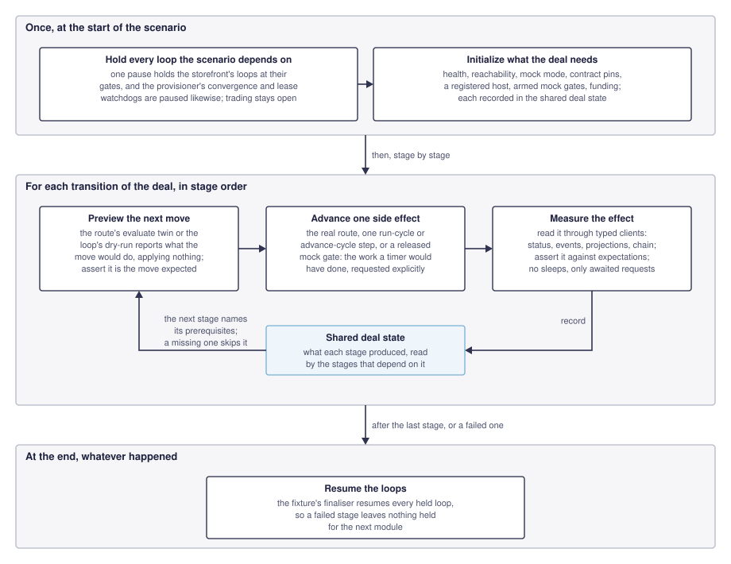

# Deal scenarios

What this repository's end-to-end scenarios must hold, as instances of
[`system-tests.md`](../engineering/system-tests.md). The lanes, the canonical compute
deal, and the doubles they run against are
[`TESTING.md`, "System Integration Tests (End-to-End)"](../../development/TESTING.md#4-system-integration-tests-end-to-end);
the holds a compute-lane scenario takes are
[`deterministic-tests.md`](deterministic-tests.md#pause-the-loop-then-advance-it-explicitly).

## A complete deal per domain

Every deployable domain owns one release-qualified complete-deal scenario:
discovery, negotiation, settlement, delivery, and domain-defined teardown.
The teardown observation follows the resource sold: VM capacity is released,
an API-credit grant is consumed until the authority returns HTTP 402, and a
bare-metal lease is released only when authenticated access is revoked and the
selected-site authority reports teardown. A health check or static Compose
render is not deal evidence.

## The discipline every scenario follows

Every scenario follows the discipline of
[`system-tests.md`, "A scenario is a sequence of state changes"](../engineering/system-tests.md#a-scenario-is-a-sequence-of-state-changes).
Here a scenario holds its loops through the pause and step controls under
["Pause the loop, then advance it explicitly"](deterministic-tests.md#pause-the-loop-then-advance-it-explicitly), and
initializes what the deal needs. It previews each move through the route's
evaluate twin or the loop's dry run. What a stage produced goes into the shared
deal state for the stages that depend on it, and whatever happened, the
fixture's finaliser resumes the loops.

A stage reaches an instant through lane time: one time every party of a lane
perceives, which the scenario sets
([`TESTING.md`, "Lane time"](../../development/TESTING.md#lane-time) gives the
parties and the fixture that sets them). Here:

- every Compose lane runs on injected lane time, every party set to one instant
  together and confirmed at it;
- a stage reaches an instant by setting lane time, never by waiting, and waits
  only for its own request's effect;
- lane time only moves forward and is never reset: each module continues from the
  instant the one before it left;
- a party the run's profile names but cannot reach fails the setup rather than
  skipping;
- a run on wall time — an external-topology run, or one against the local Helm
  release — waits only for an instant the scenario's own data fixes, such as the
  Agreement's start or that start plus an offset the scenario chose, or one an
  authority recorded in a signed record as the effect of the scenario's own
  request, such as a preemption's effective instant or the funded boundary; it
  polls a live producer for an effect of the scenario's own request, bounded by the
  producer's own schedule plus the run's poll bound, such as a period's earnings
  awaited through that period's end; and a stage needing any other instant is a
  blocked skip naming the wall-time target; the shared stages reach both through one
  helper;
- a run is on one time source throughout, and the session fails naming a party on
  another.

A message a stage sends off the request path, such as the seller-side
introduction mail, is read back from the lane's Mailpit. The introduction
retention sweep, a behaviour defined by a window elapsing, is proven at a level
that can drive the clock; no pipeline stage waits for it.

Source: [`docs/development/diagrams/e2e-stage-discipline.drawio`](../../development/diagrams/e2e-stage-discipline.drawio).

The shared deal state is `DomainDealState`, from
`e2e-tests/tests/e2e/roles/helpers/domain_deal.py`, which the scenarios share
with exact event ordering, profiled buyer configuration, and the public client
helpers in `e2e-tests/tests/e2e/roles/buyer_cli.py`. The helpers keep domain
results opaque: they do not assume a VM listing, provisioning job, host field,
API key, Physical Resource, site, or teardown payload. A scenario supplies its
codecs and domain assertions instead of copying another domain's control flow.
A stage names each earlier result it depends on with `require_state`, one
exact producer/consumer field at a time. When an earlier stage or external
authority is unavailable, the dependent stage names that prerequisite and
remains blocked; it is never counted as a successful live deal.

## A system test reaches services only through their interfaces

The e2e test pod reaches services only through their interfaces
([`system-tests.md`](../engineering/system-tests.md#a-system-test-reaches-services-only-through-their-interfaces)):
typed clients, explicit test controllers, and stage/event APIs over HTTP.

## A lane provides its own configuration

A lane provides its own configuration, so a scenario that finds a lane setting
missing fails rather than skipping.

## Locally verifiable and external-topology scenarios

End-to-end scenarios come in the two kinds of
[`system-tests.md`, "Locally verifiable and external-topology scenarios"](../engineering/system-tests.md#locally-verifiable-and-external-topology-scenarios).
Here a *locally verifiable* scenario runs against this repository's own stack — a
lane's Compose project or a Helm release — with provisioning in its mock profile
and the payments service and the dispute authority replaced by the in-lane doubles.
An *external-topology*
scenario needs a hosted payments target or a real host, and is the only evidence
for real delivery, access, and revocation on a host, and a payments target's
records; one that makes a deal extends a locally verifiable one.

The real-provisioning qualification modules for observations 2, 4 and 5 extend the
lanes' buyer purchases, subclassing their shared stages
([the real-provisioning lane](../../development/TESTING.md#the-real-provisioning-lane)); observation 6's
module makes no deal, and follows the other two by name on the same stack.
Funding a payer account at a payment provider's sandbox, and providing the hosts,
are the deployment's topology. An absent target is a blocked skip. The scenarios
log the identifiers each stage reads — the buyer run, Agreement, transaction,
reservation, jobs, relay port, and grant — and no record format is defined for
the operator's summary.

A qualification module's outcome is per observation
([`system-tests.md`, "An observation is made, failed, or unproven"](../engineering/system-tests.md#an-observation-is-made-failed-or-unproven)).
Every stage of a qualification module requires the module's observations, or its
cycle's in a module run once per cycle, unless the stage narrows that to fewer; the
module logs each observation's outcome after its last stage
(`e2e-tests/tests/e2e/roles/helpers/qualification.py`).

A VM lease's end is reached by moving its agreed end into the past and stepping
one lease-watchdog cycle with the watchdog held, which runs exactly the service
code an expiry runs; lease durations stay fixed. Back-dating is admitted below
setting lane time, and weaker than it.
