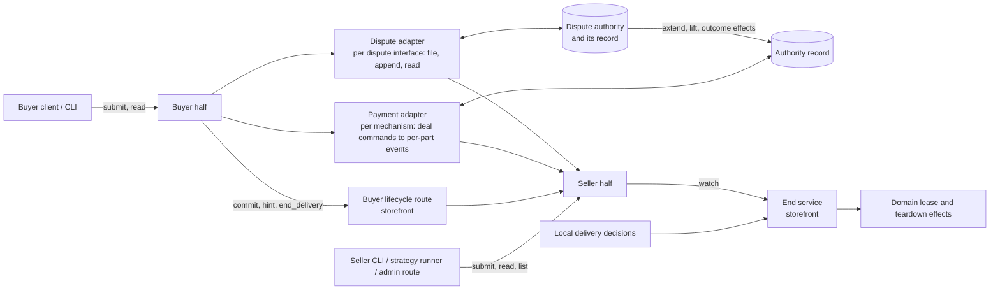

## Context

What exists today (evidence for the decisions below, not a specification):

- **Negotiation and settle.** Negotiation is buyer-driven signed rounds. The seller's responses authenticate the seller principal in transit, and accepted terms keep the exact buyer and seller parties (`negotiation-protocol`, "Principal-bound negotiation history"). The buyer client verifies the seller's signed acceptance and keeps only its payload (`core/buyer/src/core_buyer/negotiation_client.py`); the storefront stores negotiation messages without the request proof. Settle's contract is core's: the route table `settlement_routes` (`SETTLE` in its negotiation and Alkahest `escrow_uid` forms, `SETTLE_STATUS`, `REFUND`), its response models, and the typed-client method `settle_agreement`. Each domain storefront (VM, bare metal, API credits) mounts it, and VM seller response signing binds it. `Agreement` is `extra: "forbid"` and carries the full selected `SettlementOption` verbatim; the option's settlement parameters are mechanism-owned and opaque to core. Core defines no universal Agreement hash.
- **Heartbeats.** The storefront stores a heartbeat's principal, timestamp, and payload, not its signature (`core/storefront/src/core_storefront/heartbeats.py`). A stored heartbeat is the seller's record that one arrived, not buyer-signed evidence.
- **Alkahest.** An obligation's committed content is its arbiter and `DemandData`. The default recipient arbiter's demand is `{recipient}`; the trusted-oracle and splitter demands are `{oracle, data}`. An interruptible listing builds a `vms.interruptible.v1` term with a splitter whose oracle is the first configured `interruptible_oracle_addresses` entry: the seller wallet by default, possibly a third party. The term nevertheless hard-codes `refund_authority: seller_declared`. A storefront-wide `[Settlement.alkahest].interruptible` flag marks every listing interruptible, whatever its options.
- **Interruption today.** The VM interrupt endpoint is gated by the storefront admin key and an administrator principal, so its caller is the seller's own staff or automation. It truncates the capacity lease (minute precision) and returns `splitter_declaration_pending` for the money side. Terminal hosted settlement truncates the lease from the other direction (`truncate_lease_for_terminal_settlement`). Bare metal has a buyer-authenticated `POST /api/v1/fulfillments/{negotiation_id}/teardown` that ends the lease at once with no money side, and ends the lease on an uncollected terminal obligation through `terminate_lease`. A truncated lease is released when provisioning's lease watchdog next polls (60 seconds by default). Leases can be shortened, never extended.
- **Seller refund and reconciliation.** The seller reverses a hosted payment through `POST /api/v1/settlements/{negotiation_id}/refund`. Every storefront composing hosted payments runs a reconciliation pass that advances approved deals a buyer never settled (`kit/arkhai-payments/src/market_arkhai_payments/reconciliation.py`).
- **Hosted payments** (the `arkhai.payments.v1` mechanism). The facts below are those of the payments contract `spot-deals-through-arkhai-payments` builds on; the contract vendored in `kit/arkhai-payments/schema` already defines rate parts, but SCM derives only `once` parts. The required revision adds per-part lifecycle authorities and related behavior.
  - **Commitment.** The seller derives the mandate from the exact Agreement bytes; `mandate.deal` is `sha256(JCS(Agreement))`. The payer commits by approving it with an authenticated request. The Agreement can be attached to the transaction.
  - **Events.** `start`, `stop`, and `reverse` are authenticated requests from accounts the mandate lists for that kind. `derive_mandate` hard-codes `start` and `stop` to both parties. A stop names its cause: payer, payee, authority, or terms. Billing periods count from `start`; the first batch is reserved at approval.
  - **Settlement.** A stop takes effect when received and is never backdated; today it cannot be future-dated either. Funding exhaustion stops the transaction at the last paid boundary with cause "terms". The signed snapshot carries events, the stop record, settled amounts, and a funded-through time. SCM does not yet verify snapshot proofs.
  - **Disputes.** The mandate lists a dispute authority allowed to `reverse`, configured once per storefront as `[Settlement.arkhai_payments].dispute_authority`; no automated one exists. Deals through the official Arkhai registry are mediated by Arkhai, manually today.

## Decisions

The decisions were revised after each design-review round; `Status` lists what changed.

### D1. The protocol is what a party must do to continue

A step is protocol when refusing it leaves a party unable to continue:

1. **Discovery:** without the registry's schema a buyer finds no listings.
2. **Negotiation:** without the negotiation schema the parties reach no agreement.
3. **Commitment:** the single act, defined by the mechanism, that makes the agreement binding (D2). Hosted: the payer's mandate approval; the payee commits by building the mandate it offers. If a seller-funded bond arrives (D5, deferred), its change orders the two approvals to minimize network hops. Alkahest: the escrow obligation on chain. Asynchronous peer-to-peer: the countersignature.

After commitment, refusing to continue is a broken obligation, no different from breaking a later clause, and it is visible only through the evidence it leaves. Everything after commitment, including the buyer's settle handoff, is post-commitment lifecycle (D6). Core keeps the registry, negotiation, and the schema-opaque agreement and commitment carriers.

Moving the settle contract out of core is its own change, `move-settle-out-of-core`, because it moves one shared route table (`SETTLE`, `SETTLE_STATUS`, `REFUND`), touches three domains and VM response signing, and overlaps `move-escrow-into-alkahest`'s ownership of the Alkahest settle path. This change adds the lifecycle routes beside it (D6) and leaves settle where it is.

### D2. The committed agreement is defined by the mechanism

The agreement is what is enforceable in arbitration, `arbitrate(demand, evidence)`, and its form is the arbitration mechanism's:

| Mechanism | Committed agreement | Commitment reference |
|---|---|---|
| Alkahest | The arbiter and its `DemandData` | Escrow obligation UID |
| Hosted payments | The mandate, with the exact negotiated Agreement hashed into mandate.deal and optionally attached | Transaction ID |
| Asynchronous peer-to-peer | The countersigned negotiated Agreement | Its signature digest |

- **The negotiated Agreement is the input.** Each mechanism derives its committed form from it. Before committing, the buyer verifies that the committed form is that mechanism's derivation of the negotiated terms. This generalizes the buyer's existing check (`buyer-orchestration`, "Payment buyers approve and settle by negotiation") rather than relaxing it.
- **No universal agreement identity.** Committed agreements are not compatible across mechanisms in general; two mechanisms may be designed to be. `negotiation-protocol`'s "no universal Agreement hash" stays. The lifecycle layer treats the commitment reference as opaque.
- **Lifecycle terms bind only if the committed form encodes them.** Hosted: each part's terms and the authorities of its events (D5). Alkahest: the arbiter's `DemandData`. Today's oracle and splitter demands carry only an oracle address, so Alkahest options carry no lifecycle terms until the specialized arbiter of D13 exists.

### D3. Later information is evidence, not protocol

Information exchanged after commitment is not committed or carried by the protocol unless a dispute arises. The agreement's dispute authority defines which of it can become evidence. Each party keeps what its dispute authority expects it to submit (D9).

### D4. A clause is admissible if its named dispute authority can decide it

- **Decidable.** The agreement names the dispute authority that decides disputes about it. "The buyer received a working VM" is admissible under Arkhai mediation's optimistic procedure, where parties act and Arkhai resolves disputes. Which authorities a registry's deals default to is the registry operator's choice, published in its descriptor (below); the official Arkhai registry recommends Arkhai mediation. The open-source code ships no authority: no account, origin or key of any operator's service is built in.
- **The authority is a party of its own.** A dispute authority fills the role of the oracle of Alkahest's `TrustedOracleArbiter`, or of the arbiter contract itself on a self-serve path. It is a client of the payment mechanism like the buyer and the seller, which the committed form authorizes to send certain events (D5), and otherwise independent of it: not one system with the payments service that answers for it. It may charge its own fees, require deposits, or run public mechanisms of its own outside the payment mechanism; SCM carries what the authority's interface requires and assumes none of it.
- **Named per deal, under the payment mechanism.** Terms follow `mechanism { fields }`, and at SCM's level the payment mechanism is primary. A hosted option's `adjudication.dispute` names the authority acting on its deal: its interface, the protocol SCM and the payments service speak with it, such as `arkhai.mediation.v1`, and that interface's fields, which are configuration: where the authority is reached, its account at the payment mechanism, the key that signs its records, and interface-owned `params`. Another operator running an identical service at another origin with another account is another authority with the same interface. An authority that runs several procedures of its own behind one interface names the procedure in its `params`. On Alkahest the arbiter is the mechanism's field: `TrustedOracleArbiter`'s oracle identity is a field of that arbiter, committed in its `DemandData`, and the oracle's own APIs belong to that oracle.
- **Authorities advertise compatibility.** An authority advertises the payment mechanisms it can act on, its minimum dispute window and case hold, and any default outcome, in its interface's published description. Each place that recommends or configures an authority carries a copy of that advertisement, and the checks read the copy; fetching the published description is an optional refresh that may only narrow it.
- **Registries recommend; roles choose.** A registry's descriptor may list recommended dispute authorities, operator-authored like its display name. A role's authorities are its own `[[Dispute]]` entries in preference order, followed by those its registry recommends unless it turns them off (D6). A seller offers from that list; a buyer accepts only from it.
- **Reachable.** Before committing, each party checks it can take part. The buyer accepts an option's authority only when its `interface`, `origin`, `account` and `record_key` all equal one authority in its list, and its `params` equal that entry's or satisfy the interface's own acceptance check; matching the account alone would let a seller pair the real authority's account with an origin and key it controls, so filings would never reach the authority holding the extend right. It also refuses an option whose interface its client has no adapter for, or whose authority does not advertise the option's payment mechanism. An authority speaking a supported interface is still refused when the buyer has not accepted it, since the buyer trusts it with held money (D12), as an Alkahest buyer trusts only known oracles.
- **Chosen per option.** A buyer cannot change a seller's option, so choosing an authority means choosing among options; a seller may price them differently.

### D5. A deal is a set of parts; payment events are per part

**Events follow the mechanism's joints.** A deal's money is a set of parts, and each mechanism's events are the operations its machinery can actually perform on a part on its own. Where a mechanism can apply an effect in part, the event is partial; where it can only act all at once, the event is whole, and any finer consequence needs a separate part.

- **Hosted payments is a ledger.** At approval a `once` part's gross is posted from the payer's balance to a per-part hold account in the service's ledger; money crosses the card network only at top-ups and withdrawals. `reverse {part, amount}` is a compensating posting from the hold back to the payer, repeatable until the hold is empty, with no fee, since the fee is taken on release. So reversal is partial and repeatable up to what a part still holds, and a penalty up to the held payment is a partial `reverse`, not a bond.
- **Alkahest escrow is all or nothing.** An obligation is collected whole when its arbiter is satisfied or reclaimed whole on expiry; the splitter declares one split, once. It has no partial reverse, so any penalty, even one smaller than the price, must be a separate seller-funded escrow. That arrives with the specialized arbiter (D13).

Hosted parts:

| Part | Events |
|---|---|
| `once` | collect (applied by the service when the hold ends), `reverse` of any amount up to what is held, repeatable |
| `rate` (`spot-deals-through-arkhai-payments`) | `start`, `stop {part, at?}` of this part (a notice is a stop with the sender's notice period), collect, `reverse` of any amount up to what is held, repeatable |
| `bond` (reserved; needs a payments change, below) | award to the payer of any amount up to what is held, repeatable; return of the remainder to the seller, applied by the service when the hold ends |

Lifecycle and authorities are per part: that is the point of composing a mandate from parts, and it lets several rate parts run at different granularities. The published contract has no mandate-level authorities: every part carries its own `authorities` (`stop`, `reverse`, `extend`, and `start` for rate parts), and the adapter puts the dispute authority on every part it must be able to stop, reverse or extend, each permission granted separately. A `once` part has no start or stop, because nothing about a fixed amount starts or stops: its protection is the hold. More exotic deal structures are new combinations of parts, never new deal-level events at the authority. Deal-level commands such as "end delivery at *T*" belong to the lifecycle layer (D6), whose payment adapter translates each into the events of the parts it affects. The payment core never receives a deal-level event, and it has no notion of disputes: disputes are per agreement and sit outside it (D10).

**No structure is forced.** Option builders offer reasonable defaults as presets ("spot", "on-demand", "reserved"; with or without a bond once a mechanism can hold one). Every preset is only a combination of parts and terms in the generic vocabulary, and nothing special-cases one.

**The option's shape.** A settlement option states three things, each under the name a buyer reads it by, and its ID is the hash of the canonical payload of all of them:

- `price` — the offer's commercial terms, `{asset, rates}`, read by negotiation, the registry and the price accessor whatever the settlement; absent on a rateless option such as an introduction.
- `settlement` — how the deal is settled: a `schema` naming the settlement mechanism (`arkhai.payments.v1`, `alkahest.v1`, `contact-exchange.v1`) and, flat beside it, that schema's own parameters, validated by the mechanism's model; no schema may define a key named `schema`. The buyer's selection mirrors it with the buyer's own schema parameters.
- `lifecycle` — the parties' rights after commitment, owned by this change's codec and read by lifecycle adapters, never by a settlement mechanism's model: `adjudication`, on every option whose mechanism has a lifecycle adapter — the dispute authority that decides disputes about the agreement (D4, D10), the dispute window, and the maximum case hold; `early_termination`, only when some part of the option can be stopped — who is entitled to stop it, each party's priced notice and started-period treatment, the term end's started-period treatment, and the premature-stop penalty; the deal's horizon itself is the Agreement's `duration_seconds`, resolved per deal at acceptance from the listing's bounds, so the option is the same for every buyer and its ID is stable from registry to Agreement; `delivery_deadline_seconds`, on every option whose seller delivers a resource — the seconds after the later of the payment authority's commitment instant and the Agreement start within which the resource is available to the buyer, after which the seller has not delivered (D8); and `bond`, optional, the seller's stake beyond the payment (below). The builder emits `lifecycle` only on an option whose mechanism has a lifecycle adapter, and the buyer refuses one that carries it otherwise; the adapter derives each part's authorities from it, so rights are the source and the mandate's authorities the derivation.

All three are in the Agreement bytes and the option ID, so their key and field names are fixed here. An option with no `lifecycle` hashes without the key, so API-credit and existing listings keep their IDs.

```json
{
  "option_id": "<sha256 of the canonical payload of price, settlement, lifecycle>",
  "price": {"asset": "USD/6", "rates": [{"field": "amount", "per": "hour", "value": "72000"}]},
  "settlement": {
    "schema": "arkhai.payments.v1",
    "payee_account": "acct_seller_example",
    "approval_window": "PT15M",
    "period": "PT1H",
    "reserve_ahead_seconds": 3600
  },
  "lifecycle": {
    "adjudication": {
      "version": 1,
      "dispute": {
        "interface": "arkhai.mediation.v1",
        "origin": "https://mediation.arkhai.example",
        "account": "acct_arkhai_mediation",
        "record_key": "ed25519:…",
        "params": {"procedure": "optimistic"}
      },
      "dispute_window_seconds": 1209600,
      "case_hold_max_seconds": null
    },
    "early_termination": {
      "version": 1,
      "entitlements": {
        "payer": {"notice_seconds": 0, "settles_through": "started_period"},
        "payee": {"notice_seconds": 120, "settles_through": "last_boundary"}
      },
      "settles_through": "last_boundary",
      "premature_stop_penalty": "1728000"
    },
    "delivery_deadline_seconds": 1800,
    "bond": {"version": 1, "amount": "5000000"}
  }
}
```

The option carries one `asset`, in `price`; the hosted mechanism's parameters no longer repeat it, and the mandate reads the option's. Renaming the wire fields changes every existing option ID, hosted or not, so every listing is republished once at this change's rollout (below); nothing else about option identity changes.

- **Entitlements authorize acting in one's own interest.** The adapter derives each entitled initiator's stop entry and the dispute authority's entry for stoppable parts. Seller stop entries exist only for entitlements, such as spot's notice entry; an on-demand option has none. Acting in one's own interest requires an entitlement or the dispute authority's ruling. The payments service knows accounts, money movement and the authorizations a mandate states; roles are opaque to it, and it has no implicit rule about whose favour an action serves, no payee notice waiver and no early release by the payer. "Won't preempt" on on-demand is therefore enforced by remedy, not by the mandate: a positive premature-stop penalty and a buyer's case over held money (with a bond reserved for stake beyond it). The seller's own exit is the mechanically ruled self-penalty filing below. The dispute authority acts through its own entries. A rate part's `start` authority is the payee alone (D7).
- **A seller's exceptional end is a dispute filing.** `exceptional_end(at)` is a deal-level intent the seller half files with the agreement's dispute authority through the dispute adapter, journaled with the end. The seller sends no stop or reverse of its own for it, so the dispute authority never reconciles what the seller already did. A self-penalty is a package (stop, refunds, bond); a partial direct path would still need a dispute; and the authority records disputes, for example to ban bad sellers. Arkhai mediation rules a request at least as strong as the standard one mechanically (D10). The payments vocabulary has no exceptional-end kind or field. Timing is never future-dated: a pre-start failure journals immediately and files at the Agreement start (D8). The buyer may still dispute the seller's account.
- **Premature-stop penalty.** `early_termination.premature_stop_penalty` is a nonnegative integer amount in the option asset's minor units (canonical decimal string, like `bond.amount`); absent or zero means none. It is forfeited for a seller end the terms do not entitle, on spot as well as on-demand. An entitled notice stop pays none; an emergency exit without notice pays it. After the standard unearned-money refunds, mediation reverses `min(premature_stop_penalty, earned amounts still held)` to the payer across parts in mandate order. In a buyer's case alleging an unentitled seller end, a person applies the same capped remedy. Recommendations: on-demand presets default to 24 periods' price; the buyer's default acceptance policy refuses on-demand without a positive penalty, since the buyer benefits and enforces it, like partialPeriod. Terms owns those defaults and display; the foundation owns the codec and dispute mapping. The cap sums held amounts across parts, which is sound because an SCM option has one asset: every part of a mandate SCM derives is in the option's asset. The penalty is computed from the authority's snapshot when the ruling applies, not at filing, so it shrinks as holds release before the ruling.
- **A seller's promise is priced by what can be taken back.** On hosted payments, an outcome may reverse any part of the held payment, partially and more than once; a partial reverse while the term continues is a discount. That covers every penalty up to what is held. `bond.amount` is the seller's stake beyond it: money funded by the seller toward the payer, held, awarded to the payer in part or whole by outcomes, and returned to the seller when its hold ends. The payments service cannot express this today: a mandate has one direction, a reverse returns money to its funder, and maturity releases to its recipient, so a bond would be backwards, and two linked mandates commit non-atomically. Its maintainers lean to per-part direction with a "return on maturity" hold inside one mandate. Until that exists, the `bond` term's name and shape are reserved in the codec and builders refuse to emit it on hosted options; hosted bond derivation, its query field and its approval order are a follow-up change. A deal needs a bond only when its promised penalty can exceed the payment still held, such as a cheap deal with a costly failure, or a rate deal whose collected periods are no longer held. On a mechanism without partial reversal (Alkahest), the same `bond` term is realized as a separate escrow whatever its size.
- **The dispute window sets the earliest payout.** Each amount a part holds pays out no earlier than the part's end plus `adjudication.dispute_window_seconds`. A `once` part ends at the end of the service it buys: the Agreement's term end, `start_utc + duration_seconds`, for prepaid service, or the later of the Agreement start and approval for setup; a rate part ends at its stop, or the term end if it is not stopped, since a stopped part has no later conduct to dispute. On a compute option the window is at least `delivery_deadline_seconds` plus the authority's advertised minimum window, so a setup part — ending at the later of the Agreement start and approval — cannot pay out before the seller's delivery obligation is due and a case can be filed on it; the terms change refuses the option otherwise, and the margin is the authority's own statement of what a filer needs rather than a constant of this design. The window bounds payout, not filing: whether an authority takes a case filed after it is the authority's own policy, and the payments service only refuses an extension for money already paid out. Outcomes act only on money still held, so a case keeps the deal's money held until it is decided, through a generic hold extension: two per-part payment events that only the dispute authority sends.
  - `extend {part, until?}` opens an extension on a part and returns the extension's `ref`. While any extension on a part is open, each amount the part holds pays out at the later of its normal date and the latest `until` among the open extensions, or not at all while one has no `until`; never later than its normal date plus the part's maximum extension. `extend` carries an idempotency key, so a retry after an `unknown` result returns the same `ref` rather than opening a second extension nobody holds a `ref` for. It is refused for money already paid out, decided by the payments service's receipt time.
  - `lift {part, ref}` ends one extension. A part's amounts past their normal date pay out once no extension on it remains open.
- **A case holds money only through an accepted `extend`.** On each part, a case protects exactly the money for which the payments service accepted the authority's `extend`; the payment authority, not the dispute authority, draws that line. Arkhai mediation sends `extend` on every part with held money as part of filing, with no human step and before acknowledging the case, keyed by case and part so that a restart repeats an extension rather than duplicating it. It answers the filer in its own protocol, never by passing the payments service's response through (D6): the case reference and each part's status, `held` with its extension ref or `not_held` with the reason, or its own error when it could not complete the extensions, whether the payments service refused, failed or missed the authority's deadline. A part with nothing left to protect, because it has paid out or was wholly reversed, is reported `not_held` with that reason, and filing completes without an extension on it. A late case still exists and may be ruled; its outcome may end delivery, but it cannot move money already paid out. Filing late is the filer's own risk.
- **Each case owns its extensions.** The dispute authority applies a case's outcome, then lifts that case's extensions; a part pays out only after every open extension on it has ended, so a lift for a closed case cannot release money another open case still holds. A partial `reverse` followed by `lift` awards the payer part and pays the rest to the payee with existing operations. A `ref` is an opaque label to the payments service, which knows nothing of cases.
- **The case hold is capped by terms.** `adjudication.case_hold_max_seconds` is the agreed maximum extension, a nonnegative integer or `null`, carried into each part's `maxHoldExtension`; with `null`, an extension without `until` lasts until it is lifted. Each authority advertises the smallest cap it can work with, possibly requiring `null`; Arkhai mediation's defaults use `null`, which trusts it to rule (D12). Only the agreement's dispute authority may `extend` or `lift`, through one authorities key covering both. No party receives a counterparty-interest release capability.
- **Holds per part shape.** On rate parts an extension covers every amount the part holds while it is open, including periods earned after it opened, each capped from its own normal date. Each mechanism derives its holds from the window. On hosted payments every part carries an optional `end`, at which the service stops it with cause terms, and a hold `{afterStop: d}` releasing at the part's own stop plus *d*. The adapter gives each part its own service end and hold `{afterStop: dispute_window}`, so a setup `once` part pays out one window after the later of the Agreement start and approval and a prepaid `once` part one window after the term end, and an early stop starts the window early; rate parts use the same rule, so a stopped spot deal does not wait out its unused maximum term. Evidence is kept at least as long (D9).
- **Approval window.** The hosted option's existing `window` settlement parameter sets only approval expiry and is renamed `approval_window`, with query field `arkhai_payments.approval_window`. Holds come only from the dispute window.
- **Authority causes need no entitlement.** Funding exhaustion stops every part of the transaction at its funded-through time, with cause terms; starved parts keep what they paid for, and a top-up before then rescues them. A transaction is the set of parts funded together, so parts useful alone belong in separate transactions. The maximum term stops at an absolute instant, the Agreement's `start_utc + duration_seconds`, carried in the mandate as each rate or prepaid-service part's `end` (setup has its own end, the later of the Agreement start and approval). That is the instant the lease ends (D8), whenever the seller sent `start`. Both stops have cause "terms".
- **One priced notice per party.** Each stop authority carries exactly its entitlement's `notice_seconds` (D7); there is no second exposure tail. `exposure_seconds` and `stop+exposure` are retired and rejected by the codec.
- **Started-period treatment is committed.** The codec defines `settles_through` as `started_period` ↔ payments `partialPeriod: charged`, `last_boundary` ↔ `returned`, or `stop` ↔ `prorated`. The payment authority computes billing at the effective stop, not SCM through a later correction. Which treatment a deal carries is negotiated: the seller's presets offer payer `started_period` and payee `last_boundary`, and the buyer, who benefits from the payee's treatment, protects itself by refusing options whose terms it does not accept. The default acceptance policy owned by `negotiate-open-ended-compute-terms` and applied by the buyer half refuses a payee entitlement or term end that is not `last_boundary`; a buyer may loosen it. Dispute authorities read the terms and do not set them. Until the vendored revision expresses a value, publication and buyer acceptance fail closed on it. Interim spot offers use `started_period` on both sides, which a default buyer refuses, so rate options reach default buyers only once the revision is vendored; an option must never advertise the returned preset and silently charge instead.
- **Term ends have their own treatment.** The sole term-end carrier is `early_termination.settles_through`; no mechanism-specific option field duplicates it. It is mapped by the adapter to each rate part's `end.partialPeriod` using the same values as a stop-authority entry. Compute presets use `last_boundary` (returned), so billing never runs past the agreed maximum. Publication and acceptance fail closed until the vendored contract expresses that treatment. Interim recommendation: publish rate options with an absolute end and a charged final partial period, explicitly disclosed as term-end `started_period` in the option. Rate billing starts at activation, which may follow the Agreement start; the payments end is absolute, so rounding a horizon cannot align it with a billing boundary. Exhaustion needs no separate partial-period rule: reserve-ahead puts it on a period boundary.
- **Setup is not prepaid running time.** A setup `once` part is owed by the buyer from approval: it prices the provisioning the commitment triggers, so a buyer-caused end leaves it with the seller, before or after activation. Its end is the later of the Agreement start and approval, and it pays out one dispute window later; the standard self-penalty returns all of it for undelivered service and none after delivery, which is the only ground on which it returns. It needs no link to the rate part and no activation-anchored end; spot derives it. The payments service clamps a part whose `end.at` is at or before approval to approval, with the mandate's bytes and hash unchanged, and a setup part with `{afterStop: d}` then releases at approval plus *d*; the producer's clamped-setup-and-rate snapshot vector covers it. How mediation's mapping returns a zero-length part for non-delivery is an open question below.
- **Delivery has a deadline the buyer reads.** `delivery_deadline_seconds` is the seller's published promise: the resource is available to the buyer — the storefront's durable `available` record, credentials ready for the buyer to read, which the buyer observes and keeps as its delivery instant (D9) — no later than that many seconds after the later of the commitment instant the payment authority recorded (approval, for hosted deals) and the Agreement's `start_utc`. Site activation, `start` and disclosure before it are the seller's own ordering; the site's phase is a capacity fact, not delivery. The storefront publishes the value its site enforces — the pool's `delivery_deadline_seconds` tag, read at publication like the pool's other hints — and supplies the accepted value and the anchor instant at site commit, bounded by the pool's current policy: a commit asking more time than the pool now grants is refused, a seller failure before dispatch. The site cannot verify the anchor — it knows no payment mechanism — so its deadline is the seller's own safeguard against its storefront's absence, not the buyer's guarantee: a storefront that supplies a late anchor lengthens the site's deadline and not the promise. The buyer's guarantee is the dispute authority's judgement from the payment authority's approval record and the Agreement, both in the buyer's evidence store (D9), with the storefront's journaled commit and its supplied anchor as evidence against it; a pool that enforces no deadline publishes no term, and the default buyer refuses a compute option without one. `available` not durably established by the deadline is non-delivery (D8) whether or not the term continues, so a buyer's protection does not depend on a short horizon; a site activation that lands late, or in time with `start` or disclosure after the deadline, does not make the deal delivered and authorizes no new rate billing; a start already accepted is corrected by the ruling, not unmade. The anchor is the one the setup part's end uses: approval starts the seller's clock, not the buyer's later `commit` and not the storefront's own site commit. `renewable-compute-lease-deadlines` owns the pool tag and the site's enforcement; `negotiate-open-ended-compute-terms` emits the term and checks at acceptance that the horizon leaves room for the latest permitted approval, this deadline and one whole period.
- **Entitled stop treatment is a term the mechanism applies,** never an intermediary correcting a priced stop. A seller's exceptional end is the separate dispute filing above.

The rate-part behaviour in these bullets (payer stop, notice periods, exhaustion, maximum-term stop) is implemented by `spot-deals-through-arkhai-payments`, which owns its requirements. This change fixes the vocabulary, its validation, and the derivation of authorities.

Term semantics:

| Input | Meaning |
|---|---|
| No `adjudication` on an option whose mechanism has a lifecycle adapter | The builder refuses to emit it; the buyer refuses it. |
| No `early_termination` | No part of the deal can be stopped. Each part has only the events its shape offers. |
| `early_termination` on an option with no stoppable part | The builder refuses to emit it. |
| Unknown `version`, initiator key or `settles_through` value | The buyer refuses the option; the builder refuses to emit it. |
| A `dispute` whose interface has no adapter, or whose authority does not advertise the option's payment mechanism | Refused at publication and by the buyer (D4). |
| A `dispute` authority the buyer has not accepted | The buyer refuses the option (D4). |
| Empty `entitlements` | Refused at publication; omit `early_termination` instead. |
| The deal's horizon | `Agreement.duration_seconds`, resolved at acceptance from the listing's bounds (`negotiate-open-ended-compute-terms` D5); recurring horizons require at least one whole period but are not rounded; the rate part's `end` is `start_utc + duration_seconds`. |
| `early_termination.settles_through` | Term-end treatment, distinct from each entitlement's treatment; compute presets use `last_boundary`, mapped to the rate part's `end.partialPeriod: returned`. |
| `settles_through` unsupported by the vendored payment contract | Refused at publication and by the buyer; no storefront refund substitutes for a committed billing term. |
| Seller servicing budget | Local polling, watchdog and teardown budgets are seller capacity-protection choices (D8), not another payment term. |
| `early_termination.premature_stop_penalty` absent or zero | No additional seller-end penalty; negative, fractional or noncanonical amounts are refused. |
| No `bond` | The deal has no bond part; penalties are bounded by what the mechanism can still reverse. |
| `dispute_window_seconds` below the authority's minimum; `case_hold_max_seconds` absent, negative, or below the authority's minimum | Refused at publication and by the buyer. |

**Discovery.** These terms are filtered per option, not per listing, because a buyer selects one option. They are common settlement fields owned by the lifecycle codec, not by a mechanism: `adjudication.dispute.interface`, `adjudication.dispute.account`, `early_termination.payer`, `early_termination.payee`, `early_termination.payee.notice_seconds`, `early_termination.premature_stop_penalty`. Absent penalty projects zero in the option asset's minor units; comparisons remain asset-correlated. The settlement query language's namespace rules are amended to admit the codec's projections as the one shared exception. The registry schema does not change. Recommendation (18 F15): keep projections minimal and perform exact authority-identity and treatment checks at selection; account-only discovery is a candidate filter, never an acceptance claim.

**Alkahest.** The two mutually exclusive flags (`oracle_gated`, `interruptible`) become `[Settlement.alkahest].release_models`, a list drawn from `recipient`, `oracle_gated` and `interruptible`; the storefront publishes one Alkahest option per release model. Migration maps `oracle_gated = true` to `["oracle_gated"]`, `interruptible = true` to `["interruptible"]`, and neither to `["recipient"]`. The oracle-address settings are validated against list membership, and bare metal refuses a list containing `interruptible`. The listing-level marker is removed, and the admin interrupt route reads the accepted option's release condition. The splitter option keeps its current service terms and stays the seller-trusted path until the specialized arbiter exists.

**API credits stays compatible, not serviced.** API-credit hosted options carry `adjudication` and derive their holds from it like every hosted option, so nothing here blocks servicing them later. API-credit roles still compose the dispute authority entries an option is checked against: the storefront at publication, the buyer when selecting and in the mandate check. This change does not give the API-credit storefront the seller half, an evidence store or `watch`, nor its buyer a filing path through the buyer half; that is a known limit (D15).

**Rollout is forward only.** Hosted payments has had no live use, so no accepted hosted work needs servicing across the upgrade; the option's new field names change every option ID, so every listing — Alkahest and contact-exchange included — is republished at the upgrade. Storefronts and buyer clients upgrade together, development deployments discard their accepted hosted work and republish, and an older buyer facing a newer seller fails closed at the mandate check, since the derived authorities differ. There is no versioned servicing path and no rollback. Site/storefront and buyer/storefront pairs also upgrade together before the new report sender and canonical buyer verbs are enabled, across mechanisms; older endpoints are not a supported teardown fallback. A report receiver's 404/unsupported response parks push for that peer while retaining the event for authenticated pull; transient failures retry.

### D6. Post-commitment lifecycle: one interface on each side of the mechanism

Every post-commitment action goes through a uniform interface on both sides, and the mechanism sits between them:



**Each action has one counterpart.** A party talks to the storefront, the payment authority or the dispute authority, and the outcome it receives is that counterpart's own:

| Actor | Action | Counterpart |
|---|---|---|
| Buyer | negotiate; `commit`, `hint`, `end_delivery` | Storefront |
| Buyer | approve; an entitled `stop`; read | Payment authority |
| Buyer | file, `append`, read cases | Dispute authority |
| Seller | `start`, entitled notice stop, `reverse`; read, `watch` | Payment authority |
| Seller | file `exceptional_end(at)` or a contested claim; `append`; read, `watch` cases | Dispute authority |
| Seller | end service | Its own storefront |
| Dispute authority | `extend`, `lift`, outcome effects | Payment authority |

The payment authority only answers requests. A dispute authority that fails at the payment authority returns its own error; a party wanting to know what the payment authority recorded reads it there itself.

**Three kinds of record.**

- **Payment events** are the payment authority's record of what happened to a part: `start`, `stop` (pending until its effective time when the sender has a notice period), collect, `reverse`, award, return, `extend` and `lift` (D5), and stops the authority applies itself (exhaustion, a part's `end`, a pending stop taking effect). Shape: `{negotiation_id, commitment_ref, part, kind, actor, at, amount, cause, case_ref, extension_ref, sequence, authority_record_ref}`; the actor of `extend`, `lift` and outcome effects is the dispute authority; `case_ref` names the case that caused it, if any, and `extension_ref` the extension an `extend` opened or a `lift` ended. `extend` and `lift` have no physical effect. Lease top-up, deferred (D8), will need a kind of its own, `top_up`.
- **Dispute events** are the dispute record's, per agreement: a case filed, appended to, ruled or closed. Shape: `{negotiation_id, commitment_ref, case_ref, kind, actor, at, items, outcome, sequence, record_ref}`. A transaction may have any number of cases. The record's sequence is per agreement, across its cases, and its entries are signed by the dispute authority (D10).
- **Peer messages** are buyer-to-seller and have no authority record: `commit` (the commitment reference and post-commitment information, D14), `hint` (a courtesy notice that the buyer acted) and `end_delivery` (the buyer's request that delivery end at the storefront's durable receipt time; no buyer-supplied `at`). They are kept as evidence. `commit` and `hint` are acted on only after a read of the authority; `end_delivery` asks for less service than the buyer is owed, so the storefront acts on it directly (D8), and its signed response is the seller's acknowledgement of the end.

**Commands and outcomes.** `submit` takes a deal-level command, never an event: `{negotiation_id, kind, operation_key, at, payload}`. Payment commands go to the payment adapter, which translates them into the affected parts' events; `dispute`, `exceptional_end` and `append` go to the dispute adapter (D10), whose outcome is the dispute authority's own: a `dispute` is `accepted` with the case reference and each part's status (D5), and `rejected` only when the authority refuses the filing. The outcome is `accepted` (with the resulting authority records), `rejected` (with the authority's reason), `pending`, or `unknown` (transport failure). An `unknown` outcome is resolved by `read`, never by assuming either result. The operation key is stable across retries, and the adapter derives from it each part event's idempotency key and that of a filing or `append`, so a retried filing returns the one case and a retried append the one item; a retry with the same key and different content is rejected locally. Which actor may submit which kind follows from the parts' authorities (D5, D7). `read` returns the deal's lifecycle state (below), each part's open extensions, its authority events and its cases. Its storefront delivery view contains end-service attribution, physical progress and obtained site reports independently of the payment adapter. Recommendation: when the mechanism has no adapter, return that delivery view with an explicit `rejected` authority view naming the mechanism, rather than suppressing the signed delivery evidence or inventing authority state.

**Buyer half:** `submit` and `read(negotiation_id)`, through the domain's buyer stage table, which already dispatches by mechanism; core buyer code does not bind the kit.

**Seller half:**

- `submit` and `read(negotiation_id)`.
- `list`: the seller's deals with a commitment, bounded pages with a continuation token, each with negotiation ID, commitment reference, domain, mechanism, entitlements, lifecycle state (unstarted, running, ending, ended, repair required), the current deadline, whether any part has an open extension, and its open cases. A deal with only `once` parts is running from its verified commitment until delivery ends. An empty page is not an error. This is the active-deal view `automate-seller-spot` builds on.
- `watch(negotiation_id)` yields first the current state (the latest payment events, the agreement's cases, and any deadline), then each later payment event, dispute event, and deadline change. It keeps one durable cursor per record per deal: the payment authority's per-transaction sequence and the dispute record's per-agreement sequence, which also surfaces cases filed while the storefront was down. Order holds within each record; there is no order across them. A cursor advances after the event's effect is journaled, or at once for an event with no effect, such as an append, an `extend` or `lift`, a discount, or a closed case. A ruling's delivery end is journaled by end service; a case the counterparty filed is journaled as the seller's append of its evidence, keyed by `case_ref` (D10), so a crash before appending repeats the append rather than losing it. Restart replays each record from its cursor. Repeated events are harmless because end service is idempotent. A deal with only `once` parts has no deadline but its lease.

**Routes.** Both halves are exposed on the storefront as a lifecycle route contract with its own client package:

- seller-authenticated `submit`, `read`, `list`, using the existing administrator-principal contract the interrupt route uses;
- a buyer-authenticated route for peer messages (`commit`, `hint`, `end_delivery`), authenticated as the negotiation's buyer principal, on the VM and bare-metal storefronts. Its responses are signed like every other buyer route. For hosted options the buyer half sends `commit` here; until `move-settle-out-of-core` lands the storefront's handler shares the settle handler's implementation, the settle route keeps serving its other callers, and API credits keeps settle. There is still no buyer relay to the authority: buyer actions go to the authority.

The seller CLI, the strategy runner, a dry-run planner built on `read` and `list`, and the VM admin interrupt route for hosted deals call the seller half.

**Adapters** come in two families, each resolved through a table the domain composition fills, so the lifecycle kits receive adapters injected and never import a payment or dispute kit. **Payment adapters** translate deal-level commands into the payment authority's per-part events; the payment core stays per-part. They resolve through the domain's role table, keyed by negotiation ID and the Agreement's mechanism, not through the escrow-client port, and dispatch within a mechanism per arbiter, and per oracle or oracle schema for oracle-backed arbiters. **Dispute adapters** resolve through a dispute adapter table beside it, keyed by the agreement's `adjudication.dispute.interface`. An interface with no adapter is `rejected` before any request goes out. Compatibility is checked only before commitment; afterwards a deal's commands go to the authority its Agreement names, which answers for itself. A dispute adapter talks only to the agreement's dispute authority, at the origin the Agreement names: it files cases, appends to them and reads the record, and returns the authority's responses as lifecycle outcomes. It never contacts the payment authority and never applies an outcome, which only the dispute authority does (D10). It also owns its interface's requests: it maps the deal-level intents SCM issues, at least `buyer_end(at)` and `exceptional_end(at)`, into its interface's request or rejects them as unsupported, and builds or validates any free-form request, so neither the generic kits nor their callers write interface-specific JSON. The `arkhai.mediation.v1` adapter, client, vendored contract, signing fixtures and in-process contract fake are in `kit/arkhai-mediation`; the runnable HTTP double belongs to `add-arkhai-payments-lane-double`. Kits and their library-integration tests never depend on that tooling; fakes and HTTP doubles consume the same contract vectors. For payments, one clock-injected authority engine lives in kit/arkhai-payments fixtures: the in-process fake uses it directly and the HTTP double wraps it with controls and mediation composition, not a second authority algorithm. Published or candidate schema/frame bytes, models and vectors belong solely to the owning payment/dispute kit, pinned with SOURCE provenance; sections 8.1 and 12.1 expose installed resource APIs for selected bytes/models and publication/hash metadata from built wheels, generated from one canonical source. Lane-only proposed declarations select those same candidate bytes for publication, acceptance and derivation, never a permissive union; tooling never owns a competing candidate. Unpublished bytes permit proposed qualification only. The Alkahest specialized arbiter, when it exists, is both payment mechanism and authority for its deals. This change ships the hosted payment adapter for `once` parts and the `arkhai.mediation.v1` dispute adapter; adapters stay stateless, since neither kit holds a servicing daemon. An Alkahest adapter waits for the specialized arbiter (D13).

**Neutral delivery contracts.** `kit/deal-servicing` owns `authorize_delivery(deal, phase)` for commit, dispatch, start and disclose, with allow/refuse/pending, reason, operation ID and evidence references; `kit/deal-lifecycle` owns the injected payment adapter's `authorize(phase, evidence)` and `start_billing(operation_key, activated_delivery_evidence)` operations. The shared phase enum is reserve, commit, dispatch, activate, start and disclose. The versioned, secret-free evidence envelope binds negotiation, commitment, reservation/fulfillment identities, activation record reference and instant (`ActivatedDeliveryRef`), and the validated ready-evidence digest/projection; adapters interpret their own evidence, never generic hosted snapshot fields. End service exposes `begin_billing(operation_key, activated_delivery_ref) → intent_ref, outcome`; the compute path supplies its stable operation key, while end service alone journals the immutable billing-start key and evidence before I/O and derives per-part keys through the adapter. Delivery retains only that intent's reference. Activation precedes billing start; a once-only adapter allows validated commitment evidence and returns no-op for billing start. Unknown results require read/same-key resolution before disclosure. Current Alkahest uses an explicit no-financial-action implementation after typed/versioned selected-stage evidence validation and local admission; a missing table entry is never allow. The foundation defines these protocols, spot interprets rate evidence, and convergence composes their rate execution.

**Configuration.** A role's authorities are, in preference order, its own `[[Dispute]]` entries, then the authorities recommended in the descriptor of the registry it works through where `use_registry_dispute_authorities` is true — the default for a storefront, which is choosing who may rule against it in its own discovery venue, and off for a buyer, who would otherwise be letting the registry operator name the party that decides about its held money without having configured anything. A buyer with no entries and the setting off accepts no hosted option, and the refusal names the two ways out: list an authority, or opt into the registry's recommendations. The shipped buyer profiles and development fixtures opt in explicitly, so every example a buyer copies shows the choice. Each entry, local or recommended, names one authority by its identity (`interface`, `origin`, `account`, `record_key`), its `params`, and its copy of the advertisement; a local entry may be marked not offered or not accepted. A storefront's builders fill each option's `adjudication.dispute` from its first offered authority that advertises the option's mechanism, or emit one option per authority where the seller offers several; a listing published to several registries takes each registry's recommendations into account. A buyer accepts only authorities in its list (D4) and prefers options in list order. Credentials to file, append and read are bound by authority identity in `[[DisputeCredential]]` entries (identity and an environment-variable reference), separately from preference, so they serve registry-recommended authorities and running deals alike. With no authorities at all, a storefront publishes no hosted option and a buyer accepts none, and each reports so at startup. Once an Agreement is accepted, its terms, not configuration, name the deal's authority: mandate derivation reads the authority's account from the option, and changing preferences, recommendations or advertisements affects only options built afterwards. A running deal whose authority has no credential bound is shown as repair required in `list`. `[Settlement.arkhai_payments].dispute_authority` is retired and rejected with a diagnostic naming `[[Dispute]]`; the VM buyer's configuration template loses its commented line, and no template ships an authority.

**Refund and reconciliation.**

- The seller's refund becomes a `reverse` lifecycle command. The refund route remains until `move-settle-out-of-core` retires it.
- The reconciliation pass stays and finds commitments a buyer never reported. It is a convenience for the seller, not a safety requirement: a `once` payment stays reversible for its whole hold, so a seller that collects without delivering faces a case (D7).

**Packaging.** The neutral layer is market-neutral, so it lives in kits split by kind and area:

| Package | Area and kind | Holds |
|---|---|---|
| `kit/deal-lifecycle-contracts` | Contracts | Wire models (commands, outcomes, events, peer messages, case payload), route contracts and response models |
| `kit/deal-lifecycle` | Foundation library, on the contracts | Term codec and semantics, payment and dispute adapter protocols and their tables, evidence-store interface, end-acknowledgement binding/verifier over `kit/identity` |
| `kit/deal-lifecycle-client` | Client | Typed client for the routes |
| `kit/deal-lifecycle-buyer` | Buyer-side library, a new kit area | The buyer half (dispatch, case building around the dispute adapter's requests, `commit`, `hint` and the end command), the buyer's evidence store, its prune command and case export; the domain buyer stage injects the lifecycle client |
| `kit/arkhai-mediation` | Dispute kit, on the foundation library | The `arkhai.mediation.v1` dispute adapter, its client, the vendored contract and signing fixtures (the runnable double is `add-arkhai-payments-lane-double`'s); reads the authority's origin, account and record key from the Agreement |
| `kit/deal-servicing` | Storefront-side library, beside `kit/capacity-publication` | End service, funding timers, `watch` loops and cursors, the storefront's evidence store |

Mechanism kits and dispute kits depend on the foundation library and the contracts only. A dispute kit is a new kind beside mechanism kits in `ARCHITECTURE.md`'s "Kit areas": the one kit that speaks one dispute interface, depended on only by specializations and compositions. It names no payment mechanism, since compatibility is the authority's advertisement and reaches SCM as data. `ARCHITECTURE.toml` gains a `[[disputes]]` table registering each interface and its kit beside `[[mechanisms]]`, and "Scope" says a kit holds nothing, exactly one mechanism, or exactly one dispute interface. `scripts/architecture.py` loads the table, grants each interface to its kit, adds interface tokens to the vocabulary check, and refuses a kit scoped to both a mechanism and a dispute interface; without that, the rule D4 relies on would go unchecked. The buyer-side area is new: its kits are composed by buyers, never by a storefront or a site, and may depend on foundation libraries and contracts only; the lifecycle client they need is injected by the domain buyer stage. The buyer composition passes the evidence-store root, beside the buyer profile, so the kit does not depend on core buyer. `ARCHITECTURE.md`'s kit areas gain both. `watch` loops run under `kit/storefront`'s loop controller. Their cursors are lifecycle observation state, not a payment ledger, so "Marketplace roles hold no payment ledger" is amended to say so. The domain supplies lease and teardown effects through a narrow port, so a later merge of the VM and bare-metal domains does not entangle the kits with either.

### D7. The authority's record decides; parties act there

An early end, start, notice or dispute is an authorized party's action with its own credentials at the named authority: authorization is an entitlement the mandate states or the dispute authority's ruling. The authority's record is the only authoritative statement of what happened. Holding a handle grants no permission.

- **The hold protects undelivered payments.** A cooperative seller files its own failure: a delivery that fails or never starts makes the seller half journal its end and file `exceptional_end` at the deal's start with the dispute authority (D8), whose standard ruling also stops rate parts and releases their reservations. A `once` payment cannot be collected until its hold ends, no earlier than its own part end plus the dispute window, and the dispute authority can reverse it until then. A seller that never delivers, for whatever reason, therefore cannot keep the money once the buyer files a case the dispute authority holds, that is, once the payments service accepts the authority's extension on it (D5); no start-gating is needed. A buyer who commits and never sends `commit` has to file that case itself, so the buyer is always the one who needs to notify. Rate parts earn nothing before the payee's `start`.
- **Start after activation** (rate parts, specified by `spot-deals-through-arkhai-payments`). The seller activates the lease before it sends `start` as a journaled effect, not as delivery authorization; when it cannot start, the provisioned resource is ended through end service (D8). The pre-start window is the seller's risk. Repeated short deals that each cost the seller setup are the seller's to price or refuse, and nothing requires a minimum spend: the default presets charge a setup `once` part beside the rate part, which is simpler than a guard against abuse, and a seller may instead or also refuse buyers in its negotiation policy, for example by blacklisting principals that churn.
- **Notice is a scheduled stop hosted by the authority.** Each stop authority carries a notice duration in the mandate, `authorities.stop = [{account, notice, partialPeriod}]`, and `stop {part, at?}` takes effect at the later of `at` (or now) and now plus the sender's notice; the earliest pending stop wins, and a pending stop cannot be withdrawn. A seller reclaim is the seller's `stop` with its notice equal to the entitlement's `notice_seconds`, and the authority applies it itself at that time, with cause payee; the seller half may still call the command `notice`. A payer's notice is exactly its entitlement's `notice_seconds`, including zero, with `partialPeriod` mapped from its `settles_through` by D5. The dispute authority's notice is 0. The seller sends one message, and the buyer is protected even if the seller never acts again.
- **Courtesy.** Our implementations tell the counterparty after acting: the buyer's client sends a `hint` after a stop, and the seller after a notice. A buyer may include an optional webhook in its `commit`; delivering to it needs an egress guard and is not part of this change. Hints bring a read forward and do nothing else.

### D8. End service at T

End service in `kit/deal-servicing` drives the domain's lease effects from final requests, "end delivery at T", with stable request identity, actor, cause, source and evidence references.

- **Sources and earliest end.** Authority stops read through watch, dispute rulings with a delivery end, verified site `lease_ended` reports, buyer `end_delivery`, seller exceptional ends, failed delivery/start, and existing terminal-settlement paths all use this service. Keep every source, including superseded and equal-time requests; the earliest T wins. Recommendation: stable request identity selects attribution for equal times. Earlier evidence never resurrects delivery or repeats physical work. Each effect has a journaled stable operation key.
- **Admission and atomic recording.** Record the end even before a lease exists. `admit(negotiation_id, phase, expected_revision) → admitted | ended(T), revision` uses the caller's storefront database session and a persistent revision/CAS to order reservation, dispatch, activation and credential authorization against end recording. A stale revision retries, never authorizes. `record_end(final_request, filing_intent? | pending_classification?)` atomically records the end and its required filing or pending-classification slot in the same transaction; replay cannot lose either. Undispatched work completes without teardown; dispatched work is adopted then terminated. `unify-compute-delivery-path` consumes this port, not a second lock or journal.
- **Classification hook.** Verified entitled authority stops, terms ends, rulings and buyer surrender are not seller failures. Unentitled site withdrawal, provisioning/start failure and activation lapse require a seller `exceptional_end` filing. The closed classification is lawful (verified entitled buyer/payee stop, terms/exhaustion, ruling or buyer surrender), seller failure (unentitled withdrawal, provisioning/start failure, activation lapse or independently established non-delivery), or pending evidence. Non-delivery has two instants, and the earlier controls: the Agreement's term end, and the option's `delivery_deadline_seconds` after the later of the commitment instant and `start_utc`; `available` not durably established by the earlier is seller failure even while the term continues — a site activation before the deadline with `start` or disclosure after it included — and the dispute authority checks the deadline against the payment authority's own commitment record and the buyer's kept delivery instant. End service refuses a new `begin_billing` on a deal past its deadline without `available`, so a seller that has already failed starts no rate; a `start` the authority accepted before the deadline is history no local check can undo — that deal is the started-but-undisclosed case, access denied, resource ended, `exceptional_end(at = deadline)` filed, and the ruling returns what the rate earned since `at`. Classify from verified evidence and entitlement, not event kind or arrival order: a clock or payee stop cannot erase prior never-delivered failure. A correlated site report retains its controlling lawful request. A lawful end does not erase an independently established earlier seller failure, and settlement lateness alone is not a buyer-fault exemption. End service exposes `resolve_correction(source_ref, expected_revision, evidence, classification, filing_intent?)`: atomically resolve the pending slot as discharged or required filing in the same journal, preserving the fixed basis and revision; no synthetic end or second journal. Physical end work never waits for classification. Convergence owns funding-timer classification and revised-remedy execution scenarios; this change supplies the classification and journal hooks, not a duplicate rate algorithm.
- **Seller exceptional end.** When the storefront learns of an unentitled end, the seller half journals the attributed delivery end and files `exceptional_end(at)` with the agreement's dispute authority through the dispute adapter, in the same `record_end` operation. It sends no stop or reverse of its own. Mediation's standard ruling (D10) is the self-penalty. A buyer disputing the account files a case. Stops are never backdated. For never-delivered failure fix `min(Agreement.start_utc, failure_observed_at)` with the evidence; if start is future, journal now and file at Agreement start with at equal to start. Never future-date the filing or recompute its basis on retry. An earlier lawful end suppresses a new seller-failure filing merely from refused admission. Filings carry stable keys and survive crashes and unknown responses; the dispute adapter resumes by key rather than filing twice. A spot seller's emergency exit is this filing.
- **Receipt-time buyer surrender.** `end_delivery` has no `at`. Authenticate the accepted buyer and record/sign the storefront's own durable receipt time T, bound to the request identity. Same-key retries retain that receipt; an existing earlier final request still wins without claiming the buyer established a historical fact. Reject a supplied `at`, past or future. A buyer seeking an earlier correction asks the seller or files a case. End delivery immediately at receipt without an authority read, including before fulfillment. The signed response states recorded end, receipt and current physical progress, never calls queued teardown released.
- **Surrender and billing.** `end_delivery` stops delivery, not billing: the storefront has no authority to stop billing for the buyer. The buyer half stops at the payment authority first. If the authority is unreachable, it journals its stop and retries under the same key; billing runs until the stop lands. The buyer may additionally file `buyer_end(at)`, which goes to triage, with the signed request and receipt as evidence.
- **Buyer guarantee and fallback.** The buyer half acts at the payment authority first; spot owns the normal stop-then-hint rate sequence, preserving delivery through priced notice. Explicit end-now-regardless sends `end_delivery` as well. If payments is unknown or unreachable it journals its stop and retries under the same key, and may also file `buyer_end(at)` with the signed request and any seller acknowledgement; use the acknowledged receipt when present, otherwise the kept observation as a contested claim. A person triages every such case; there is no mechanical buyer_end ruling. A ruling realizes the payer's own stop as received at at: preserve payer notice and partialPeriod and net against any accepted/pending stop; it cannot undo priced notice merely because a response was lost. No payer entitlement means no invented stop right. Unreachable mediation filings are journaled and retried, with evidence retained. Delivery, the buyer's stop and the dispute outcome remain separate.
- **Canonical buyer surface.** `end_delivery(negotiation_id)` is the typed-client method in both domains, with response verification and exact-envelope capture. VM gains an end verb; `market bare-metal teardown` keeps its spelling over that client through the buyer half. Refuse outside-settlement stages. Delivery-only surrender remains available for once-only and current Alkahest deals without inventing a refund or stop. Display acknowledgement, payment and case progress separately. Admin interrupt submits entitled notice stop, otherwise journals an immediate delivery end and files seller `exceptional_end(now)` with the dispute authority, retaining administrator/reason/cause; no ruling is needed.
- **Lease and funding.** Lease maximum remains Agreement start plus duration, equal to max term. A funded-through observation is renewable, not itself a final request: convergence owns authority-read-before-expiry and timer replacement. When T is now or past terminate immediately; for future T truncate with at least second precision. Existing minute-format ends remain readable. Leases cannot extend; top-up lease extension is deferred and distinct from hold extension.
- **Seller liveness and budgets.** Recommendation: size reserve-ahead and payer notice against polling/watchdog/teardown budgets; shortfall warns without stopping loops. These are seller capacity choices, not buyer guarantees. While the storefront is down the seller may serve unpaid until the maximum lease end; the buyer is not charged beyond it.

#### The buyer's end

This is the one statement of how a buyer ends a deal; every other document cites it by this heading. The buyer half acts at the payment authority first, under its own entitlement — stop, then the `hint` to the storefront, keeping delivery through any priced notice. If the authority is unreachable it journals the stop and retries under the same key, and billing runs until the stop lands; the storefront has no authority to stop billing for the buyer. `end_delivery` ends delivery now regardless; it carries no `at`, and the storefront records and signs its own receipt time as evidence of surrender, not as a payment authority. The buyer may additionally file `buyer_end(at)` with the signed request, the receipt and any acknowledgement as evidence; the case carries the exact Agreement verified against the mandate's deal hash and needs no payment attachment, a person triages it, and its ruling is realized as the payer's own stop at `at` with the payer's notice and `partialPeriod`, netted against any accepted or pending stop. There is no mechanical `buyer_end` ruling (an open question below asks whether a receipt-backed one should exist); no acknowledgement waives the priced notice; no payer entitlement means no invented stop right. Unreachable filings are journaled and retried with evidence retained.

#### Site-signed lease-ended report

The site records `lease_ended` when it forms the intent to end a lease, before teardown, in the same transaction as the ending transition. The immutable payload carries stable event identity, reservation identity, site identity, effective instant, cause and source state; termination includes the caller's reason, failure includes its reason, and when a site deadline caused the end, the claimed deadline and its phase. The cause set is extensible: a site deadline adds its own cause, such as an activation deadline's lapse, under this event contract. Cover expiry, explicit termination, direct release with nothing dispatched, release failure and force-release, not only paths entering `releasing`. Repeating the same transition returns the same event. A failed release is not proof of stopped hardware: the report states intent and failure, and capacity stays unavailable until the existing release guard allows it.

A separate outbox keyed by event identity delivers the stored payload to the owning storefront, signed with the site's service identity. A 404/unsupported receiver parks push to that peer and retains the report for pull; transient failures retry. Enable this sender only with the coordinated site/storefront upgrade (D5). Do not reuse the capacity-released outbox keyed by reservation: an intended end and proven capacity release need separate acknowledgements. Both storefronts verify the callback against the reservation's configured site peer, receive it idempotently, keep its signed bytes, and supply a final request with the site's instant, actor and cause. The authenticated lease read exposes the same signed report as pull recovery; notification loss costs a polling interval, not evidence or the deal. The capacity-released callback alone still reports proven capacity return and reopens listings.

The buyer-authenticated lifecycle read returns the exact site-signed report, including its proof, beside the storefront's final-request attribution and physical progress. The buyer keeps those bytes in its own evidence store (D9). This is a site statement, not a payment or dispute authority record: the buyer verifies it directly only when it independently trusts the site's identity; otherwise it still keeps it for the dispute authority to evaluate. A storefront can withhold the report, so the buyer's guarantee remains its own stop and case, never the callback's delivery.

The site knows no payment mechanism, transaction ID or payee credential, and reports only to the storefront; the seller's financial action for an unentitled end is the `exceptional_end(at)` dispute filing above. Event recording, crash recovery and delivery form an independent acceptance boundary testable without a storefront. Recommendation: implement this one-event outbox now; `replace-polling-with-authenticated-push` adopts it for general event transport rather than introducing another. If that transport lands first, reuse it and reverify this boundary before implementation. `renewable-compute-lease-deadlines` adds any activation/lapse causes and phases to this report; neither it nor renewal is required for this report's existing end paths.

### D9. Each party keeps its evidence

A kit-owned evidence store keeps exact bytes, separate from replay state. The foundation library defines its interface; the buyer's implementation is `kit/deal-lifecycle-buyer`, stored as files under a root the buyer composition passes, beside the buyer profile, and the storefront's is in `kit/deal-servicing`. A party puts its records before the dispute authority by filing a case or appending to one (D10).

- **Key.** The negotiation ID, because the first evidence (the acceptance envelopes) exists before any commitment. The commitment reference is recorded as an attribute once known. A negotiation has at most one live commitment; a superseded attempt is kept with its own reference and marked superseded.
- **Always:** the commitment envelopes, the counterparty's signed message that made the agreement. The buyer keeps the seller's signed acceptance (proof headers and exact body) before committing. The seller keeps the buyer's signed message the agreement rests on, whatever the path: the buyer's opening or counteroffer when the seller accepted it, or the buyer's acceptance of a seller counter; an administrative acceptance is kept with its administrator as author. Both capture them at the signed transport boundary through an injected envelope-capture seam that carries the exact bytes and verification context to the party's store, since today's transport returns only the parsed payload. Both keep the peer messages they sent or received.
- **Site and end evidence:** both parties keep the buyer's signed `end_delivery` request and the storefront's signed acknowledgement, which is the storefront's version 2 response signature (`arkhai.market-response-signature.v2`, `kit/identity`) over its response to that request, made by the Agreement's `seller` principal so that any dispute authority can verify it from the Agreement alone; the storefront keeps site-signed `lease_ended` reports and returns them verbatim through the lifecycle read for the buyer to keep. End service's source requests, attribution and effect journal follow the same retention rule below. Site reports remain evidence, not authority records.
- **By dispute authority:** authority records the party receives (hosted receipts and snapshots, signed dispute-record entries, on-chain references). Signed heartbeat envelopes join when a dispute authority names heartbeats as evidence; none does yet.
- **Three classes, none conclusive alone.** A party's evidence falls into three classes a person weighs and the display names: the seller's assertions (its durable `available` record, its signed receipts and acknowledgements, its journal), the buyer's observations (its recorded delivery instant, its credential read, its access failures, each kept with the signed bytes it rests on), and independent records (the payment authority's events and snapshots, the dispute authority's signed record entries, the site's signed `lease_ended` report, and later a metering gateway's). A seller's `available` recorded before the delivery deadline is its claim to have delivered, not a defeat of the buyer's non-delivery case: the buyer's kept observation that nothing was reachable stands against it, and the authority's person decides between them (D10). No class is proof by itself; the architecture does not require independent attestation of delivery in this goal and says so rather than treating the seller's record as one.
- **Retention.** For a deal with `adjudication` and a lifecycle adapter, records are kept until the agreement's `dispute_window_seconds` after the latest of: the deal's delivery end and physical recovery, the last payout of every part as the party observes it (an open extension delays it), and the close of every case on the deal; then they are deleted. The storefront observes through `watch`; the buyer, which has no `watch`, through a prune command that reads each deal before deleting anything. A deal ended early by a ruling therefore keeps its evidence while its money is still held and a case on it can still be filed in time. An accepted negotiation that is never committed is kept for the same window after its acceptance expires. Both parties read the window from the Agreement, so neither can shorten it after acceptance. A deal with no lifecycle terms or no adapter, such as today's Alkahest deals, committed or not, still has its envelopes and obtained end evidence captured, and keeps them until a later change defines how they are pruned.
- **Dependencies:** exact bytes are stored raw now; `version-accepted-artifacts` later supplies their typed evolution and is not a prerequisite. The signer's principal history across key rotation is recorded here and not solved.

### D10. Disputes are per agreement; their consequences are per part

Disputes and payments are separate systems, run by separate parties. Payment events concern parts (D5); a case concerns what the Agreement promised and is filed with its named dispute authority (D4).

- **Case and Agreement acquisition.** A self-contained bundle carries commitment reference, the exact negotiated Agreement, claim, requested outcome and ordered evidence. Mediation verifies the Agreement against the committed mandate's deal hash. Neither party need have deposited an Agreement attachment; an attachment is optional, not a prerequisite to filing.
- **Requests and adapters.** The dispute adapter maps the deal-level intents `buyer_end(at)` (buyer-filed) and `exceptional_end(at)` (payee-filed) into its interface's request vocabulary, or builds/validates an interface-owned request. Generic lifecycle kits contain no interface JSON and compute no case effects. The authority reads the committed form and chooses per-part consequences it can apply. A buyer_end claim is triaged by a person and cannot bypass the payer's notice or partialPeriod: its financial realization is the payer's own stop as received at at, net of recorded stops and prior effects. A future effective stop from that notice may be scheduled or awaited; at itself is never future-dated.
- **Filing and revision identities.** Online replay and operator recovery share an immutable semantic filing identity binding commitment, exact Agreement authority, cause/end revision and fixed request. The dispute adapter must resolve/adopt an equivalent existing payee case under that identity and provide same-key retry without a concurrent-writer duplicate; preflight read alone is insufficient. Before a revised request, resolve unknown original filings/effects and map the earlier basis through a qualified revision or linked-case operation carrying prior ruling/effect references. Mediation nets prior authority effects. Missing same-intent or revision evidence means repair required, not a fresh key, append-as-amendment or a local monetary delta.
- **Append and record.** Either party may append repeatedly to an open case under idempotency keys. The storefront journals its own evidence append before advancing the dispute cursor. If closure wins, verify closure, mark append skipped and retain local evidence; an acknowledged append retains its acknowledgement. Each authority-signed entry is verified against the Agreement's record key. The record is sequenced per agreement across all cases.
- **Evidence weighed by class.** A ruling weighs the seller's assertions, the buyer's observations and the independent records as the three classes D9 names; a seller's timely `available` record does not by itself defeat a buyer's non-delivery claim, and a buyer's unsupported claim of unreachability does not by itself establish it. Mechanical rulings use only independent records; everything weighed by class is a person's.
- **Outcome and application.** Any subset of per-part payment consequences and a delivery end may be ruled; a discount without a delivery end leaves service running. Only the dispute authority sends a case's extend/lift and applies its effects using its own entries, with case references and stable effect IDs/applied states. Parties only file, append and read. Past corrections use stop-now plus the difference from the properly priced counterfactual, not a backdated stop or indiscriminate reversal of the containing period. A ruling states its partialPeriod explicitly through the authority's `{account, notice: PT0S, partialPeriod: chosen}` entry. Outcomes cannot move money already paid out.
- **Entitled and voluntary events stay with the parties.** Entitled stops, starts and reverses are payment-adapter operations, not cases. Authority delivery rulings reach end service through watch.
- **One mechanical ruling.** Arkhai mediation serves approved storefronts and returns a named refusal outside its scope. Every accepted case enters triage, alerts operators and is ruled by a person, including buyer_end with a seller acknowledgement (acknowledgements are evidence, not a ruling input), except a payee-filed `exceptional_end(at)` request at least as strong as the standard request, which is ruled mechanically as "The standard self-penalty" below states. A weaker request enters triage. Further automation arrives with the managed metering gateway. The buyer may always contest a seller's account through a case.
- **Deferred:** attestation normalization and other automated-adjudication fields become normative with that automation.

#### The standard self-penalty

This is the one statement of mediation's mechanical ruling; every other document cites it by this heading and does not restate its steps. Realized through mediation's own stop entry `{account, notice: PT0S, partialPeriod: chosen}`, the standard request:

1. stops every rate part at now with `returned` — on-demand always returned, which is the meaning of the on-demand contract;
2. reverses what the rate parts earned since `at`;
3. reverses the unserved share of each `once` part by time — setup is owed from approval (D5, "Setup is not prepaid running time"), so all of it if the seller never delivered and none once it has;
4. reverses `min(premature_stop_penalty, earned amounts still held)` to the payer across parts in mandate order — a ceiling over what is earned and still held, the setup charge alone early in a deal and nothing without one.

Bond award stays reserved for hosted bonds. The seller sends no stop or reverse of its own for the filing it answers; an entitled notice stop pays none of it; a spot seller's emergency exit is this filing. A buyer's case over the same account is a person's to rule.

### D11. Adjudication is optimistic; automation is deferred

Arkhai already resolves disputes for deals through its registry. Apart from the qualifying seller self-penalty in D10, cases are person-ruled. Further automation is deferred and is built together with a managed metering gateway that produces the delivery evidence an automated ruling would rest on. Remedies differ by mechanism: on hosted payments a ruling applies through partial `reverse` (and bond awards, once bonds exist) while funds are held, which a timely case's extensions guarantee (D5); on the current Alkahest path a declared split cannot be undone on chain, so remedies are off-chain.

### D12. Design for the adversarial worst case; default to cooperation

- **Safety depends only on authority records** and a party's own kept records, never on a message the counterparty may withhold. The seller reads the authority for stops; the buyer reads it for notices and reclaims.
- **Capacity protection is the seller's choice.** Exhaustion: reserve-ahead covers the seller's exposure while funded-through stops advancing. Buyer stop: the one priced payer notice (D5), which may be zero; reserve-ahead does not pay for that tail. Seller abandonment: the maximum-term stop and the scheduled notice stop end billing without a further seller message. Exceptional seller ends and lesser failures: a partial or full reverse of the held payment, and a bond beyond it when the deal has one. Silent commitment: the hold and a case on `once` parts; no earnings before `start` on rate parts (D7). Churn: there is no guaranteed minimum spend; the seller may add a setup `once` part, and since a seller need not accept every negotiation, a DoS guard or blocklist belongs in its negotiation acceptance policy.
- **Trusted dispute authority.** A case the authority holds freezes the seller's payout at whatever the authority charges the filer, and cases can chain: one filed while another holds a part is held too, even after the window. With `case_hold_max_seconds: null` the freeze lasts until the authority has ruled on all of them, so the seller's delay is bounded by the authority's diligence, not by the terms. Both parties accept that by choosing the option, which is why a buyer accepts only authorities in its list (D4); accepting a registry's recommended authorities trusts that registry's operator for this, which is more than discovery asks — discovery trust is about what a buyer sees and is checked against the seller's own signed acceptance; this is trusting the operator to name who rules on the buyer's money — so a buyer opts into it rather than inheriting it ("Configuration", D6). A time-to-dismiss commitment or a filing deposit is the authority's to offer.
- **Pinned authority details.** The Agreement fixes the authority's origin and record key for the deal's life, which a `null` case hold can make unbounded. The code does not follow a rotation; the hosted authority's published key-retention commitment (D13) is what makes the pin safe to rely on, and activation requires it. If the authority moves its origin or rotates its record key mid-deal, the dispute adapter can reach only the old origin and new record entries fail verification, so `watch` cannot act on later rulings. This is a known limit; resolving the record key through the identity kit with its key history, and following a signed hand-off to a successor origin, are left for later.
- **Defaults cooperate.** Our implementations send hints and end service promptly. Hints are idempotent and trigger a read, so a forged one does nothing.
- **Choose flows for the worst case:** one authority, one record, a bounded exposure window.
- **The honest-crash exposure, stated.** If the resource is lost while the seller's storefront is down, the buyer is charged until its own stop lands; a seller that recovers within the dispute window files `exceptional_end(at)` and returns everything since the loss, and a case is the buyer's remedy after that. No number the seller publishes bounds this case; the buyer's own stop does. Every surface that shows a buyer the terms says so (`negotiate-open-ended-compute-terms` D7). The buyer's watchdog that bounds it — the buyer half probing the delivered resource and issuing the buyer's own stop when it stops answering — is `spot-deals-through-arkhai-payments`' (its D6a), since it is the rate buyer end exercised by the client instead of by hand.

### D13. Hosted payments first; a neutral trustless alternative must stay possible

- **Production first.** The hosted mechanism is made complete and production-quality first.
- **Alkahest is at the user's own risk.** It is maintained so that every managed component has a feasible trustless alternative, not offered as production-ready. Before it is, optimistic mediation would be a specialized arbiter contract, more specific than `TrustedOracleArbiter`, possibly heartbeat-signature based, whose `DemandData` encodes the terms and accepts posted notices. The Alkahest lifecycle adapter is built with it.
- **The test** for a decision is whether a neutral arbiter (another oracle, or a signature-based arbiter) could implement it. A decision fails if only a managed service can hold the evidence or act, if evaluation needs data only a managed party can produce, or if the commitment cannot be expressed on chain or as exchanged signatures. D2's mechanism-defined agreement, D5's per-part events following each mechanism's joints, D5's per-case hold extensions (an arbiter can refuse release while a case is open), D10's outcomes as lists of per-part effects, D7's scheduled notice, and D9's kept signed bytes all pass it: each is a rule an arbiter contract can check against posted records, and a bond is an escrow the seller funds.

### D14. Message sequence and information placement

1. **Discovery.** The buyer queries the registry.
2. **Negotiation.** Rounds run until the seller's signed acceptance of the negotiated Agreement.
3. **Commitment.** The mechanism derives its committed form; every funding party verifies and commits (D1, D2).
4. **Post-commitment exchange.** The buyer's `commit` carries the commitment reference and anything the seller needs that is not in the agreement. The seller starts service and replies, possibly asynchronously, with access details and action handles.

| Information | Placement |
|---|---|
| Known before agreement, must bind both parties | Agreement |
| Known before agreement, not sensitive, acceptable to hold for uncommitted deals | May ride in the agreement to save an exchange (for example an SSH public key) |
| Personal or secret | Revealed after commitment, never in the agreement |
| Created by settlement | The authority's record |
| Created by fulfillment | Fulfillment result |

For an interruptible VM deal on hosted payments (the rate part arrives with `spot-deals-through-arkhai-payments`):

```mermaid
sequenceDiagram
    autonumber
    participant B as Buyer
    participant R as Registry
    participant S as Storefront (seller)
    participant P as Hosted payments (authority)
    participant A as Dispute authority
    participant X as Site / provisioning

    rect rgb(235, 242, 255)
    Note over B,P: Protocol
    B->>R: listing query
    R-->>B: listings: VM shape, arkhai.payments.v1 option with adjudication, early_termination
    B->>S: signed proposal: VM terms incl. ssh_public_key, chosen option
    S-->>B: signed acceptance: negotiated Agreement bytes, plus mandate derived from them (mandate.deal = sha256(JCS(Agreement)))
    B->>B: verify mandate is the derivation of the Agreement, keep acceptance as evidence
    B->>P: approve mandate (+ Agreement attachment)
    P-->>B: signed receipt, transaction id
    end

    rect rgb(240, 248, 236)
    Note over B,X: Post-commitment lifecycle
    B->>S: commit (buyer lifecycle route): transaction id
    S->>P: read verified snapshot: approvals, deal hash
    S->>X: reserve capacity, provision (lease end = start_utc + max term)
    S->>P: read, then start rate part (payee only)
    S-->>B: (async) access: host, port, handle
    loop while service runs
        S->>P: watch: funding timer follows funded-through
    end
    end

    alt buyer stop
        B->>P: stop rate part (payer entitlement)
        B-->>S: hint
        S->>P: watch: effective stop record, billing per partialPeriod
    else seller reclaim
        S->>P: stop on rate part, pending until now + seller's notice period
        S-->>B: courtesy notice
        B->>P: read: pending stop, effective time
        P->>P: stop at effective time, cause payee
        S->>P: watch: stop record
    else funds exhausted or maximum term
        P->>P: stop at last funded boundary or start_utc + max term, cause terms
        S->>P: watch: stop record
    else exceptional end
        S->>S: journal delivery end and exceptional_end(at) filing
        S->>A: file exceptional_end(at), stable key; the seller sends no stop or reverse
        A->>P: standard ruling through its own entry: stop returned, reverse since at and unserved once share, then capped premature-stop penalty
    else partial failure
        B->>A: dispute (case payload)
        A->>P: extend each part with held money
        P-->>A: extension refs
        A-->>B: accepted: case ref, each part held
        B-->>S: hint
        S->>A: watch: case filed
        S->>A: append (seller's evidence), journaled
        A->>P: ruling: reverse part of the held payment (case_ref in payload), term continues
        A->>P: lift this case's extensions
        S->>A: watch: ruling, no delivery end
    end
    S->>X: end service at T
```

### D15. Scope and related changes

- **This change:** D1–D14; the five lifecycle packages and `kit/arkhai-mediation`; the lifecycle routes and client (seller `submit`, `read`, `list`; buyer `commit`, `hint`, `end_delivery`); the `adjudication` and `early_termination` codec with `bond` reserved, its semantics table and its common query fields; deriving each part's authorities from the terms; Alkahest release models replacing the listing-wide flag; the hosted payment adapter for `once` parts (`read`, `watch`, partial reverse), with the buyer's `commit` peer message; the dispute adapter table and the `arkhai.mediation.v1` dispute adapter (file, append, read); `[[Dispute]]` defaults; end service and its final-request interface, with authority, dispute and local sources, and its order against delivery start; both evidence stores; routing bare-metal teardown and both terminal-settlement paths through end service; the canonical-client buyer end verbs in both domains; the site's signed `lease_ended` report, transactional outbox, receipt and buyer read. This absorbs the buyer-termination design into this one implementation basis. Verified at integration level against a payments test double at the `kit/arkhai-payments` boundary, per `TESTING.md`, "Private Service Dependencies".
- **`spot-deals-through-arkhai-payments`:** the hosted rate part and adapter events, the buyer stop-and-hint re-drive (nonzero notice keeps delivery until the effective stop), and rate-specific period, reserve-ahead and end derivation. The codec mapping is owned by this change (D5); rate execution is spot's; compute preset publication belongs to `negotiate-open-ended-compute-terms`. `converge-ongoing-compute-leases` owns funding timers and consuming servicing scenarios. `activate-per-period-compute-servicing` owns hosted qualification, including the four paths (buyer stop, seller reclaim with notice, exhaustion and human-ruled dispute). Client-side unit/library integration uses kit-owned contract fakes; runnable-double evidence is lane/e2e evidence. It depends on this change's relevant sections.
- **`move-settle-out-of-core`:** moves the settle route table and client method out of core, retires the settle, status and refund routes in favour of the lifecycle routes, and moves API credits and the Alkahest settle path. It depends on this change and on `move-escrow-into-alkahest`.
- **`automate-seller-spot`:** rescoped to the strategy runner as a caller of the seller half. It depends on both hosted changes.
- **Known limit, unowned:** servicing API-credit disputes. API-credit options carry the terms and their holds follow the window (D5), and API-credit roles compose the dispute authority entries to check them, but the API-credit storefront composes no seller half, evidence store or `watch`, and its buyer has no filing path through the buyer half. `move-settle-out-of-core` gives API credits a lifecycle binding but adds no lifecycle behaviour; the change that services API-credit disputes is not yet proposed, by decision: API credits is not launched, and the roadmap's Goal 8 gap table owns the gap, including the open decision on credits already issued when a ruling reverses payment. Until it is owned, the API-credit buyer client says that it offers no filing and that the terms are enforceable at the authorities.
- **Deferred:** automating more of Arkhai mediation's rulings, the metering gateway, the specialized Alkahest arbiter and its lifecycle adapter, and heartbeat evidence.

## Implementation cadence

Two rounds, one session each:

1. **Foundation, wire, and buyer side.** `kit/deal-lifecycle-contracts`, `kit/deal-lifecycle` (term codec and semantics, adapter protocols and tables, evidence-store interface) and `kit/deal-lifecycle-client`; `kit/deal-lifecycle-buyer`; `[[Dispute]]` and `[[DisputeCredential]]`, the registry descriptor's recommended authorities, and the retirement of the payments section's dispute authority; the `[[disputes]]` architecture table and its check; the envelope-capture seam; the common query fields; Alkahest release models and their migration; and buyer evidence keeping and buyer-half dispatch. It changes wire bytes and nothing yet acts on them, so it can be reviewed alone. Three items need the payments service's published hold-extension contract vendored first, because every hosted mandate they derive fails the vendored schema until then: hosted authority derivation per part, the buyer's mandate check, and the hosted option builders. They run in round 1 only if that contract is vendored by then, and otherwise move to round 2.
2. **Seller servicing and domain wiring.** Snapshot-proof verification, its vector and receipt-kit fixture, ahead of `watch`; `kit/deal-servicing` (storefront evidence store, `watch` loops and cursors, end service and its journal), the hosted payment adapter for `once` parts, `kit/arkhai-mediation` and its dispute adapter against the kit-owned in-process mediation contract fake, the lifecycle routes and their response signing, seller servicing-budget diagnostics, the VM admin route and bare-metal teardown as callers, terminal settlement through end service, delivery admission ordered against the end, and second-precision VM lease ends, with integration tests against the kit-owned in-process payments contract fake. The site report/outbox is independently verifiable first; the buyer end verbs then use its read and end-service progress. Existing compute complete-deal scenarios gain buyer-end and report retrieval stages; rate stop/outage scenarios remain with `spot-deals-through-arkhai-payments` and the in-lane doubles.

## Dependencies on the hosted payments service

To be confirmed against the payments contract and vendored through `kit/arkhai-payments/schema/SOURCE.md`. Items gate implementation, not planning; `add-arkhai-payments-lane-double`'s test double implements the confirmed contract.

This change. Checked against the published contract with the payments service's maintainers:

- A finished part that neither released nor reversed money reports `settled`; `reversed` means a positive reversed amount. A clamped rate part, and a rate part stopped `returned` before its first period completed, report `settled`.
- Producer conformance vectors, vendored with the schema: signed snapshots including the clamped setup-and-rate case; replay scenarios for partial rate reversals while running and after stop (fees compensated, the original stop settlement unchanged) and for a payer stop whose response is lost, retried under the same key before and after the notice deadline and applied once. They are fixed-clock producer fixtures, so SCM's lane qualification still owns an HTTP lost-response test. Mediation's buyer_end netting against real payments, for pending, accepted and late payer stops under every cut rule, is producer-qualified.
- Works today: partial, repeatable `reverse {part, amount}` up to what a part still holds, sent only by the part's own `authorities.reverse`, which include the agreement's dispute authority on every part it must be able to reverse; ledger-only holds; a per-transaction event sequence and `latestEventSequence`; an opaque event `payload`, which carries the case reference.
- Not needed: gating `once` collection on `start`. The hold, through the dispute window, already keeps an undelivered payment reversible.
The partialPeriod revision is published and ready to vendor at task 8.1 with its schema and vectors. The exact producer revision belongs only in `kit/arkhai-payments/schema/SOURCE.md` at vendoring. Producer integration tests cover chosen, end and reverse behaviour; real-HTTP lane qualification is separate. Absent producer vectors cannot be hidden by storefront corrections or late mutation of accepted mandates. SCM vendors a coherent contract revision and its vectors together. The revision is published as a schema and conformance vectors, vendored together and identified in `kit/arkhai-payments/schema/SOURCE.md`; protocol names are unchanged, and the hosted deployment follows separately:

- Lifecycle per part: `start` and `stop {part, at?}` address a part, with per-part authorities, instead of `stop` ending the whole transaction. Stop authorities carry notice durations; there is no separate `notice` event. Required by `spot-deals-through-arkhai-payments`; this change derives the per-part authorities.
- Per-part hold extensions. `extend {part, until?}`, with an idempotency key, opens an extension and returns its `ref`, the `extend` event's sequence; it is refused only when the part can hold nothing more (a released or wholly reversed `once` part, a stopped rate part with nothing held); `lift {part, ref}` ends that extension. While any extension on a part is open, each held amount pays out at the later of its normal date and the latest open `until`, or not while an open extension has no `until`, capped at its normal date plus the part's `maxHoldExtension` (always present, `null` for unbounded). Every part carries its own `authorities` (`{stop, reverse, extend}` for `once`, plus `start` for `rate`; stop entries `{account, notice, partialPeriod}`), with no mandate-level authorities; SCM derives only the agreement's dispute authority into `extend`, which also authorizes `lift`. Authorities are ordinary accounts: the service requires no particular account, and its only enforced policy is the per-sale service fee. Snapshots show each part's `started`, `stop`, `pendingStop`, `extensions` and effective `releaseAt`. Refusals: `409 hold_not_extendable`, `404 extension_not_found`, `409 extension_closed`. Every mandate hash and test vector changes.
- An optional `end` per part, at which the service stops it with cause terms, carrying its own `partialPeriod` (`charged`, `returned`, `prorated`) with the same semantics as a stop-authority entry. The codec's term-end `settles_through` maps to it; compute presets require returned and fail closed until vendored (D5). A hold `{afterStop: d}` releases at the part's own stop plus *d*, replacing `{until: "stop"}` (which is `afterStop "P0D"`).
- Funding exhaustion stopping every part of the transaction at funded-through.
- `partialPeriod` on every stop-authority entry beside `notice`, and on each part's `end`, with `charged`, `returned` and `prorated` semantics computed by the payment authority (`prorated` rounds in the payer's favour). A stop entry may instead say `chosen`, and a stop sent under it must carry its own `partialPeriod`; SCM derives the dispute authority's stop entry as `{account, notice: PT0S, partialPeriod: "chosen"}`, while the parties' entries stay fixed. So that no treatment needs a clawback, a rate period is earned when it ends or when the part stops, and stays reserved from the payer until then; with `{for}` holds the payee is paid each period one period later than when periods were earned at their start, and `{afterStop}` parts are unaffected. Exhaustion needs no rule: it lands on `fundedThrough`, a period boundary. Missing expressibility gates publication and acceptance as D5 states; no storefront correction substitutes.
- Stop retry vectors: a payer stop retried under the same key after a lost response nets with the accepted stop and lands once with its notice and treatment.
- Producer vectors: a signed snapshot, snapshots before and after `start`, and partial reversals of rate parts both before and after stop. Vendor these with the schema; absent vectors are an explicit conformance gate, not synthetic proof of publication.
- Snapshot-proof verification in SCM before snapshot state is read as evidence, in round 2 ahead of `watch`: configured identity sets with validity windows, embedded-receipt attestation and caller-supplied minimum sequence. Reject mode changes, cross-deal or regressing state; a fresh current-key snapshot may attest its embedded old receipt while retaining original bytes.

Filed as an idea, deferred until needed in practice: a bond (per-part direction and a "return on maturity" hold, or an equivalent), with both parties' approvals committing one mandate.

Arkhai mediation, the `arkhai.mediation.v1` interface: a dispute authority operated by Arkhai, a client of the payments service like any party and not part of its core. Its implementation is Arkhai's and not public; SCM's documents keep only the generic dispute protocol, the service's public behaviour and SCM's client. Its contract is vendored in `kit/arkhai-mediation/schema` with a `SOURCE.md` and a stated version, like the payments contract. Before publication, candidate schema, models, frame bytes and vectors remain kit-owned and are pinned in SOURCE as unpublished; consumers and tooling use the same bytes, and live use fails closed. Section 12.1 supplies models and record-signing fixtures before the HTTP double is constructed; round 2's unit/library integration uses the kit's vector-derived in-process fake, never a tooling dependency. The contract gates the adapter's live use and the hosted admin route on `once`-only deals, not planning:

- A published description: the interface version, the payment mechanisms it advertises, its minimum dispute window and case hold, any default outcome when nobody submits evidence, any fees or deposits it asks of filers (Arkhai mediation charges no filing fee; its cut is the per-sale payments fee), its published mapping from Agreement terms to the mandate, its policy on repeated and concurrent cases on one agreement and on closing a case nobody advances — a filing limit, a deposit, a dismissal procedure or bounded extensions with an appeal, any one of them but published, since with `case_hold_max_seconds: null` the filer's cost of a hold is otherwise far below the payee's cost of the withheld money — and its key-retention commitment: the record key an Agreement names stays valid for verifying that agreement's records, and the origin stays reachable, for the life of the deal plus its dispute window and any open case. `activate-per-period-compute-servicing` qualifies the hosted authority against this description and blocks on an item it lacks. Confirm that each `once` part's term is its own end, including setup ending at the later of the Agreement start and approval, rather than the whole deal's horizon.
- Its published case policy, as qualified: no filing fee or deposit and a `null` minimum case hold; repeated and concurrent cases are independent, each with its own extensions, a part releasing only once every case's extensions are lifted, and rulings netting earlier cases' effects; a case closes automatically as dismissed (`nothing_held`, a signed entry, no extensions) only when every part is definitively `not_held` at filing, never on an uncertain extend result; an operator may dismiss an ungrounded case; no inactivity timeout and no published operator response bound; the record key and origin stay valid for the deal's life, its dispute window and any open case. SCM requires no time limit or deposit of an authority (D12): abuse by a free filer is answered by triage dismissal and by sellers' acceptance policy, which may refuse buyers on a reputation list such as one Arkhai maintains.
- Case filing by either party, keyed by commitment reference, with an idempotency key, the case payload and the party's credential. Filing sends `extend` on every part with held money automatically, before acknowledging, keyed by case and part, and answers in its own protocol: the case reference and each part's status (`held` with its extension ref, or `not_held` with the reason, paid out or reversed), its own error when it could not complete the extensions, or a pending case read later. A filing after the window is recorded and may be ruled.
- Service restricted to storefronts approved on Arkhai's registry as of transaction approval, through its managed accounts system, not SCM core; other filings receive a named refusal. The case carries the exact Agreement, verified against the committed mandate's deal hash, including when neither party deposited an attachment.
- `append` to an open case by either party, repeatable with idempotency keys and actor attribution.
- Requests in its own terms, including `buyer_end(at)` (buyer-filed) and `exceptional_end(at)` (payee-filed), with at no later than now, both in its published mapping. Mediation computes the per-part effects of its rulings, not SCM.
- A buyer_end ruling realizes the payer's own stop as received at at: include its notice, its committed partialPeriod at the resulting effective stop, and net accepted/pending stops and already-applied effects (especially an unknown stop that landed). It leaves once parts untouched. When notice ends in the future the authority schedules the effective stop or awaits it; it never erases priced notice merely because service was surrendered. Missing payer entitlement is not a new stop right. Each ruling states treatment through mediation's own `{account, notice: PT0S, partialPeriod: chosen}` entry.
- Every case enters triage with operator alerts and is ruled by a person, including buyer_end with signed acknowledgement evidence, except a payee-filed exceptional_end(at) request at least as strong as the standard request (D10), which is ruled mechanically through mediation's own `{account, notice: PT0S, partialPeriod: chosen}` entry. Acknowledgement verification as an automatic ruling input is not a dependency. The payments service gains no exceptional-end vocabulary. Further automation arrives with the managed metering gateway.
- Revision-bound case filings retain prior effect references; qualification establishes netting across prior cases where relevant. A seller's exceptional_end filing needs no netting against seller actions, because the seller sends no stop or reverse of its own.
- A per-agreement record both parties can read, sequenced across its cases and signed by the record key named in the Agreement: filed, appended, ruled, closed, each case's extension refs, and each outcome's effects with their IDs and applied state.
- Effects applied as the dispute authority, each carrying the case reference: partial `reverse` today, and with rate parts a per-part `stop`; then `lift` of that case's own extensions.

`spot-deals-through-arkhai-payments`:

- Rate parts, funded-through, reserve-ahead, and stop causes.
- Stop authorities with notice durations, applied by the service as pending stops.
- A stop at each part's `end` with cause terms.
- Payer and payee billing treatment from the foundation-owned stop-authority mapping (D5), with no second exposure tail.
- The dispute authority as a per-part `stop` authority on rate parts.
- Rate parts' `{afterStop: dispute_window}` holds.

## Alternatives considered

- **Interruption as a core verb, or settle as protocol.** Rejected (D1): neither is required to continue.
- **Moving settle out of core in this change.** Rejected (D1): it moves a shared table across three domains and overlaps `move-escrow-into-alkahest`.
- **A universal agreement digest across mechanisms.** Rejected (D2): the committed agreement is the mechanism's.
- **Deal-level lifecycle events at the payment service.** Rejected (D5): they fix one deal structure into the service. Per-part events compose into any structure, and the translation belongs to the adapter.
- **A penalty requiring a hosted bond.** Rejected (D5): `premature_stop_penalty` reverses earned amounts still held, capped after unearned-money refunds; a bond is only for stake beyond the held payment.
- **Disputes as part events at the payment core.** Rejected (D10): a dispute is per agreement and can yield several fine-grained consequences on different parts, or none that end the term; the payment core only needs per-part effects with authorities.
- **Bond forfeited whole.** Rejected (D5): a ruling may be a discount while the deal continues, so awards are partial and repeatable.
- **A bond on every penalized hosted deal.** Rejected (D5): the ledger already reverses held payment partially; a bond is only the stake beyond it.
- **Partial reverse on Alkahest.** Rejected (D5): escrow obligations collect or reclaim whole, so a finer consequence there is a separate part.
- **A bond as a second, reverse-direction mandate.** Rejected (D5): reverse and release land on the wrong parties for a bond, and two approvals commit non-atomically.
- **A listing-level evidence window.** Rejected (D9): a seller could change it after acceptance, and it could disagree with how long funds are held.
- **Terms in `provision_terms` or a new top-level Agreement field.** Rejected (D5): per listing rather than per option, or a protocol version bump for every party.
- **Lifecycle terms inside the settlement mechanism's parameters.** Rejected (D5): the terms are the parties' rights, read by lifecycle adapters and not by the mechanism, and placing them in the mechanism's dictionary makes every mechanism's model admit keys it does not own under a name that says the wrong thing. A flat renamed field beside them was considered and set aside for the nested shape, which names each group for what a buyer reads it as.
- **A listing-level registry field derived from options.** Rejected (D5): it says some option can end early while the buyer selects one.
- **Own-interest stops without an entitlement.** Rejected (D5): roles are opaque to payments, so there is no implicit favour rule, payee notice waiver, payer early release or seller restitution entry. The seller's exit is the `exceptional_end` filing.
- **Timeliness at the dispute service's receipt.** Rejected (D5): payout can win between the case reaching the authority and its `extend` reaching the payments service, so only the payment authority's acceptance of `extend` decides what a case holds.
- **The window as a filing deadline enforced by SCM.** Not taken (D5): the payments service can enforce only payout, so the window sets the earliest payout and late filings are the authority's policy. An authority may still refuse them.
- **The delivery deadline as pool policy only.** Rejected (D5, 2026-10-29): a buyer who cannot read how long delivery may take cannot tell a short horizon from an undeliverable one, and a seller that activates late inside a long term has, by the term-end rule alone, not failed. The pool's tag stays the seller's source; the option publishes it.
- **A `delivery` term family (`delivery.within_seconds`).** Rejected (D5): one flat field, named the same as the pool tag that feeds it, leaves nothing to translate between the site, the storefront and the buyer.
- **Rate-part holds anchored at the term end.** Not taken (D5): simpler for today's service, but a stopped spot deal would wait its unused maximum term for payout.
- **One hold floor per part.** Rejected (D5): a `lift` sent when one case closes can arrive after another case's `extend` and release money that case still needs.
- **Caller-chosen extension refs.** Rejected (D5): a service-issued `ref` behind an idempotency key cannot collide across cases, and a retried `extend` returns the same one.
- **A fixed window for filing and decision, with no extension.** Rejected (D5): a case filed in time could still be decided after its money paid out, unless every deal held funds for the longest possible case.
- **Workarounds for a hold extension on today's service.** Rejected (D5): a `reverse` returns the money to the payer's balance with no way to pay the payee later; an authority-held `until: stop` ties the freeze to ending the deal; a long hold makes every payee wait the whole window, disputed or not.
- **Seller self-correction through payment-adapter calls.** Rejected (D8, D10): a self-penalty is a package (stop, refunds, bond), a partial direct path would still need a dispute, the dispute authority would have to reconcile what the seller already did, and the authority records disputes, for example to ban bad sellers.
- **A compound termination authority at the payment service.** Rejected for now (D5, D10): one transaction-level event that ends billing at an authorized past time, settles rate parts returned, refunds once parts by unserved share and forfeits a bond. Deferred until hosted bonds are designed; it would also need a way for the dispute authority to record such terminations, since it records disputes to act on bad sellers.
- **A seller-only `respond`.** Rejected (D10): any party may add to a case, more than once.
- **A shipped vocabulary of dispute mechanisms, each with one authority account.** Rejected (D4): the authority is per deal, as a `TrustedOracleArbiter`'s oracle is; configuration lists only defaults.
- **Dispute kits declaring the payment mechanisms they support.** Rejected (D4, D6): compatibility is the authority's advertisement, and a dispute kit naming a payment mechanism would break the kit scope rule.
- **The dispute authority and payments service as one party.** Rejected (D4, D6): the authority is an independent client of the payment mechanism with its own errors, fees and mechanisms, so it never passes a payment response through as its answer.
- **SCM computing a request's per-part effects.** Not taken (D10): the authority reads the committed form and applies effects itself, so a request in deal terms keeps SCM out of the authority's decision.
- **Servicing API-credit disputes in this change.** Rejected (D15): the work is the compute domains'; API credits only stays compatible.
- **Versioned servicing for accepted pre-upgrade hosted deals.** Rejected (D5): hosted payments has had no live use; rollout is forward only.
- **Only the buyer files about seller failures.** Rejected (D10): an offline buyer would keep paying for a dead machine.
- **Notice followed by a later seller stop.** Rejected (D7): a seller that never sends the stop leaves the buyer paying.
- **Early end on the conditional-escrow port.** Rejected (D6): hosted payments never implements it, and it is becoming Alkahest-internal.
- **A buyer-stop relay route on the storefront.** Rejected (D6): the buyer submits to the authority.
- **Relying only on storefront goodwill for buyer protection.** Rejected (D8, D12): the storefront has no authority to stop billing for the buyer, so the buyer's guarantee is its own payment-authority stop, journaled and retried, and its case.
- **A required minimum spend on bare metal.** Rejected (D7): what churn costs is the seller's to price or refuse; the default presets charge a setup fee.
- **An Alkahest lifecycle adapter for the seller-held oracle now.** Rejected (D13): it binds only off-chain, has no buyer transport to the oracle, and orders this change with `move-escrow-into-alkahest`.
- **One `kit/deal-lifecycle` package.** Rejected (D6): mechanism kits, buyers and `kit/storefront` may not depend on persistence and orchestration.
- **A billing horizon the payee advances, with billing lapsing when it stops.** Rejected (D12): the payee keeps advancing it whatever it delivers, so it protects the buyer only from an honest seller whose storefront crashed, never from one that misbehaves. The buyer's guarantee is its own stop and a case over held money; an honest seller's late-discovered ends are its own `exceptional_end` filings (D8).
- **Backdated payee stops at the payment service.** Rejected (D8, D10): a past end is realized as a stop now plus a `reverse` of what was earned since, which the hold still covers; a backdated stop would only change the signed settled figure.
- **Payer stops that settle at receipt.** Rejected (D5): a stop returns the part's unearned reservations, so reserve-ahead does not cover the seller's reaction and teardown time; the payer's stop notice, priced in the option and zero if the seller chooses, does.
- **A lease that tracks funded-through and is extended.** Rejected (D8): a dead storefront would tear down a VM the buyer is still paying for.
- **Funded-through as an end request.** Rejected (D8): leases cannot be extended, so a renewed deadline would tear down a funded VM.
- **Refusing to start lifecycle loops on a polling shortfall.** Rejected (D8): one misconfigured deal would stop watching every deal.
- **Notice pushed to a buyer address.** Rejected (D7): no record the authority can check.
- **A separate end-deal route and domain-only bare-metal transport.** Rejected (D6, D8): `end_delivery` and the lifecycle client supply one authenticated surface without a second contract.
- **A request-log decision with physical and financial instants.** Rejected (D8, D10): end service realizes one earliest delivery end; only the authorities correct money through stop-now plus reversal, including late evidence.
- **A core-owned end log and fixed core retention floor.** Rejected (D8, D9): servicing owns the journal, and the agreed dispute window bounded by the authority's advertised minimum governs both parties' evidence.
- **An administrative override bypassing attributable self-correction.** Rejected (D8): emergency delivery end journals the seller's `exceptional_end` filing, never an unpriced own-interest stop.
- **A new reserved-deal cancellation/refund term.** Not taken (D8): ending delivery alone changes no `once` payment; revisit if a seller offers refundable reserved terms.
- **Truncating to now and manually running the watchdog.** Rejected (D8): terminate invokes the existing release path immediately; truncation is for future ends.
- **Lease-ended reports on the capacity-release outbox.** Rejected (D8): two events need separate acknowledgements and an immutable end instant rather than a rebuilt payload.
- **Reporting only after teardown, or only by polling.** Rejected (D8): report the intended end promptly and durably; keep polling as recovery and proven capacity release separate.
- **The site calling the payments service.** Rejected (D8): the site has no mechanism dependency or payee credential; the seller files `exceptional_end` with the dispute authority and the buyer's own case is the backstop.
- **First arrival or one mutable end intent as the end's history.** Rejected (D8): the earliest final request wins and kept source records preserve attribution and retry identity.
- **Retaining nothing until a dispute authority exists.** Rejected (D9): signatures not kept on arrival cannot be recovered.

## Open questions

- **Who rules a receipt-backed `buyer_end`.** D10 sends every `buyer_end(at)` to a person. When the case carries the storefront's signed receipt of surrender at *T* — signed by the Agreement's seller principal over the buyer's signed request, verifiable from the Agreement alone — and `at` is no earlier than *T*, the seller has signed the fact and nothing is left for a person to weigh; a mechanical ruling (stop the rate parts at *T* under the payer's entry, reverse what they earned since) would give the payment-outage path an automatic remedy, with `at` before *T* and unacknowledged ends staying a person's. Whether Arkhai mediation publishes that rule, or the design says *person-ruled until it does*, is with the service's maintainers.
- **Whether the `arkhai.mediation.v1` contract is published.** This change's Status says it is published and ready for 12.1 vendoring; the campaign index's lane-double and activation rows and this change's proposal say it is pending, and the roadmap follows the Status. The two readings decide whether a run against the mediation double can ever claim published qualification. Until the payments service's maintainer confirms which is true, the pending reading governs: the mediation double stays proposed-only and 12.1 vendors nothing; the first point at which the bytes are needed is the lane double's design review, which resolves this.
- **Case transport.** Where an automated authority receives a case, and how privately held evidence is disclosed only to it, deferred with D11.

## Status

**One change, two rounds.** The plan's sixteen sections are implemented and reviewed one at a time and merge to `dev` as they land, so round 1's code — the kits, the codec and option shape, the evidence store, the buyer half, hosted mandates — is on `dev` before round 2 starts. The change is not split at that boundary: archiving round 1 alone would merge into `openspec/specs` a buyer half that files cases no kit yet speaks to and an `end_delivery` no end service yet honours, so the deal-lifecycle contract archives whole, when the seller half, end service and the mediation adapter give it its meaning (decided 2026-10-29).

Design triage on 2026-10-29 of reviews 17 and 18 (the reconciled Goal 8 second review). All owner decisions are applied, the final ones superseding earlier rounds: the seller's exceptional_end(at) is a dispute filing through the dispute adapter, journaled with the end, with no stop or reverse sent by the seller; Arkhai mediation's only mechanical ruling is a payee-filed request at least as strong as the standard self-penalty; buyer_end(at) stays a buyer-filed case ruled by a person; end_delivery is receipt-only and the storefront cannot stop billing for the buyer, whose half stops at the payment authority and retries a journaled stop under one key; "won't preempt" on on-demand is enforced by remedy; case-carried exact Agreement; one shared kit-owned clock-injected payments fixture engine; and one term-end settles_through field. Withdrawn: payment-adapter self-correction, the seller restitution entry, the implicit favour rule, payee notice waiver, payer early release and the several-stop-entries dependency. A compound payment-service termination authority is recorded as a deferred rejected alternative.

Applied 17 F1–F5 and 18 F1–F14/F16–F17. 18 F15 recommendation: retain minimal discovery projections and perform exact identity/treatment checks at selection. The shared acknowledgement binding/verifier lives in the neutral foundation kit, not servicing; round-2 buyer-end verification follows mediation and route wiring. One requirement owner per behavior: rate execution belongs to spot; timers and revised-remedy consuming scenarios to convergence; neutral classification, admission, evidence and filing journaling stay here. The foundation archives first, renewable before unify for site/event overlap, and unify before redesign-authenticated-requests for identity; later MODIFIED blocks must preserve all its clauses and scenarios. No reverse archive ordering is supported.

Rejected suggested alternatives: buyer-supplied past times; mechanical acknowledgement rulings; a missing-payee fallback treatment; seller restitution entry and payment-adapter self-correction (withdrawn by the final decision); undefined authority treatment-policy checks; duplicate mechanism term-end fields. Recommended (not additional owner decisions): stable-ID equal-time attribution, minimal discovery projections, and splitting round-1 fake-adapter buyer dispatch from round-2 end verification. External contract publication/vectors still gate implementation and live claims, not design triage.

Promotion remains planned to lifecycle spec/architecture (including External authorities), settlement-servicing and buyer orchestration, plus deployment/site/report companions named in proposal/tasks; no unimplemented permanent behavior is promoted now. The coordinated index/roadmap reflect the one mechanical seller self-penalty including the premature-stop penalty, published payments partialPeriod revision, pending mediation contract, archive order and section-level dependencies.

Status after coordination: ready for implementation with section-level contract gates. The partialPeriod revision is published and ready for 8.1 vendoring; whether the mediation contract is published is an open question above, so until it is confirmed the mediation double stays proposed-only and hosted deployment is not the only external gate. Sibling changes other than the lane double remain in design for a short focused re-check. Validation on 2026-10-29: pinned 1.14.0 and installed strict OpenSpec checks passed without warnings for both owned changes. Foundation check-change passes five checks and reports only the accepted future deal-lifecycle/architecture.md citation; terms check-change passes all six. No runtime code, deployment or new tests changed; packaging/runtime suites are not claimed.

## Coordinated second-review validation

On 2026-10-29, all nine Goal 8 changes pass both
`bunx @fission-ai/openspec@1.14.0 validate <change> --strict` and
`openspec validate <change> --strict`, without warnings. MODIFIED-target informational
notices for unify/convergence are covered by foundation-first and activation-change-before-
unify archive order. `make check-change CHANGE=<change>` passes all checks except
the expressly accepted future `openspec/specs/deal-lifecycle/architecture.md`
citation in foundation, spot and convergence. The same strict/check-change runs
pass for the narrow hardening and kit-owned sibling edits. `make check-change-index`,
`make check-comment-hygiene` and `git diff --check` pass. This is design validation,
not runtime evidence. The ten second-review triage records retain historical
findings under a final coordination supersession; no finding is missing triage.

Supplied representation/interface recommendations: canonical installed resource APIs
from one source; immutable shared filing/revision identities; injected preset
helpers; canonical decimal-string penalty encoding and asset-correlated zero-when-
absent projection. They follow existing amount/identity conventions rather than add
payment-service capabilities. Owner-recommended defaults remain on-demand 24 periods' price
and buyer refusal without a positive penalty. Exact producer revision is not
recorded by this design pass; task 8.1 alone records it in payments schema/SOURCE.md.
