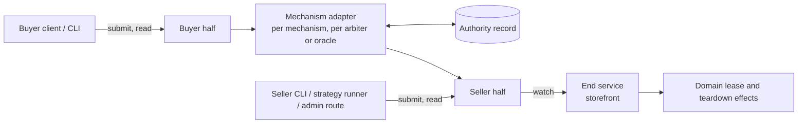

## Context

What exists today (evidence for the decisions below, not a specification):

- **Negotiation and settle.** Negotiation is buyer-driven signed rounds. The seller's responses authenticate the seller principal in transit, and accepted terms keep the exact buyer and seller parties (`negotiation-protocol`, "Principal-bound negotiation history"). The buyer client verifies the seller's signed acceptance and keeps only its payload (`core/buyer/src/core_buyer/negotiation_client.py`); the storefront stores negotiation messages without the request proof. Settle is a core storefront route with a core typed-client method, `settle_agreement`. `Agreement` is `extra: "forbid"` and carries the full selected `SettlementOption`, whose `params` are mechanism-owned and opaque to core. Core defines no universal Agreement hash.
- **Heartbeats.** The storefront stores a heartbeat's principal, timestamp, and payload, not its signature (`core/storefront/src/core_storefront/heartbeats.py`). A stored heartbeat is the seller's record that one arrived, not buyer-signed evidence.
- **Alkahest.** An obligation's committed content is its arbiter and `DemandData`. The default recipient arbiter's demand is `{recipient}`; the trusted-oracle and splitter demands are `{oracle, data}`. An interruptible listing builds a `vms.interruptible.v1` term with a splitter whose oracle is the first configured `interruptible_oracle_addresses` entry: the seller wallet by default, possibly a third party. The term nevertheless hard-codes `refund_authority: seller_declared`. A storefront-wide `[Settlement.alkahest].interruptible` flag marks every listing interruptible, whatever its options.
- **Interruption today.** The VM interrupt endpoint is gated by the storefront admin key and an administrator principal, so its caller is the seller's own staff or automation. It truncates the capacity lease (minute precision) and returns `splitter_declaration_pending` for the money side. Terminal hosted settlement truncates the lease from the other direction (`truncate_lease_for_terminal_settlement`). Bare metal has a buyer-authenticated `POST /api/v1/fulfillments/{negotiation_id}/teardown` that ends the lease at once with no money side, and ends the lease on an uncollected terminal obligation through `terminate_lease`. A truncated lease is released when provisioning's lease watchdog next polls (60 seconds by default). Leases can be shortened, never extended.
- **Hosted payments** (the `arkhai.payments.v1` mechanism). The facts below are those of the payments contract `spot-deals-through-arkhai-payments` builds on; the contract vendored in `kit/arkhai-payments/schema` has `once` parts only and no stop cause, funded-through, or rate part.
  - **Commitment.** The seller derives the mandate from the exact Agreement bytes; `mandate.deal` is `sha256(JCS(Agreement))`. The payer commits by approving it with an authenticated request. The Agreement can be attached to the transaction.
  - **Events.** `start`, `stop`, and `reverse` are authenticated requests from accounts the mandate lists for that kind. `derive_mandate` hard-codes `start` and `stop` to both parties. A stop names its cause: payer, payee, authority, or terms. Billing periods count from `start`; the first batch is reserved at approval.
  - **Settlement.** A stop takes effect when received and cannot be future-dated. Funding exhaustion stops the transaction at the last paid boundary with cause "terms". The signed snapshot carries events, the stop record, settled amounts, and a funded-through time. SCM does not yet verify snapshot proofs.
  - **Disputes.** The mandate lists a dispute authority allowed to `reverse`; no automated one exists. Deals through the official Arkhai registry are mediated by Arkhai, manually today.

## Decisions

The decisions were revised after the first design-review round; `Status` maps the earlier numbering.

### D1. The protocol is what a party must do to continue

A step is protocol when refusing it leaves a party unable to continue:

1. **Discovery:** without the registry's schema a buyer finds no listings.
2. **Negotiation:** without the negotiation schema the parties reach no agreement.
3. **Commitment:** the single act, defined by the mechanism, that makes the agreement binding (D2). Hosted: the payer's mandate approval. Alkahest: the escrow obligation on chain. Asynchronous peer-to-peer: the countersignature.

After commitment, refusing to continue is a broken obligation, no different from breaking a later clause, and it is visible only through the evidence it leaves. Everything after commitment, including the buyer's settle handoff, is post-commitment lifecycle (D6). Core keeps the registry, negotiation, and the schema-opaque agreement and commitment carriers. The settle route and `settle_agreement` move out of core to the lifecycle kit as the `commit` event.

### D2. The committed agreement is defined by the mechanism

The agreement is what is enforceable in arbitration, `arbitrate(demand, evidence)`, and its form is the arbitration mechanism's:

| Mechanism | Committed agreement | Commitment reference |
|---|---|---|
| Alkahest | The arbiter and its `DemandData` | Escrow obligation UID |
| Hosted payments | The payments service's Agreement: the mandate, with the negotiated Agreement attached and hashed into `mandate.deal` | Transaction ID |
| Asynchronous peer-to-peer | The countersigned negotiated Agreement | Its signature digest |

- **The negotiated Agreement is the input.** Each mechanism derives its committed form from it. Before committing, the buyer verifies that the committed form is that mechanism's derivation of the negotiated terms. This generalizes today's exact-release-condition check rather than relaxing it.
- **No universal agreement identity.** Committed agreements are not compatible across mechanisms in general; two mechanisms may be designed to be. `negotiation-protocol`'s "no universal Agreement hash" stays. The lifecycle layer treats the commitment reference as opaque.
- **A clause binds only if the committed form encodes it.** Hosted: mandate authorities, parts, and the notice event (D7). Alkahest: the arbiter's `DemandData`. Today's oracle and splitter demands carry only an oracle address, so on the current Alkahest path interruption terms are enforceable only through off-chain mediation (D11).

### D3. Later information is evidence, not protocol

Information exchanged after commitment is not committed or carried by the protocol unless a dispute arises. The agreement's regime defines which of it can become evidence. Each party keeps what its regime expects it to submit (D9).

### D4. A clause is admissible if its named adjudicator can decide it

- **Decidable.** The agreement names the regime that decides each clause. For deals through the official Arkhai registry the default regime is **optimistic, Arkhai-adjudicated**: parties act, and Arkhai resolves disputes. "The buyer received a working VM" is admissible under it. A deal through another registry names its own adjudicator, or none and says so.
- **Reachable.** Before committing, each party checks it can take part in the named regime. The buyer client validates the committed form against the advertised option (D2).
- **Negotiable.** The regime is a negotiable, possibly priced, part of the terms.

### D5. The early-termination clause

The clause is a kit-defined sub-object inside each settlement option's `params`, so it is part of the Agreement bytes and chosen per option. The option builder for a mechanism and arbiter emits it only when the option's part shape and arbiter can end early; a hosted `once` part cannot, a `rate` part can. Our two mechanisms share the codec by choice. The listing-wide interruptible flag is removed, and the registry exposes a filterable field derived from the options.

```json
{
  "option_id": "opt_…",
  "mechanism": "arkhai.payments.v1",
  "asset": "USD/6",
  "rates": [{"field": "amount", "per": "minute", "value": "1200"}],
  "params": {
    "payee_account": "acct_seller_example",
    "reserve_ahead_seconds": 300,
    "early_termination": {
      "version": 1,
      "regime": "optimistic.arkhai",
      "entitlements": {
        "payer": {"notice_seconds": 0, "settles_through": "stop+exposure"},
        "payee": {"notice_seconds": 120, "settles_through": "stop"}
      },
      "exposure_seconds": 300,
      "max_term_seconds": 2592000
    }
  }
}
```

- **Entitlements are the stop authorities.** An entitlement per initiator states notice and settlement rule; the mechanism's stop authorities are derived from it and nothing else. An on-demand option has no `payee` entitlement and the seller is not a stop authority.
- **Exceptional ends are disputes.** A seller whose hardware fails on a deal it may not stop does not stop; the buyer's remedy is a dispute, and the cooperative version is the seller conceding on the buyer's behalf (D6). One mechanism serves both.
- **Exhaustion is a cause, not an initiator.** The authority records it; no entitlement is needed.
- **Buyer stops settle through the seller's exposure.** A buyer stop at *t* settles through *t* plus the declared `exposure_seconds` (D8), so the seller's unpaid window is bounded by terms, not by its polling.
- **Notice is posted at the authority** (D7).
- **Initiator-dependent rules are terms the mechanism applies,** never an intermediary sending compensating refunds.

### D6. Post-commitment lifecycle: one interface on each side of the mechanism

Every post-commitment action is a **lifecycle event** with a uniform shape on both sides, and the mechanism sits between them:



- **Event:** `{commitment_ref, kind, actor, at, cause, authority_record_ref, payload}`. Kinds: `commit`, `start`, `notice`, `stop`, `dispute`, `concede`; `extend` is reserved for top-up.
- **Buyer half:** `submit(event)` and `read(commitment_ref)`. The buyer client never branches on mechanism.
- **Seller half:** `submit`, `read`, and `watch(commitment_ref)`, which yields events from the authority's record. End service consumes only `watch`. Provisioning never sees the mechanism.
- **Adapters** resolve through the domain's role table, keyed by negotiation ID and the Agreement's mechanism, not through the escrow-client port. Within a mechanism they dispatch per arbiter, and per oracle or oracle schema for oracle-backed arbiters, because oracles need not behave alike and are usually reached out of band. An arbiter with no early-end adapter cannot carry the clause. Hosted: `stop`, `start`, and dispute calls with idempotency keys like `reverse`'s, and `read`/`watch` from the verified signed snapshot. Alkahest: through its own port, ordered with `move-escrow-into-alkahest`; with the seller's wallet as oracle the authority is local.
- **The seller's own capability.** The seller half is exposed as seller-authenticated `submit` and `read` routes on the storefront, keyed by commitment reference. The seller CLI, the strategy runner of `automate-seller-spot`, and a dry-run planner built on `read` call it; the VM admin interrupt route becomes one more caller and loses its own lease and split logic.
- **Placement.** The neutral layer (event model, clause codec, evidence store, route contracts and typed client, end-service orchestration) is a new kit, working name `kit/deal-lifecycle`, because two domains consume it. Adapters live in the mechanism kits, as alternative implementations of one slot. The domain supplies lease and teardown effects through a narrow port, so a later merge of the VM and bare-metal domains does not entangle the kit with either.

### D7. The authority's record decides; parties act there

An early end, a start, a notice, or a dispute is an action by an entitled party, with its own credentials, at the authority the agreement names. The authority's record is the only authoritative statement of what happened. Holding a handle grants no permission.

- **Funds move only after a seller action that begins or completes service.** Hosted: `start` authority is the payee alone, and the seller calls it when service begins; an unstarted mandate's hold is released when its window expires. Alkahest: the seller's claim. A buyer who commits and never sends the `commit` handoff only locks its own funds, so the buyer is always the one who needs to notify; the seller need not watch for commitments.
- **Notice is hosted by the authority.** A seller reclaim with notice posts a `notice` event; the period runs from the authority's record, and the authority rejects a seller stop before notice plus period. The current Alkahest path cannot enforce a notice period; the specialized arbiter of D13 would.
- **Courtesy.** Our implementations tell the counterparty after acting: the buyer's client after a stop, the seller after a notice or reclaim. A buyer may include an optional webhook in its `commit` handoff; delivering to it needs an egress guard and is not part of this change. Courtesy notices are hints that bring a read forward.

### D8. End service at T

End service is the storefront operation that consumes lifecycle events and drives the domain's lease effects.

- **Lease term.** A deal that runs until stopped carries a maximum term, and its lease ends at that term. The storefront enforces the funded-through time and stop records; the lease end is the backstop. This is the only form enforceable with on-chain settlement.
- **Primitive.** When *T* is now or past, terminate the lease (bare metal's `end_lease` is the precedent). When *T* is later, truncate it at full precision.
- **Exposure.** The declared `exposure_seconds` covers the seller's whole window: polling interval, the watchdog interval when truncating, and teardown.
- **Liveness is the seller's risk.** With the storefront down or its lifecycle loops paused, the seller serves unpaid until the lease's maximum end; the buyer is not harmed.
- **Bare metal.** The buyer teardown route becomes an end-service call with the buyer as actor. It ends delivery only; payment stops only at the authority.
- **Extension** (top-up) is deferred with the `extend` kind; leases cannot be extended today.

### D9. Each party keeps its evidence

A kit-owned evidence store, keyed by commitment reference, keeps exact bytes, separate from replay state and never pruned with it.

- **Always:** the commitment envelopes. The buyer keeps the seller's signed acceptance (proof headers and exact body); the seller keeps the buyer's signed accepting request.
- **By regime:** authority records the party receives (hosted receipts and snapshots, on-chain references), and signed heartbeats where the clause names them.
- **Dependencies:** `version-accepted-artifacts` for exact bytes and their evolution; the signer's principal history across key rotation, recorded here and not solved.

### D10. A dispute is one case payload

A dispute is one self-contained payload: the bundle a party exports and attaches when it files, and the payload of the `dispute` and `concede` events.

- **Case:** the commitment reference, the committed agreement or where to fetch it, the clause, the claim, the requested outcome, and ordered evidence items.
- **Evidence item:** an evidence-store record: kind, producer, time, content digest, and the exact original bytes or the authority's signed record. Mechanism records are referenced, not copied into a parallel format.
- **Sketch only:** fields that only automated adjudication needs, such as attestation normalization. They become normative with the change that automates adjudication.
- **File and concede are in scope.** A conceded dispute needs no adjudicator; the authority applies it mechanically, as it records a stop. Contested cases go to Arkhai's mediation.

### D11. Adjudication is optimistic; automation is deferred

Arkhai already resolves disputes for deals through its registry, manually. The deferred dispute authority automates certain cases of this, and is built together with a managed metering gateway that produces the delivery evidence it would decide on. Remedies differ by mechanism: on hosted payments a ruling applies through `reverse` while funds are held; on the current Alkahest path a declared split cannot be undone on chain, so remedies are off-chain.

### D12. Design for the adversarial worst case; default to cooperation

- **Safety depends only on authority records** and a party's own kept records, never on a message the counterparty may withhold. The seller reads the authority for stops; the buyer reads it for notices and reclaims.
- **Exposure is bounded by agreed terms.** Exhaustion: reserve-ahead covers the seller's exposure while funded-through stops advancing. Buyer stop: the exposure tail (D5). Silent commitment: no charge until the seller starts (D7). Churn: each stopped deal pays at least the exposure tail; the seller may add a setup `once` part, and since a seller need not accept every negotiation, a DoS guard or blocklist belongs in its negotiation acceptance policy.
- **Defaults cooperate.** Our implementations send courtesy notices and end service promptly. Courtesy messages are idempotent hints that trigger a read, so a forged one does nothing.
- **Choose flows for the worst case:** one authority, one record, a bounded exposure window.

### D13. Hosted payments first; a neutral trustless alternative must stay possible

- **Production first.** The hosted mechanism is made complete and production-quality first.
- **Alkahest is at the user's own risk.** It is maintained so that every managed component has a feasible trustless alternative, not offered as production-ready. Before it is, optimistic mediation would be a specialized arbiter contract, more specific than `TrustedOracleArbiter`, possibly heartbeat-signature based, whose `DemandData` encodes the clause and accepts posted notices.
- **The test** for a decision is whether a neutral arbiter (another oracle, or a signature-based arbiter) could implement it. A decision fails if only a managed service can hold the evidence or act, if evaluation needs data only a managed party can produce, or if the commitment cannot be expressed on chain or as exchanged signatures. D2's mechanism-defined agreement, D7's authority-hosted notice, and D9's kept signed bytes all pass it.

### D14. Message sequence and information placement

1. **Discovery.** The buyer queries the registry.
2. **Negotiation.** Rounds run until the seller's signed acceptance of the negotiated Agreement.
3. **Commitment.** The mechanism derives its committed form; the buyer verifies and commits (D2).
4. **Post-commitment exchange.** The buyer's `commit` handoff carries the commitment reference and anything the seller needs that is not in the agreement. The seller starts service and replies, possibly asynchronously, with access details and action handles.

| Information | Placement |
|---|---|
| Known before agreement, must bind both parties | Agreement |
| Known before agreement, not sensitive, acceptable to hold for uncommitted deals | May ride in the agreement to save an exchange (for example an SSH public key) |
| Personal or secret | Revealed after commitment, never in the agreement |
| Created by settlement | The authority's record |
| Created by fulfillment | Fulfillment result |

For an interruptible VM deal on hosted payments:

```mermaid
sequenceDiagram
    autonumber
    participant B as Buyer
    participant R as Registry
    participant S as Storefront (seller)
    participant P as Hosted payments (authority)
    participant X as Site / provisioning

    rect rgb(235, 242, 255)
    Note over B,P: Protocol
    B->>R: listing query
    R-->>B: listings: VM shape, arkhai.payments.v1 option with early_termination clause
    B->>S: signed proposal: VM terms incl. ssh_public_key, chosen option
    S-->>B: signed acceptance: negotiated Agreement bytes, plus mandate derived from them (mandate.deal = sha256(JCS(Agreement)))
    B->>B: verify mandate is the derivation of the Agreement; keep acceptance as evidence
    B->>P: approve mandate (+ Agreement attachment)
    P-->>B: signed receipt, transaction id
    end

    rect rgb(240, 248, 236)
    Note over B,X: Post-commitment lifecycle
    B->>S: commit: transaction id
    S->>P: read verified snapshot: approval, deal hash
    S->>X: reserve capacity, provision (lease end = max term)
    S->>P: start (payee only)
    S-->>B: (async) access: host, port, handle
    loop while service runs
        S->>P: watch: serve until funded-through
    end
    end

    alt buyer stop
        B->>P: stop (payer entitlement)
        B-->>S: courtesy notice
        S->>P: watch: stop record, settled through stop + exposure
    else seller reclaim
        S->>P: notice (payee entitlement)
        S-->>B: courtesy notice
        B->>P: read: notice record, effective time
        S->>P: stop at or after notice + period
    else funds exhausted
        P->>P: stop at last funded boundary, cause terms
        S->>P: watch: stop record
    else exceptional end
        S->>P: concede on the buyer's behalf (case payload)
        S->>P: watch: stop record, cause dispute
    end
    S->>X: end service at T
```

### D15. Scope and related changes

- **This change:** D1–D14, `kit/deal-lifecycle`, moving settle out of core, the bare-metal teardown route, a hosted adapter, and an adapter for the current Alkahest path, each limited to what its mechanism supports today, on-demand first.
- **`spot-deals-through-arkhai-payments`:** the hosted rate part and reserve-ahead, implemented against this change's kit, with the amendments in its proposal. It depends on this change.
- **`automate-seller-spot`:** rescoped to the strategy runner as a caller of the seller half. It depends on both.
- **Deferred:** the automated dispute authority, the metering gateway, and the specialized Alkahest arbiter.

## Dependencies on the hosted payments service

To be confirmed against the payments contract and vendored through `kit/arkhai-payments/schema/SOURCE.md`:

- Rate parts, funded-through, reserve-ahead, and stop causes (as in `spot-deals-through-arkhai-payments`).
- Payee-only `start`, and release of an unstarted mandate's hold when its window expires.
- A `notice` event and rejection of entitled stops before notice plus period.
- A payer stop that settles through the declared exposure.
- File and concede of a dispute, applied mechanically when conceded.
- Snapshot-proof verification in SCM before snapshot state is read as evidence.

## Alternatives considered

- **Interruption as a core verb, or settle as protocol.** Rejected (D1): neither is required to continue.
- **A universal agreement digest across mechanisms.** Rejected (D2): the committed agreement is the mechanism's.
- **Clause in `provision_terms` or a new top-level Agreement field.** Rejected (D5): per listing rather than per option, or a protocol version bump for every party.
- **Broad stop authorities with breach classification.** Rejected (D5): it mixes contractual and exceptional ends; exceptional ends are disputes.
- **Early end on the conditional-escrow port.** Rejected (D6): hosted payments never implements it, and it is becoming Alkahest-internal.
- **A buyer-stop relay route on the storefront.** Rejected (D6): the buyer submits to the authority.
- **A lease that tracks funded-through and is extended.** Rejected (D8): a dead storefront would tear down a VM the buyer is still paying for.
- **Notice by waiting before the stop, or pushed to a buyer address.** Rejected (D7): no record the authority can check.
- **Retaining nothing until a dispute authority exists.** Rejected (D9): signatures not kept on arrival cannot be recovered.

## Open questions

- **Event fields and idempotency.** Exact fields per kind, and the idempotency rule when `at` changes. Settled in planning.
- **Defaults.** Must every clause state its regime's default outcome, or may a regime declare it once?
- **Naming.** Early termination, interruption, or another name; whether "spot" and "interruptible" remain user-facing presets.
- **Payee commitment lookup.** Whether the payee can list transactions by mandate deal hash, useful as a backstop read though not required (D7).
- **Case transport.** Where an automated authority receives a case, and how privately held evidence is disclosed only to it, deferred with D11.

## Status

Design, second round. Earlier numbering: old D1 → D1; D2 and D9 → D2; D3 → D3; D4 → D4; D5 → D5; D6 → D6 and D8; D7 → D7; D8 → D14; D10 → D10; D11 → D11; D12 → D12; D13 → D13. New: D9, D15. Next: a second design review, then spec deltas and `tasks.md`, which must include a hosted end-to-end scenario covering buyer stop, seller reclaim with notice, funding exhaustion, and a conceded dispute.
