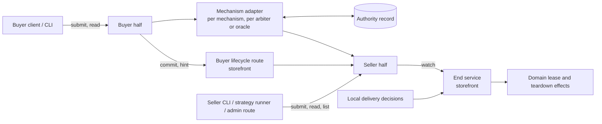
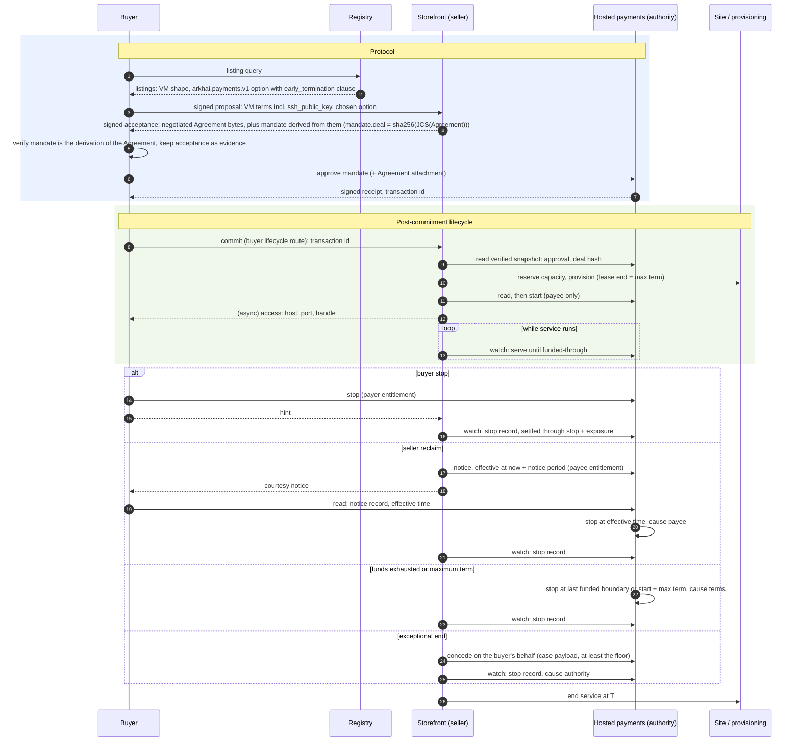

## Context

What exists today (evidence for the decisions below, not a specification):

- **Negotiation and settle.** Negotiation is buyer-driven signed rounds. The seller's responses authenticate the seller principal in transit, and accepted terms keep the exact buyer and seller parties (`negotiation-protocol`, "Principal-bound negotiation history"). The buyer client verifies the seller's signed acceptance and keeps only its payload (`core/buyer/src/core_buyer/negotiation_client.py`); the storefront stores negotiation messages without the request proof. Settle's contract is core's: the route table `settlement_routes` (`SETTLE` in its negotiation and Alkahest `escrow_uid` forms, `SETTLE_STATUS`, `REFUND`), its response models, and the typed-client method `settle_agreement`. Each domain storefront (VM, bare metal, API credits) mounts it, and VM seller response signing binds it. `Agreement` is `extra: "forbid"` and carries the full selected `SettlementOption`, whose `params` are mechanism-owned and opaque to core. Core defines no universal Agreement hash.
- **Heartbeats.** The storefront stores a heartbeat's principal, timestamp, and payload, not its signature (`core/storefront/src/core_storefront/heartbeats.py`). A stored heartbeat is the seller's record that one arrived, not buyer-signed evidence.
- **Alkahest.** An obligation's committed content is its arbiter and `DemandData`. The default recipient arbiter's demand is `{recipient}`; the trusted-oracle and splitter demands are `{oracle, data}`. An interruptible listing builds a `vms.interruptible.v1` term with a splitter whose oracle is the first configured `interruptible_oracle_addresses` entry: the seller wallet by default, possibly a third party. The term nevertheless hard-codes `refund_authority: seller_declared`. A storefront-wide `[Settlement.alkahest].interruptible` flag marks every listing interruptible, whatever its options.
- **Interruption today.** The VM interrupt endpoint is gated by the storefront admin key and an administrator principal, so its caller is the seller's own staff or automation. It truncates the capacity lease (minute precision) and returns `splitter_declaration_pending` for the money side. Terminal hosted settlement truncates the lease from the other direction (`truncate_lease_for_terminal_settlement`). Bare metal has a buyer-authenticated `POST /api/v1/fulfillments/{negotiation_id}/teardown` that ends the lease at once with no money side, and ends the lease on an uncollected terminal obligation through `terminate_lease`. A truncated lease is released when provisioning's lease watchdog next polls (60 seconds by default). Leases can be shortened, never extended.
- **Seller refund and reconciliation.** The seller reverses a hosted payment through `POST /api/v1/settlements/{negotiation_id}/refund`. Every storefront composing hosted payments runs a reconciliation pass that advances approved deals a buyer never settled (`kit/arkhai-payments/src/market_arkhai_payments/reconciliation.py`).
- **Hosted payments** (the `arkhai.payments.v1` mechanism). The facts below are those of the payments contract `spot-deals-through-arkhai-payments` builds on; the contract vendored in `kit/arkhai-payments/schema` has `once` parts only and no stop cause, funded-through, or rate part.
  - **Commitment.** The seller derives the mandate from the exact Agreement bytes; `mandate.deal` is `sha256(JCS(Agreement))`. The payer commits by approving it with an authenticated request. The Agreement can be attached to the transaction.
  - **Events.** `start`, `stop`, and `reverse` are authenticated requests from accounts the mandate lists for that kind. `derive_mandate` hard-codes `start` and `stop` to both parties. A stop names its cause: payer, payee, authority, or terms. Billing periods count from `start`; the first batch is reserved at approval.
  - **Settlement.** A stop takes effect when received and cannot be future-dated. Funding exhaustion stops the transaction at the last paid boundary with cause "terms". The signed snapshot carries events, the stop record, settled amounts, and a funded-through time. SCM does not yet verify snapshot proofs.
  - **Disputes.** The mandate lists a dispute authority allowed to `reverse`; no automated one exists. Deals through the official Arkhai registry are mediated by Arkhai, manually today.

## Decisions

The decisions were revised after the second design-review round; `Status` lists what changed.

### D1. The protocol is what a party must do to continue

A step is protocol when refusing it leaves a party unable to continue:

1. **Discovery:** without the registry's schema a buyer finds no listings.
2. **Negotiation:** without the negotiation schema the parties reach no agreement.
3. **Commitment:** the single act, defined by the mechanism, that makes the agreement binding (D2). Hosted: the payer's mandate approval. Alkahest: the escrow obligation on chain. Asynchronous peer-to-peer: the countersignature.

After commitment, refusing to continue is a broken obligation, no different from breaking a later clause, and it is visible only through the evidence it leaves. Everything after commitment, including the buyer's settle handoff, is post-commitment lifecycle (D6). Core keeps the registry, negotiation, and the schema-opaque agreement and commitment carriers.

Moving the settle contract out of core is its own change, `move-settle-out-of-core`, because it moves one shared route table (`SETTLE`, `SETTLE_STATUS`, `REFUND`), touches three domains and VM response signing, and overlaps `move-escrow-into-alkahest`'s ownership of the Alkahest settle path. This change adds the lifecycle routes beside it (D6) and leaves settle where it is.

### D2. The committed agreement is defined by the mechanism

The agreement is what is enforceable in arbitration, `arbitrate(demand, evidence)`, and its form is the arbitration mechanism's:

| Mechanism | Committed agreement | Commitment reference |
|---|---|---|
| Alkahest | The arbiter and its `DemandData` | Escrow obligation UID |
| Hosted payments | The payments service's Agreement: the mandate, with the negotiated Agreement attached and hashed into `mandate.deal` | Transaction ID |
| Asynchronous peer-to-peer | The countersigned negotiated Agreement | Its signature digest |

- **The negotiated Agreement is the input.** Each mechanism derives its committed form from it. Before committing, the buyer verifies that the committed form is that mechanism's derivation of the negotiated terms. This generalizes the buyer's existing check (`buyer-orchestration`, "Payment buyers approve and settle by negotiation") rather than relaxing it.
- **No universal agreement identity.** Committed agreements are not compatible across mechanisms in general; two mechanisms may be designed to be. `negotiation-protocol`'s "no universal Agreement hash" stays. The lifecycle layer treats the commitment reference as opaque.
- **A clause binds only if the committed form encodes it.** Hosted: mandate authorities, parts, and the notice event (D7). Alkahest: the arbiter's `DemandData`. Today's oracle and splitter demands carry only an oracle address, so Alkahest options carry no early-termination clause until the specialized arbiter of D13 exists.

### D3. Later information is evidence, not protocol

Information exchanged after commitment is not committed or carried by the protocol unless a dispute arises. The agreement's regime defines which of it can become evidence. Each party keeps what its regime expects it to submit (D9).

### D4. A clause is admissible if its named adjudicator can decide it

- **Decidable.** The agreement names the regime that decides each clause. For deals through the official Arkhai registry the default regime is **optimistic, Arkhai-adjudicated**: parties act, and Arkhai resolves disputes. "The buyer received a working VM" is admissible under it. A deal through another registry names its own adjudicator, or none and says so.
- **Reachable.** Before committing, each party checks it can take part in the named regime. The buyer refuses an option whose regime it does not recognize (D5). Regime identifiers are a closed vocabulary the buyer client ships, not free strings it trusts.
- **Chosen per option.** A buyer cannot change seller-owned option params, so choosing a regime means choosing among options; a seller may price them differently.

### D5. The early-termination clause

The clause is a sub-object under the `early_termination` key of each settlement option's `params`, so it is part of the Agreement bytes and chosen per option. The key and field names are fixed here because they are hashed into option IDs. "Spot" and "on-demand" are option-builder presets and user-facing labels, not wire names.

The builder for a mechanism and part shape emits the clause only when that shape can end early: a hosted `rate` part can; a hosted `once` part and every current Alkahest arbiter cannot (D2). The listing-wide `[Settlement.alkahest].interruptible` flag is replaced by option-scoped configuration. The Alkahest splitter option keeps its current service terms and the admin interrupt route keeps serving it, as the seller-trusted path, until the specialized arbiter exists.

```json
{
  "option_id": "opt_…",
  "mechanism": "arkhai.payments.v1",
  "asset": "USD/6",
  "rates": [{"field": "amount", "per": "minute", "value": "1200"}],
  "params": {
    "payee_account": "acct_seller_example",
    "reserve_ahead_seconds": 300,
    "early_termination": {
      "version": 1,
      "regime": "optimistic.arkhai",
      "entitlements": {
        "payer": {"notice_seconds": 0, "settles_through": "stop+exposure"},
        "payee": {"notice_seconds": 120, "settles_through": "stop"}
      },
      "exposure_seconds": 300,
      "max_term_seconds": 2592000,
      "concession": {"settles_through": "end", "refund": "unserved"}
    }
  }
}
```

- **Entitlements are the stop authorities.** An entitlement per initiator states notice and settlement rule; the mechanism's stop authorities are derived from it and nothing else. An on-demand option has no `payee` entitlement and the seller is not a stop authority.
- **Exceptional ends are disputes, with a floor.** A seller whose hardware fails on a deal it may not stop does not stop; the buyer's remedy is a dispute, and the cooperative version is the seller conceding on the buyer's behalf (D10). A concession is a stop no entitlement grants, so the clause's `concession` states the least it must give, and the authority rejects a lesser one. The floor is at least no charge after the concession's end time and a refund of reserved but unserved funds. A seller-caused end therefore costs the seller more than an entitled stop would.
- **Authority causes need no entitlement.** Funding exhaustion stops at the last funded boundary, and the maximum term stops at `start + max_term_seconds`; the authority applies both with cause "terms". Billing therefore cannot outlive the lease (D8), whether or not the seller is a stop authority or its storefront is alive.
- **Buyer stops settle through the seller's exposure.** A buyer stop at *t* settles through *t* plus `exposure_seconds` (D8), so the seller's unpaid window is bounded by terms, not by its polling.
- **Notice is a scheduled stop at the authority** (D7).
- **Initiator-dependent rules are terms the mechanism applies,** never an intermediary sending compensating refunds.

Clause semantics:

| Input | Meaning |
|---|---|
| No clause | No early-end entitlement. Stop authorities are the mechanism's defaults for that part shape; for a hosted `once` part these are unchanged by this change. |
| Unknown `version`, unknown `regime`, unknown initiator key or `settles_through` value | The buyer refuses the option; the builder refuses to emit it. |
| Empty `entitlements` | Refused at publication; omit the clause instead. |
| `max_term_seconds` versus Agreement `duration_seconds` | Must be equal until a schema change replaces the fixed-term fields (`spot-deals-through-arkhai-payments`, "Known mismatch"). |
| `reserve_ahead_seconds` versus `exposure_seconds` | `reserve_ahead_seconds ≥ exposure_seconds`, enforced by the builder and by the buyer's validation. |
| Missing `concession` | The floor above applies. |

**Discovery.** Early termination is filtered per option, not per listing, because a buyer selects one option. Each mechanism registration projects typed fields from its clause into the settlement query language (for example `early_termination.payer`, `early_termination.payee.notice_seconds`), evaluated per option on the buyer side. The registry schema does not change.

**Rollout.** An older buyer facing a newer seller fails closed at the mandate check, since the derived authorities differ. Storefronts and buyer clients upgrade together; there is no backwards-compatibility promise.

### D6. Post-commitment lifecycle: one interface on each side of the mechanism

Every post-commitment action goes through a uniform interface on both sides, and the mechanism sits between them:



**Two kinds of record.**

- **Authority events** are the authority's record: `start`, `notice`, `stop`, `reverse`, `dispute`, `concede`, and stops the authority applies itself (exhaustion, maximum term, a matured notice). Shape: `{negotiation_id, commitment_ref, kind, actor, at, cause, sequence, authority_record_ref, payload}`. `extend` is reserved for top-up.
- **Peer messages** are buyer-to-seller and have no authority record: `commit` (the commitment reference and post-commitment information, D14) and `hint` (a courtesy notice that the buyer acted). They are kept as evidence and acted on only after a read of the authority.

**Commands and outcomes.** `submit` takes a command, never an event: `{negotiation_id, kind, operation_key, at, payload}`. Its outcome is `accepted` (with the resulting authority record), `rejected` (with the authority's reason), `pending`, or `unknown` (transport failure). An `unknown` outcome is resolved by `read`, never by assuming either result. The operation key is stable across retries; a retry with the same key and different content is rejected locally. The adapter passes the key as the authority's idempotency key, as hosted `reverse` does today. Which actor may submit which kind is the mechanism's authorities (D5, D7).

**Buyer half:** `submit` and `read(negotiation_id)`, through the domain's buyer stage table, which already dispatches by mechanism; core buyer code does not bind the kit.

**Seller half:**

- `submit` and `read(negotiation_id)`.
- `list`: the seller's deals with a commitment, bounded pages with a continuation token, each with negotiation ID, commitment reference, domain, mechanism, entitlements, lifecycle state (unstarted, running, ending, ended, repair required) and the current deadline. An empty page is not an error. This is the active-deal view `automate-seller-spot` builds on.
- `watch(negotiation_id)` yields first the current state (the latest authority events and the funded-through deadline), then each later authority event and deadline change in authority sequence order. Its cursor is the authority's per-transaction event sequence, stored durably per deal and acknowledged after end service records the effect; restart replays from the stored cursor. Repeated events are harmless because end service is idempotent.

**Routes.** Both halves are exposed on the storefront as a lifecycle route contract with its own client package:

- seller-authenticated `submit`, `read`, `list`, using the existing administrator-principal contract the interrupt route uses;
- a buyer-authenticated route for peer messages (`commit`, `hint`), authenticated as the negotiation's buyer principal. For hosted options the buyer half sends `commit` here; until `move-settle-out-of-core` lands the storefront's handler shares the settle handler's implementation, and the settle route keeps serving its other callers. There is still no buyer relay to the authority: buyer stops go to the authority.

The seller CLI, the strategy runner, a dry-run planner built on `read` and `list`, and the VM admin interrupt route for hosted deals call the seller half.

**Adapters** resolve through the domain's role table, keyed by negotiation ID and the Agreement's mechanism, not through the escrow-client port. Within a mechanism they dispatch per arbiter, and per oracle or oracle schema for oracle-backed arbiters. A part shape or arbiter with no early-end adapter cannot carry the clause. This change ships the hosted adapter; adapters stay stateless, since the payments kit holds no servicing daemon. An Alkahest adapter waits for the specialized arbiter (D13).

**Refund and reconciliation.**

- The seller's refund becomes a `reverse` lifecycle command. The refund route remains until `move-settle-out-of-core` retires it.
- The reconciliation pass stays, as the backstop that finds commitments a buyer never reported. Since only the seller can `start` (D7), it is a convenience for the seller, not a safety requirement.

**Packaging.** The neutral layer is market-neutral, so it lives in kits split by kind and area:

| Package | Area and kind | Holds |
|---|---|---|
| `kit/deal-lifecycle` | Foundation library | Event, command and outcome models; clause codec and semantics; adapter protocol; case payload; evidence record types |
| `kit/deal-lifecycle-contracts` | Contracts | Lifecycle route contracts and response models |
| `kit/deal-lifecycle-client` | Client | Typed client for the routes |
| `kit/deal-servicing` | Storefront-side library, beside `kit/capacity-publication` | End service, `watch` loops and cursors, the evidence store |

Mechanism kits depend on the foundation library only. `watch` loops run under `kit/storefront`'s loop controller. Their cursors are lifecycle observation state, not a payment ledger, so "Marketplace roles hold no payment ledger" is amended to say so. The domain supplies lease and teardown effects through a narrow port, so a later merge of the VM and bare-metal domains does not entangle the kits with either.

### D7. The authority's record decides; parties act there

An early end, a start, a notice, or a dispute is an action by an entitled party, with its own credentials, at the authority the agreement names. The authority's record is the only authoritative statement of what happened. Holding a handle grants no permission.

- **Funds move only after a seller action that begins service.** Hosted: `start` authority is the payee alone, and the seller calls it when service begins; an unstarted mandate's hold is released when its window expires. A buyer who commits and never sends `commit` locks only its own funds, so the buyer is always the one who needs to notify.
- **Start after provisioning.** The seller reads the authority, provisions, reads again, then sends `start`. If the payer stopped meanwhile, or `start` is rejected, end service terminates the provisioned resource, found by negotiation ID. A crash between provisioning and `start` resumes from the operation journal with the same decision. The pre-start window is the seller's risk; a seller who wants cover adds a setup `once` part.
- **Notice is a scheduled stop hosted by the authority.** A seller reclaim posts one `notice` with an effective time no earlier than now plus the entitlement's `notice_seconds`. The authority applies the stop itself at that time, with cause payee. This is the only future-dated stop. The seller sends one message, and the buyer is protected even if the seller never acts again.
- **Courtesy.** Our implementations tell the counterparty after acting: the buyer's client sends a `hint` after a stop, and the seller after a notice. A buyer may include an optional webhook in its `commit`; delivering to it needs an egress guard and is not part of this change. Hints bring a read forward and do nothing else.

### D8. End service at T

End service is the storefront operation that drives the domain's lease effects. Its input is "end delivery at *T*", with actor, cause, and source.

- **Sources.** Authority events through `watch` (a stop, a matured notice, a funded-through deadline), and local delivery decisions: bare metal's buyer teardown route, a failed start (D7), and the existing terminal-settlement paths, the VM's `truncate_lease_for_terminal_settlement` and bare metal's lease end on an uncollected terminal obligation. All of them route through end service.
- **Local decisions do not move money.** Bare metal's buyer teardown ends delivery and the buyer keeps paying; payment stops only at the authority. Its record is the buyer's signed teardown request, kept in the evidence store.
- **Earliest wins.** Repeated requests for one deal take the earliest *T*, matching `truncate_lease`'s earlier-only rule. Each effect is journaled and retried until done.
- **Lease term.** A deal that runs until stopped carries a maximum term, and its lease ends at that term, the same instant the authority stops billing (D5). The funded-through time and stop records end it earlier.
- **Primitive.** When *T* is now or past, terminate the lease (bare metal's `end_lease` is the precedent). When *T* is later, truncate it at full precision.
- **Exposure.** `exposure_seconds` covers the seller's whole window: polling interval, the watchdog interval when truncating, and teardown. A seller must configure polling within the exposure its published options declare; a storefront refuses to start lifecycle loops whose configured interval exceeds the smallest exposure among its active deals.
- **Liveness is the seller's risk.** With the storefront down or its lifecycle loops paused, the seller serves unpaid until the lease's maximum end; the buyer is not charged past it.
- **Extension** (top-up) is deferred with the `extend` kind; leases cannot be extended today.

### D9. Each party keeps its evidence

A kit-owned evidence store keeps exact bytes, separate from replay state.

- **Key.** The negotiation ID, because the first evidence (the acceptance envelopes) exists before any commitment. The commitment reference is recorded as an attribute once known. A negotiation has at most one live commitment; a superseded attempt is kept with its own reference and marked superseded.
- **Always:** the commitment envelopes. The buyer keeps the seller's signed acceptance (proof headers and exact body); the seller keeps the buyer's signed accepting request. Both keep the peer messages they sent or received.
- **By regime:** authority records the party receives (hosted receipts and snapshots, on-chain references), and signed heartbeats where the clause names them.
- **Retention.** Records are kept until a dispute window after the deal's last authority event, then deleted. The window is configured per storefront and disclosed with the listing, as introduction retention is; uncommitted negotiations follow negotiation retention.
- **Dependencies:** exact bytes are stored raw now; `version-accepted-artifacts` later supplies their typed evolution and is not a prerequisite. The signer's principal history across key rotation is recorded here and not solved.

### D10. A dispute is one case payload

A dispute is one self-contained payload: the bundle a party exports and attaches when it files, and the payload of the `dispute` and `concede` commands.

- **Case:** the commitment reference, the committed agreement or where to fetch it, the clause, the claim, the requested outcome, and ordered evidence items.
- **Evidence item:** an evidence-store record: kind, producer, time, content digest, and the exact original bytes or the authority's signed record. Mechanism records are referenced, not copied into a parallel format.
- **Sketch only:** fields that only automated adjudication needs, such as attestation normalization. They become normative with the change that automates adjudication.
- **File and concede are in scope.** A conceded dispute needs no adjudicator; the authority applies it mechanically, provided it meets the clause's concession floor (D5). Contested cases go to Arkhai's mediation.

### D11. Adjudication is optimistic; automation is deferred

Arkhai already resolves disputes for deals through its registry, manually. The deferred dispute authority automates certain cases of this, and is built together with a managed metering gateway that produces the delivery evidence it would decide on. Remedies differ by mechanism: on hosted payments a ruling applies through `reverse` while funds are held; on the current Alkahest path a declared split cannot be undone on chain, so remedies are off-chain.

### D12. Design for the adversarial worst case; default to cooperation

- **Safety depends only on authority records** and a party's own kept records, never on a message the counterparty may withhold. The seller reads the authority for stops; the buyer reads it for notices and reclaims.
- **Exposure is bounded by agreed terms.** Exhaustion: reserve-ahead covers the seller's exposure while funded-through stops advancing. Buyer stop: the exposure tail (D5). Seller abandonment: the maximum-term stop and the scheduled notice stop end billing without a further seller message. Exceptional seller ends: the concession floor. Silent commitment: no charge until the seller starts (D7). Churn: each stopped deal pays at least the exposure tail; the seller may add a setup `once` part, and since a seller need not accept every negotiation, a DoS guard or blocklist belongs in its negotiation acceptance policy.
- **Defaults cooperate.** Our implementations send hints and end service promptly. Hints are idempotent and trigger a read, so a forged one does nothing.
- **Choose flows for the worst case:** one authority, one record, a bounded exposure window.

### D13. Hosted payments first; a neutral trustless alternative must stay possible

- **Production first.** The hosted mechanism is made complete and production-quality first.
- **Alkahest is at the user's own risk.** It is maintained so that every managed component has a feasible trustless alternative, not offered as production-ready. Before it is, optimistic mediation would be a specialized arbiter contract, more specific than `TrustedOracleArbiter`, possibly heartbeat-signature based, whose `DemandData` encodes the clause and accepts posted notices. The Alkahest lifecycle adapter is built with it.
- **The test** for a decision is whether a neutral arbiter (another oracle, or a signature-based arbiter) could implement it. A decision fails if only a managed service can hold the evidence or act, if evaluation needs data only a managed party can produce, or if the commitment cannot be expressed on chain or as exchanged signatures. D2's mechanism-defined agreement, D5's authority-applied stops and concession floor, D7's scheduled notice, and D9's kept signed bytes all pass it: each is a rule an arbiter contract can check against posted records.

### D14. Message sequence and information placement

1. **Discovery.** The buyer queries the registry.
2. **Negotiation.** Rounds run until the seller's signed acceptance of the negotiated Agreement.
3. **Commitment.** The mechanism derives its committed form; the buyer verifies and commits (D2).
4. **Post-commitment exchange.** The buyer's `commit` carries the commitment reference and anything the seller needs that is not in the agreement. The seller starts service and replies, possibly asynchronously, with access details and action handles.

| Information | Placement |
|---|---|
| Known before agreement, must bind both parties | Agreement |
| Known before agreement, not sensitive, acceptable to hold for uncommitted deals | May ride in the agreement to save an exchange (for example an SSH public key) |
| Personal or secret | Revealed after commitment, never in the agreement |
| Created by settlement | The authority's record |
| Created by fulfillment | Fulfillment result |

For an interruptible VM deal on hosted payments (the rate part arrives with `spot-deals-through-arkhai-payments`):



### D15. Scope and related changes

- **This change:** D1–D14; the four lifecycle packages; the lifecycle routes and client (seller `submit`, `read`, `list`; buyer `commit`, `hint`); the clause codec, its semantics table and its settlement-query projection; option-scoped Alkahest interruptible configuration replacing the listing-wide flag; the hosted adapter for what `once` parts support (`commit`, payee-only `start`, `read`, `watch`, `reverse`, and dispute file and concede once the service provides them); end service with its authority and local sources; the evidence store; routing bare-metal teardown and both terminal-settlement paths through end service. Verified at integration level against a payments test double at the `kit/arkhai-payments` boundary, per `TESTING.md`, "Private Service Dependencies".
- **`spot-deals-through-arkhai-payments`:** the hosted rate part, clause emission on rate options, and the rate-part early-end slice: payer stop with exposure tail, scheduled notice stop, exhaustion, maximum-term stop, and `reserve_ahead_seconds ≥ exposure_seconds`. It owns the four-path scenario (buyer stop, seller reclaim with notice, funding exhaustion, conceded dispute), as an e2e against the payments service's public test deployment, readiness-gated, with client-side integration tests against the test double. It depends on this change.
- **`move-settle-out-of-core`:** moves the settle route table and client method out of core, retires the settle, status and refund routes in favour of the lifecycle routes, and moves API credits and the Alkahest settle path. It depends on this change and on `move-escrow-into-alkahest`.
- **`automate-seller-spot`:** rescoped to the strategy runner as a caller of the seller half. It depends on both hosted changes.
- **Deferred:** the automated dispute authority, the metering gateway, the specialized Alkahest arbiter and its lifecycle adapter.

## Dependencies on the hosted payments service

To be confirmed against the payments contract and vendored through `kit/arkhai-payments/schema/SOURCE.md`. Items gate implementation, not planning; the test double implements the confirmed contract.

This change:

- Payee-only `start`, and release of an unstarted mandate's hold when its window expires.
- Idempotency keys on `start`, as on `reverse`.
- File and concede of a dispute; a concession applied mechanically when it meets the mandate's concession floor, and rejected otherwise.
- Snapshot-proof verification in SCM before snapshot state is read as evidence.

`spot-deals-through-arkhai-payments`:

- Rate parts, funded-through, reserve-ahead, and stop causes.
- A `notice` event with an effective time, applied by the service as a stop at that time.
- A stop at `start + max_term` with cause terms.
- A payer stop that settles through the declared exposure.

## Alternatives considered

- **Interruption as a core verb, or settle as protocol.** Rejected (D1): neither is required to continue.
- **Moving settle out of core in this change.** Rejected (D1): it moves a shared table across three domains and overlaps `move-escrow-into-alkahest`.
- **A universal agreement digest across mechanisms.** Rejected (D2): the committed agreement is the mechanism's.
- **Clause in `provision_terms` or a new top-level Agreement field.** Rejected (D5): per listing rather than per option, or a protocol version bump for every party.
- **A listing-level registry field derived from options.** Rejected (D5): it says some option can end early while the buyer selects one.
- **Broad stop authorities with breach classification.** Rejected (D5): it mixes contractual and exceptional ends; exceptional ends are disputes.
- **Unbounded or buyer-filed-only concessions.** Rejected (D5, D10): unbounded lets a seller stop an on-demand deal at will; buyer-filed-only leaves an offline buyer paying for a dead machine.
- **Notice followed by a later seller stop.** Rejected (D7): a seller that never sends the stop leaves the buyer paying.
- **Early end on the conditional-escrow port.** Rejected (D6): hosted payments never implements it, and it is becoming Alkahest-internal.
- **A buyer-stop relay route on the storefront.** Rejected (D6): the buyer submits to the authority.
- **An Alkahest lifecycle adapter for the seller-held oracle now.** Rejected (D13): it binds only off-chain, has no buyer transport to the oracle, and orders this change with `move-escrow-into-alkahest`.
- **One `kit/deal-lifecycle` package.** Rejected (D6): mechanism kits, buyers and `kit/storefront` may not depend on persistence and orchestration.
- **A lease that tracks funded-through and is extended.** Rejected (D8): a dead storefront would tear down a VM the buyer is still paying for.
- **Notice pushed to a buyer address.** Rejected (D7): no record the authority can check.
- **Retaining nothing until a dispute authority exists.** Rejected (D9): signatures not kept on arrival cannot be recovered.

## Open questions

- **Notice withdrawal.** Whether a seller may withdraw a notice before it takes effect. No later decision prescribes either answer.
- **Defaults.** Must every clause state its regime's default outcome when nobody submits evidence, or may a regime declare it once? The example clause does not answer it.
- **Case transport.** Where an automated authority receives a case, and how privately held evidence is disclosed only to it, deferred with D11.

## Status

Design, third round. Changed after the second review round (`reviews/04-design-external.md`, `reviews/05-design.md`):

- D1: settle moves in `move-settle-out-of-core`.
- D2, D13: Alkahest options carry no clause; the Alkahest adapter is deferred with the specialized arbiter.
- D5: the field name is fixed; a concession floor, an authority-applied maximum-term stop, a semantics table, and a per-option query projection replacing the registry field.
- D6: authority events and peer messages separated; command outcomes, operation keys, `watch` replay, seller `list`, a buyer lifecycle route, refund as `reverse`, reconciliation as backstop, and a four-package split.
- D7: notice is a scheduled stop; the start-after-provisioning race is defined.
- D8: end service has authority and local sources; earliest *T* wins.
- D9: keyed by negotiation ID, with a retention end.
- D15: the rate-part early-end slice and the four-path scenario move to `spot-deals-through-arkhai-payments`.

Next: spec deltas and the implementation cadence, then a third design review over the design and deltas together.
