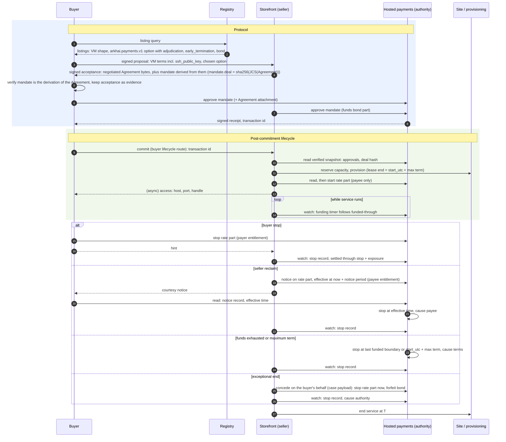

## Context

What exists today (evidence for the decisions below, not a specification):

- **Negotiation and settle.** Negotiation is buyer-driven signed rounds. The seller's responses authenticate the seller principal in transit, and accepted terms keep the exact buyer and seller parties (`negotiation-protocol`, "Principal-bound negotiation history"). The buyer client verifies the seller's signed acceptance and keeps only its payload (`core/buyer/src/core_buyer/negotiation_client.py`); the storefront stores negotiation messages without the request proof. Settle's contract is core's: the route table `settlement_routes` (`SETTLE` in its negotiation and Alkahest `escrow_uid` forms, `SETTLE_STATUS`, `REFUND`), its response models, and the typed-client method `settle_agreement`. Each domain storefront (VM, bare metal, API credits) mounts it, and VM seller response signing binds it. `Agreement` is `extra: "forbid"` and carries the full selected `SettlementOption`, whose `params` are mechanism-owned and opaque to core. Core defines no universal Agreement hash.
- **Heartbeats.** The storefront stores a heartbeat's principal, timestamp, and payload, not its signature (`core/storefront/src/core_storefront/heartbeats.py`). A stored heartbeat is the seller's record that one arrived, not buyer-signed evidence.
- **Alkahest.** An obligation's committed content is its arbiter and `DemandData`. The default recipient arbiter's demand is `{recipient}`; the trusted-oracle and splitter demands are `{oracle, data}`. An interruptible listing builds a `vms.interruptible.v1` term with a splitter whose oracle is the first configured `interruptible_oracle_addresses` entry: the seller wallet by default, possibly a third party. The term nevertheless hard-codes `refund_authority: seller_declared`. A storefront-wide `[Settlement.alkahest].interruptible` flag marks every listing interruptible, whatever its options.
- **Interruption today.** The VM interrupt endpoint is gated by the storefront admin key and an administrator principal, so its caller is the seller's own staff or automation. It truncates the capacity lease (minute precision) and returns `splitter_declaration_pending` for the money side. Terminal hosted settlement truncates the lease from the other direction (`truncate_lease_for_terminal_settlement`). Bare metal has a buyer-authenticated `POST /api/v1/fulfillments/{negotiation_id}/teardown` that ends the lease at once with no money side, and ends the lease on an uncollected terminal obligation through `terminate_lease`. A truncated lease is released when provisioning's lease watchdog next polls (60 seconds by default). Leases can be shortened, never extended.
- **Seller refund and reconciliation.** The seller reverses a hosted payment through `POST /api/v1/settlements/{negotiation_id}/refund`. Every storefront composing hosted payments runs a reconciliation pass that advances approved deals a buyer never settled (`kit/arkhai-payments/src/market_arkhai_payments/reconciliation.py`).
- **Hosted payments** (the `arkhai.payments.v1` mechanism). The facts below are those of the payments contract `spot-deals-through-arkhai-payments` builds on; the contract vendored in `kit/arkhai-payments/schema` has `once` parts only and no stop cause, funded-through, or rate part.
  - **Commitment.** The seller derives the mandate from the exact Agreement bytes; `mandate.deal` is `sha256(JCS(Agreement))`. The payer commits by approving it with an authenticated request. The Agreement can be attached to the transaction.
  - **Events.** `start`, `stop`, and `reverse` are authenticated requests from accounts the mandate lists for that kind. `derive_mandate` hard-codes `start` and `stop` to both parties. A stop names its cause: payer, payee, authority, or terms. Billing periods count from `start`; the first batch is reserved at approval.
  - **Settlement.** A stop takes effect when received and cannot be future-dated. Funding exhaustion stops the transaction at the last paid boundary with cause "terms". The signed snapshot carries events, the stop record, settled amounts, and a funded-through time. SCM does not yet verify snapshot proofs.
  - **Disputes.** The mandate lists a dispute authority allowed to `reverse`; no automated one exists. Deals through the official Arkhai registry are mediated by Arkhai, manually today.

## Decisions

The decisions were revised after the second design-review round; `Status` lists what changed.

### D1. The protocol is what a party must do to continue

A step is protocol when refusing it leaves a party unable to continue:

1. **Discovery:** without the registry's schema a buyer finds no listings.
2. **Negotiation:** without the negotiation schema the parties reach no agreement.
3. **Commitment:** the single act, defined by the mechanism, that makes the agreement binding (D2). Hosted: approval of the mandate by every party that funds one of its parts: the payer, and also the seller when the deal includes a seller-funded bond (D5). Alkahest: the escrow obligation on chain. Asynchronous peer-to-peer: the countersignature.

After commitment, refusing to continue is a broken obligation, no different from breaking a later clause, and it is visible only through the evidence it leaves. Everything after commitment, including the buyer's settle handoff, is post-commitment lifecycle (D6). Core keeps the registry, negotiation, and the schema-opaque agreement and commitment carriers.

Moving the settle contract out of core is its own change, `move-settle-out-of-core`, because it moves one shared route table (`SETTLE`, `SETTLE_STATUS`, `REFUND`), touches three domains and VM response signing, and overlaps `move-escrow-into-alkahest`'s ownership of the Alkahest settle path. This change adds the lifecycle routes beside it (D6) and leaves settle where it is.

### D2. The committed agreement is defined by the mechanism

The agreement is what is enforceable in arbitration, `arbitrate(demand, evidence)`, and its form is the arbitration mechanism's:

| Mechanism | Committed agreement | Commitment reference |
|---|---|---|
| Alkahest | The arbiter and its `DemandData` | Escrow obligation UID |
| Hosted payments | The payments service's Agreement: the mandate, with the negotiated Agreement attached and hashed into `mandate.deal` | Transaction ID |
| Asynchronous peer-to-peer | The countersigned negotiated Agreement | Its signature digest |

- **The negotiated Agreement is the input.** Each mechanism derives its committed form from it. Before committing, the buyer verifies that the committed form is that mechanism's derivation of the negotiated terms. This generalizes the buyer's existing check (`buyer-orchestration`, "Payment buyers approve and settle by negotiation") rather than relaxing it.
- **No universal agreement identity.** Committed agreements are not compatible across mechanisms in general; two mechanisms may be designed to be. `negotiation-protocol`'s "no universal Agreement hash" stays. The lifecycle layer treats the commitment reference as opaque.
- **Lifecycle terms bind only if the committed form encodes them.** Hosted: each part's terms and the authorities of its events (D5). Alkahest: the arbiter's `DemandData`. Today's oracle and splitter demands carry only an oracle address, so Alkahest options carry no lifecycle terms until the specialized arbiter of D13 exists.

### D3. Later information is evidence, not protocol

Information exchanged after commitment is not committed or carried by the protocol unless a dispute arises. The agreement's regime defines which of it can become evidence. Each party keeps what its regime expects it to submit (D9).

### D4. A clause is admissible if its named adjudicator can decide it

- **Decidable.** The agreement names the regime that decides each clause. For deals through the official Arkhai registry the default regime is **optimistic, Arkhai-adjudicated**: parties act, and Arkhai resolves disputes. "The buyer received a working VM" is admissible under it. A deal through another registry names its own adjudicator, or none and says so.
- **Reachable.** Before committing, each party checks it can take part in the named regime. The buyer refuses an option whose regime it does not recognize (D5). Regime identifiers are a closed vocabulary the buyer client ships, not free strings it trusts.
- **Chosen per option.** A buyer cannot change seller-owned option params, so choosing a regime means choosing among options; a seller may price them differently.

### D5. A deal is a set of parts; lifecycle terms are per part

**Per-part events.** A deal's money is a set of parts, and the payment authority's lifecycle events are per part: each part offers only the events it is reasonable to apply to that part alone.

| Part | Events |
|---|---|
| `once` | `start`, collect, `reverse`, `dispute` |
| `rate` (`spot-deals-through-arkhai-payments`) | `start`, `notice`, `stop`, collect, `reverse`, `dispute` |
| `bond` | forfeit, release, `dispute` |

A `once` part has no stop, because nothing about a fixed amount can be stopped. More exotic deal structures are new combinations of parts, never new deal-level events at the authority. Deal-level commands such as "end delivery at *T*" and "concede" belong to the lifecycle layer (D6), whose mechanism adapter translates each into the events of the parts it affects. The authority's core never receives a deal-level event.

**No structure is forced.** Option builders offer reasonable defaults as presets ("spot", "on-demand", "reserved", each with or without a bond). Every preset is only a combination of parts and terms in the generic vocabulary, and nothing special-cases one.

**Negotiated terms.** Three objects in an option's `params` carry the lifecycle terms SCM negotiates; the adapter derives each part's terms from them. All three are in the Agreement bytes and the option ID, so their key and field names are fixed here.

- `adjudication`, on every option whose mechanism has a lifecycle adapter: the regime that decides disputes (D4).
- `early_termination`, only when some part of the option can be stopped: who is entitled to stop it, the seller's exposure, and the maximum term.
- `bond`, optional: the seller's bond (below).

```json
{
  "option_id": "opt_…",
  "mechanism": "arkhai.payments.v1",
  "asset": "USD/6",
  "rates": [{"field": "amount", "per": "minute", "value": "1200"}],
  "params": {
    "payee_account": "acct_seller_example",
    "reserve_ahead_seconds": 300,
    "adjudication": {"version": 1, "regime": "optimistic.arkhai"},
    "early_termination": {
      "version": 1,
      "entitlements": {
        "payer": {"notice_seconds": 0, "settles_through": "stop+exposure"},
        "payee": {"notice_seconds": 120, "settles_through": "stop"}
      },
      "exposure_seconds": 300,
      "max_term_seconds": 2592000
    },
    "bond": {"version": 1, "amount": "5000000"}
  }
}
```

- **Entitlements are the stop authorities of stoppable parts.** The adapter makes each initiator with an entitlement a `stop` authority of the option's stoppable parts, and nobody else. An on-demand option has no `payee` entitlement, so the seller cannot stop it. A `once` part has no stop event, so it has no stop authorities with or without a clause; its `start` authority is the payee alone (D7).
- **Exceptional ends are disputes.** A seller whose hardware fails on a deal it may not stop files a dispute and concedes it on the buyer's behalf (D10). The adapter applies a concession through each affected part's events. Rate parts stop at the concession's end time, which may not be later than now, so a concession is never an unannounced notice. `once` parts reverse what the case requests, by default the unserved share of the term by time. A bond is forfeited.
- **A seller's promise is a bond.** A `bond` part is funded by the seller, held through the deal and its dispute window, forfeited to the buyer when the seller loses or concedes a dispute, and released to the seller otherwise. It is how an at-will seller exit acquires a concrete price. Without one, conceding costs the seller only its unserved revenue; that is the deal the buyer chose, and buyers can filter for a bond.
- **Authority causes need no entitlement.** Funding exhaustion stops at the last funded boundary. The maximum term stops at an absolute instant, the Agreement's `start_utc + max_term_seconds`, carried in the mandate. That is the instant the lease ends (D8), whenever the seller sent `start`. Both stops have cause "terms".
- **Buyer stops settle through the seller's exposure.** A payer stop at *t* settles through *t* plus `exposure_seconds`, bounding the seller's unpaid window by terms.
- **Notice is a scheduled stop at the authority** (D7).
- **Initiator-dependent rules are terms the mechanism applies,** never an intermediary sending compensating refunds.

The rate-part behaviour in these bullets (payer stop, notice, exhaustion, maximum-term stop) is implemented by `spot-deals-through-arkhai-payments`, which owns its requirements. This change fixes the vocabulary, its validation, and the derivation of authorities.

Term semantics:

| Input | Meaning |
|---|---|
| No `adjudication` on an option whose mechanism has a lifecycle adapter | The builder refuses to emit it; the buyer refuses it. |
| No `early_termination` | No part of the deal can be stopped. Each part has only the events its shape offers. |
| `early_termination` on an option with no stoppable part | The builder refuses to emit it. |
| Unknown `version`, unknown `regime`, unknown initiator key or `settles_through` value | The buyer refuses the option; the builder refuses to emit it. |
| Empty `entitlements` | Refused at publication; omit `early_termination` instead. |
| `max_term_seconds` versus Agreement `duration_seconds` | Must be equal until a schema change replaces the fixed-term fields (`spot-deals-through-arkhai-payments`, "Known mismatch"). |
| `reserve_ahead_seconds` versus `exposure_seconds` | `reserve_ahead_seconds ≥ exposure_seconds`, enforced by the builder and by the buyer's validation. |
| `exposure_seconds` versus the seller's servicing budget | `exposure_seconds` is at least the storefront's polling interval plus its declared watchdog and teardown budget, checked at publication and at acceptance (D8). |
| No `bond` | The deal has no bond part. |

**Discovery.** These terms are filtered per option, not per listing, because a buyer selects one option. They are common settlement fields owned by the lifecycle codec, not by a mechanism: `adjudication.regime`, `early_termination.payer`, `early_termination.payee.notice_seconds`, `bond.amount`. The settlement query language's namespace rules are amended to admit the codec's projections as the one shared exception. The registry schema does not change.

**Alkahest.** The listing-wide `[Settlement.alkahest].interruptible` flag becomes `[Settlement.alkahest].release_models`, a list such as `["recipient", "interruptible"]`; the storefront publishes one Alkahest option per release model. Migration maps `interruptible = true` to `["interruptible"]`. The listing-level marker is removed, and the admin interrupt route reads the accepted option's release condition. The splitter option keeps its current service terms and stays the seller-trusted path until the specialized arbiter exists.

**Rollout.** An older buyer facing a newer seller fails closed at the mandate check, since the derived authorities differ. Storefronts and buyer clients upgrade together; there is no backwards-compatibility promise.

### D6. Post-commitment lifecycle: one interface on each side of the mechanism

Every post-commitment action goes through a uniform interface on both sides, and the mechanism sits between them:


**Two kinds of record.**

- **Authority events** are the authority's record of what happened to a part: `start`, `notice`, `stop`, `reverse`, `dispute`, `concede`, forfeit and release, and stops the authority applies itself (exhaustion, maximum term, a matured notice). Shape: `{negotiation_id, commitment_ref, part, kind, actor, at, cause, sequence, authority_record_ref, payload}`. `extend` is reserved for top-up.
- **Peer messages** are buyer-to-seller and have no authority record: `commit` (the commitment reference and post-commitment information, D14) and `hint` (a courtesy notice that the buyer acted). They are kept as evidence and acted on only after a read of the authority.

**Commands and outcomes.** `submit` takes a deal-level command, never an event: `{negotiation_id, kind, operation_key, at, payload}`. The adapter translates it into the affected parts' events. Its outcome is `accepted` (with the resulting authority records), `rejected` (with the authority's reason), `pending`, or `unknown` (transport failure). An `unknown` outcome is resolved by `read`, never by assuming either result. The operation key is stable across retries, and the adapter derives each part event's idempotency key from it; a retry with the same key and different content is rejected locally. Which actor may submit which kind follows from the parts' authorities (D5, D7). `read` returns the deal's lifecycle state (below) and its authority events, or `rejected` when the deal's mechanism has no adapter.

**Buyer half:** `submit` and `read(negotiation_id)`, through the domain's buyer stage table, which already dispatches by mechanism; core buyer code does not bind the kit.

**Seller half:**

- `submit` and `read(negotiation_id)`.
- `list`: the seller's deals with a commitment, bounded pages with a continuation token, each with negotiation ID, commitment reference, domain, mechanism, entitlements, lifecycle state (unstarted, running, ending, ended, repair required) and the current deadline. An empty page is not an error. This is the active-deal view `automate-seller-spot` builds on.
- `watch(negotiation_id)` yields first the current state (the latest authority events and the funded-through deadline), then each later authority event and deadline change in authority sequence order. Its cursor is the authority's per-transaction event sequence, stored durably per deal and acknowledged after end service records the effect; restart replays from the stored cursor. Repeated events are harmless because end service is idempotent. A deal with only `once` parts has no deadline but its lease.

**Routes.** Both halves are exposed on the storefront as a lifecycle route contract with its own client package:

- seller-authenticated `submit`, `read`, `list`, using the existing administrator-principal contract the interrupt route uses;
- a buyer-authenticated route for peer messages (`commit`, `hint`), authenticated as the negotiation's buyer principal, on the VM and bare-metal storefronts. Its responses are signed like every other buyer route. For hosted options the buyer half sends `commit` here; until `move-settle-out-of-core` lands the storefront's handler shares the settle handler's implementation, the settle route keeps serving its other callers, and API credits keeps settle. There is still no buyer relay to the authority: buyer actions go to the authority.

The seller CLI, the strategy runner, a dry-run planner built on `read` and `list`, and the VM admin interrupt route for hosted deals call the seller half.

**Adapters** are the translation layer between deal-level commands and the authority's per-part events; the authority's core stays per-part. They resolve through the domain's role table, keyed by negotiation ID and the Agreement's mechanism, not through the escrow-client port. Within a mechanism they dispatch per arbiter, and per oracle or oracle schema for oracle-backed arbiters. This change ships the hosted adapter for `once` and `bond` parts; adapters stay stateless, since the payments kit holds no servicing daemon. An Alkahest adapter waits for the specialized arbiter (D13).

**Refund and reconciliation.**

- The seller's refund becomes a `reverse` lifecycle command. The refund route remains until `move-settle-out-of-core` retires it.
- The reconciliation pass stays and finds commitments a buyer never reported. Once the payments service confirms that an unstarted `once` hold cannot be collected and is returned (Dependencies), it is a convenience for the seller; until then it is a safety requirement, since the seller would otherwise hold a payment with nothing delivered.

**Packaging.** The neutral layer is market-neutral, so it lives in kits split by kind and area:

| Package | Area and kind | Holds |
|---|---|---|
| `kit/deal-lifecycle-contracts` | Contracts | Wire models (commands, outcomes, events, peer messages, case payload), route contracts and response models |
| `kit/deal-lifecycle` | Foundation library, on the contracts | Term codec and semantics, adapter protocol, evidence-store interface |
| `kit/deal-lifecycle-client` | Client | Typed client for the routes |
| `kit/deal-lifecycle-buyer` | Buyer-side library | The buyer's evidence store and case export |
| `kit/deal-servicing` | Storefront-side library, beside `kit/capacity-publication` | End service, funding timers, `watch` loops and cursors, the storefront's evidence store |

Mechanism kits depend on the foundation library and the contracts only. `watch` loops run under `kit/storefront`'s loop controller. Their cursors are lifecycle observation state, not a payment ledger, so "Marketplace roles hold no payment ledger" is amended to say so. The domain supplies lease and teardown effects through a narrow port, so a later merge of the VM and bare-metal domains does not entangle the kits with either.

### D7. The authority's record decides; parties act there

An early end, a start, a notice, or a dispute is an action by an entitled party, with its own credentials, at the authority the agreement names. The authority's record is the only authoritative statement of what happened. Holding a handle grants no permission.

- **Funds move only after a seller action that begins service.** Hosted: `start` authority is the payee alone, and the seller calls it when service begins. An unstarted `once` hold cannot be collected and returns to the payer at the mandate's start deadline (Dependencies). A buyer who commits and never sends `commit` then locks only its own funds, so the buyer is always the one who needs to notify.
- **Start after provisioning.** The seller reads the authority, provisions, reads again, then sends `start`. If the payer stopped meanwhile, `start` is rejected, or provisioning has not finished by the absolute maximum end, the seller does not start and end service terminates the provisioned resource, found by negotiation ID. A crash between provisioning and `start` resumes from the operation journal with the same decision. The pre-start window is the seller's risk; a seller who wants cover adds a setup `once` part.
- **Notice is a scheduled stop hosted by the authority.** A seller reclaim posts one `notice` on the stoppable parts, with an effective time no earlier than now plus the entitlement's `notice_seconds`. The authority applies the stop itself at that time, with cause payee. This is the only future-dated stop. The seller sends one message, and the buyer is protected even if the seller never acts again.
- **Courtesy.** Our implementations tell the counterparty after acting: the buyer's client sends a `hint` after a stop, and the seller after a notice. A buyer may include an optional webhook in its `commit`; delivering to it needs an egress guard and is not part of this change. Hints bring a read forward and do nothing else.

### D8. End service at T

End service is the storefront operation that drives the domain's lease effects. Its input is a final request, "end delivery at *T*", with actor, cause, and source.

- **Final requests.** Authority stops through `watch` (a payer stop, a matured notice, exhaustion, the maximum term, a concession), and local delivery decisions: bare metal's buyer teardown route, a failed start (D7), and the existing terminal-settlement paths, the VM's `truncate_lease_for_terminal_settlement` and bare metal's lease end on an uncollected terminal obligation. All of them route through end service.
- **Earliest final request wins.** Repeated final requests for one deal take the earliest *T*, matching `truncate_lease`'s earlier-only rule. Each effect is journaled and retried until done.
- **Funding is a timer, not an end.** A funded-through deadline is renewable: funding advances it. End service keeps it as a local timer that moves with each deadline change and issues a final request only when the timer expires without renewal. Truncating the lease to a funding deadline would be irreversible, since leases cannot be extended.
- **Local decisions do not move money.** Bare metal's buyer teardown ends delivery and the buyer keeps paying; payment stops only at the authority. Its record is the buyer's signed teardown request, kept in the evidence store.
- **Lease term.** A deal's lease ends at the Agreement's `start_utc + duration_seconds`, which equals `start_utc + max_term_seconds`, the instant the authority stops billing (D5). Stops and an expired funding timer end it earlier.
- **Primitive.** When *T* is now or past, terminate the lease (bare metal's `end_lease` is the precedent). When *T* is later, truncate it at the requested instant to at least one-second precision; the VM storefront stops formatting lease ends to the minute, and minute-format ends already stored stay readable.
- **Exposure budget.** `exposure_seconds` covers the seller's whole window: polling interval, watchdog interval when truncating, and teardown. The storefront declares its watchdog and teardown budget in configuration, and refuses at publication and at acceptance an option whose `exposure_seconds` is below polling plus that budget. A configuration change that would push an active deal over its exposure is refused. At runtime a shortfall only warns: the lifecycle loops never stop watching.
- **Liveness is the seller's risk.** With the storefront down or its lifecycle loops paused, the seller serves unpaid until the lease's maximum end; the buyer is not charged past it.
- **Extension** (top-up) is deferred with the `extend` kind; leases cannot be extended today.

### D9. Each party keeps its evidence

A kit-owned evidence store keeps exact bytes, separate from replay state. The foundation library defines its interface; the buyer's implementation is `kit/deal-lifecycle-buyer`, stored as files beside the buyer profile, and the storefront's is in `kit/deal-servicing`.

- **Key.** The negotiation ID, because the first evidence (the acceptance envelopes) exists before any commitment. The commitment reference is recorded as an attribute once known. A negotiation has at most one live commitment; a superseded attempt is kept with its own reference and marked superseded.
- **Always:** the commitment envelopes. The buyer keeps the seller's signed acceptance (proof headers and exact body) before committing; the seller keeps the buyer's signed accepting request. Both keep the peer messages they sent or received.
- **By regime:** authority records the party receives (hosted receipts and snapshots, on-chain references). Signed heartbeat envelopes join when a regime names heartbeats as evidence; none does yet.
- **Retention.** Records are kept while the deal, its physical recovery, or any dispute on it is open, and for a dispute window after the last of these closes; then they are deleted. An accepted negotiation that is never committed is kept for the window after its acceptance expires. The storefront configures the window and publishes it with each listing; the buyer applies the window the listing published.
- **Dependencies:** exact bytes are stored raw now; `version-accepted-artifacts` later supplies their typed evolution and is not a prerequisite. The signer's principal history across key rotation is recorded here and not solved.

### D10. A dispute is one case payload

A dispute is one self-contained payload: the bundle a party exports and attaches when it files, and the payload of the `dispute` and `concede` commands.

- **Case:** the commitment reference, the committed agreement or where to fetch it, the terms, the claim, the requested outcome, and ordered evidence items.
- **Evidence item:** an evidence-store record: kind, producer, time, content digest, and the exact original bytes or the authority's signed record. Mechanism records are referenced, not copied into a parallel format.
- **Sketch only:** fields that only automated adjudication needs, such as attestation normalization. They become normative with the change that automates adjudication.
- **File and concede are in scope.** A conceded dispute needs no adjudicator. The adapter applies it through each affected part's events (D5), including forfeiting a bond. Contested cases go to Arkhai's mediation.

### D11. Adjudication is optimistic; automation is deferred

Arkhai already resolves disputes for deals through its registry, manually. The deferred dispute authority automates certain cases of this, and is built together with a managed metering gateway that produces the delivery evidence it would decide on. Remedies differ by mechanism: on hosted payments a ruling applies through `reverse` while funds are held; on the current Alkahest path a declared split cannot be undone on chain, so remedies are off-chain.

### D12. Design for the adversarial worst case; default to cooperation

- **Safety depends only on authority records** and a party's own kept records, never on a message the counterparty may withhold. The seller reads the authority for stops; the buyer reads it for notices and reclaims.
- **Exposure is bounded by agreed terms.** Exhaustion: reserve-ahead covers the seller's exposure while funded-through stops advancing. Buyer stop: the exposure tail (D5). Seller abandonment: the maximum-term stop and the scheduled notice stop end billing without a further seller message. Exceptional seller ends: a bond, when the deal has one. Silent commitment: no charge until the seller starts (D7). Churn: each stopped deal pays at least the exposure tail; the seller may add a setup `once` part, and since a seller need not accept every negotiation, a DoS guard or blocklist belongs in its negotiation acceptance policy.
- **Defaults cooperate.** Our implementations send hints and end service promptly. Hints are idempotent and trigger a read, so a forged one does nothing.
- **Choose flows for the worst case:** one authority, one record, a bounded exposure window.

### D13. Hosted payments first; a neutral trustless alternative must stay possible

- **Production first.** The hosted mechanism is made complete and production-quality first.
- **Alkahest is at the user's own risk.** It is maintained so that every managed component has a feasible trustless alternative, not offered as production-ready. Before it is, optimistic mediation would be a specialized arbiter contract, more specific than `TrustedOracleArbiter`, possibly heartbeat-signature based, whose `DemandData` encodes the terms and accepts posted notices. The Alkahest lifecycle adapter is built with it.
- **The test** for a decision is whether a neutral arbiter (another oracle, or a signature-based arbiter) could implement it. A decision fails if only a managed service can hold the evidence or act, if evaluation needs data only a managed party can produce, or if the commitment cannot be expressed on chain or as exchanged signatures. D2's mechanism-defined agreement, D5's per-part events and bond, D7's scheduled notice, and D9's kept signed bytes all pass it: each is a rule an arbiter contract can check against posted records, and a bond is an escrow the seller funds.

### D14. Message sequence and information placement

1. **Discovery.** The buyer queries the registry.
2. **Negotiation.** Rounds run until the seller's signed acceptance of the negotiated Agreement.
3. **Commitment.** The mechanism derives its committed form; every funding party verifies and commits (D1, D2).
4. **Post-commitment exchange.** The buyer's `commit` carries the commitment reference and anything the seller needs that is not in the agreement. The seller starts service and replies, possibly asynchronously, with access details and action handles.

| Information | Placement |
|---|---|
| Known before agreement, must bind both parties | Agreement |
| Known before agreement, not sensitive, acceptable to hold for uncommitted deals | May ride in the agreement to save an exchange (for example an SSH public key) |
| Personal or secret | Revealed after commitment, never in the agreement |
| Created by settlement | The authority's record |
| Created by fulfillment | Fulfillment result |

For an interruptible VM deal on hosted payments (the rate part arrives with `spot-deals-through-arkhai-payments`):



### D15. Scope and related changes

- **This change:** D1–D14; the five lifecycle packages; the lifecycle routes and client (seller `submit`, `read`, `list`; buyer `commit`, `hint`); the `adjudication`, `early_termination` and `bond` codec, its semantics table and its common query fields; deriving each part's authorities from the terms; Alkahest release models replacing the listing-wide flag; the hosted adapter for `once` and `bond` parts (`commit`, payee-only `start`, `read`, `watch`, `reverse`, and dispute file and concede once the service provides them); end service with funding timers and its authority and local sources; both evidence stores; routing bare-metal teardown and both terminal-settlement paths through end service. Verified at integration level against a payments test double at the `kit/arkhai-payments` boundary, per `TESTING.md`, "Private Service Dependencies".
- **`spot-deals-through-arkhai-payments`:** the hosted rate part and its adapter events, presets that emit `early_termination`, and the requirements for payer stop with exposure tail, scheduled notice stop, exhaustion, the stop at `start_utc + max_term_seconds`, and `reserve_ahead_seconds ≥ exposure_seconds` in force. It owns the four-path scenario (buyer stop, seller reclaim with notice, funding exhaustion, conceded dispute), as an e2e against the payments service's public test deployment, readiness-gated, with client-side integration tests against the test double. It depends on this change.
- **`move-settle-out-of-core`:** moves the settle route table and client method out of core, retires the settle, status and refund routes in favour of the lifecycle routes, and moves API credits and the Alkahest settle path. It depends on this change and on `move-escrow-into-alkahest`.
- **`automate-seller-spot`:** rescoped to the strategy runner as a caller of the seller half. It depends on both hosted changes.
- **Deferred:** the automated dispute authority, the metering gateway, the specialized Alkahest arbiter and its lifecycle adapter, and heartbeat evidence regimes.

## Implementation cadence

Two rounds, one session each:

1. **Foundation, wire, and buyer side.** `kit/deal-lifecycle-contracts`, `kit/deal-lifecycle` (term codec and semantics, adapter protocol, evidence-store interface) and `kit/deal-lifecycle-client`; `kit/deal-lifecycle-buyer`; hosted authority derivation per part; the common query fields; Alkahest release models and their migration; and buyer verification, evidence keeping and buyer-half dispatch. It changes wire bytes and nothing yet acts on them, so it can be reviewed alone.
2. **Seller servicing and domain wiring.** `kit/deal-servicing` (storefront evidence store, `watch` loops and cursors, funding timers, end service and its journal), the hosted adapter for `once` and `bond` parts, the lifecycle routes and their response signing, the exposure-budget checks, the VM admin route and bare-metal teardown as callers, terminal settlement through end service, and second-precision VM lease ends, with integration tests against the payments test double.

## Dependencies on the hosted payments service

To be confirmed against the payments contract and vendored through `kit/arkhai-payments/schema/SOURCE.md`. Items gate implementation, not planning; the test double implements the confirmed contract.

This change:

- Lifecycle events are per part, and the service's core takes no deal-level event.
- Payee-only `start`. A `once` hold cannot be collected before the payee's `start`, and returns to the payer if the part is not started by a start deadline the mandate carries, derived from `start_utc` and the option's hold window.
- Idempotency keys on `start`, as on `reverse`.
- A per-transaction event sequence and a cause on each stored event.
- File and concede of a dispute, a concession applied through each affected part's events.
- A `bond` part: funded by the payee, held through the deal and its dispute window, forfeited to the payer on a lost or conceded dispute, released to the payee otherwise. A mandate is committed when every party that funds one of its parts has approved it.
- Snapshot-proof verification in SCM before snapshot state is read as evidence.

`spot-deals-through-arkhai-payments`:

- Rate parts, funded-through, reserve-ahead, and stop causes.
- A `notice` event with an effective time, applied by the service as a stop at that time.
- A stop at the mandate's absolute maximum end with cause terms.
- A payer stop that settles through the declared exposure.

## Alternatives considered

- **Interruption as a core verb, or settle as protocol.** Rejected (D1): neither is required to continue.
- **Moving settle out of core in this change.** Rejected (D1): it moves a shared table across three domains and overlaps `move-escrow-into-alkahest`.
- **A universal agreement digest across mechanisms.** Rejected (D2): the committed agreement is the mechanism's.
- **Deal-level lifecycle events at the payment service.** Rejected (D5): they fix one deal structure into the service. Per-part events compose into any structure, and the translation belongs to the adapter.
- **A concession floor in the clause.** Rejected (D5): it special-cases one penalty shape and, as drafted, cost no more than an entitled stop. A bond part prices seller exits in the generic vocabulary.
- **Terms in `provision_terms` or a new top-level Agreement field.** Rejected (D5): per listing rather than per option, or a protocol version bump for every party.
- **A listing-level registry field derived from options.** Rejected (D5): it says some option can end early while the buyer selects one.
- **Broad stop authorities with breach classification.** Rejected (D5): it mixes contractual and exceptional ends; exceptional ends are disputes.
- **Buyer-filed-only concessions.** Rejected (D10): an offline buyer would keep paying for a dead machine.
- **Notice followed by a later seller stop.** Rejected (D7): a seller that never sends the stop leaves the buyer paying.
- **Early end on the conditional-escrow port.** Rejected (D6): hosted payments never implements it, and it is becoming Alkahest-internal.
- **A buyer-stop relay route on the storefront.** Rejected (D6): the buyer submits to the authority.
- **An Alkahest lifecycle adapter for the seller-held oracle now.** Rejected (D13): it binds only off-chain, has no buyer transport to the oracle, and orders this change with `move-escrow-into-alkahest`.
- **One `kit/deal-lifecycle` package.** Rejected (D6): mechanism kits, buyers and `kit/storefront` may not depend on persistence and orchestration.
- **A lease that tracks funded-through and is extended.** Rejected (D8): a dead storefront would tear down a VM the buyer is still paying for.
- **Funded-through as an end request.** Rejected (D8): leases cannot be extended, so a renewed deadline would tear down a funded VM.
- **Refusing to start lifecycle loops on a polling shortfall.** Rejected (D8): one misconfigured deal would stop watching every deal.
- **Notice pushed to a buyer address.** Rejected (D7): no record the authority can check.
- **Retaining nothing until a dispute authority exists.** Rejected (D9): signatures not kept on arrival cannot be recovered.

## Open questions

- **Notice withdrawal.** Whether a seller may withdraw a notice before it takes effect. Owned by `spot-deals-through-arkhai-payments`; no decision here prescribes either answer.
- **Defaults.** Must every `adjudication` state its regime's default outcome when nobody submits evidence, or may a regime declare it once? The example does not answer it.
- **Case transport.** Where an automated authority receives a case, and how privately held evidence is disclosed only to it, deferred with D11.

## Status

Design, fourth round. Changed after the third review round (`reviews/06-design-external.md`, `reviews/07-design.md`):

- D5: per-part lifecycle events, with deal-level commands translated by the adapter; `adjudication` separate from `early_termination`; the concession floor replaced by a generic `bond` part; the maximum term anchored to `start_utc`; the exposure budget and common query fields; Alkahest release models.
- D6: wire models in the contracts package; a buyer-side evidence package; `read` defined; buyer route signed and limited to VM and bare metal.
- D7: no start past the maximum end; `once` holds wait for `start`.
- D8: funding is a renewable timer; exposure checked at publication and acceptance; second-precision VM lease ends.
- D9: retention runs from the close of the deal and its disputes; heartbeat evidence deferred.
- D15: rate-part requirements belong to `spot-deals-through-arkhai-payments`.

Next: a fourth design review over the design and deltas.
