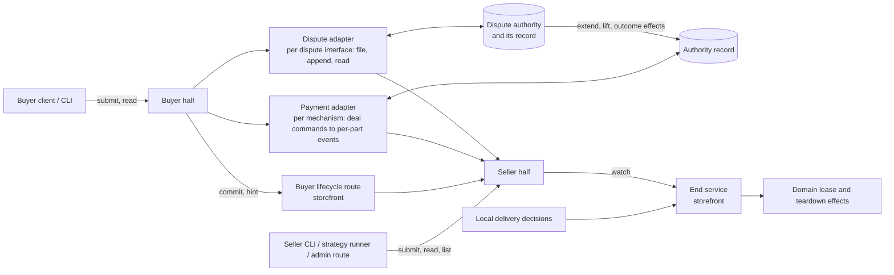
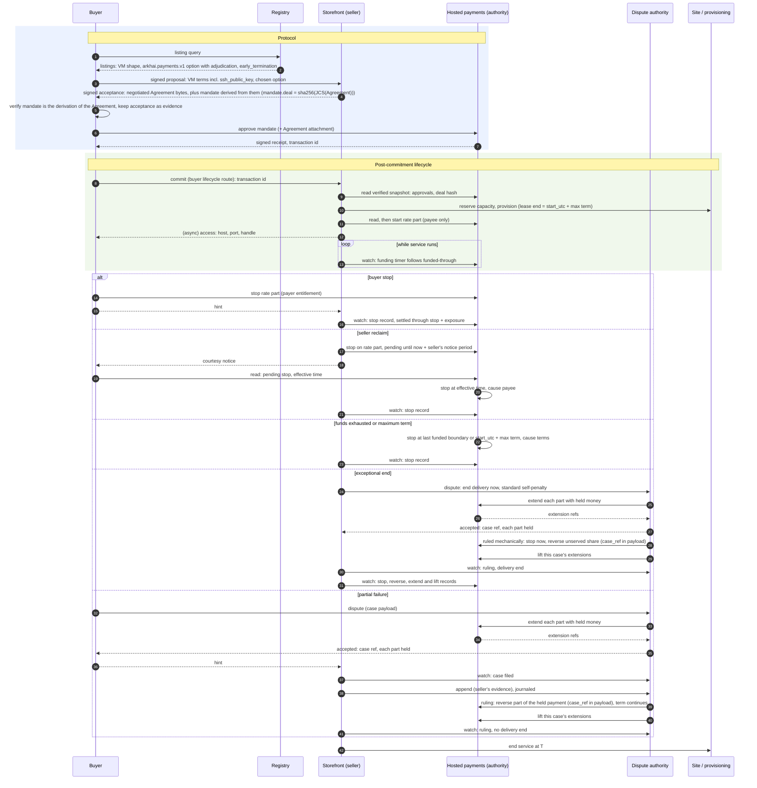

## Context

What exists today (evidence for the decisions below, not a specification):

- **Negotiation and settle.** Negotiation is buyer-driven signed rounds. The seller's responses authenticate the seller principal in transit, and accepted terms keep the exact buyer and seller parties (`negotiation-protocol`, "Principal-bound negotiation history"). The buyer client verifies the seller's signed acceptance and keeps only its payload (`core/buyer/src/core_buyer/negotiation_client.py`); the storefront stores negotiation messages without the request proof. Settle's contract is core's: the route table `settlement_routes` (`SETTLE` in its negotiation and Alkahest `escrow_uid` forms, `SETTLE_STATUS`, `REFUND`), its response models, and the typed-client method `settle_agreement`. Each domain storefront (VM, bare metal, API credits) mounts it, and VM seller response signing binds it. `Agreement` is `extra: "forbid"` and carries the full selected `SettlementOption`, whose `params` are mechanism-owned and opaque to core. Core defines no universal Agreement hash.
- **Heartbeats.** The storefront stores a heartbeat's principal, timestamp, and payload, not its signature (`core/storefront/src/core_storefront/heartbeats.py`). A stored heartbeat is the seller's record that one arrived, not buyer-signed evidence.
- **Alkahest.** An obligation's committed content is its arbiter and `DemandData`. The default recipient arbiter's demand is `{recipient}`; the trusted-oracle and splitter demands are `{oracle, data}`. An interruptible listing builds a `vms.interruptible.v1` term with a splitter whose oracle is the first configured `interruptible_oracle_addresses` entry: the seller wallet by default, possibly a third party. The term nevertheless hard-codes `refund_authority: seller_declared`. A storefront-wide `[Settlement.alkahest].interruptible` flag marks every listing interruptible, whatever its options.
- **Interruption today.** The VM interrupt endpoint is gated by the storefront admin key and an administrator principal, so its caller is the seller's own staff or automation. It truncates the capacity lease (minute precision) and returns `splitter_declaration_pending` for the money side. Terminal hosted settlement truncates the lease from the other direction (`truncate_lease_for_terminal_settlement`). Bare metal has a buyer-authenticated `POST /api/v1/fulfillments/{negotiation_id}/teardown` that ends the lease at once with no money side, and ends the lease on an uncollected terminal obligation through `terminate_lease`. A truncated lease is released when provisioning's lease watchdog next polls (60 seconds by default). Leases can be shortened, never extended.
- **Seller refund and reconciliation.** The seller reverses a hosted payment through `POST /api/v1/settlements/{negotiation_id}/refund`. Every storefront composing hosted payments runs a reconciliation pass that advances approved deals a buyer never settled (`kit/arkhai-payments/src/market_arkhai_payments/reconciliation.py`).
- **Hosted payments** (the `arkhai.payments.v1` mechanism). The facts below are those of the payments contract `spot-deals-through-arkhai-payments` builds on; the contract vendored in `kit/arkhai-payments/schema` has `once` parts only and no stop cause, funded-through, or rate part.
  - **Commitment.** The seller derives the mandate from the exact Agreement bytes; `mandate.deal` is `sha256(JCS(Agreement))`. The payer commits by approving it with an authenticated request. The Agreement can be attached to the transaction.
  - **Events.** `start`, `stop`, and `reverse` are authenticated requests from accounts the mandate lists for that kind. `derive_mandate` hard-codes `start` and `stop` to both parties. A stop names its cause: payer, payee, authority, or terms. Billing periods count from `start`; the first batch is reserved at approval.
  - **Settlement.** A stop takes effect when received and is never backdated; today it cannot be future-dated either. Funding exhaustion stops the transaction at the last paid boundary with cause "terms". The signed snapshot carries events, the stop record, settled amounts, and a funded-through time. SCM does not yet verify snapshot proofs.
  - **Disputes.** The mandate lists a dispute authority allowed to `reverse`, configured once per storefront as `[Settlement.arkhai_payments].dispute_authority`; no automated one exists. Deals through the official Arkhai registry are mediated by Arkhai, manually today.

## Decisions

The decisions were revised after each design-review round; `Status` lists what changed.

### D1. The protocol is what a party must do to continue

A step is protocol when refusing it leaves a party unable to continue:

1. **Discovery:** without the registry's schema a buyer finds no listings.
2. **Negotiation:** without the negotiation schema the parties reach no agreement.
3. **Commitment:** the single act, defined by the mechanism, that makes the agreement binding (D2). Hosted: the payer's mandate approval; the payee commits by building the mandate it offers. If a seller-funded bond arrives (D5, deferred), its change orders the two approvals to minimize network hops. Alkahest: the escrow obligation on chain. Asynchronous peer-to-peer: the countersignature.

After commitment, refusing to continue is a broken obligation, no different from breaking a later clause, and it is visible only through the evidence it leaves. Everything after commitment, including the buyer's settle handoff, is post-commitment lifecycle (D6). Core keeps the registry, negotiation, and the schema-opaque agreement and commitment carriers.

Moving the settle contract out of core is its own change, `move-settle-out-of-core`, because it moves one shared route table (`SETTLE`, `SETTLE_STATUS`, `REFUND`), touches three domains and VM response signing, and overlaps `move-escrow-into-alkahest`'s ownership of the Alkahest settle path. This change adds the lifecycle routes beside it (D6) and leaves settle where it is.

### D2. The committed agreement is defined by the mechanism

The agreement is what is enforceable in arbitration, `arbitrate(demand, evidence)`, and its form is the arbitration mechanism's:

| Mechanism | Committed agreement | Commitment reference |
|---|---|---|
| Alkahest | The arbiter and its `DemandData` | Escrow obligation UID |
| Hosted payments | The payments service's Agreement: the mandate, with the negotiated Agreement attached and hashed into `mandate.deal` | Transaction ID |
| Asynchronous peer-to-peer | The countersigned negotiated Agreement | Its signature digest |

- **The negotiated Agreement is the input.** Each mechanism derives its committed form from it. Before committing, the buyer verifies that the committed form is that mechanism's derivation of the negotiated terms. This generalizes the buyer's existing check (`buyer-orchestration`, "Payment buyers approve and settle by negotiation") rather than relaxing it.
- **No universal agreement identity.** Committed agreements are not compatible across mechanisms in general; two mechanisms may be designed to be. `negotiation-protocol`'s "no universal Agreement hash" stays. The lifecycle layer treats the commitment reference as opaque.
- **Lifecycle terms bind only if the committed form encodes them.** Hosted: each part's terms and the authorities of its events (D5). Alkahest: the arbiter's `DemandData`. Today's oracle and splitter demands carry only an oracle address, so Alkahest options carry no lifecycle terms until the specialized arbiter of D13 exists.

### D3. Later information is evidence, not protocol

Information exchanged after commitment is not committed or carried by the protocol unless a dispute arises. The agreement's dispute authority defines which of it can become evidence. Each party keeps what its dispute authority expects it to submit (D9).

### D4. A clause is admissible if its named dispute authority can decide it

- **Decidable.** The agreement names the dispute authority that decides disputes about it. "The buyer received a working VM" is admissible under Arkhai mediation's optimistic procedure, where parties act and Arkhai resolves disputes. Which authorities a registry's deals default to is the registry operator's choice, published in its descriptor (below); the official Arkhai registry recommends Arkhai mediation. The open-source code ships no authority: no account, origin or key of any operator's service is built in.
- **The authority is a party of its own.** A dispute authority fills the role of the oracle of Alkahest's `TrustedOracleArbiter`, or of the arbiter contract itself on a self-serve path. It is a client of the payment mechanism like the buyer and the seller, which the committed form authorizes to send certain events (D5), and otherwise independent of it: not one system with the payments service that answers for it. It may charge its own fees, require deposits, or run public mechanisms of its own outside the payment mechanism; SCM carries what the authority's interface requires and assumes none of it.
- **Named per deal, under the payment mechanism.** Terms follow `mechanism { fields }`, and at SCM's level the payment mechanism is primary. A hosted option's `adjudication.dispute` names the authority acting on its deal: its interface, the protocol SCM and the payments service speak with it, such as `arkhai.mediation.v1`, and that interface's fields, which are configuration: where the authority is reached, its account at the payment mechanism, the key that signs its records, and interface-owned `params`. Another operator running an identical service at another origin with another account is another authority with the same interface. An authority that runs several procedures of its own behind one interface names the procedure in its `params`. On Alkahest the arbiter is the mechanism's field: `TrustedOracleArbiter`'s oracle identity is a field of that arbiter, committed in its `DemandData`, and the oracle's own APIs belong to that oracle.
- **Authorities advertise compatibility.** An authority advertises the payment mechanisms it can act on, its minimum dispute window and case hold, and any default outcome, in its interface's published description. Each place that recommends or configures an authority carries a copy of that advertisement, and the checks read the copy; fetching the published description is an optional refresh that may only narrow it.
- **Registries recommend; roles choose.** A registry's descriptor may list recommended dispute authorities, operator-authored like its display name. A role's authorities are its own `[[Dispute]]` entries in preference order, followed by those its registry recommends unless it turns them off (D6). A seller offers from that list; a buyer accepts only from it.
- **Reachable.** Before committing, each party checks it can take part. The buyer accepts an option's authority only when its `interface`, `origin`, `account` and `record_key` all equal one authority in its list, and its `params` equal that entry's or satisfy the interface's own acceptance check; matching the account alone would let a seller pair the real authority's account with an origin and key it controls, so filings would never reach the authority holding the extend right. It also refuses an option whose interface its client has no adapter for, or whose authority does not advertise the option's payment mechanism. An authority speaking a supported interface is still refused when the buyer has not accepted it, since the buyer trusts it with held money (D12), as an Alkahest buyer trusts only known oracles.
- **Chosen per option.** A buyer cannot change seller-owned option params, so choosing an authority means choosing among options; a seller may price them differently.

### D5. A deal is a set of parts; payment events are per part

**Events follow the mechanism's joints.** A deal's money is a set of parts, and each mechanism's events are the operations its machinery can actually perform on a part on its own. Where a mechanism can apply an effect in part, the event is partial; where it can only act all at once, the event is whole, and any finer consequence needs a separate part.

- **Hosted payments is a ledger.** At approval a `once` part's gross is posted from the payer's balance to a per-part hold account in the service's ledger; money crosses the card network only at top-ups and withdrawals. `reverse {part, amount}` is a compensating posting from the hold back to the payer, repeatable until the hold is empty, with no fee, since the fee is taken on release. So reversal is partial and repeatable up to what a part still holds, and a penalty up to the held payment is a partial `reverse`, not a bond.
- **Alkahest escrow is all or nothing.** An obligation is collected whole when its arbiter is satisfied or reclaimed whole on expiry; the splitter declares one split, once. It has no partial reverse, so any penalty, even one smaller than the price, must be a separate seller-funded escrow. That arrives with the specialized arbiter (D13).

Hosted parts:

| Part | Events |
|---|---|
| `once` | collect (applied by the service when the hold ends), `reverse` of any amount up to what is held, repeatable |
| `rate` (`spot-deals-through-arkhai-payments`) | `start`, `stop {part, at?}` of this part (a notice is a stop with the sender's notice period), collect, `reverse` of any amount up to what is held, repeatable |
| `bond` (reserved; needs a payments change, below) | award to the payer of any amount up to what is held, repeatable; return of the remainder to the seller, applied by the service when the hold ends |

Lifecycle and authorities are per part: that is the point of composing a mandate from parts, and it lets several rate parts run at different granularities. The service today has mandate-level authorities, with `start` anchoring every rate part and `stop` ending the whole transaction; that is a defect filed with its maintainers (Dependencies), and spot-deals depends on its fix. This change ships only `once` parts, which need neither. A `once` part has no start or stop, because nothing about a fixed amount starts or stops: its protection is the hold. More exotic deal structures are new combinations of parts, never new deal-level events at the authority. Deal-level commands such as "end delivery at *T*" belong to the lifecycle layer (D6), whose payment adapter translates each into the events of the parts it affects. The payment core never receives a deal-level event, and it has no notion of disputes: disputes are per agreement and sit outside it (D10).

**No structure is forced.** Option builders offer reasonable defaults as presets ("spot", "on-demand", "reserved"; with or without a bond once a mechanism can hold one). Every preset is only a combination of parts and terms in the generic vocabulary, and nothing special-cases one.

**Negotiated terms.** Three objects in an option's `params` carry the lifecycle terms SCM negotiates; the adapter derives each part's terms from them. All three are in the Agreement bytes and the option ID, so their key and field names are fixed here.

- `adjudication`, on every option whose mechanism has a lifecycle adapter: the dispute authority that decides disputes about the agreement (D4, D10), the dispute window, and the maximum case hold.
- `early_termination`, only when some part of the option can be stopped: who is entitled to stop it, the seller's exposure, and the maximum term.
- `bond`, optional: the seller's stake beyond the payment (below).

```json
{
  "option_id": "opt_…",
  "mechanism": "arkhai.payments.v1",
  "asset": "USD/6",
  "rates": [{"field": "amount", "per": "minute", "value": "1200"}],
  "params": {
    "payee_account": "acct_seller_example",
    "reserve_ahead_seconds": 300,
    "adjudication": {
      "version": 1,
      "dispute": {
        "interface": "arkhai.mediation.v1",
        "origin": "https://mediation.arkhai.example",
        "account": "acct_arkhai_mediation",
        "record_key": "ed25519:…",
        "params": {"procedure": "optimistic"}
      },
      "dispute_window_seconds": 1209600,
      "case_hold_max_seconds": null
    },
    "early_termination": {
      "version": 1,
      "entitlements": {
        "payer": {"notice_seconds": 0, "settles_through": "stop+exposure"},
        "payee": {"notice_seconds": 120, "settles_through": "stop"}
      },
      "exposure_seconds": 300,
      "max_term_seconds": 2592000
    },
    "bond": {"version": 1, "amount": "5000000"}
  }
}
```

- **Entitlements are the stop authorities.** The adapter makes each initiator with an entitlement a `stop` authority of the stoppable parts. The agreement's dispute authority, the account in `adjudication.dispute`, is also a `stop` authority of every stoppable part, used only to apply outcomes (D10). Nobody else may stop, and options without `early_termination` have no stoppable part. An on-demand option has no `payee` entitlement, so the seller cannot stop it. A rate part's `start` authority is the payee alone (D7).
- **Exceptional ends are disputes.** A seller whose hardware fails on a deal it may not stop files a dispute with the agreement's authority requesting its own penalty, which Arkhai mediation rules mechanically (D10); the outcome ends delivery and applies per-part consequences with the dispute authority's own authority.
- **A seller's promise is priced by what can be taken back.** On hosted payments, an outcome may reverse any part of the held payment, partially and more than once; a partial reverse while the term continues is a discount. That covers every penalty up to what is held. `bond.amount` is the seller's stake beyond it: money funded by the seller toward the payer, held, awarded to the payer in part or whole by outcomes, and returned to the seller when its hold ends. The payments service cannot express this today: a mandate has one direction, a reverse returns money to its funder, and maturity releases to its recipient, so a bond would be backwards, and two linked mandates commit non-atomically. Its maintainers lean to per-part direction with a "return on maturity" hold inside one mandate. Until that exists, the `bond` term's name and shape are reserved in the codec and builders refuse to emit it on hosted options; hosted bond derivation, its query field and its approval order are a follow-up change. A deal needs a bond only when its promised penalty can exceed the payment still held, such as a cheap deal with a costly failure, or a rate deal whose collected periods are no longer held. On a mechanism without partial reversal (Alkahest), the same `bond` term is realized as a separate escrow whatever its size.
- **The dispute window sets the earliest payout.** Each amount a part holds pays out no earlier than the part's end plus `adjudication.dispute_window_seconds`. A `once` part ends at the Agreement's term end, `start_utc + duration_seconds` (for a lease, the lease end); a rate part ends at its stop, or the term end if it is not stopped, since a stopped part has no later conduct to dispute. The window bounds payout, not filing: whether an authority takes a case filed after it is the authority's own policy, and the payments service only refuses an extension for money already paid out. Outcomes act only on money still held, so a case keeps the deal's money held until it is decided, through a generic hold extension: two per-part payment events that only the dispute authority sends.
  - `extend {part, until?}` opens an extension on a part and returns the extension's `ref`. While any extension on a part is open, each amount the part holds pays out at the later of its normal date and the latest `until` among the open extensions, or not at all while one has no `until`; never later than its normal date plus the part's maximum extension. `extend` carries an idempotency key, so a retry after an `unknown` result returns the same `ref` rather than opening a second extension nobody holds a `ref` for. It is refused for money already paid out, decided by the payments service's receipt time.
  - `lift {part, ref}` ends one extension. A part's amounts past their normal date pay out once no extension on it remains open.
- **A case holds money only through an accepted `extend`.** On each part, a case protects exactly the money for which the payments service accepted the authority's `extend`; the payment authority, not the dispute authority, draws that line. Arkhai mediation sends `extend` on every part with held money as part of filing, with no human step and before acknowledging the case, keyed by case and part so that a restart repeats an extension rather than duplicating it. It answers the filer in its own protocol, never by passing the payments service's response through (D6): the case reference and each part's status, `held` with its extension ref or `not_held` with the reason, or its own error when it could not complete the extensions, whether the payments service refused, failed or missed the authority's deadline. A part with nothing left to protect, because it has paid out or was wholly reversed, is reported `not_held` with that reason, and filing completes without an extension on it. A late case still exists and may be ruled; its outcome may end delivery, but it cannot move money already paid out. Filing late is the filer's own risk.
- **Each case owns its extensions.** The dispute authority applies a case's outcome, then lifts that case's extensions; a part pays out only after every open extension on it has ended, so a lift for a closed case cannot release money another open case still holds. A partial `reverse` followed by `lift` awards the payer part and pays the rest to the payee with existing operations. A `ref` is an opaque label to the payments service, which knows nothing of cases.
- **The case hold is capped by terms.** `adjudication.case_hold_max_seconds` is the agreed maximum extension, a nonnegative integer or `null`, carried into each part's `maxHoldExtension`; with `null`, an extension without `until` lasts until it is lifted. Each authority advertises the smallest cap it can work with, possibly requiring `null`; Arkhai mediation's defaults use `null`, which trusts it to rule (D12). Only the agreement's dispute authority may `extend` or `lift`, through one authorities key covering both, so neither party can freeze or release a payout itself.
- **Holds per part shape.** On rate parts an extension covers every amount the part holds while it is open, including periods earned after it opened, each capped from its own normal date. Each mechanism derives its holds from the window. On hosted payments every part carries an optional `end`, at which the service stops it with cause terms, and a hold `{afterStop: d}` releasing at the part's own stop plus *d*. The adapter gives each part `end` = the Agreement's term end and hold `{afterStop: dispute_window}`, so a `once` part pays out exactly at its end plus the window, and an early stop starts the window early; rate parts use the same rule, so a stopped spot deal does not wait out its unused maximum term. Evidence is kept at least as long (D9).
- **Approval window.** The hosted option's existing `params.window` sets only approval expiry and is renamed `approval_window`, with query field `arkhai_payments.approval_window`. Holds come only from the dispute window.
- **Authority causes need no entitlement.** Funding exhaustion stops every part of the transaction at its funded-through time, with cause terms; starved parts keep what they paid for, and a top-up before then rescues them. A transaction is the set of parts funded together, so parts useful alone belong in separate transactions. The maximum term stops at an absolute instant, the Agreement's `start_utc + max_term_seconds`, carried in the mandate as each part's `end`. That is the instant the lease ends (D8), whenever the seller sent `start`. Both stops have cause "terms".
- **Buyer stops settle through the seller's exposure.** A payer stop at *t* settles through *t* plus `exposure_seconds`, bounding the seller's unpaid window by terms.
- **Notice is a stop authority's notice period** (D7).
- **Initiator-dependent rules are terms the mechanism applies,** never an intermediary sending compensating refunds.

The rate-part behaviour in these bullets (payer stop, notice periods, exhaustion, maximum-term stop) is implemented by `spot-deals-through-arkhai-payments`, which owns its requirements. This change fixes the vocabulary, its validation, and the derivation of authorities.

Term semantics:

| Input | Meaning |
|---|---|
| No `adjudication` on an option whose mechanism has a lifecycle adapter | The builder refuses to emit it; the buyer refuses it. |
| No `early_termination` | No part of the deal can be stopped. Each part has only the events its shape offers. |
| `early_termination` on an option with no stoppable part | The builder refuses to emit it. |
| Unknown `version`, initiator key or `settles_through` value | The buyer refuses the option; the builder refuses to emit it. |
| A `dispute` whose interface has no adapter, or whose authority does not advertise the option's payment mechanism | Refused at publication and by the buyer (D4). |
| A `dispute` authority the buyer has not accepted | The buyer refuses the option (D4). |
| Empty `entitlements` | Refused at publication; omit `early_termination` instead. |
| `max_term_seconds` versus Agreement `duration_seconds` | Must be equal until a schema change replaces the fixed-term fields (`spot-deals-through-arkhai-payments`, "Known mismatch"). |
| `reserve_ahead_seconds` versus `exposure_seconds` | `reserve_ahead_seconds ≥ exposure_seconds`, enforced by the builder and by the buyer's validation. |
| `exposure_seconds` versus the seller's servicing budget | `exposure_seconds` is at least the storefront's polling interval plus its declared watchdog and teardown budget, checked at publication and at acceptance (D8). |
| No `bond` | The deal has no bond part; penalties are bounded by what the mechanism can still reverse. |
| `dispute_window_seconds` below the authority's minimum; `case_hold_max_seconds` absent, negative, or below the authority's minimum | Refused at publication and by the buyer. |

**Discovery.** These terms are filtered per option, not per listing, because a buyer selects one option. They are common settlement fields owned by the lifecycle codec, not by a mechanism: `adjudication.dispute.interface`, `adjudication.dispute.account`, `early_termination.payer`, `early_termination.payee`, `early_termination.payee.notice_seconds`. The settlement query language's namespace rules are amended to admit the codec's projections as the one shared exception. The registry schema does not change.

**Alkahest.** The two mutually exclusive flags (`oracle_gated`, `interruptible`) become `[Settlement.alkahest].release_models`, a list drawn from `recipient`, `oracle_gated` and `interruptible`; the storefront publishes one Alkahest option per release model. Migration maps `oracle_gated = true` to `["oracle_gated"]`, `interruptible = true` to `["interruptible"]`, and neither to `["recipient"]`. The oracle-address settings are validated against list membership, and bare metal refuses a list containing `interruptible`. The listing-level marker is removed, and the admin interrupt route reads the accepted option's release condition. The splitter option keeps its current service terms and stays the seller-trusted path until the specialized arbiter exists.

**API credits stays compatible, not serviced.** API-credit hosted options carry `adjudication` and derive their holds from it like every hosted option, so nothing here blocks servicing them later. API-credit roles still compose the dispute authority entries an option is checked against: the storefront at publication, the buyer when selecting and in the mandate check. This change does not give the API-credit storefront the seller half, an evidence store or `watch`, nor its buyer a filing path through the buyer half; that is a known limit (D15).

**Rollout is forward only.** Hosted payments has had no live use, so no accepted hosted work needs servicing across the upgrade. Storefronts and buyer clients upgrade together, development deployments discard their accepted hosted work and republish, and an older buyer facing a newer seller fails closed at the mandate check, since the derived authorities differ. There is no versioned servicing path and no rollback.

### D6. Post-commitment lifecycle: one interface on each side of the mechanism

Every post-commitment action goes through a uniform interface on both sides, and the mechanism sits between them:



**Each action has one counterpart.** A party talks to the storefront, the payment authority or the dispute authority, and the outcome it receives is that counterpart's own:

| Actor | Action | Counterpart |
|---|---|---|
| Buyer | negotiate; `commit`, `hint` | Storefront |
| Buyer | approve; an entitled `stop`; read | Payment authority |
| Buyer | file, `append`, read cases | Dispute authority |
| Seller | `start`, an entitled `stop` (with its notice period), a voluntary `reverse`; read, `watch` | Payment authority |
| Seller | file, including its own exceptional end; `append`; read, `watch` cases | Dispute authority |
| Seller | end service | Its own storefront |
| Dispute authority | `extend`, `lift`, outcome effects | Payment authority |

The payment authority only answers requests. A dispute authority that fails at the payment authority returns its own error; a party wanting to know what the payment authority recorded reads it there itself.

**Three kinds of record.**

- **Payment events** are the payment authority's record of what happened to a part: `start`, `stop` (pending until its effective time when the sender has a notice period), collect, `reverse`, award, return, `extend` and `lift` (D5), and stops the authority applies itself (exhaustion, a part's `end`, a pending stop taking effect). Shape: `{negotiation_id, commitment_ref, part, kind, actor, at, amount, cause, case_ref, extension_ref, sequence, authority_record_ref}`; the actor of `extend`, `lift` and outcome effects is the dispute authority; `case_ref` names the case that caused it, if any, and `extension_ref` the extension an `extend` opened or a `lift` ended. `extend` and `lift` have no physical effect. Lease top-up, deferred (D8), will need a kind of its own, `top_up`.
- **Dispute events** are the dispute record's, per agreement: a case filed, appended to, ruled or closed. Shape: `{negotiation_id, commitment_ref, case_ref, kind, actor, at, items, outcome, sequence, record_ref}`. A transaction may have any number of cases. The record's sequence is per agreement, across its cases, and its entries are signed by the dispute authority (D10).
- **Peer messages** are buyer-to-seller and have no authority record: `commit` (the commitment reference and post-commitment information, D14) and `hint` (a courtesy notice that the buyer acted). They are kept as evidence and acted on only after a read of the authority.

**Commands and outcomes.** `submit` takes a deal-level command, never an event: `{negotiation_id, kind, operation_key, at, payload}`. Payment commands go to the payment adapter, which translates them into the affected parts' events; `dispute` and `append` go to the dispute adapter (D10), whose outcome is the dispute authority's own: a `dispute` is `accepted` with the case reference and each part's status (D5), and `rejected` only when the authority refuses the filing. The outcome is `accepted` (with the resulting authority records), `rejected` (with the authority's reason), `pending`, or `unknown` (transport failure). An `unknown` outcome is resolved by `read`, never by assuming either result. The operation key is stable across retries, and the adapter derives from it each part event's idempotency key and that of a filing or `append`, so a retried filing returns the one case and a retried append the one item; a retry with the same key and different content is rejected locally. Which actor may submit which kind follows from the parts' authorities (D5, D7). `read` returns the deal's lifecycle state (below), each part's open extensions, its authority events and its cases, or `rejected` when the deal's mechanism has no adapter.

**Buyer half:** `submit` and `read(negotiation_id)`, through the domain's buyer stage table, which already dispatches by mechanism; core buyer code does not bind the kit.

**Seller half:**

- `submit` and `read(negotiation_id)`.
- `list`: the seller's deals with a commitment, bounded pages with a continuation token, each with negotiation ID, commitment reference, domain, mechanism, entitlements, lifecycle state (unstarted, running, ending, ended, repair required), the current deadline, whether any part has an open extension, and its open cases. A deal with only `once` parts is running from its verified commitment until delivery ends. An empty page is not an error. This is the active-deal view `automate-seller-spot` builds on.
- `watch(negotiation_id)` yields first the current state (the latest payment events, the agreement's cases, and any deadline), then each later payment event, dispute event, and deadline change. It keeps one durable cursor per record per deal: the payment authority's per-transaction sequence and the dispute record's per-agreement sequence, which also surfaces cases filed while the storefront was down. Order holds within each record; there is no order across them. A cursor advances after the event's effect is journaled, or at once for an event with no effect, such as an append, an `extend` or `lift`, a discount, or a closed case. A ruling's delivery end is journaled by end service; a case the counterparty filed is journaled as the seller's append of its evidence, keyed by `case_ref` (D10), so a crash before appending repeats the append rather than losing it. Restart replays each record from its cursor. Repeated events are harmless because end service is idempotent. A deal with only `once` parts has no deadline but its lease.

**Routes.** Both halves are exposed on the storefront as a lifecycle route contract with its own client package:

- seller-authenticated `submit`, `read`, `list`, using the existing administrator-principal contract the interrupt route uses;
- a buyer-authenticated route for peer messages (`commit`, `hint`), authenticated as the negotiation's buyer principal, on the VM and bare-metal storefronts. Its responses are signed like every other buyer route. For hosted options the buyer half sends `commit` here; until `move-settle-out-of-core` lands the storefront's handler shares the settle handler's implementation, the settle route keeps serving its other callers, and API credits keeps settle. There is still no buyer relay to the authority: buyer actions go to the authority.

The seller CLI, the strategy runner, a dry-run planner built on `read` and `list`, and the VM admin interrupt route for hosted deals call the seller half.

**Adapters** come in two families, each resolved through a table the domain composition fills, so the lifecycle kits receive adapters injected and never import a payment or dispute kit. **Payment adapters** translate deal-level commands into the payment authority's per-part events; the payment core stays per-part. They resolve through the domain's role table, keyed by negotiation ID and the Agreement's mechanism, not through the escrow-client port, and dispatch within a mechanism per arbiter, and per oracle or oracle schema for oracle-backed arbiters. **Dispute adapters** resolve through a dispute adapter table beside it, keyed by the agreement's `adjudication.dispute.interface`. An interface with no adapter is `rejected` before any request goes out. Compatibility is checked only before commitment; afterwards a deal's commands go to the authority its Agreement names, which answers for itself. A dispute adapter talks only to the agreement's dispute authority, at the origin the Agreement names: it files cases, appends to them and reads the record, and returns the authority's responses as lifecycle outcomes. It never contacts the payment authority and never applies an outcome, which only the dispute authority does (D10). It also owns its interface's requests: it maps the deal-level intents SCM issues, at least `exceptional_end(at)`, into its interface's request or rejects them as unsupported, and builds or validates any free-form request, so neither the generic kits nor their callers write interface-specific JSON. The `arkhai.mediation.v1` adapter, its client, vendored contract and test double are in `kit/arkhai-mediation`. The Alkahest specialized arbiter, when it exists, is both payment mechanism and authority for its deals. This change ships the hosted payment adapter for `once` parts and the `arkhai.mediation.v1` dispute adapter; adapters stay stateless, since neither kit holds a servicing daemon. An Alkahest adapter waits for the specialized arbiter (D13).

**Configuration.** A role's authorities are, in preference order, its own `[[Dispute]]` entries, then the authorities recommended in the descriptor of the registry it works through, unless `use_registry_dispute_authorities = false`. Each entry, local or recommended, names one authority by its identity (`interface`, `origin`, `account`, `record_key`), its `params`, and its copy of the advertisement; a local entry may be marked not offered or not accepted. A storefront's builders fill each option's `adjudication.dispute` from its first offered authority that advertises the option's mechanism, or emit one option per authority where the seller offers several; a listing published to several registries takes each registry's recommendations into account. A buyer accepts only authorities in its list (D4) and prefers options in list order. Credentials to file, append and read are bound by authority identity in `[[DisputeCredential]]` entries (identity and an environment-variable reference), separately from preference, so they serve registry-recommended authorities and running deals alike. With no authorities at all, a storefront publishes no hosted option and a buyer accepts none, and each reports so at startup. Once an Agreement is accepted, its terms, not configuration, name the deal's authority: mandate derivation reads the authority's account from the option, and changing preferences, recommendations or advertisements affects only options built afterwards. A running deal whose authority has no credential bound is shown as repair required in `list`. `[Settlement.arkhai_payments].dispute_authority` is retired and rejected with a diagnostic naming `[[Dispute]]`; the VM buyer's configuration template loses its commented line, and no template ships an authority.

**Refund and reconciliation.**

- The seller's refund becomes a `reverse` lifecycle command. The refund route remains until `move-settle-out-of-core` retires it.
- The reconciliation pass stays and finds commitments a buyer never reported. It is a convenience for the seller, not a safety requirement: a `once` payment stays reversible for its whole hold, so a seller that collects without delivering faces a case (D7).

**Packaging.** The neutral layer is market-neutral, so it lives in kits split by kind and area:

| Package | Area and kind | Holds |
|---|---|---|
| `kit/deal-lifecycle-contracts` | Contracts | Wire models (commands, outcomes, events, peer messages, case payload), route contracts and response models |
| `kit/deal-lifecycle` | Foundation library, on the contracts | Term codec and semantics, payment and dispute adapter protocols and their tables, evidence-store interface |
| `kit/deal-lifecycle-client` | Client | Typed client for the routes |
| `kit/deal-lifecycle-buyer` | Buyer-side library, a new kit area | The buyer half (dispatch, case building around the dispute adapter's requests, `commit` and `hint`), the buyer's evidence store, its prune command and case export; the domain buyer stage injects the lifecycle client |
| `kit/arkhai-mediation` | Dispute kit, on the foundation library | The `arkhai.mediation.v1` dispute adapter, its client, the vendored contract and its test double; reads the authority's origin, account and record key from the Agreement |
| `kit/deal-servicing` | Storefront-side library, beside `kit/capacity-publication` | End service, funding timers, `watch` loops and cursors, the storefront's evidence store |

Mechanism kits and dispute kits depend on the foundation library and the contracts only. A dispute kit is a new kind beside mechanism kits in `ARCHITECTURE.md`'s "Kit areas": the one kit that speaks one dispute interface, depended on only by specializations and compositions. It names no payment mechanism, since compatibility is the authority's advertisement and reaches SCM as data. `ARCHITECTURE.toml` gains a `[[disputes]]` table registering each interface and its kit beside `[[mechanisms]]`, and "Scope" says a kit holds nothing, exactly one mechanism, or exactly one dispute interface. `scripts/architecture.py` loads the table, grants each interface to its kit, adds interface tokens to the vocabulary check, and refuses a kit scoped to both a mechanism and a dispute interface; without that, the rule D4 relies on would go unchecked. The buyer-side area is new: its kits are composed by buyers, never by a storefront or a site, and may depend on foundation libraries and contracts only; the lifecycle client they need is injected by the domain buyer stage. The buyer composition passes the evidence-store root, beside the buyer profile, so the kit does not depend on core buyer. `ARCHITECTURE.md`'s kit areas gain both. `watch` loops run under `kit/storefront`'s loop controller. Their cursors are lifecycle observation state, not a payment ledger, so "Marketplace roles hold no payment ledger" is amended to say so. The domain supplies lease and teardown effects through a narrow port, so a later merge of the VM and bare-metal domains does not entangle the kits with either.

### D7. The authority's record decides; parties act there

An early end, a start, a notice, or a dispute is an action by an entitled party, with its own credentials, at the authority the agreement names. The authority's record is the only authoritative statement of what happened. Holding a handle grants no permission.

- **The hold protects undelivered payments.** A cooperative seller files first: a delivery that fails or never starts makes the seller half file `exceptional_end` at the deal's start (D8), which also stops rate parts and releases their reservations. A `once` payment cannot be collected until its hold ends, no earlier than the term end plus the dispute window, and the dispute authority can reverse it until then. A seller that never delivers, for whatever reason, therefore cannot keep the money once the buyer files a case the dispute authority holds, that is, once the payments service accepts the authority's extension on it (D5); no start-gating is needed. A buyer who commits and never sends `commit` has to file that case itself, so the buyer is always the one who needs to notify. Rate parts earn nothing before the payee's `start`.
- **Start after provisioning** (rate parts, specified by `spot-deals-through-arkhai-payments`). The seller provisions before it sends `start`; when it cannot start, the provisioned resource is ended through end service (D8). The pre-start window is the seller's risk; a seller who wants cover adds a setup `once` part.
- **Notice is a scheduled stop hosted by the authority.** Each stop authority carries a notice duration in the mandate, `authorities.stop = [{account, notice}]`, and `stop {part, at?}` takes effect at the later of `at` (or now) and now plus the sender's notice; the earliest pending stop wins, and a pending stop cannot be withdrawn. A seller reclaim is the seller's `stop` with its notice equal to the entitlement's `notice_seconds`, and the authority applies it itself at that time, with cause payee; the seller half may still call the command `notice`. A payer stop through the exposure tail is the payer's notice equal to `exposure_seconds`. The dispute authority's notice is 0. The seller sends one message, and the buyer is protected even if the seller never acts again.
- **Courtesy.** Our implementations tell the counterparty after acting: the buyer's client sends a `hint` after a stop, and the seller after a notice. A buyer may include an optional webhook in its `commit`; delivering to it needs an egress guard and is not part of this change. Hints bring a read forward and do nothing else.

### D8. End service at T

End service is the storefront operation that drives the domain's lease effects. Its input is a final request, "end delivery at *T*", with actor, cause, and source.

- **Final requests.** Authority stops through `watch` (a payer stop, a matured notice, exhaustion, the maximum term), dispute outcomes that end delivery (a ruling, at its stated time), and local delivery decisions: bare metal's buyer teardown route, a failed rate-part start (D7), and the existing terminal-settlement paths, the VM's `truncate_lease_for_terminal_settlement` and bare metal's lease end on an uncollected terminal obligation. All of them route through end service.
- **Earliest final request wins.** Repeated final requests for one deal take the earliest *T*, matching `truncate_lease`'s earlier-only rule. Each effect is journaled and retried until done.
- **The end also governs delivery admission.** The earliest final request is recorded per deal whether or not a lease exists yet, and delivery start, including reconciliation's, is ordered against it as against refund intent: a deal whose end has arrived does not start, a lease started later ends no later than it, and fulfillment already dispatched is adopted and then terminated. A deal ended before any resource was dispatched completes with nothing to tear down. The VM and bare-metal admission and recovery paths change accordingly.
- **Funding is a timer, not an end** (implemented with rate parts in `spot-deals-through-arkhai-payments`, against this change's final-request interface). A funded-through deadline is renewable: funding advances it. End service keeps it as a local timer that moves with each deadline change and issues a final request only when the timer expires without renewal. Truncating the lease to a funding deadline would be irreversible, since leases cannot be extended.
- **Ends the terms do not entitle are filed by the seller.** When the storefront learns of an end it did not request and no entitlement covers, it files `exceptional_end(at)` itself, with `at` the instant service ended: a site that withdraws or loses the resource, reported after the fact, or a delivery that fails or never starts, where `at` is the deal's start. The filing is journaled with the final request, so a crash between them replays it. This is the cooperative path: an honest seller returns what it did not earn without the buyer filing, while the buyer's own case stays the backstop against a seller that does not (D10, D12). A seller cannot do this with its own payment events, since stops are never backdated and a payee's `reverse` of rate earnings would leave the part running.
- **Local decisions do not move money.** Bare metal's buyer teardown ends delivery and the buyer keeps paying; payment stops only at the authority. Its record is the buyer's signed teardown request, kept in the evidence store.
- **Lease term.** A deal's lease ends at the Agreement's `start_utc + duration_seconds`, which equals `start_utc + max_term_seconds`, the instant the authority stops billing (D5). Stops and an expired funding timer end it earlier.
- **Primitive.** When *T* is now or past, terminate the lease (bare metal's `end_lease` is the precedent). When *T* is later, truncate it at the requested instant to at least one-second precision; the VM storefront stops formatting lease ends to the minute, and minute-format ends already stored stay readable.
- **Exposure budget.** `exposure_seconds` covers the seller's whole window: polling interval, watchdog interval when truncating, and teardown. The storefront declares its watchdog and teardown budget in configuration, and refuses at publication and at acceptance an option whose `exposure_seconds` is below polling plus that budget. A configuration change that would push an active deal over its exposure is refused. At runtime a shortfall only warns: the lifecycle loops never stop watching.
- **Liveness is the seller's risk.** With the storefront down or its lifecycle loops paused, the seller serves unpaid until the lease's maximum end; the buyer is not charged past it.
- **Lease extension** (top-up) is deferred, with its own `top_up` kind; leases cannot be extended today. It is unrelated to a hold extension (D5).

### D9. Each party keeps its evidence

A kit-owned evidence store keeps exact bytes, separate from replay state. The foundation library defines its interface; the buyer's implementation is `kit/deal-lifecycle-buyer`, stored as files under a root the buyer composition passes, beside the buyer profile, and the storefront's is in `kit/deal-servicing`. A party puts its records before the dispute authority by filing a case or appending to one (D10).

- **Key.** The negotiation ID, because the first evidence (the acceptance envelopes) exists before any commitment. The commitment reference is recorded as an attribute once known. A negotiation has at most one live commitment; a superseded attempt is kept with its own reference and marked superseded.
- **Always:** the commitment envelopes, the counterparty's signed message that made the agreement. The buyer keeps the seller's signed acceptance (proof headers and exact body) before committing. The seller keeps the buyer's signed message the agreement rests on, whatever the path: the buyer's opening or counteroffer when the seller accepted it, or the buyer's acceptance of a seller counter; an administrative acceptance is kept with its administrator as author. Both capture them at the signed transport boundary through an injected envelope-capture seam that carries the exact bytes and verification context to the party's store, since today's transport returns only the parsed payload. Both keep the peer messages they sent or received.
- **By dispute authority:** authority records the party receives (hosted receipts and snapshots, signed dispute-record entries, on-chain references). Signed heartbeat envelopes join when a dispute authority names heartbeats as evidence; none does yet.
- **Retention.** For a deal with `adjudication` and a lifecycle adapter, records are kept until the agreement's `dispute_window_seconds` after the latest of: the deal's delivery end and physical recovery, the last payout of every part as the party observes it (an open extension delays it), and the close of every case on the deal; then they are deleted. The storefront observes through `watch`; the buyer, which has no `watch`, through a prune command that reads each deal before deleting anything. A deal ended early by a ruling therefore keeps its evidence while its money is still held and a case on it can still be filed in time. An accepted negotiation that is never committed is kept for the same window after its acceptance expires. Both parties read the window from the Agreement, so neither can shorten it after acceptance. A deal with no lifecycle terms or no adapter, such as today's Alkahest deals, committed or not, still has its envelopes captured, and keeps them until a later change defines how they are pruned.
- **Dependencies:** exact bytes are stored raw now; `version-accepted-artifacts` later supplies their typed evolution and is not a prerequisite. The signer's principal history across key rotation is recorded here and not solved.

### D10. Disputes are per agreement; their consequences are per part

Disputes and payment are separate systems, run by separate parties. Payment is per part (D5). A dispute is per agreement: a case is about what the agreement promised, not about one part, and the authority that decides it is the agreement's (D4).

- **Case.** One self-contained payload: the commitment reference, the committed agreement or where to fetch it, the terms, the claim, the requested outcome, and ordered evidence items. It is the bundle a party exports and files, and the payload of `dispute`.
- **Requests are in the authority's terms.** A requested outcome is either a deal-level intent SCM itself issues, such as `exceptional_end(at)`, which the dispute adapter maps into its interface's request, or an interface request the dispute adapter builds or validates. The authority turns it into per-part effects as a client of the payment authority, reading the committed form, and refuses effects the mechanism cannot perform; SCM computes no per-part effects. The seller half's exceptional-end command files `exceptional_end(at)` with `at` no later than now: now for an operator's command, or the instant service actually ended when the storefront learns of an end after the fact (D8). What that means for Arkhai mediation, its standard seller self-penalty, is defined by the `arkhai.mediation.v1` contract.
- **Append.** `append {case_ref, items}` adds evidence items or statements to an open case. Any party to the agreement may call it, as often as it likes, and the dispute record shows each item under the actor that sent it. A case the buyer files is the storefront's cue to append its evidence, such as the buyer's signed message the agreement rests on and its peer messages, journaled before its cursor moves (D6); nothing assumes only the seller appends, or appends once. If the case has closed before the append lands, as when the storefront was down while it was filed and ruled, the journal records the append as skipped for a closed case once the authority confirms closure, keeps the local evidence, and observation continues; an append acknowledged before closure keeps its acknowledgement.
- **Evidence item:** an evidence-store record: kind, producer, time, content digest, and the exact original bytes or the authority's signed record. Mechanism records are referenced, not copied into a parallel format.
- **Outcome.** A ruling is a list of consequences, each either a payment effect on one part (reverse an amount of a payment part, award an amount of a bond, stop a `rate` part at a *T* no later than now, since outcomes cannot be future-dated) or a delivery end at *T*. Stops are never backdated either: the dispute authority realizes a past *T* as a stop now plus a `reverse` of what the part earned since *T*, which the case's extension still holds. Any subset may appear. An outcome with no delivery end leaves the term running: a partial reverse is a discount. A transaction may receive several outcomes over its life, from several cases, each bounded by what its parts still hold.
- **Application.** Only the dispute authority performs dispute events: a case's `extend` and `lift` (D5) and its outcome's effects. It applies each payment effect at the payment authority with its own mandate-level authority, the case reference in the event payload, and records each effect in its record with a stable ID and an applied state, so a partly applied outcome resumes without applying an effect twice. Parties' dispute adapters file, append and read; neither party applies an outcome.
- **The dispute record is signed.** Each entry is signed by the dispute authority with the key the Agreement names in `adjudication.dispute.record_key`, and parties verify it through the identity kit as they verify payment receipts, so it is an authority record for D9 and D12.
- **Ordinary lifecycle events stay with the parties.** Events within the deal's terms, such as an entitled stop, a notice, a rate part's `start`, or a seller's voluntary refund, are applied directly by the party at the payment authority with its own authority (D7). Only outcomes of cases go through the dispute authority. A delivery end reaches the storefront through `watch` on the dispute record and goes to end service as a final request (D8).
- **An authority may restrict which deals it serves,** answering a filing outside its scope with a named refusal, which the buyer half reports as `rejected` with that reason. Arkhai mediation serves only storefronts approved on Arkhai's registry.
- **Each authority decides what it rules mechanically.** A dispute is a dispute; the lifecycle layer has no separate term for a party conceding, and which disputes an authority rules with no person is its published policy, not an SCM rule. Arkhai mediation starts with the common cases nobody should handle by hand, chiefly a seller's self-penalty: a payee-filed request at least as strong as the standard one on every part. The standard request ends delivery now, reverses the unserved share of `once` parts by time, stops `rate` parts now, and awards any bond in full; a seller ending a deal for its own fault, such as failed hardware, is the main such case. A weaker payee request, such as a bare stop, would be an unentitled exit, so it is not ruled mechanically. Everything else, including any payer filing, goes to a triage pipeline that alerts Arkhai's operators by email and similar channels, and is ruled by a person and applied the same way. Mechanical handling grows as classes of automatable dispute become clear, above all with the managed metering gateway, which collects its own evidence (D11). The buyer may still file its own case.
- **Sketch only:** fields that only automated adjudication needs, such as attestation normalization. They become normative with the change that automates adjudication.

### D11. Adjudication is optimistic; automation is deferred

Arkhai already resolves disputes for deals through its registry, manually. Automating more of them is deferred and is built together with a managed metering gateway that produces the delivery evidence an automated ruling would rest on. Remedies differ by mechanism: on hosted payments a ruling applies through partial `reverse` (and bond awards, once bonds exist) while funds are held, which a timely case's extensions guarantee (D5); on the current Alkahest path a declared split cannot be undone on chain, so remedies are off-chain.

### D12. Design for the adversarial worst case; default to cooperation

- **Safety depends only on authority records** and a party's own kept records, never on a message the counterparty may withhold. The seller reads the authority for stops; the buyer reads it for notices and reclaims.
- **Exposure is bounded by agreed terms.** Exhaustion: reserve-ahead covers the seller's exposure while funded-through stops advancing. Buyer stop: the exposure tail (D5). Seller abandonment: the maximum-term stop and the scheduled notice stop end billing without a further seller message. Exceptional seller ends and lesser failures: a partial or full reverse of the held payment, and a bond beyond it when the deal has one. Silent commitment: the hold and a case on `once` parts; no earnings before `start` on rate parts (D7). Churn: each stopped deal pays at least the exposure tail; the seller may add a setup `once` part, and since a seller need not accept every negotiation, a DoS guard or blocklist belongs in its negotiation acceptance policy.
- **Trusted dispute authority.** A case the authority holds freezes the seller's payout at whatever the authority charges the filer, and cases can chain: one filed while another holds a part is held too, even after the window. With `case_hold_max_seconds: null` the freeze lasts until the authority has ruled on all of them, so the seller's delay is bounded by the authority's diligence, not by the terms. Both parties accept that by choosing the option, which is why a buyer accepts only authorities in its list (D4); accepting a registry's recommended authorities trusts that registry's operator for this, as discovery already does. A time-to-dismiss commitment or a filing deposit is the authority's to offer.
- **Pinned authority details.** The Agreement fixes the authority's origin and record key for the deal's life, which a `null` case hold can make unbounded. If the authority moves its origin or rotates its record key mid-deal, the dispute adapter can reach only the old origin and new record entries fail verification, so `watch` cannot act on later rulings. This is a known limit; resolving the record key through the identity kit with its key history, and following a signed hand-off to a successor origin, are left for later.
- **Defaults cooperate.** Our implementations send hints and end service promptly. Hints are idempotent and trigger a read, so a forged one does nothing.
- **Choose flows for the worst case:** one authority, one record, a bounded exposure window.

### D13. Hosted payments first; a neutral trustless alternative must stay possible

- **Production first.** The hosted mechanism is made complete and production-quality first.
- **Alkahest is at the user's own risk.** It is maintained so that every managed component has a feasible trustless alternative, not offered as production-ready. Before it is, optimistic mediation would be a specialized arbiter contract, more specific than `TrustedOracleArbiter`, possibly heartbeat-signature based, whose `DemandData` encodes the terms and accepts posted notices. The Alkahest lifecycle adapter is built with it.
- **The test** for a decision is whether a neutral arbiter (another oracle, or a signature-based arbiter) could implement it. A decision fails if only a managed service can hold the evidence or act, if evaluation needs data only a managed party can produce, or if the commitment cannot be expressed on chain or as exchanged signatures. D2's mechanism-defined agreement, D5's per-part events following each mechanism's joints, D5's per-case hold extensions (an arbiter can refuse release while a case is open), D10's outcomes as lists of per-part effects, D7's scheduled notice, and D9's kept signed bytes all pass it: each is a rule an arbiter contract can check against posted records, and a bond is an escrow the seller funds.

### D14. Message sequence and information placement

1. **Discovery.** The buyer queries the registry.
2. **Negotiation.** Rounds run until the seller's signed acceptance of the negotiated Agreement.
3. **Commitment.** The mechanism derives its committed form; every funding party verifies and commits (D1, D2).
4. **Post-commitment exchange.** The buyer's `commit` carries the commitment reference and anything the seller needs that is not in the agreement. The seller starts service and replies, possibly asynchronously, with access details and action handles.

| Information | Placement |
|---|---|
| Known before agreement, must bind both parties | Agreement |
| Known before agreement, not sensitive, acceptable to hold for uncommitted deals | May ride in the agreement to save an exchange (for example an SSH public key) |
| Personal or secret | Revealed after commitment, never in the agreement |
| Created by settlement | The authority's record |
| Created by fulfillment | Fulfillment result |

For an interruptible VM deal on hosted payments (the rate part arrives with `spot-deals-through-arkhai-payments`):



### D15. Scope and related changes

- **This change:** D1–D14; the five lifecycle packages and `kit/arkhai-mediation`; the lifecycle routes and client (seller `submit`, `read`, `list`; buyer `commit`, `hint`); the `adjudication` and `early_termination` codec with `bond` reserved, its semantics table and its common query fields; deriving each part's authorities from the terms; Alkahest release models replacing the listing-wide flag; the hosted payment adapter for `once` parts (`read`, `watch`, partial `reverse`), with the buyer's `commit` peer message; the dispute adapter table and the `arkhai.mediation.v1` dispute adapter (file, append, read); `[[Dispute]]` defaults; end service and its final-request interface, with authority, dispute and local sources, and its order against delivery start; both evidence stores; routing bare-metal teardown and both terminal-settlement paths through end service. Verified at integration level against a payments test double at the `kit/arkhai-payments` boundary, per `TESTING.md`, "Private Service Dependencies".
- **`spot-deals-through-arkhai-payments`:** the hosted rate part and its adapter events, the funding timer, the buyer's post-stop `hint`, presets that emit `early_termination`, and the requirements for payer stop with exposure tail, scheduled notice stop, exhaustion, the stop at `start_utc + max_term_seconds`, and `reserve_ahead_seconds ≥ exposure_seconds` in force. It owns the four-path scenario (buyer stop, seller reclaim with notice, funding exhaustion, a seller's mechanically ruled dispute), as an e2e against the payments service's public test deployment, readiness-gated, with client-side integration tests against the test double. It depends on this change.
- **`move-settle-out-of-core`:** moves the settle route table and client method out of core, retires the settle, status and refund routes in favour of the lifecycle routes, and moves API credits and the Alkahest settle path. It depends on this change and on `move-escrow-into-alkahest`.
- **`automate-seller-spot`:** rescoped to the strategy runner as a caller of the seller half. It depends on both hosted changes.
- **Known limit, unowned:** servicing API-credit disputes. API-credit options carry the terms and their holds follow the window (D5), and API-credit roles compose the dispute authority entries to check them, but the API-credit storefront composes no seller half, evidence store or `watch`, and its buyer has no filing path through the buyer half. `move-settle-out-of-core` gives API credits a lifecycle binding but adds no lifecycle behaviour; the change that services API-credit disputes is not yet proposed.
- **Deferred:** automating more of Arkhai mediation's rulings, the metering gateway, the specialized Alkahest arbiter and its lifecycle adapter, and heartbeat evidence.

## Implementation cadence

Two rounds, one session each:

1. **Foundation, wire, and buyer side.** `kit/deal-lifecycle-contracts`, `kit/deal-lifecycle` (term codec and semantics, adapter protocols and tables, evidence-store interface) and `kit/deal-lifecycle-client`; `kit/deal-lifecycle-buyer`; `[[Dispute]]` and `[[DisputeCredential]]`, the registry descriptor's recommended authorities, and the retirement of the payments section's dispute authority; the `[[disputes]]` architecture table and its check; the envelope-capture seam; the common query fields; Alkahest release models and their migration; and buyer evidence keeping and buyer-half dispatch. It changes wire bytes and nothing yet acts on them, so it can be reviewed alone. Three items need the payments service's published hold-extension contract vendored first, because every hosted mandate they derive fails the vendored schema until then: hosted authority derivation per part, the buyer's mandate check, and the hosted option builders. They run in round 1 only if that contract is vendored by then, and otherwise move to round 2.
2. **Seller servicing and domain wiring.** Snapshot-proof verification, its vector and receipt-kit fixture, ahead of `watch`; `kit/deal-servicing` (storefront evidence store, `watch` loops and cursors, end service and its journal), the hosted payment adapter for `once` parts, `kit/arkhai-mediation` and its dispute adapter against the mediation test double, the lifecycle routes and their response signing, the exposure-budget checks, the VM admin route and bare-metal teardown as callers, terminal settlement through end service, delivery admission ordered against the end, and second-precision VM lease ends, with integration tests against the payments test double.

## Dependencies on the hosted payments service

To be confirmed against the payments contract and vendored through `kit/arkhai-payments/schema/SOURCE.md`. Items gate implementation, not planning; the test double implements the confirmed contract.

This change. Checked against the published contract with the payments service's maintainers:

- Works today: partial, repeatable `reverse {part, amount}` up to what a part still holds, sent only by mandate-level reverse authorities, which include the agreement's dispute authority; ledger-only holds; a per-transaction event sequence and `latestEventSequence`; an opaque event `payload`, which carries the case reference.
- Not needed: gating `once` collection on `start`. The hold, through the dispute window, already keeps an undelivered payment reversible.
One contract revision ships all of the following together, so SCM re-vendors once. The revision is published as a schema and conformance vectors, vendored together and identified in `kit/arkhai-payments/schema/SOURCE.md`; protocol names are unchanged, and the hosted deployment follows separately:

- Lifecycle per part: `start` and `stop {part, at?}` address a part, with per-part authorities, instead of `stop` ending the whole transaction. Stop authorities carry notice durations; there is no separate `notice` event. Required by `spot-deals-through-arkhai-payments`; this change derives the per-part authorities.
- Per-part hold extensions. `extend {part, until?}`, with an idempotency key, opens an extension and returns its `ref`, the `extend` event's sequence; it is refused only when the part can hold nothing more (a released or wholly reversed `once` part, a stopped rate part with nothing held); `lift {part, ref}` ends that extension. While any extension on a part is open, each held amount pays out at the later of its normal date and the latest open `until`, or not while an open extension has no `until`, capped at its normal date plus the part's `maxHoldExtension` (always present, `null` for unbounded). Every part carries its own `authorities` (`{stop, reverse, extend}` for `once`, plus `start` for `rate`; stop entries `{account, notice}`), with no mandate-level authorities; SCM derives only the agreement's dispute authority into `extend`, which also authorizes `lift`. Authorities are ordinary accounts: the service requires no particular account, and its only enforced policy is the per-sale service fee. Snapshots show each part's `started`, `stop`, `pendingStop`, `extensions` and effective `releaseAt`. Refusals: `409 hold_not_extendable`, `404 extension_not_found`, `409 extension_closed`. Every mandate hash and test vector changes.
- An optional `end` per part, at which the service stops it with cause terms, and a hold `{afterStop: d}` releasing at the part's own stop plus *d*, replacing `{until: "stop"}` (which is `afterStop "P0D"`).
- Funding exhaustion stopping every part of the transaction at funded-through.
- Snapshot-proof verification in SCM before snapshot state is read as evidence, in round 2 ahead of `watch`.

Filed as an idea, deferred until needed in practice: a bond (per-part direction and a "return on maturity" hold, or an equivalent), with both parties' approvals committing one mandate.

Arkhai mediation, the `arkhai.mediation.v1` interface: a dispute authority operated by Arkhai, a client of the payments service like any party and not part of its core. Its implementation is Arkhai's and not public; SCM's documents keep only the generic dispute protocol, the service's public behaviour and SCM's client. Its contract is vendored in `kit/arkhai-mediation/schema` with a `SOURCE.md` and a stated version, like the payments contract, and round 2's integration tests use a test double at that boundary. The contract gates the adapter's live use and the hosted admin route on `once`-only deals, not planning:

- A published description: the interface version, the payment mechanisms it advertises, its minimum dispute window and case hold, any default outcome when nobody submits evidence, any fees or deposits it asks of filers (Arkhai mediation charges no filing fee; its cut is the per-sale payments fee), and its published mapping from Agreement terms to the mandate.
- Case filing by either party, keyed by commitment reference, with an idempotency key, the case payload and the party's credential. Filing sends `extend` on every part with held money automatically, before acknowledging, keyed by case and part, and answers in its own protocol: the case reference and each part's status (`held` with its extension ref, or `not_held` with the reason, paid out or reversed), its own error when it could not complete the extensions, or a pending case read later. A filing after the window is recorded and may be ruled.
- Service restricted to storefronts approved on Arkhai's registry as of the transaction's approval, gated through Arkhai's managed accounts system, not SCM core; other filings get a named refusal. It reads the whole Agreement from the payments attachment.
- `append` to an open case by either party, repeatable, with an idempotency key, each item recorded under its actor.
- Requests stated in its own terms, including its exceptional-end request, the standard seller self-penalty: end delivery at the requested time, which may be past (a stop now plus a `reverse` of what was earned since), reverse the unserved share of `once` parts by time, stop `rate` parts at that time, and award any bond in full. It turns requests into per-part effects itself.
- Mechanical rulings, initially for payee-filed requests at least as strong as the standard self-penalty; everything else to a triage pipeline that alerts its operators.
- A per-agreement record both parties can read, sequenced across its cases and signed by the record key named in the Agreement: filed, appended, ruled, closed, each case's extension refs, and each outcome's effects with their IDs and applied state.
- Effects applied as the dispute authority, each carrying the case reference: partial `reverse` today, and with rate parts a per-part `stop`; then `lift` of that case's own extensions.

`spot-deals-through-arkhai-payments`:

- Rate parts, funded-through, reserve-ahead, and stop causes.
- Stop authorities with notice durations, applied by the service as pending stops.
- A stop at each part's `end` with cause terms.
- A payer stop that settles through the declared exposure.
- The dispute authority as a per-part `stop` authority on rate parts.
- Rate parts' `{afterStop: dispute_window}` holds.

## Alternatives considered

- **Interruption as a core verb, or settle as protocol.** Rejected (D1): neither is required to continue.
- **Moving settle out of core in this change.** Rejected (D1): it moves a shared table across three domains and overlaps `move-escrow-into-alkahest`.
- **A universal agreement digest across mechanisms.** Rejected (D2): the committed agreement is the mechanism's.
- **Deal-level lifecycle events at the payment service.** Rejected (D5): they fix one deal structure into the service. Per-part events compose into any structure, and the translation belongs to the adapter.
- **A penalty floor for seller exits in the clause.** Rejected (D5): it special-cases one penalty shape and, as drafted, cost no more than an entitled stop. A bond part prices seller exits in the generic vocabulary.
- **Disputes as part events at the payment core.** Rejected (D10): a dispute is per agreement and can yield several fine-grained consequences on different parts, or none that end the term; the payment core only needs per-part effects with authorities.
- **Bond forfeited whole.** Rejected (D5): a ruling may be a discount while the deal continues, so awards are partial and repeatable.
- **A bond on every penalized hosted deal.** Rejected (D5): the ledger already reverses held payment partially; a bond is only the stake beyond it.
- **Partial reverse on Alkahest.** Rejected (D5): escrow obligations collect or reclaim whole, so a finer consequence there is a separate part.
- **A bond as a second, reverse-direction mandate.** Rejected (D5): reverse and release land on the wrong parties for a bond, and two approvals commit non-atomically.
- **A listing-level evidence window.** Rejected (D9): a seller could change it after acceptance, and it could disagree with how long funds are held.
- **Terms in `provision_terms` or a new top-level Agreement field.** Rejected (D5): per listing rather than per option, or a protocol version bump for every party.
- **A listing-level registry field derived from options.** Rejected (D5): it says some option can end early while the buyer selects one.
- **Broad stop authorities with breach classification.** Rejected (D5): it mixes contractual and exceptional ends; exceptional ends are disputes.
- **Timeliness at the dispute service's receipt.** Rejected (D5): payout can win between the case reaching the authority and its `extend` reaching the payments service, so only the payment authority's acceptance of `extend` decides what a case holds.
- **The window as a filing deadline enforced by SCM.** Not taken (D5): the payments service can enforce only payout, so the window sets the earliest payout and late filings are the authority's policy. An authority may still refuse them.
- **Rate-part holds anchored at the term end.** Not taken (D5): simpler for today's service, but a stopped spot deal would wait its unused maximum term for payout.
- **One hold floor per part.** Rejected (D5): a `lift` sent when one case closes can arrive after another case's `extend` and release money that case still needs.
- **Caller-chosen extension refs.** Rejected (D5): a service-issued `ref` behind an idempotency key cannot collide across cases, and a retried `extend` returns the same one.
- **A fixed window for filing and decision, with no extension.** Rejected (D5): a case filed in time could still be decided after its money paid out, unless every deal held funds for the longest possible case.
- **Workarounds for a hold extension on today's service.** Rejected (D5): a `reverse` returns the money to the payer's balance with no way to pay the payee later; an authority-held `until: stop` ties the freeze to ending the deal; a long hold makes every payee wait the whole window, disputed or not.
- **Concession as a term or event of its own, or applied by the seller.** Rejected (D10): a dispute is a dispute, and the dispute authority decides which it rules mechanically; the dispute authority applies the outcome, which also lets it stop a rate part on a deal where the seller has no stop entitlement.
- **A seller-only `respond`.** Rejected (D10): any party may add to a case, more than once.
- **A shipped vocabulary of dispute mechanisms, each with one authority account.** Rejected (D4): the authority is per deal, as a `TrustedOracleArbiter`'s oracle is; configuration lists only defaults.
- **Dispute kits declaring the payment mechanisms they support.** Rejected (D4, D6): compatibility is the authority's advertisement, and a dispute kit naming a payment mechanism would break the kit scope rule.
- **The dispute authority and payments service as one party.** Rejected (D4, D6): the authority is an independent client of the payment mechanism with its own errors, fees and mechanisms, so it never passes a payment response through as its answer.
- **SCM computing a request's per-part effects.** Not taken (D10): the authority reads the committed form and applies effects itself, so a request in deal terms keeps SCM out of the authority's decision.
- **Servicing API-credit disputes in this change.** Rejected (D15): the work is the compute domains'; API credits only stays compatible.
- **Versioned servicing for accepted pre-upgrade hosted deals.** Rejected (D5): hosted payments has had no live use; rollout is forward only.
- **Only the buyer files about seller failures.** Rejected (D10): an offline buyer would keep paying for a dead machine.
- **Notice followed by a later seller stop.** Rejected (D7): a seller that never sends the stop leaves the buyer paying.
- **Early end on the conditional-escrow port.** Rejected (D6): hosted payments never implements it, and it is becoming Alkahest-internal.
- **A buyer-stop relay route on the storefront.** Rejected (D6): the buyer submits to the authority.
- **An Alkahest lifecycle adapter for the seller-held oracle now.** Rejected (D13): it binds only off-chain, has no buyer transport to the oracle, and orders this change with `move-escrow-into-alkahest`.
- **One `kit/deal-lifecycle` package.** Rejected (D6): mechanism kits, buyers and `kit/storefront` may not depend on persistence and orchestration.
- **A billing horizon the payee advances, with billing lapsing when it stops.** Rejected (D12): the payee keeps advancing it whatever it delivers, so it protects the buyer only from an honest seller whose storefront crashed, never from one that misbehaves. The buyer's guarantee is its own stop and a case over held money; an honest seller's late-discovered ends are its own `exceptional_end` filings (D8).
- **Backdated payee stops at the payment service.** Rejected (D8, D10): a past end is realized as a stop now plus a `reverse` of what was earned since, which the hold still covers; a backdated stop would only change the signed settled figure.
- **Payer stops that settle at receipt.** Rejected (D5): a stop returns the part's unearned reservations, so reserve-ahead does not cover the seller's reaction and teardown time; the payer's stop notice, priced in the option and zero if the seller chooses, does.
- **A lease that tracks funded-through and is extended.** Rejected (D8): a dead storefront would tear down a VM the buyer is still paying for.
- **Funded-through as an end request.** Rejected (D8): leases cannot be extended, so a renewed deadline would tear down a funded VM.
- **Refusing to start lifecycle loops on a polling shortfall.** Rejected (D8): one misconfigured deal would stop watching every deal.
- **Notice pushed to a buyer address.** Rejected (D7): no record the authority can check.
- **Retaining nothing until a dispute authority exists.** Rejected (D9): signatures not kept on arrival cannot be recovered.

## Open questions

- **Case transport.** Where an automated authority receives a case, and how privately held evidence is disclosed only to it, deferred with D11.

## Status

Design, ninth round. Changed after the eighth review round (`reviews/15-design.md`, `reviews/16-design-external.md`) and the owner's direction:

- D4: default authorities come from the registry's descriptor, not from code or templates; the open-source repository names no operator's service. A buyer accepts an authority only on an exact match of interface, origin, account and record key, with params equal or accepted by the interface; checks read each entry's copy of the advertisement.
- D6: a committed deal is serviced by the authority its Agreement names, with credentials bound by identity in `[[DisputeCredential]]`; compatibility is checked only before commitment. Empty authority lists and the retired payments key have defined behaviour. Dispute adapters own their interface's requests and map SCM's intents, at least `exceptional_end(at)`; the content of Arkhai's self-penalty moved to its contract. `scripts/architecture.py` checks the `[[disputes]]` table.
- D5: a part with nothing left to protect is reported `not_held` with its reason. D9: deals without lifecycle terms or an adapter keep their envelopes until a later change defines pruning. D10: an append to a case that closed first is recorded as skipped. D12: pinned origin and record key are a known limit.
- The deltas now state only SCM's obligations; the dispute authority's and payments service's behaviour is in the dependency items, to be stated as context in `openspec/specs/deal-lifecycle/architecture.md`, "External authorities".

The eighth-round status's defaults stand: late-filing results, the rate-part hold anchor, the seller's journaled append and Arkhai's initial mechanical policy follow the reviewers' recommendations as reasonable defaults, not firm rejections of the alternatives.

Earlier rounds: per-case hold extensions with service-issued refs, the payment authority's acceptance of `extend` as what a case holds, `append` by any party, disputes per agreement and separate from the payment core, events along each mechanism's joints, per-part lifecycle as a filed payments defect, payment and dispute adapter families, `release_models` for all three Alkahest models, only the dispute authority applying outcomes, per-record `watch` cursors, the approval window, and forward-only rollout.

Next: planning.
