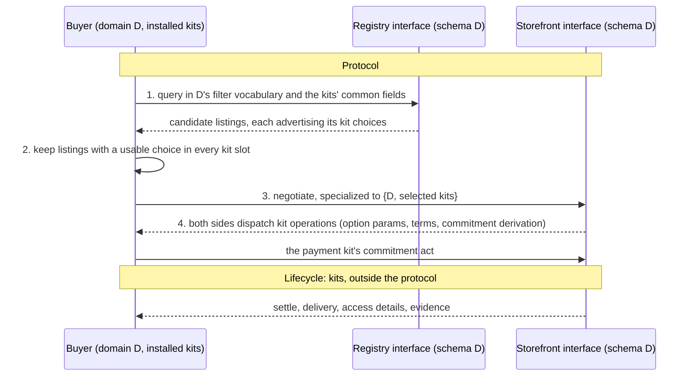

## Context

What exists today (evidence for the decisions below, not a specification):

- **One schema per registry.** A registry process loads one filter spec (`REGISTRY_FILTER_SPEC_PATH`, `core/registry/src/core_registry/api/filter_spec.py`) and its descriptor names that schema's `{id, version}` (`registry_descriptor.py`). Two schemas mean two registry roles: `compose-schema-isolated-registries` (archived 2026-09-01) added an API-credits registry subchart beside the compute one, each with its own identity, descriptor, Service, and persistence.
- **Three identifiers for "what market".** The registry schema (`compute.market` v2, in `core/registry/filter-spec.yaml`; `api_credits` v1, in `domains/apicredits/registry/`); the domain contract identity (`compute.v1` for VM, `bare_metal.v1` for bare metal, `api_credits.v1`); and payload kinds (bare metal's listing kind is `bare_metal.v2`). VM and bare metal both publish under `compute.market` and are told apart by `listing_resource.offering_mode` (enum `bare_metal`, `vm`, `container`). The compute schema sits in core although it is one market's.
- **The domain contract bundles schema and delivery.** A `MarketDomainContract` carries the listing, message, terms, materialization, receipt, and result codecs together with the storefront's fulfillment, result, and teardown hooks. VM and bare metal differ in both halves: VM sells a slice of a host, takes a connection key, and returns connection details; bare metal sells one whole host exclusively, derives its shape from the host's declaration, and returns an SSH node grant.
- **Families.** `ARCHITECTURE.md` "Family kits" and `ARCHITECTURE.toml` `[[families]]` declare one family, `compute`: vocabulary `arkhai_compute` (the capability field names both compute domains publish under) and family kit `provisioning/compute` (jobs, executors, host registry, leases). API credits has "no shared vocabulary beneath it, so no family". The `compose-api-family-kit` stack adds a second family, `api`, under `domains/api/`. Neither family kit's distribution depends on the domains it serves: `provisioning/compute` depends on core and kits only, and the api kit on `arkhai-api*`, core, and kits.
- **Multi-domain storefront.** One storefront process freezes a `StorefrontDomainRegistry` of contributions keyed by contribution ID, offering mode, domain identity, and contract version, and resolves every record from its persisted binding; "public payload fields are assertions, never selectors" (`core/storefront/src/core_storefront/domain_registry.py`). `ARCHITECTURE.md` calls it "one domain-neutral compute-family shell". API credits runs its own storefront process.
- **What a listing advertises.** `settlement_options[]`, each `{mechanism, …, params}`, advertises the payment kit, and the registry filters on `mechanism` and option fields. Delivery is advertised only inside the schema, as `listing_resource.offering_mode`. The listing shape has no identity field.
- **The protocol boundary** (`agreed-evidence-and-early-termination` D1, PR #296): a step is protocol when refusing it leaves a party unable to continue, namely discovery, negotiation, and the mechanism's commitment act. Settle, delivery, and receipts are lifecycle, visible to arbitration only through evidence. `move-settle-out-of-core` moves the settle routes out of core accordingly.

The two markets in the tree sit on opposite axes:

| | Schemas | Delivery backends | Shared code today |
|---|---|---|---|
| Compute | one (`compute.market`) | VM, bare metal (container planned) | `arkhai_compute` vocabulary, `provisioning/compute` |
| API | API credits; inference planned | one quota authority | `domains/api/*` (proposed) |

Any definition of "domain" must make both of these natural. Today compute's domains are its backends and API's domains are its schemas.

## Decisions

These are proposed for discussion; none is accepted.

### D1. A domain is one listing schema

A domain is the type of every listing on one registry. Its identity is the registry schema identity, `{id, version}`. A registry that "supports several schemas" serves their union, which is a schema in its own right, and so a domain; nothing in the architecture needs a registry with more than one schema.

- **What a domain owns:** the listing schema and its filter vocabulary, the negotiation message and terms vocabulary over it, and the buyer's interpretation of it. Payload kinds and contract versions are versions of the domain's codecs, scoped under its identity rather than standing beside it.
- **What a domain does not own:** how a deal is paid for, disputed, identified, or delivered. Those are kits (D3).
- **Thin domains are fine.** A domain may be little more than a schema and a label over kits that do all the work. Sharing code never merges domains, and different listing formats never share one; "these feel like the same kind of thing" is not a criterion.

Under this definition, API credits and inference are two domains if their listings differ, however much code they share. Whether VM and bare metal are one domain is Q1.

### D2. Registry, storefront, and domain are interfaces, not servers

A **registry interface** is the discovery routes over one domain's schema with one descriptor. A **storefront interface** is the negotiation routes over one domain's schema, plus the routes the selected kits contribute. Each has its own base URL, descriptor, principals, and record namespace; `storefront_url` and a descriptor's `baseUrl` name an interface, not a machine.

A **host** implements one or more interfaces. Hosting several can be as shallow as mounting each interface at its own base URL in one router, sharing the process, event loop, database engine, loop controller, site projection state, and any kit instance that is keyed per interface. Parallel processes and separate Helm releases remain valid implementations of the same interfaces. One rule carries over from the storefront domain registry: a request finds its interface from its route alone, never from its payload.

Consequences:

- **Several registries on one server** is several registry interfaces, not a multi-schema registry.
- **One storefront per schema.** An operator selling API credits and inference runs two storefront interfaces, possibly in one host. An operator selling VM and bare-metal capacity runs one or two depending on Q1.
- **The interface is the unit of compatibility and versioning;** the host is the unit of deployment.

### D3. Whatever negotiation specializes on is a kit, and the listing advertises it

The protocol, seen from the buyer:

- **Kit slots.** Identity, payment with its dispute mechanism (the declared pairs of #296 D4), and delivery. A slot's advertisement has the shape `settlement_options` already has: a list of `{kit identity, params}` choices, with params owned by the kit and opaque to the domain.
- **Compatibility** is the same domain and a usable choice in every slot. A buyer missing a domain's plugin cannot read the listing; a buyer missing every advertised payment kit cannot commit.
- **Filter vocabulary.** A registry's filters are the domain's fields plus the common fields of the kits its listings may advertise, as `mechanism` and the lifecycle terms of #296 D5 already are.
- **Dispatch.** Once a choice is selected for every slot, negotiation on each side dispatches the slot's operations to that kit through role tables, as the payment role table does today. Core keeps the schema-opaque carriers.

### D4. Delivery is a kit, and a receipt is its negotiated detail

A delivery kit owns how what was bought reaches the buyer: provisioning, access, teardown, and the evidence they leave.

- **In the protocol,** delivery appears only as the selected delivery choice and its params in the Agreement. A buyer's SSH key for a VM is a delivery param; so is bare metal's `access_methods`.
- **The receipt is lifecycle.** How the buyer learns to reach what it bought is whatever the delivery kit and its params say, and the protocol cares only that the delivery leaves the seller able to answer a failure-to-deliver dispute (#296 D3). Where a listing has one way of delivering, the choice is implicit and nothing extra goes on the wire.
- **The domain keeps what the buyer filters on.** If a property changes what the listing's shape means, or buyers select on it, it is schema; if it changes only how the same thing is handed over, it is delivery.

### D5. No family scope

Code that several domains share is kit code, scoped to the mechanism it is: a payment mechanism, a dispute mechanism, a delivery mechanism, or nothing. The `ARCHITECTURE.toml` `[[mechanisms]]` table, which today lists payment kits, lists delivery kits too, and `[[families]]` retires.

- **Compute:** `provisioning/compute` becomes the compute delivery kit(s) under `kit/`. `arkhai_compute` becomes the compute domain's schema package if Q1 decides one domain, or a kit vocabulary both domains bind if two.
- **API:** the `domains/api/*` packages become a quota-issuance delivery kit (authority, client, contracts, gate, buying halves). Seller machinery in `api-selling` that does not depend on issuance (negotiation, publication, listing lifecycle, route services) is the shared storefront kit that `kit-owned-storefront-shell` and `kit-owned-listing-and-fulfillment-lifecycles` extract, not an API kit.
- **The existing family-kit tests still apply to delivery kits:** a third domain could use the kit without the kit learning its schema or branching on its identity.

## Open questions

### Q1. Is compute one domain?

The question is whether "a slice of a host" and "a whole host" are different listing schemas or one schema with two deliveries.

- **A. One domain, `compute`, with VM and bare-metal delivery kits.** The shape describes the resources the buyer receives in either case; exclusivity, isolation, and access are how they are handed over. `offering_mode` leaves `listing_resource` and becomes the delivery advertisement. Today's multi-domain storefront is already close to this: one storefront selecting a delivery by mode. VM's and bare metal's terms and results become delivery-kit params and results.
- **B. Two domains, two schemas.** If buyers query them differently, or a shape means something different in each, they need separate schemas and so separate registries, and a buyer looking for either queries both. `compute.market` as a shared schema could not stay.
- **Today is neither:** one schema, two domains.

Leaning A, to be tested against the schema: does any filter or field mean something different for a bare-metal listing than for a VM listing?

### Q2. How does a listing advertise delivery?

One listing per delivery choice, or one listing offering several, each priced separately (as #296 D4 lets sellers price settlement options differently)? Goal 3's "one pool, several form factors" fits either.

### Q3. Is identity a per-listing kit slot?

Principal formats and signing schemes could be negotiated per listing, or fixed per registry by its descriptor's authority principals. Which does federation need?

### Q4. What does an interface isolate on a shared host?

Path prefix or host name; whether record namespaces are separate databases, separate schemas, or keyed rows; which kit instances may be shared across interfaces; how descriptors and principals are configured per interface.

### Q5. Union schemas and discriminators

`api_credits` listings already carry `listing_resource.kind`. If inference listings fit that schema under a new kind, inference is a variant of the API-credits domain; if they need their own fields and filters, it is a new domain. When is a discriminated union the right schema, and when is it two domains forced into one registry?

### Q6. Versioning

How does a domain version relate to a schema version, and to kit versions? A new delivery kit is not a new domain version; a new listing field is.

## Effect on in-flight changes

| Change | Effect if accepted |
|---|---|
| `multi-domain-storefront-composition` (in closeout) | Can close as is. Under Q1 A its shell is one compute storefront interface with several delivery kits; under Q1 B, two storefront interfaces in one host. Either way only names and identity placement change later |
| `bare-metal-and-credits-domain-stacks` (in implementation) | Bare metal onto the shell's routes (4a) is consistent with both Q1 answers. Recomposing API credits onto kit overlaps `compose-api-family-kit` |
| `market-platform-compute-40-multi-domain-proof` | The two-authority proof is unaffected in substance; its vocabulary follows Q1 |
| `kit-owned-storefront-shell` (in design) | Its gating question on "the compute shell's home" is answered: the shell is a kit, and compute's composition root sits with the compute domain |
| `kit-owned-listing-and-fulfillment-lifecycles` | "Fulfillment convergence extracts into the compute family kit" becomes the compute delivery kit |
| `compose-api-family-kit` (PR #299; implementation stack in progress) | The api family becomes a delivery kit plus shared storefront kit; package location and the `[[families]] api` entry change. Cheapest to decide before its gate, buying, and closeout sections |
| Inference domain plan (PR #229) | Consistent: inference is its own domain unless Q5 makes it an API-credits kind |
| `agreed-evidence-and-early-termination` (PR #296) | Its D1 is this change's basis; its non-goal "Merging the VM and bare-metal domains" is Q1 here |
| `move-settle-out-of-core` | Consistent: settle moves to the payment kits |

## Alternatives considered

- **Keep domain = schema × backend, family = whatever is shared.** Works for each market alone, but compute and API mean opposite things by both words, and every new market re-decides which axis it is on.
- **Domain = delivery backend everywhere.** Makes compute consistent and API inconsistent: API credits and inference would be one domain with two schemas, so a domain would no longer determine what a registry serves.
- **Multi-schema registries.** A registry serving several schemas is serving their union; giving it a list of schemas adds a selection rule without adding anything a union schema or a second registry interface cannot express.
- **Hosting several interfaces only as parallel deployments.** Valid, and remains valid under D2, but makes every additional schema an operational cost when the separation needed is only in routing, descriptors, and record namespaces.

## Migration sketch

Not a plan; the order follow-up changes would likely take.

1. **Vocabulary.** Promote D1–D5 to `ARCHITECTURE.md`; rename nothing in code yet.
2. **Delivery advertisement and compatibility.** Listings advertise delivery choices; buyers check every kit slot (D3, D4, Q2).
3. **Family kits to kits.** Move `provisioning/compute` and, if merged, `domains/api/*` under `kit/`; retire `[[families]]` (D5).
4. **Interfaces on shared hosts.** Registry and storefront hosts mount several interfaces (D2, Q4).
5. **Compute's domain identity.** Per Q1: collapse VM and bare metal into the compute domain with two delivery kits, or split the schema.
