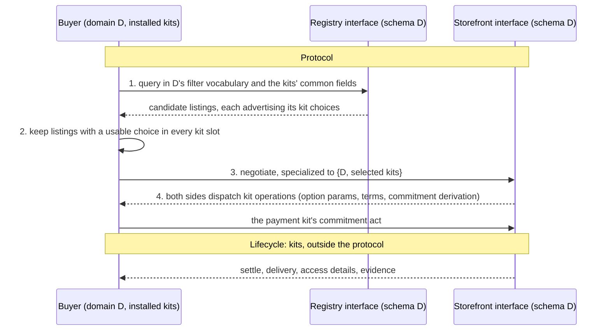

## Context

What exists today (evidence for the decisions below, not a specification):

- **One schema per registry.** A registry process loads one filter spec (`REGISTRY_FILTER_SPEC_PATH`, `core/registry/src/core_registry/api/filter_spec.py`) and its descriptor names that schema's `{id, version}` (`registry_descriptor.py`). Two schemas mean two registry roles: `compose-schema-isolated-registries` (archived 2026-09-01) added an API-credits registry subchart beside the compute one, each with its own identity, descriptor, Service, and persistence.
- **Three identifiers for "what market".** The registry schema (`compute.market` v2, in `core/registry/filter-spec.yaml`; `api_credits` v1, in `domains/apicredits/registry/`); the domain contract identity (`compute.v1` for VM, `bare_metal.v1` for bare metal, `api_credits.v1`); and payload kinds (bare metal's listing kind is `bare_metal.v2`). VM and bare metal both publish under `compute.market` and are told apart by `listing_resource.offering_mode` (enum `bare_metal`, `vm`, `container`). The compute schema sits in core although it is one market's.
- **The domain contract bundles schema and delivery.** A `MarketDomainContract` carries the listing, message, terms, materialization, receipt, and result codecs together with the storefront's fulfillment, result, and teardown hooks.
- **Layer, scope, and kind.** `ARCHITECTURE.md` "Package and dependency layers" and `ARCHITECTURE.toml` classify every package by layer (core, kit, specialization, composition: which way it may depend), scope (the set of families, domains, and mechanisms it may know; a package may depend only on packages whose scope is a subset of its own), and kind (library, executable, contracts, client; plugin as a property). Scope is declared by path and by the `[[families]]`, `[[domains]]`, and `[[mechanisms]]` tables. Known violations are `[[exceptions]]` rows, each owned by a change.
- **Families.** A family is sibling domains sharing a vocabulary package; a family kit is shared machinery speaking that vocabulary, scoped to the family. `compute` is declared (`domains/compute`, vocabulary `arkhai_compute`, family kit `provisioning/compute`). The `compose-api-family-kit` stack adds `api` under `domains/api/` so that inference composes the API-credits machinery instead of copying it. `align-package-paths-with-layers` moves `provisioning/compute` to `domains/compute/provisioning*`: under its "scope-first directories" principle, `kit/` means "knows no market", so a family kit cannot live there.
- **Multi-domain storefront.** One storefront process freezes a `StorefrontDomainRegistry` of contributions and resolves every record from its persisted binding; "public payload fields are assertions, never selectors" (`core/storefront/src/core_storefront/domain_registry.py`). The shell lives in `domains/bare_metal/storefront` and `domains/vms/storefront` imports it, an `[[exceptions]]` row owned by `kit-owned-storefront-shell`.
- **What a listing advertises.** `settlement_options[]`, each `{mechanism, …, params}`, advertises the payment kit, and the registry filters on `mechanism` and option fields. Delivery is advertised only inside the schema, as `listing_resource.offering_mode`.
- **The protocol boundary** (`agreed-evidence-and-early-termination` D1, PR #296): a step is protocol when refusing it leaves a party unable to continue, namely discovery, negotiation, and the mechanism's commitment act. Settle, delivery, and receipts are lifecycle, visible to arbitration only through evidence.

The two markets in the tree share code along opposite axes:

| | Schemas | Delivery backends | Shared code |
|---|---|---|---|
| Compute | one registry schema (`compute.market`), two listing payloads | VM, bare metal (container planned) | `arkhai_compute`, `provisioning/compute`, the storefront shell |
| API | API credits; inference planned | one quota authority | `domains/api/*` (proposed) |

## Decisions

These are proposed for discussion; none is accepted.

### D1. A domain is one listing schema

A domain is the type of every listing on one registry. Its identity is the registry schema identity, `{id, version}`. A registry that "supports several schemas" serves their union, which is a schema in its own right, and so a domain.

- **What a domain owns:** the listing schema and its filter vocabulary, the negotiation message and terms vocabulary over it, and the buyer's interpretation of it. Payload kinds and contract versions are versions of the domain's codecs, scoped under its identity.
- **What a domain does not own:** how a deal is paid for, disputed, identified, or delivered, and any code another domain could use. Those are kits.
- **A domain is a set of compatible executables.** In a decentralized market there is no realization of "a market" beyond its registries, storefronts, and buyer clients. A domain is the set of them that interoperate, which in practice federates around registries. An inference registry or storefront can be hosted without knowing API-credits ones exist; that they share libraries is invisible from outside, as two websites sharing a web framework are not one site.
- **Thin domains are the goal.** A domain may be little more than a schema and its entry points over kits that do all the work.

### D2. Registry, storefront, and domain are interfaces, not servers

A **registry interface** is the discovery routes over one domain's schema with one descriptor. A **storefront interface** is the negotiation routes over one domain's schema, plus the routes the selected kits contribute. Each has its own base URL, descriptor, principals, and record namespace; `storefront_url` and a descriptor's `baseUrl` name an interface, not a machine.

A **host** implements one or more interfaces. Hosting several can be as shallow as mounting each interface at its own base URL in one router, sharing the process, database engine, loop controller, site projection state, and any kit instance keyed per interface. Parallel processes remain valid implementations of the same interfaces. A request finds its interface from its route alone, never from its payload.

### D3. Whatever negotiation specializes on is a kit, and the listing advertises it



- **Kit slots.** Identity, payment with its dispute mechanism (the declared pairs of #296 D4), and delivery. A slot's advertisement has the shape `settlement_options` already has: a list of `{kit identity, params}` choices, with params owned by the kit and opaque to the domain.
- **Compatibility** is the same domain and a usable choice in every slot.
- **Filter vocabulary.** A registry's filters are the domain's fields plus the common fields of the kits its listings may advertise, as `mechanism` already is.
- **Dispatch.** Each slot is an interface defined below the storefront and buyer machinery, which the selected kits implement (D6).

### D4. Delivery is a kit, and a receipt is its negotiated detail

A delivery kit owns how what was bought reaches the buyer: provisioning, access, teardown, and the evidence they leave.

- **In the protocol,** delivery appears only as the selected delivery choice and its params in the Agreement.
- **The receipt is lifecycle.** How the buyer learns to reach what it bought is whatever the delivery kit and its params say; the protocol cares only that delivery leaves the seller able to answer a failure-to-deliver dispute (#296 D3). Where a listing has one way of delivering, the choice is implicit and nothing extra goes on the wire.
- **The domain keeps what the buyer filters on.** If a property changes what the listing's shape means, or buyers select on it, it is schema; if it changes only how the same thing is handed over, it is delivery.

### D5. Folders claim the dependency order, and the code must not contradict the claim

Layer and scope become one rule read from the folder tree. A package's place claims where it sits in the dependency order; the check is that every real dependency goes down that order.

```text
order
  core < kit < domains
  inside any folder:   loose packages < its subfolders
  sibling subfolders:  incomparable, unless an edge between them is declared

check(P depends on Q)
  folder(Q) ≤ folder(P)          else: error
```

- **Domains are flat.** Each domain is an independent set of entry points, so `domains/` has one incomparable subfolder per domain. Inside it, the domain's schema package is loose and its storefront, buyer, and service roots sit above it. A domain's private helpers stay in its folder; code a second domain needs moves to `kit/`.
- **Kit is flat where nothing orders it.** Loose `kit/` packages are the base every group may build on. A group (`kit/api/`, `kit/compute/`, `kit/payments/`) sits above them; its members may depend on the loose base and on each other, and nothing outside the group may depend into it except from above.
- **Folders may claim more structure than exists.** A group need not have a root package, and its members need not depend on each other; grouping packages that will be used together is a naming convenience. A declared edge nothing uses yet is allowed. This is how anticipated structure is written down.
- **A contradiction is a structural error, not an exception.** If a real dependency goes against the claimed order, the folders are wrong, usually in what something is named, and the fix is to move or rename them. `[[exceptions]]` rows become the list of places where the structure is known to be wrong.
- **What this replaces.** The layer table collapses to `core < kit < domains`; the specialization layer becomes "a group inside kit". Scope atoms and the subset rule become the folder order plus declared edges; `[[families]]`, `[[domains]]`, and `[[mechanisms]]` become folders. Kind is unchanged. "Kit composes nothing" becomes "kit holds no domain entry point": a shared service, such as the provisioning service or an authority host serving several domains, sits in its kit group.
- **Family** survives as a name for a kit group whose members build on a shared vocabulary. It is a claim the check verifies, not a scope others must trust.

### D6. Parents define interfaces; children implement them

Because a loose package cannot depend into a group, machinery that must work with any member of a group defines the interface in a loose package and the group's members implement it. The domain's entry point wires the selected implementations together.

- **Payment.** `kit/settlement-runtime` already plays this role: `kit/alkahest`, `kit/arkhai-payments`, and `kit/contact-exchange` all build on it. Grouped as `kit/payments/`, the rule forbids `kit/storefront` importing Alkahest directly, which today is an `[[exceptions]]` row owned by `move-escrow-into-alkahest`. The storefront speaks the payment interface; the Alkahest and hosted-payments clients implement it.
- **Delivery and identity** (D3's other slots) follow the same pattern: an interface in the loose base, implementations in groups, selection in the domain.
- **Bridges** between two groups, such as API selling over Alkahest, sit in one group with a declared edge to the other (`api → payments`). The edge is a fact about the design worth stating.

## Evidence

### The derived lattice on `dev`

For each package, its extent is the set of domains whose packages depend on it, directly or indirectly (from `pyproject.toml` dependencies at `origin/dev`):

| Extent | Packages |
|---|---|
| all three domains | core, `core/buyer`, `core/storefront` (+client), `core/registry-client`, `kit/storefront`, `negotiation-runtime`, `capacity-publication`, `alkahest`, `arkhai-payments`, `identity`, `policy`, `site` (+client), `settlement-runtime`, … |
| {bare_metal, vms} | `domains/compute`, `provisioning/compute` (+ansible, client, contracts), `kit/fulfillment`, `contact-exchange`, `delivery-apprise`, `pool-overrides`, and `domains/bare_metal` (+storefront) |
| {vms} | `domains/vms/*`, `kit/capability-pricing` |
| {bare_metal} | `bare_metal/buyer`, `bare_metal/provisioning/adapter` |
| {apicredits} | `domains/apicredits/*`; on the fork, all of `domains/api/*` |
| standalone | `core/registry`, `provisioning/compute/service` |

Kits used by fewer domains than their placement claims (`capability-pricing`, the compute-only kits, the fork's `api` packages) are anticipated reuse, which D5 allows.

### What D5 flags against the target tree

```text
kit/
├── storefront/  negotiation-runtime/  settlement-runtime/  identity/  …   loose base
├── payments/    alkahest/  arkhai-payments/  contact-exchange/
├── compute/     capabilities/  provisioning/  provisioning-contracts/  provisioning-client/
│                provisioning-ansible/  provisioning-service/  storefront-shell/
└── api/         vocabulary/  contracts/  client/  authority/  gate/
                 selling/  selling-alkahest/  …  buying/  buying-arkhai-payments/  …
declared edges: api → payments, compute → payments
domains/         apicredits/  inference/  vms/  bare_metal/
```

| Dependency today | Verdict | What it says |
|---|---|---|
| `vms/storefront → bare_metal/storefront` | error: sibling domains | The bare-metal storefront is the compute storefront shell and belongs in `kit/compute/` (`kit-owned-storefront-shell` already moves it) |
| `kit/storefront → kit/alkahest`, `kit/policy → kit/alkahest` | error: loose into a group | The storefront and policy speak the payment interface; Alkahest specifics leave them (`move-escrow-into-alkahest` already plans this) |
| `domains/vms/* → domains/compute` | error: domains incomparable | The compute "family" is a kit group, not a domain folder |
| `provisioning/compute → provisioning/compute/contracts` | error if contracts nests under provisioning | Contracts sit below provisioning, not inside it: `kit/compute/` is a group without a root package |
| fork `api/gate` not built on `arkhai-api` | allowed | A group need not have a root |

Every flagged dependency already has an `[[exceptions]]` row or an owning change, so D5 agrees with the structural work in flight and gives it one rule.

## Open questions

### Q1. Is compute one domain?

VM and bare metal publish under one registry schema, `compute.market`, but have different listing payloads (`VmListing`, `BareMetalListing`), messages, terms, and results. Work in flight already unifies their storefront implementation; that is code sharing, which D5 places in `kit/compute/` whichever way this question goes.

- **A. One domain, `compute`, with VM and bare-metal delivery kits.** The listing shape describes the resources the buyer receives in either case; exclusivity, isolation, and access are how they are handed over. `offering_mode` leaves `listing_resource` and becomes the delivery advertisement, and VM's and bare metal's terms and results become delivery-kit params and results.
- **B. Two domains, two schemas.** If buyers query them differently, or a shape field means something different in each, they need separate schemas and so separate registries (or an explicit union, Q5).
- **Today is neither:** one registry schema, two domain contracts.

Leaning A, to be tested against the schema: does any filter or field mean something different for a bare-metal listing than for a VM listing? Under D5 the answer moves only folders under `domains/`.

### Q2. How does a listing advertise delivery?

One listing per delivery choice, or one listing offering several, each priced separately (as #296 D4 lets sellers price settlement options differently)?

### Q3. Is identity a per-listing kit slot?

Principal formats and signing schemes could be negotiated per listing, or fixed per registry by its descriptor's authority principals.

### Q4. What does an interface isolate on a shared host?

Path prefix or host name; whether record namespaces are separate databases, schemas, or keyed rows; which kit instances may be shared across interfaces; how descriptors and principals are configured per interface.

### Q5. Union schemas and discriminators

`api_credits` listings carry `listing_resource.kind` and compute listings carry `offering_mode`. When is a discriminated union the right schema, and when is it two domains forced into one registry?

### Q6. Versioning

How does a domain version relate to a schema version, and to kit versions? A new delivery kit is not a new domain version; a new listing field is.

### Q7. Where does the order live in configuration?

The folder tree carries most of the order. Declared edges between groups, and the root-relative rules for each domain's schema package, need a home in `ARCHITECTURE.toml`; kind rules stay as they are.

## Effect on in-flight changes

| Change | Effect if accepted |
|---|---|
| `align-package-paths-with-layers` (in design) | Compute's shared code moves to `kit/compute/`, not `domains/compute/provisioning*`; `domains/compute` becomes `kit/compute/capabilities`. Its scope-first principle survives with "scope" read as the claimed order |
| `compose-api-family-kit` (PR #299; stack through §10 on the fork) | `domains/api/*` moves to `kit/api/*`, and `[[families]] api` becomes a kit group with a declared edge to `payments`. Package contents are unaffected. Cheapest before it merges |
| Inference domain plan (PR #229) | Consistent: `domains/inference` holds a schema and entry points over `kit/api/` |
| `kit-owned-storefront-shell` (in design) | Its question on "the compute shell's home" is answered: `kit/compute/`, or loose `kit/` for what is market-neutral |
| `kit-owned-listing-and-fulfillment-lifecycles` | "Fulfillment convergence extracts into the compute family kit" lands in `kit/compute/` |
| `move-escrow-into-alkahest` | Consistent: it removes the loose-into-group dependencies D5 flags, and D6 names the pattern |
| `multi-domain-storefront-composition` (in closeout) | Can close as is; only names and placement change later |
| `bare-metal-and-credits-domain-stacks`, `market-platform-compute-40-multi-domain-proof` | Unaffected in substance; vocabulary follows Q1 |
| `agreed-evidence-and-early-termination` (PR #296) | Its D1 is this change's basis; its non-goal "Merging the VM and bare-metal domains" is Q1 here |

## Alternatives considered

- **Keep domain = schema × backend, family = whatever is shared.** Compute's domains are backends and API's are schemas; every new market re-decides which axis it is on.
- **Families as declared scope atoms under `domains/`.** The current model. "Knows a market" has no fixed meaning: a payment service that supports some trades but not others would become market-specific, and over time `kit/` empties into families. It also places shared libraries beside domains, obscuring that a domain is a set of compatible executables.
- **Families containing their domains** (`domains/api/{lib,credits,inference}`). Makes the scope set literal in the path, but treats a code-sharing relation as part of a domain's identity.
- **Everything in one library tree** (`lib/{core,payments,…}`, `domains/`). Erases the line between the protocol, which every party must speak, and our libraries, which nobody outside can see.
- **Purely derived placement** (a package lives at the meet of its consumers). Correct as a check, but punishes building kit ahead of its second consumer and turns directory structure into a moving target; D5 keeps the derived lattice as the check and lets folders claim more.

## Migration sketch

Not a plan; the order follow-up changes would likely take.

1. **Rule.** Promote D1, D2, D5, and D6 to `ARCHITECTURE.md`; teach `make check-architecture` the folder order, reporting today's violations as the existing exceptions.
2. **Kit groups.** Move `provisioning/compute` and `domains/compute` into `kit/compute/`, the fork's `domains/api/*` into `kit/api/`, and the payment kits into `kit/payments/`, alongside the in-flight extractions.
3. **Delivery advertisement and compatibility** (D3, D4, Q2).
4. **Interfaces on shared hosts** (D2, Q4).
5. **Compute's domain identity** (Q1).
