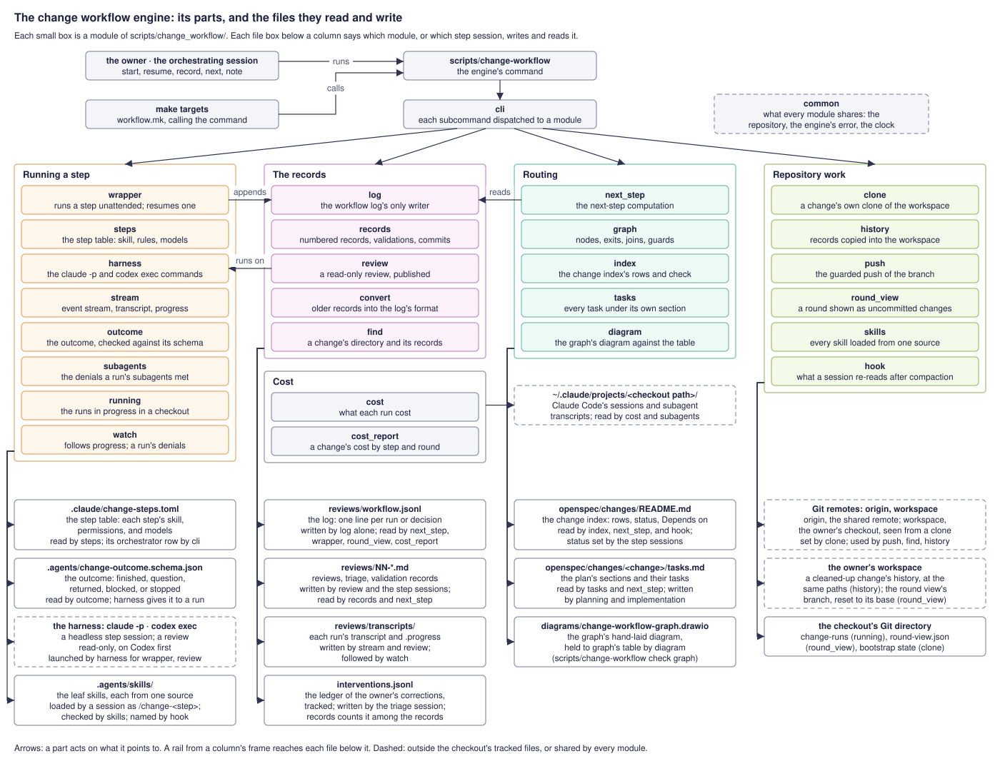
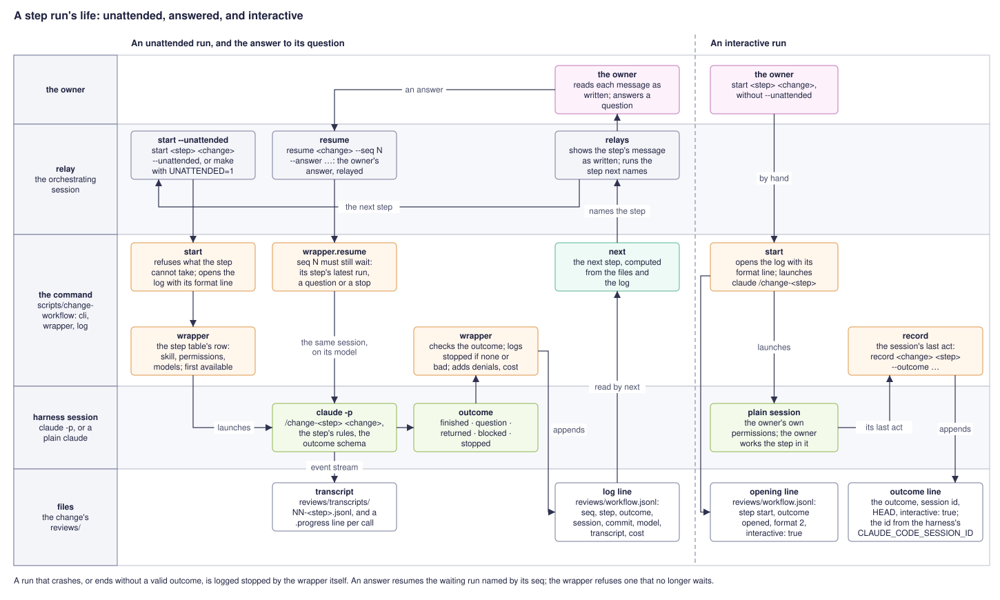
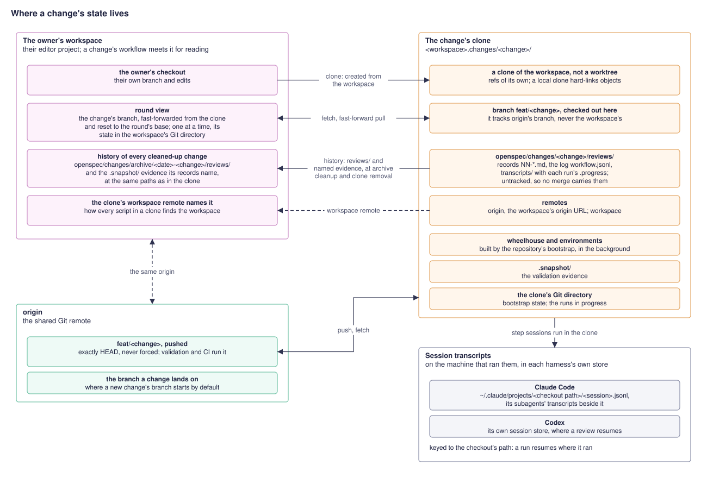
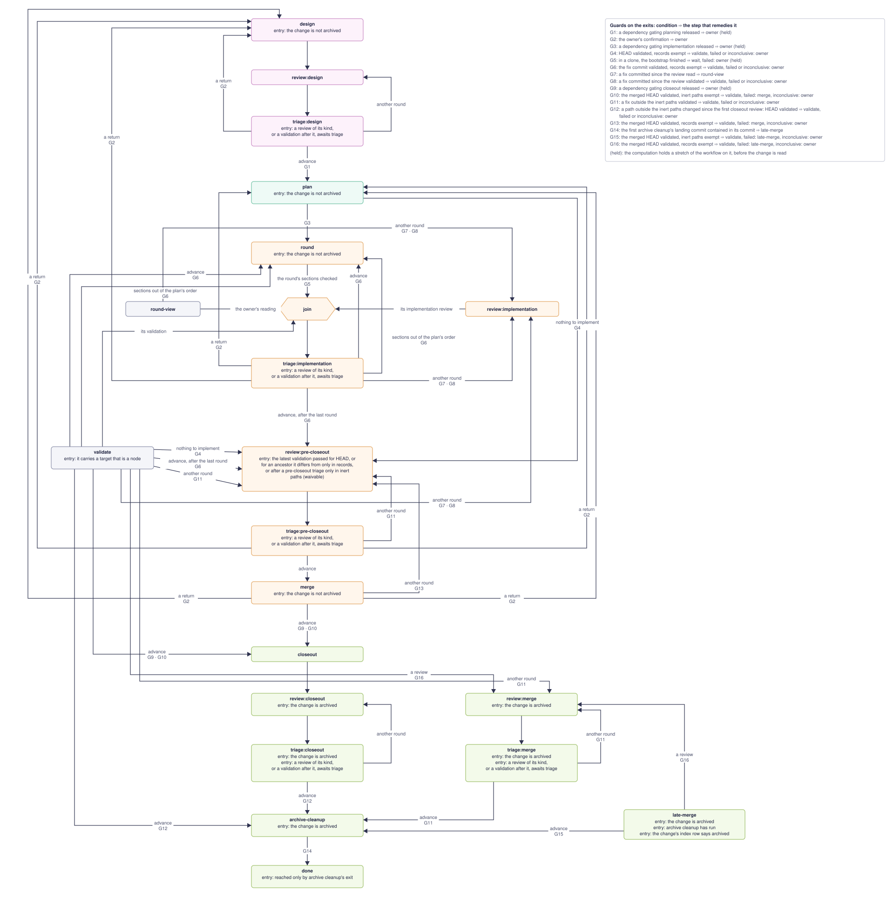

# The change workflow

The [specification](spec.md) defines how an OpenSpec change is worked: the phases it
moves through, its review records, triage, the intervention ledger, validation, the
orchestrating session that advances a change through its steps, the engine that runs
them, and the interfaces an adopting repository may rely on. Its
[index](index.md) organizes the requirements by id into five parts, and this document
follows the same parts: the process; implementation and validation; reviews and
triage; the engine; the public surface. It explains why the workflow is shaped as it
is. How to run each step is in
[`docs/agents/change-workflow.md`](../../../docs/agents/change-workflow.md); how this
repository fills the roles the workflow leaves to a repository is in
[`market-change-workflow`](../market-change-workflow/README.md).

A change's design and its guidance are where the repository owner's judgement
matters: deciding what a change does, and refining the rules so later reviews find
less. Everything else around a change is transport — carrying a review from one
agent to another, resuming a session that stalled, running the same validation
sequence before every review, choosing which step runs next. The workflow makes
agents do the transport. Each phase's procedure is written once, as a skill any
agent harness can load; reviews are exchanged as files; validation runs unattended;
an orchestrating session carries the change from one step to the next; and the owner
reads every finding, discussed or reported in a triage's table of default
acceptances, and decides every design question.

## The process

### Phases, triage, and archival

A change moves through design, planning, implementation, and closeout, and a phase
ending in a review is finished only when that review's triage names a step of the
next phase as its exit, or the owner directs one. Planning starts only after the
design review's triage advances it,
so a review that redirects the design never discards a plan; a design question
planning exposes returns the change to design.

### The owner is interrupted only for judgement

A change stops for the owner at four kinds of moment: the design discussion's
questions; the owner's notes on each implementation round, read through the round
view; the triage discussion — each discussed finding's disposition, and, when the
agent recommends another review round, whether the fixes merit it, asked once every
discussed finding is disposed and before any fix, while the owner is still present;
and the interrupts no rule can settle, such as an environmental remedy validation
proposes, a denial that needs a rule, a proposed return, a stopped step, or a
prerequisite to release. Every other transition advances on conditions the
computation checks.

A triage asks only what the owner's answer could change. A review finding the
default rule admits is accepted by default and reported, not asked ([Triage](#triage));
and when the agent recommends advancing, the triage takes the advancing exit without
asking and reports it beside its table of default acceptances. The owner's recorded
answers showed why: at the gates of the triages measured, the owner took the
agent's recommendation to advance 55 times in 56, and its recommendation of another
round 18 times in 20, so the question about advancing cost a turn every round and
almost never changed anything, while disagreement concentrated where another round
was recommended. A recommendation of another round is still argued and asked. The
table rides on the triage's last question when it asks one, so a correction there is
an ordinary disposition made before any fix; a triage that asks nothing gives it in
its final report, and a correction after the fixes revisits the finished triage. The
owner is never made to wait on a confirmation of the table: that would be the
question under another name, leaving the owner's window idle.

Reviews are not gates. A gate at each review would ask the owner a question whose
answer does not vary, and asking it leaves the owner's window idle while their
attention is elsewhere; a routing question at each review would be the same
interruption under another name. A
review's triage chooses its exit among those its node declares — the step that
advances the change, another review of the same kind, or, before the archive, a
return to design or planning — on the owner's disposition, and names it in its
outcome with the records it triaged (`triaged`). Its file's `## Next` keeps the
choice in prose for whoever reads the history, and nothing routes on it, since
routing on free text is a model's reading again. Because the outcome names the
reviews it governs, the log alone says which triage governs a review and which run
a return's confirmation resolves; a fixed token in the file needed files' times to
say either. A triage file no triage outcome names is a triage in progress, whatever
its words. Once the owner confirms a return, that review no longer governs, and what
the return leads to is a round of its own, read, validated, and reviewed afresh —
even a rework of the returned round's own sections, which under the returned round
would reach the next round unread and unreviewed. A declined return is the owner's
to settle, since the triage it ended no longer says what follows. A triage with
nothing to discuss that recommends advancing advances without asking the owner
anything. An implementation round, the merge
before closeout, and the merge after the archive advance only on a `passed`
validation of their final commit,
and after a closeout review a correction
outside the repository's inert paths is validated before archive cleanup, so a code
correction reaches the merge validated unless the owner waives it. The owner's own look at the pull request before merging is outside
the workflow.

An intervention — another review, a validation before a step, a step past a guard,
a confirmed return — is a deliberate, per-change, irregular transition, and the
owner's alone. The owner directs any node of the graph by a decision line `by:
owner` naming its target as an outcome names an exit, with a reason that says what
it skips, and the computation names the directed step until a run of it takes an
exit. A direction checks no exit guard: an exit guard conditions a step's choice,
and a transition the owner made deliberately is not refused by one; a problem it
causes is corrected by another direction. Its target's entry guards are checked,
and the log's writer refuses it, naming the guard, while an unwaivable one of any
node it names is not met — the target nested in a direction to validation
included — so a direction no step could carry out is refused while the owner is
present rather than failing later as a stopped run. A waivable entry guard, the
pre-closeout review's validation, takes the direction as its override, and the
waivers of another design review and of archive cleanup's validation are plain
directions. Interventions declared as owner-only edges of the table were rejected:
each new kind would need an OpenSpec change before it could be used once, and an
intervention is the transition the workflow did not plan for. Only a decision the
log attributes to the owner directs a step or confirms a return, as with the
owner's other decisions — a branch decision, a waiver — so the orchestrating session
directs nothing of its own accord, and never records a step's exit on its behalf.

A waiver skips evidence, so only the owner waives, and no waiver is taken by
default: until how often the owner accepts each kind is measured, a wrong default
would cost a broken pipeline found later. But the owner had been proposing nearly
every waiver themselves, for a few recurring reasons, so a step that meets a guard the
owner may waive recommends a waiver when one of those reasons, written as a criterion,
holds — commits that differ from validated ones only in paths no part of validation
exercises, a failure already diagnosed as environmental in an earlier record, a review
and a validation of commits differing only in records or documentation, or a decision
after a return to design confined to one requirement's wording or a choice the design
review weighed — naming the criterion and its evidence (CW-q3dm); the merge before
closeout keeps its own judgement. Criteria with no recommendation would leave the
owner to spot every waiver. Each recommendation is a ledger line, taken or declined,
so a guidance review can count them by criterion, the evidence a later change would
need to take a criterion's waivers by default. The criteria themselves are in the
workflow's guide, under "Waivers".

A step's judgement of the exit it takes is followed without the owner's
confirmation unless the exit needs a waiver. A confirmation of a judgement the owner
almost always shares is a stop with a foregone answer; a waiver skips evidence, and
so stays the owner's. The merge after the archive judges whether its resolutions
need a review on written criteria and takes that exit without asking; the merge
before closeout still asks the owner to confirm another pre-closeout review, until
the workflow's use shows whether it should change too.

The archive is the boundary no direction crosses. An archived change's deltas are
already merged into `openspec/specs/`, so design, planning, and implementation
refuse it; the closeout review, its triage, archive cleanup, the merge after the
archive, the merge review, and its triage need the archive, and archive cleanup
would otherwise mark `archived` a change whose deltas were never merged. No step
after the archive returns the change to an earlier phase either: once the landing
branch's changes are interleaved with the archived deltas, the archive's merge of
them cannot be undone, and archive cleanup's release of dependents would be left
wrong. Where a merge after the archive cannot resolve a conflict so that both sides
hold, or the landing branch has invalidated the change's design, the merge asks the
owner and leaves the merge in progress; the owner resolves it as they direct, lands
the change and follows up in a new change, or takes it off the workflow.

### The merge before closeout

A change is reviewed against the branch it was branched from as it stood then, and
lands on that branch as it stands when it merges, and between the two the branch
moves. A merge of it made whenever the owner thinks of it can fall after the
pre-closeout review, where no
step owns what it breaks: implementation has no section for it and triage no review
of it, so a failed validation of the merge reaches the owner with nowhere to go. So
the merge is a step of the graph, after the pre-closeout triage and before
closeout, and closeout is reached only through it: the validation before closeout is
then a validation of the change merged with what it lands on.

Git merges text, not meaning. Code the change added that calls what that branch
renamed or
removed merges without a conflict and fails only when it runs, and end-to-end
scenarios fail only in the pipeline, which no local suite stands in for. So the
merge reconciles the change's own code with the branch's changes, not only its
conflicts,
and a failed validation of the merged `HEAD` routes back to the merge, which holds
what each side changed, rather than to the owner; an inconclusive one, being missing
evidence, still goes to the owner.

Most merges are mechanical — locks, index rows, version bumps — so the merge is not
a review round of its own. It judges what it needs, and its default is the cheapest
safe route, taken without asking: closeout after a passing validation of the merged
`HEAD`. Each costlier or riskier deviation is the owner's to confirm: another
pre-closeout review, when the merge changed what the change does, and closeout
without that validation, which is the owner's direction past the guard as any
waiver is. After a review of the merge, its triage advances to the merge again,
which finds the branch merged, or merges what it gained meanwhile.

Which branch a change lands on is recorded with its clone: the branch the workspace
had checked out when the orchestrating session made the clone, or the clone's
`--from` (["A change is worked in its own clone"](#a-change-is-worked-in-its-own-clone)).
Each finished merge records in its outcome the branch it brought in, as `landing`
with the remote it fetched from and the commit (["The log, its format, and the
conversion"](#the-log-its-format-and-the-conversion)). `start merge` adds to the
merge's invocation the branch it is given, else the branch the change's last
finished merge recorded, else the clone's, and the skill merges the branch its
invocation names and assumes none. The owner names another, `FROM=<branch>` through
the make fragment, and every later merge of the change — a repair, the merge
repeated after its review, a merge after the archive — brings that branch in again
without the orchestrating session having to remember it: with the clone's branch
first, the merge repeated after its review would bring in a branch other than the
one reviewed whenever the argument was forgotten. A change worked in place, with no
clone and no merge recorded yet, is merged only from a branch given, and the merge
refuses without one. No repository default stands in: a default would be right for
most changes and silently wrong for one branched from elsewhere. The record takes
the branch name alone into `start merge`, never the remote: a merge after the
archive may run in the workspace once the clone is gone, whose remotes are named
otherwise, and it chooses its remote afresh where it runs and records it.

The merge before closeout sits in the implementation phase, since it may change
code, and sets `ready for closeout` as it advances only when the merged `HEAD` is
already validated; closeout accepts a row still `in implementation` once the
computation names it, as it did when a triage advanced before its fix was validated.
A merge of the branch at any other time before the archive stays the owner's
intervention, and does not replace this one.

#### The merge after the archive

The landing branch keeps moving after the merge before closeout: while closeout, its
review, and archive cleanup run, and while the pull request waits. When the
change's branch then conflicts with it or falls behind it, the change is merged
again through the merge after the archive, `late-merge`: a node of its own whose run
is the merge step, with the same skill, mechanics, permissions, and target, as
`round` runs implementation. A new step would have copied the merge's permissions
into a second row of the step table, with a target, hook rights, and a model entry of
its own, and had the owner leave the orchestrating session to run it; a `merge`
qualified by a kind would have needed a permanent rule that a kindless merge is the
one before closeout; and one `merge` node with both sets of exits would declare exits
wrong in every state it can be in. Un-archiving the change into a new round was
rejected for the reasons the archive boundary gives
([The owner is interrupted only for
judgement](#the-owner-is-interrupted-only-for-judgement)), and because the common,
mostly mechanical merge would go through a dozen steps whose resolution the merge has
already made.

It is entered only once archive cleanup has run and while the change's index row
says `archived`: the merge keeps that row, and archive cleanup run again tells itself
from a first run by it, so a change whose row was pruned has the row restored before
the owner directs the merge. It resolves as the merge before closeout does, and also
keeps the change archived. The change's own row stays `archived` and its archived
directory as its branch has them. `openspec/specs/`, each `index.md`, and the
permanent documents keep both sides — every requirement saying what each change
meant, every id unique — since the change's deltas are already merged there and no
later step reads them. A row the landing branch brought that depends on the change
is released as archive cleanup releases a dependent, since archive cleanup run again
releases nothing. The capacity figure kept is the one measured later. The pull
request's drafts are appended to, never redrafted, since the history copy refuses a
file that changed other than by growing.

The merge judges whether its resolutions need a review of their own, a review of kind
`merge`, on criteria its skill writes: a conflict resolved outside the mechanical
files — the change index, other changes' documents, files the hooks rebuild,
version-only bumps, and files a validation part's cleanup writes; a reconciliation
of the change's own code or scenarios; a file outside the mechanical files that both
sides changed since the merge base, since two changes' edits to one specification can
merge cleanly into contradiction; and a contract the landing branch changed in
meaning. Several changes on one goal run in parallel and promote into the same
specifications, so such a review is often warranted, and a confirmation of it would
be a foregone stop: the merge names the review or archive cleanup and the
orchestrating session follows it. Always reviewing would spend a review and a triage
on a merge whose only conflict was an index row.

The merged `HEAD` is validated before the review or archive cleanup, as before
closeout, and a failed validation names the merge after the archive again, which
repairs what it found; the end-to-end pipeline is the only check that finds a stale
call in a scenario. Only the owner waives that validation, and the waiver is the
owner's direction to the exit the merge named, so a review the merge chose is not
skipped with the validation; skipping both is a direction to archive cleanup whose
reason says so. A direction checks no exit guard, so a waiver always directed to
archive cleanup would have skipped a chosen review silently. The merge review's
triage advances to archive cleanup, which runs again on the archived row and ends at
`done`, or names another merge review; it does not return to the merge. The owner
reviews the branch before merging the pull request and directs another merge after
the archive when the landing branch has moved again: a loop ending only when the
landing branch gained nothing would go round until the branch paused.

Detection runs by itself only where nothing it moves is under the owner's review.
Archive cleanup fetches the branch the last finished merge recorded, or else the
clone's, and records what it fetched; its first exit to `done`, before the pull
request opens, names the merge after the archive when that commit is not in the
branch, and the orchestrating session runs it without asking. A long closeout is
when the landing branch gains the other changes on the owner's goal, and the check
costs one fetch. After the pull request opens, nothing detects that the landing
branch moved: nothing runs after `done`, a poller or a trigger on pushes would need
infrastructure the workflow lacks, and a merge started by itself would move the
branch the owner is reviewing. The owner then starts the merge by telling the
orchestrating session, which records the direction.

### Closeout and archival

Closeout and archival are one phase. Closeout writes the documents OpenSpec does not
synchronize, then archives the change, which merges its deltas into
`openspec/specs/`, so the closeout review reads the specifications as they will
land rather than inferring them from the delta. The steps after the archive find the
change by name under its dated directory; design, planning, and implementation have
nothing to do with an archived change and refuse it.

Closeout changes documentation only. The code was last reviewed at pre-closeout and
the closeout review reads documentation, so a closeout code edit would go unreviewed
as code; comment hygiene and import placement are therefore done before the
pre-closeout review and only confirmed at closeout. A code defect a closeout review
does find stops for the owner, who directs the correction and decides whether it
needs another reader; reopening the change for a full round is not required for what
is expected to be rare.

Archive cleanup follows the closeout review's advancing triage as a step of its own,
with its own entry checks, rather than as the end of triage: it releases the
change's dependents, sets it `archived`, drafts the merge, runs the cleanup of every
validation part that declares one (`run cleanup`), and copies its history into the
owner's workspace, and is the point at which the change lands. Its check that a
correction outside the repository's inert paths
was validated stands even for another change's commit on a shared branch, since the
merge carries every commit on it; the owner may waive it, judging the paths named,
and the waiver is a ledger line.

### The index states what may start

The active-change index is what the next-step computation reads to decide what
starts next, so a row's status names its phase and its state within it (`ready
for`, `in`, `blocked in`), and dependencies on other changes sit in their own column
with the phase each gates. A single word such as `active` cannot carry that
decision; it erases the difference between a change waiting for design and one
waiting for a plan, which separate skills perform.

When a dependency lands, its dependents' designs rest on a codebase it has just
altered, so archive cleanup returns each dependent not yet implementing to design.
That ties reverification to a step that already runs. A dependent already in
implementation, or blocked for its own reason, keeps its status.

Every step that edits the index runs `make check-change-index`. The citation check
cannot see those edits: it is scoped to a change's own documents, and the index's
links are relative directory links. The check covers active changes only; archived
rows are recent history and may be pruned at any time.

### A prerequisite is proposed apart and halts its dependent

A design that cannot proceed without another change shapes that change's
requirements and initial proposal with the owner, and halts. The proposal is written
in a worktree on a new branch from the branch the change lands on, and reaches the
blocked branch only by merging that branch once it lands, so the blocked branch never
holds a copy of its own:
writing it on the blocked branch and cherry-picking it would leave, after the
landing branch is merged back, the unarchived copy beside its archived one without a
conflict, and
stacking the prerequisite on the blocked branch would put two changes in one pull
request and stop the prerequisite landing alone. One change per branch is the rule
this keeps.

The blocked change then stays `in design`, with the prerequisite in `Depends on`
gating design; `blocked in design` is kept for reasons that are not another change.
Starting the prerequisite's workflow is the owner's, as choosing any other work is.
Once the prerequisite is archived and merged in, the dependency names an archived
change, which the index check rejects; the computation recognizes that state, and on
the owner's word the dependency is dropped and design resumes.

## Implementation and validation

### Sections are slices, sessions are the owner's

Compliance with the repository guidance degrades as a session grows, and sharply
once it compacts. `AGENTS.md` is loaded as system context and survives, but the
documents it requires reading enter through tool calls, are ordinary conversation,
and are summarized away; the summary keeps the task state and drops the rules.
Before compaction the same rules sit ever further behind tool output.

A plan nevertheless says nothing of sessions. A `tasks.md` section is a coherent
slice that one verification point proves, sized by what it changes and what proves
it; whether one session implements it, several sessions one each, or a coding
harness at all, is not the plan's concern, so the same plan serves any of them. How
many sessions implement the work, and how much each round covers before it is
reviewed, is the change's implementation cadence, settled in the design discussion:
the order of implementation can bear on the design, and a cadence settled there is
not asked about once the owner's attention has moved on. The design states it in
terms of the work, since section numbers do not exist yet; planning orders its
sections by it and reports, in its outcome rather than in `tasks.md`, the sessions
and rounds that implement them. The orchestrating session records each round from
that mapping as it starts, and asks the owner only for a change with no mapping.

Each session starts with no prior conversation, reads the guidance, the change, and
its sections, and records anything a later session needs in the change's files
before each section is committed. A fresh-context agent checks each section's diff
against the guidance before commit: it does not share the implementer's
degradation. The risk of a growing session stays advice to weigh, not a rule a plan
enforces. The owner may still send the next section, or a fix, to an earlier
implementation session they name by its id — one small enough to carry it, or the
one that made the edits a later finding concerns, which holds their context. The
session is named, never inferred: a rule such as "continue the latest run" could
not reach an earlier session, and would let sessions grow with no one choosing it.
A continued session runs on the model it ran on, since a session cannot move
between harnesses.

A section's verification names only evidence an implementation session can
produce. Evidence only a push produces — a run of a CI workflow that a change
branch's push does not trigger — is written on its own
`Owed by validation:` line, naming the workflow, the job, and what the job must
show, and gates no task. A task gated on evidence no session can produce stays
unchecked, and the next-step computation names implementation for it
indefinitely; a round advances only on a passed validation, and every validation
dispatches what the change's complete sections owe unless the owner waived that part,
so the owed evidence keeps its gate without a checkbox. An older plan that put such evidence inside a
verification task is corrected by the implementation session, which checks the task
on its own evidence and names the rest as owed; closeout records the owed
observations from the latest passing validation, as it records the pipeline run.

Within a Claude Code session, a hook that runs after compaction sends the session
back to the documents themselves. It never injects a digest of their rules: the
hook's context is capped far below the documents' size, and a digest is a second
copy that drifts. Codex has no equivalent.

### The owner reads a round in their own workspace

The owner reads a round as uncommitted changes in their own workspace, because that
is where the owner reads and runs tests: `make round-view` resets the change's
branch to the round's base — the commit recorded as the round started, so commits
landing between rounds are not shown as the round's — with the files unchanged, and
`make round-done` returns it. An editor comparison against a base ref reads as a
comparison, not as the changes being worked, and runs the tests on whatever the
workspace holds; a second editor project per round lacks the owner's test setup.

For a change worked in its own clone, the view is in the owner's workspace, on the
workspace's copy of the branch, fast-forwarded from the clone, and never moves the
branch the clone's steps run on. Validation and the implementation review therefore
start as soon as the round is committed, beside the reading. Reading first was only
ever there because the view moved the one checkout validation describes; with the
view in another repository, validation's premise that its checkout is the commit
holds throughout, and the owner's reading, which takes as long as it takes, comes
off the round's critical path. Triage waits for all three: the review does not read
the owner's notes, which are triaged beside it. A change worked in the workspace
without a clone keeps the reading first, since its view moves the branch its own
steps run on; while that view is open every step that describes or publishes a
commit refuses.

The view never takes a silent risk with the owner's work. It refuses a dirty
workspace, a run in progress there, and an ignored file a move would overwrite,
naming each, rather than stashing or moving anything of the owner's. A commit the
owner makes while the branch sits at the round's base — an editor's "commit all" is
one click — is carried onto the round's head when the view closes, holding exactly
the paths it changed; where the round also changed a path, the commit is carried
only when it holds every change the round made there, since with the index at the
base a missing round change means the owner either left it unstaged or removed it,
and the files cannot say which. Laying such a version over the head would revert
the round's change inside the owner's commit, and merging it would undo a removal
the owner meant, so the view refuses and says how to commit again on the round's
head. Triage pulls the owner's commits into the clone fast-forward only.

When a round's triage records another round over a fix it committed, the repeat
pass is read the same way, as the changes from the commit that triage's review read
to the fix: the commits a repeat round exists for are the ones the owner would
otherwise never see. An answer saved before that triage finished answers only for
the earlier pass. The orchestrating session waits for the owner's notes and saves
them as a numbered record before it closes the view, so a restart cannot lose them.

### Validation observes a committed slice

An implementation slice is committed before it is reviewed, so validation describes
one commit and must not change the checkout: a step that rewrites a tracked file
validates a tree that is not the commit, then pushes and runs end to end against the
commit that was never checked. Validation therefore fails rather than repairs. It
regenerates no tracked file: a regeneration such as relocking would silently repair
the condition a check exists to report, so it belongs to implementation, and the
condition sends the slice back.

Validation's parts are the repository's: what evidence a commit needs depends on how
the repository builds, deploys, and tests what it ships. The workflow fixes what
every part shares — each part's evidence comes from the commit under validation, the
worktree is clean and `HEAD` unmoved after every part, and a part that cannot show
that produces no further evidence — and the record names the end-to-end scenarios
that exercise the change, each with its basis. How this repository fills the parts
is [`market-change-workflow`'s](../market-change-workflow/README.md#validations-parts).

So the parts are declared in the repository's configuration
([A repository's configuration](#a-repositorys-configuration)), not written into
the skill. A part is one long command, `run`, or a dispatch that returns at once and
a wait for what it started, `start` and `collect`; it may be `owed`, run once for
each `Owed by validation:` line of a complete section with that line's workflow as
`{owed}`; it may come `after` another part; it names the `evidence` directory its
logs go to, which validation diagnoses from and history copies; and it may declare
the `cleanup` archive cleanup runs for it. A `preflight` runs before every part, and
its failure ends validation as environmental. The skill keeps the workflow's own
rules — push first, waivers, diagnosis, and the result — and learns the parts from
the engine, never from the file: `config parts <change>` prints the preflight, then
each run in order, an owed part once per owed workflow, named by its part and that
workflow (`ci ci.yml`), or once `not owed`. Every started part is dispatched first,
in declared order, so the slowest evidence is under way before the long local parts
run, and then the `run` parts in declared order, each after the part it names. A
part's `after` names one declared before it, and a started part follows only another
started part, so the file's check refuses every cycle and every order the dispatches
could not keep. Ordering the plan topologically instead would have broken the
promised order within each shape to tolerate a mistake the check can refuse. Which
parts are waived stays out of the plan: whether a standing waiver has lapsed is
judged against earlier records, which is the skill's reading.

A declared command promises only its exit status and, for a `start`, that its last
line of standard output is the marker its `collect` waits past, such as the newest
run before its dispatch. The engine keeps that marker in the validation's own state,
keyed by the commit, the part, and an owed part's workflow, so owed runs dispatched
side by side never share one, and a retried `start` replaces its key's marker so a
collect always waits past the newest dispatch; it fills `{after}` from it, and the
skill passes none. Each part ends with a closing line the engine writes itself, in a
fixed form the skills match — the part, its owed workflow, the commit, the result,
the exit status, and the evidence directory — whatever the command printed, so no
repository's command has to print the workflow's wording. Make exits 2 whenever a
recipe fails, so no exit-status convention richer than zero and non-zero would
survive the commonest implementation; classifying a failure as the commit's,
environmental, or of unknown cause stays the skill's, from the evidence. A
structured result each command writes was rejected, since it would move part of the
diagnosis into repository code and ask every adopter to write a format.

Evidence only a push produces is dispatched by validation, from the run of the
validated commit, never judged from a sibling run. Every validation dispatches what
its complete sections owe, unless the owner waived that part, because a fix commit
can break evidence an earlier commit produced, as with the pipeline.

"Fixes nothing" protects the commit, not the machine. A failure diagnosed as
environmental is put to the owner with its remedy and its part rerun on the owner's
word; only failures the commit caused, or whose cause is unknown, become findings.
A result is `passed`, `failed`, or `inconclusive`, the last meaning no failure was
the commit's but some part produced no evidence.

Any part may be waived, by the owner alone. The owner can already waive validation
entirely, so forbidding a part would only push them to that when one part blocks
them; and a repository's broadest part is often wider than a change confined to a
few files needs. A waived part is an omission of evidence, recorded as `waived`:
neither passed, failed, nor inconclusive, and counted in no result, which is judged
on the parts that ran. Recording it `inconclusive` would stop every validation for a
ruling the owner already gave; an environmental failure the owner waives rather than
remedies is recorded so too. A waiver for later validations — the Helm and pipeline
parts for the rest of a change, say, while nothing it touches affects what they
validate — is the owner's decision in the change's workflow log, naming the parts and
the condition, which validation reads before it runs any part. An instruction passed
in a validation's invocation is no waiver: a validation started by hand would miss
it, and two places would have to remember it. A standing waiver lapses, and the part
runs, when the commits since that part last ran include a merge, which brings in code
the change did not write, or break the condition. Waiving every part is no
validation at all, but the owner's direction past the guard it remedies.

### An implementation round is triaged together, in a fresh session

The owner's reading of a round, the implementation review, and the validation of the
same commit are triaged in one session that is not the implementing one. Validation
results go to triage, not to the reviewer: a reviewer given them would wait an hour
for the pipeline, could fix nothing, and judges the code the same either way; and
fixes for failures and findings often touch the same code. The owner's notes are
saved verbatim and evaluated like any finding, not obeyed, so a note the files
contradict is answered with the evidence.

## Reviews and triage

### Reviews are files

A review is one Markdown file in the change's `reviews/` directory, and the only
record of its findings. Later reviews and triage read earlier findings and their
dispositions from these files rather than from any session's memory, which is what
lets a pre-closeout review ask a different session whether earlier feedback was
addressed, survive compaction, and run under either harness. A structured copy
beside each review would be a second source that can disagree with it.

A re-review continues its own reviewer on the same harness, so the reviewer weighs a
revision with the context that led to its findings; it still reads the triage from
the records. A reviewer's raw session is kept as a transcript, but no review or
triage step reads one: a transcript carries the session context the file exchange
exists to keep out. The reviewer runs read-only and never writes the record itself;
its answer is published, from its first title line, only when it has the review
format, so an error or a truncated answer never becomes history, while narration
before the title is left to the transcript; a run that published nothing is a
failed run however many earlier records exist.

A reviewer that finishes with a draft the format check refuses is sent the problems
in its own session, on the same model, and its answer is checked again — once,
unless `review.format-retries` says otherwise. Refusing outright would lose a whole
review, the costliest run of a round, to a defect of form such as an empty field,
and the rerun would start from nothing; a send-back costs one turn of a session
that still holds the review. Only a format refusal goes back: an unavailable reviewer, a
network failure, or a non-zero exit says nothing a correction could fix. The run's
line records each send-back's problems and its message says the review was sent
back, which the owner is told without being asked anything. A refusal that survives
keeps its draft under `transcripts/`, where no triage reads it, and its line records
the reviewer's session and the problems, so the next review of the kind continues
that session with them rather than starting again; a fresh review starts anew. The
reviewer runs the same check before it answers, `check review <kind> <change>` on
its draft piped on standard input, since it writes no file; the command and the
publisher call the one check, so they cannot disagree.

Every finding states its alternatives: each option a reasonable owner might choose,
with its trade-off, or `none` and why the fix is evident (CW-a2lf). "None" is a
statement, not an omission, and the publishing check refuses a finding without the
field, since an absent line cannot tell "none" from "not considered". The field gives
default acceptance's weakest condition — that no alternative exists — a reading
independent of the triaging agent's, usually by another model, at no cost of a run.

Each review is of a kind — design, implementation, pre-closeout, closeout, or merge
— and each kind asks its own questions and has its own triage, with the exits that
kind's place in the graph allows. The review of the merge before closeout is the
pre-closeout review asking one question more, since its triage's exits — the merge
again, planning, design — are the right ones there. After the archive they are all
wrong, so the merge after the archive has a kind of its own, `merge`: it reads each
resolution against both parents and every commit since the merge's first parent,
each specification and index the merge touched for what both changes meant with no
id duplicated or dropped, and the change's code and end-to-end scenarios against what
the landing branch renamed, removed, moved, or changed in meaning. The closeout
review with those questions added was rejected: built to read documentation, since
closeout edits no code, it would gain a duty to read code, its own questions would
mostly not apply, and its records would mean two things.

`reviews/` is untracked: it is working history, and anything durable in it reaches
permanent documentation through promotion. It moves with the change into the
archive; for a change worked in its own clone, archive cleanup copies it into the
owner's workspace ([History lives in the owner's
workspace](#history-lives-in-the-owners-workspace)), where it stays until an export
flow carries it elsewhere.

### A finding has a lens, a basis, and a severity

A flat list of finding classes conflates two questions: what kind of attention a
finding needs, and what it rests on. Test coverage is both a kind of attention and
an application of written guidance, so a `coverage` class and a `compliance` class
overlap. A finding therefore carries a lens (`direction`, `consistency`, `testing`,
`documentation`, `architecture`, `scope`, `readiness`) and a basis
(`specification`, `guidance`, `evidence`, `judgement`) as separate axes, with a
severity beside them.

The basis is what makes the owner's corrections useful. A `guidance` finding that
reached a review means a written rule was not mechanically enforced, and the
question is which check should have caught it. A `judgement` finding the owner
accepts is an unwritten rule, and the question is whether to write it.

### Triage

The implementing agent states a position on every finding — agree, disagree, or
partly — with a reason either way, so that deference to the reviewer is visible
rather than the default. Every finding the triage does not accept by default reaches
the owner, one per message, each after any decision that could change it: a summary
up front invites dispositions before the arguments are read, and a question about
one finding is not acceptance of another. Such a finding is disposed of only when
the owner says so; silence never disposes of it.

A review finding is accepted by default when it meets every condition of the default
rule (CW-d5ac): it comes from a review, not a validation record, the owner's notes,
or the orchestrating session's observations; it is not `blocking`; the agent agrees
and proposes one edit or one fix; neither the reviewer nor the agent lays out an
alternative, and the agent names nothing that would change its recommendation; and
its fix touches no interface or representation, migration or compatibility path, the
change's scope, or the validation environment. Such a finding is reported in the
triage's table, not presented on its own.

The rule comes from the owner's recorded dispositions. Over the 478 findings of the
changes triaged in the period measured, 79% were accepted as proposed; and of the 313
whose full presentation survived, the class the rule describes — measured as Rule E —
covered 23%, with one accepted with a condition and one overridden: 2.7%
intervention overall, about 10% on the later changes held out from the measurement.
Each condition excludes where the owner intervened: findings from a validation
record (62% intervention) or the owner's notes (30%); a finding where the agent laid
out alternatives or named what would change its mind (31% and 36%); and fixes
touching an interface (29%), a migration (50%), the validation environment (50%), or
the change's scope (23%). Wider rules covered more of the earlier changes at about 2%
but rose to 10–14% on the later ones, so the rule is stated in the workflow's own
terms rather than fitted. Its `blocking` exclusion is the one input besides the
record that the agent does not judge, which matters while agents learn the rule, and
the reviewer's alternatives add a second. It starts conservative and is widened only
on evidence a guidance review brings.

A default acceptance's triage entry records its classification — how the finding met
each condition — written as its position is decided, before any finding is
presented, and its disposition reads "accepted by default". A dropped alternative is
invisible in a one-line table, so drift in how agents read "no alternative" across
many triages is the realistic failure, and the recorded classifications are what a
guidance review samples to catch it. An independent check of each triage's
classification by another agent was rejected as a run per triage that narrows the
rule whenever two readings differ, most of whose purpose the reviewer's alternatives
already serve; auditing default acceptances in the next review would be late, and a
workflow duty in a review about the change; watching only how often the owner
revisits is blind to the failure it is meant to catch.

The owner may revisit a default acceptance, or the advancing exit a triage took, at
any time before archive cleanup ends (CW-r8vz). Before the fixes, the table rides on
the triage's last question, so a revisit is an ordinary disposition. After, on the
owner's direction naming the triage's run, that finished triage is resumed with the
owner's words — the only finished run a resume accepts, and only while it is the
latest triage of its reviews: it holds every finding's context, amends its fix in a
new commit, logs the correction, and names its exit again, so a revisit may become
another round or a return. A step started after it is stopped first, and is resolved
rather than resumed, since its tree moved under it. Carrying the revisit into the next
triage as a note was rejected: after a design review, the plan and a round of code
would be built on the wrong edit, and after a closeout review there is no next triage.
Directing the revisit to the step that owns the work was rejected too, since no node
takes a pre-closeout or closeout revisit and that step lacks the triage's reasoning.
A revisit adds no node or edge to the graph: it resumes a step that exists, under the
owner's direction. Should revisits become frequent enough to complicate rounds,
bringing them into the graph is a change a guidance review would propose. Once
archive cleanup reaches `done`, a revisit belongs on the pull request.

### Guidance reviews

The owner's corrections show where the guidance is wrong, missing, or unenforced,
and default acceptance needs watching, so the owner periodically runs a guidance
review (CW-g6ua), through the `guidance-review` skill. It is not a step of any change:
no node, no step-table row, no outcome. It runs interactively in the owner's
workspace, which alone holds every cleaned-up change's records. It reads every
change's ledger, triage records, and workflow log since the last review; reports the
dispositions, the default acceptances and their revisits before and after the fixes,
an audit of a sample of recorded classifications against their findings, the waivers
recommended and taken by criterion, and the terms the owner asked about; groups the
owner's corrections into guidance that is false, rules applied but unwritten, and
rules written but unenforced; and lists candidate edits for the owner to pick, which
it writes as a change's proposal on the owner's word. A skill rather than each review
re-deriving its method; and not a change of its own, since a guidance review has
nothing to land, only a proposal to start.

Every guidance review, whether or not it writes a proposal, appends a line to a
period ledger, `openspec/changes/archive/guidance-reviews.jsonl`, untracked beside the
cleaned-up records it measures: its period and its headline figures. The next review
starts where the last line ends and has the earlier figures to compare with. The
newest proposal could not serve as the cursor, since a review that picks nothing
writes none; a tracked table of periods would commit outside any change; and asking
the owner for a start date each time would keep the history in the owner's memory.
What reaches the repository from a review is aggregates and the principles drawn from
them, never the owner's words.

No numeric threshold narrows or widens the default rule. Each guidance review reports
the period's default acceptances, revisits, and audit beside the rule's measured
baseline — 2.7% intervention overall, about 10% on the held-out changes — and proposes
keeping, narrowing, or widening it, or bringing revisits into the graph; the owner
decides. Fixed thresholds over samples this small would be noise.

### The intervention ledger

The intervention ledger (`interventions.jsonl`, tracked) records the owner's course
corrections: deciding otherwise than the agent proposed, or adding context that
changes the work. Most dispositions accept the proposal and are recorded only in the
triage file; the ledger exists to show where the agents' judgement needed
correcting, and the owner's guidance reviews read it. It is tracked so it travels
with the change through archival.

Two kinds of line need marking for a guidance review to count them. A correction of
a default acceptance, before its fix or after, is an ordinary entry whose disposition
begins `revisits default acceptance:` (CW-v1rk), a revisit of the advancing exit
naming the finding `next`; the workflow log, where a revisit after the fixes has its
direction, says which it was. And a waiver a step recommended is a line whether or
not the owner takes it, its agent's position naming the recommendation and its
criterion, a declined one being a correction like any other (CW-n6wy). A step that
commits nothing leaves the line to the step that next commits: a validation's to the
triage that reads its record, or archive cleanup for a record no triage reads.

## The engine

### Its parts

The engine is the tooling that runs a change's steps. A repository and a person reach
it through one command, `scripts/change-workflow`, whose subcommands dispatch to a
package beside it, `scripts/change_workflow/`. The package holds one concern per
module, on the standard library alone, and its modules reach each other by relative
import, so nothing outside it imports any of them.

- **The command** (`cli`) parses a subcommand and its flags and hands it to the module
  that does the work. Its exit status is one of three categories, and what a program
  may read of its output is its structured form ([The public
  surface](#the-public-surface)).
- **The repository's configuration.** `config` reads `.agents/workflow.toml` and
  checks all of it as it loads, and answers `config`, `config load`, `config parts`,
  and `check config`. `hooks` runs the repository's hooks and validation's parts
  through `run`, ends each with the engine's closing line, keeps a dispatch's marker
  for its collect, and runs `pre-commit`'s default checks alone (`check change`) and
  the configured OpenSpec command (`openspec`).
- **Starting a step.** `steps` reads the step table — each step's skill and its
  permission rules — and defines what a model a step runs on is; which models it runs
  on are the configuration's. `wrapper` runs an unattended step: it chooses the
  first available model, builds the run's prompt and permissions, and starts the
  harness through `harness`, which holds the Claude Code and Codex command lines and
  how each says it cannot serve a model. `stream` reads the run's event stream into a
  transcript, a progress file, and the run's denials, and `subagents` the denials its
  subagents met. `outcome` checks the outcome the run ends with against the outcome
  schema. `cost` measures what the run cost. `running` records each run in progress in
  a checkout, and keeps each session's invocations through `run` and the guarded
  push until the session's log line records them. `review` runs a review read-only and publishes its answer as the
  change's next numbered record.
- **The log.** `log` is the change's workflow log's only writer: the wrapper's line
  for each run, an interactive run's recorded outcome, the orchestrating session's
  notes, and the owner's decisions. `convert` brings a change's older records into
  the log's format.
- **Reading a change.** `find` locates a change by name, active or archived, and its
  records, in the checkout or the owner's workspace. `records` reads the numbered
  records under `reviews/` and the commits and results they name. `index` reads the
  change index, its rows' statuses and dependencies, and checks it; `tasks` checks a
  task list's sections.
- **Routing.** `graph` is the workflow's graph as one table: its nodes, their exits,
  joins, and guards, and the only list of the steps and review kinds. `next_step`
  reads a change's files and log and names the step that runs next, interpreting the
  graph. `diagram` holds the graph's hand-laid diagram to the table.
- **A change's places.** `clone` creates, reads, and removes a change's own clone of
  the owner's workspace; `history` copies a change's history from its clone into the
  workspace; `round_view` shows an implementation round as uncommitted changes for the
  owner to read.
- **Guards and support.** `push` is the guarded push of a change's own branch;
  `wait` blocks until a file holds a line matching a pattern, so an unattended step
  waits for a background command inside one call; `skills` checks that every skill loads from its one source; `hook` tells a Claude
  Code session what to re-read after its context is compacted; `watch` follows the
  steps as they run and reports a run's denials; `cost_report` totals a change's cost
  by step and round; `common` holds what every module shares: the repository a
  command acts on, found from the working directory's Git top level, the engine's
  error, and its clock.

Beside the package, `workflow.mk` is a make fragment whose targets call the command,
for a repository's `Makefile` to include; it sets no value of the repository's, which
the configuration holds, and is a convenience with no compatibility promise.

Its source is [`change-workflow-engine-parts.drawio`](diagrams/change-workflow-engine-parts.drawio),
exported to the SVG beside it. It is maintained by review, like any other
documentation: it is not generated from the package, and no check compares its boxes
with the modules.

### A step run's life

A step starts through the command, `start <step> <change>`, which checks the change,
refuses while a round view is open, and opens the change's log with a line carrying
its format before any step it starts runs. Interactively, it launches the harness on
the step's skill under the owner's own permissions; the session records its outcome
as its last act through `record`. Unattended, the wrapper starts the harness headless
with the step's skill, permissions, model, and the outcome schema; the harness's
event stream is written to a transcript and a progress file under `reviews/` as the
run goes; and when the run ends, the wrapper checks its outcome and appends one line
to the log with the run's session, model, cost, and denials, or a `stopped` line of
its own for a run that ended without one. The next-step computation then reads the
change's files and that log and names what runs next.

The line also records, as `invoked`, every hook, part, and command the run asked the
engine to run through `run` or the guarded push: its owed workflow and phase, the
command it resolved to, its exit status, when it started, and how long it took. `run`
and `push` keep these by the session's id until a line takes them — the wrapper's for
an unattended run, the one `record` writes for an interactive run — and keep nothing
outside a session. With the validation record and the evidence directories, that is
the durable account of what ran and how it ended, one the agent cannot write. A
hook's output stays in the run's transcript. A clone's bootstrap belongs to no step's
run: the orchestrating session starts it in the background and it outlives the call,
so its record is the clone's bootstrap state, which holds the command it resolved
to beside its log and exit status. The field is optional, and a line without it
reads as one with it, so it is no part of the record set's format version.

A run that ends with a question waits. The owner's answer resumes the same session,
through `resume`, naming the run it answers by its place in the log, and that turn's
outcome is logged in turn. The orchestrating session is a lane beside the runs: it
runs the computation, starts the step it names, shows each outcome's message to the
owner as written, and carries the owner's reply back as a resume, a decision, or a
direction.

Its source is [`change-workflow-step-run.drawio`](diagrams/change-workflow-step-run.drawio),
exported to the SVG beside it, and maintained by review.

### Where a change's state lives

A change's state is spread over four places, each holding what the others cannot.
The checkout the change is worked in — its own clone, or the owner's workspace for a
change worked in place — holds its branch, its tracked files (the change's documents
and the ledger), and its untracked records under `reviews/`: the numbered reviews,
validations, and triage files, the workflow log, and the transcripts and progress
files of its runs, with the validation evidence and the round's base. The owner's
workspace holds the round view the owner reads, and, once archive cleanup has copied
it, the history of every cleaned-up change. The branch's remote holds what the
guarded push sent, which the pipeline and the pull request read. The harness keeps
each session's own transcript on the machine that ran it, which a resume reads; the
workflow's records name each session by its id and never read that transcript.

Its source is [`change-workflow-state.drawio`](diagrams/change-workflow-state.drawio),
exported to the SVG beside it, and maintained by review.

### The command and its tiers

Every operation the engine offers is a subcommand of the one command: starting,
resuming, and stopping steps, recording outcomes and decisions, running a review, finding a change
and its records, the next-step computation, clones and their history, round views,
following runs, cost, the guarded push, the repository's hooks and validation's parts
(`run`), the configuration's resolution and plans (`config`, `config load`, `config
parts`), the configured OpenSpec command (`openspec`), and the checks of the
configuration, a change's default checks, the index, a task list, the push's
preconditions, and the skills. The command is the engine's promise, and its
name is the one extraction installs unchanged; nothing can import it, so a repository
that calls it cannot come to depend on a module. A repository's own scripts call it
too, reading `find --json` or `clone where` rather than the package's functions. The
make fragment's targets, and the repository's own, are conveniences around the
command and carry no promise. Which subcommands and outputs another party may rely
on is set out under [The public surface](#the-public-surface).

### The orchestrator relays and routes

The orchestrating session starts steps, shows each step's message to the owner as
written, and sends the owner's reply back as written. It reads what routing and
recovery need — the computation and the inputs it names, the workflow log, and the
denials report — and never code, reviews, or change documents to form a view of a
finding or a design question. An orchestrating session that stated its own position
on each finding read again what the step had read, which cost tokens and blurred
whose recommendation the owner was weighing. It runs at medium effort: it needs a
large context for a change's relayed turns, not the effort of judging them. Its
model and effort are the step table's `[orchestrator]` row, which carries no
permission rules, since the session runs on the owner's own.

The owner can always reach a running step. The orchestrating session starts a long
step in the background and stays free, so the owner can speak to it mid-step, and on
the owner's word it stops the step through the command,
`scripts/change-workflow stop`, naming the step when validation and a review run side
by side (CW-k2rv). A message reaches the owner only at a turn's end, and a step
otherwise ends either waiting for the owner or after its fixes are committed and the
next step started; without a stop, an owner who saw a step going wrong could only
wait for it. The run is logged `stopped` with its session, the agent or reviewer it
started is ended, so no orphaned reviewer writes output after the stop, and the
interrupt is recorded as the owner's decision, which resolves no run; the session
then recovers the stop as any stop, as the owner says — resumed with the owner's
words, rerun, or resolved and the change directed elsewhere. A stopped review
publishes nothing and is rerun, and a stop commits nothing (CW-w4ne). The same
procedure stops the step running after a triage when the owner revisits that
triage's default acceptance ([Triage](#triage)).

`stop` signals only a process it verifies is still the recorded run (CW-h7lq). Each
run holds an exclusive lock on its record for as long as it runs, opened so the run's
children do not inherit it, and a record counts as a run only while its lock is held,
for `stop` and the round view alike; the kernel releases the lock however the process
ends, so neither a reused process id nor a surviving child can pass for the run.
`stop` checks the lock as it selects the run and again just before it signals, and
refuses a stale record or a run that ended between the checks. The second check and
the signal are two system calls the lock cannot make atomic, and that window is an
accepted risk: the signal reaches another process only if the kernel hands out its
whole process-id range between them, to a process of the same user, which no test
can trigger, so guarding it would be guard code for a case nobody can describe. A
process's recorded start time and Linux's process handles would each close it for
one platform only, and a control channel per run would add a thread and a protocol to
every runner. The run holds its record from before its agent or reviewer starts
until its line is written, and a stop ends the run only while that process runs; one
held before it starts ends the run as it would start, and one after it has exited
ends nothing, so the run logs the outcome it reached. Killing the run there would
delete a published review, or log `stopped` over a step whose outcome, commits
included, was reached. The harness's own stop of a background command was rejected,
since a SIGKILL leaves no log line, and delivering words into a running session is
not something a headless run accepts.

The owner instructs the orchestrating session rather than leaving it to run a
separate target: a transition the owner starts, such as a merge after the archive,
is the owner's direction, which the session records on their word, and the session
then runs whatever the computation names. A step of its own that the owner ran by
hand would bypass the log, the validation, and the review the session carries.

What only the orchestrating session sees is still reported. Misbehaviour of the
workflow's tooling that shows across steps — an answer delivered to the wrong
session, a denial missing from a line, a table rule several steps trip — it writes
as the change's next numbered record, marked as its own observations, which the
next triage reads like the owner's notes. Defects of that kind were found by the
orchestrating session alone; relaying with no observations would have lost them.

It also maintains the workflow. It creates the change's clone and branch, and on the
owner's word commits skill and permission changes, anything else the owner
explicitly asks for, and merges of the branch the change lands on, in the change's
clone and on its branch, so they take effect for the next step and land with the
feature; committed on the landing branch in the owner's workspace, the clone's step
table would not see them until that branch was merged in. It commits nothing while a
step runs and never writes the change's
feature work of its own accord. Nothing restricts its commits mechanically: it runs
on the owner's interactive permissions, and "when the owner instructs" is not a rule
a table can hold. It commits no step's leftover work: each step commits its own
([Pushing is guarded, never repaired](#pushing-is-guarded-never-repaired)), so
tracked work left after a step ended is that step's defect, brought to the owner.

A merge of the landing branch is made between steps, never while a round view is
open, nor between a round's sections being committed and that round's triage, so it
never moves the commit a round's validation and review describe or falls inside a
round's diff. Conflicts are tiered by who understands them. In the change index,
change documents, the step table, and skills, the orchestrating session resolves them
itself: it knows the workflow's files, and there is rarely a real decision in them.
A conflict in code goes to the owner as it stands, and one the owner does not rule
on goes to an implementation run naming the conflicted files, with no planning,
since understanding the code and deciding such a conflict is implementation's
work; that run concludes the merge the orchestrating session began rather than
redoing it. While a merge is in progress, the next-step computation names the owner,
so a restarted session does not route on the change's state alone.

### Steps run headless and resume with the owner's answers

A step the orchestrating session delegates runs as a headless Claude Code process
through one wrapper, `scripts/change-workflow start --unattended`, which each
step's `make` target reaches with `UNATTENDED=1`. The wrapper gives the run the step's skill, its
permissions, and the outcome schema, records the run's session, and appends one
line to the change's workflow log. A step the orchestrating session runs and one the
owner runs by hand with `UNATTENDED=1` are the same process, and the owner can take
a stopped step over with `claude --resume <session>`. A subagent of the
orchestrating session would share its process, could not be started through `make`
or taken over from another terminal, and would need a second mechanism beside the
review's.

A question from a step is a resume, never a restart. The step ends its turn with a
`question` outcome; the owner's answer resumes the same session, which keeps its
history and carries on. The resume names the run it answers by its place in the
log, and the wrapper refuses a run that is not waiting, since with validation and a
review running side by side the log's last run is not necessarily the one that
asked. The one finished run it resumes is a triage the owner's direction names for a
revisit, and that direction is spent by the one resume. Design and triage are discussions held this way: each reply is a turn whose
message the orchestrating session shows the owner, and the owner's reply resumes
the step. The step's loading — guidance, specifications, code, reviews — stays in
its own session rather than accumulating in the orchestrating one, at the cost of
every turn replaying its session from the prompt cache. A discussion keeps one
decision or finding per turn: batched turns gave thinner answers, and an earlier
decision can change a later question. Planning resumes the design session, which is
usually still warm and holds the design's context.

Every run ends with an outcome — finished, naming the exit it takes, a question, a
proposed return naming the step it returns to, blocked on a prerequisite, or
stopped — and the wrapper writes a
`stopped` line itself for a run that crashed or ended without one, since a step
writing its own outcome file writes nothing when it fails. A session can take more
turns after it has reported: a background command finishing, or a wake-up it
scheduled, starts another, and that turn's outcome — often "nothing left to wait
for" — would otherwise replace the report. The line is logged from the last turn,
so routing reads what the session ended on, and keeps each earlier turn's outcome
beside it, which the orchestrating session shows the owner first; choosing the
"substantive" outcome would be a guess that hides the later turn. The prompt every
unattended run is given says a background command wakes the session when it ends,
so a step never schedules a wake-up to wait for one.

The files hold a change's state — its index row, records, and task list — and the
log holds the transitions chosen on that state: the exit each run took and the
owner's decisions, beside what the files cannot hold, session ids, rounds, and each
run's cost. Each prevails in its own domain. A status set back by hand changes the
state, and the computation follows it to where its phase starts; a status ahead of
the log is a step that set it and closed before it recorded, so that step is named
as in progress rather than skipped, since only its outcome carries its exit — a
plan's carries its rounds too. A proposed return does not move the status: the owner
confirms it as a decision line, and the step it directs sets its phase's status.

The wrapper writes each run's event stream to a transcript under `reviews/` and a
progress file of one line per tool call, so whether a long step is stuck can be
read rather than waited out; `make change-watch` follows the progress files as each
step starts, into the archive when closeout moves the change there. Run from the
workspace, it follows a change worked in its own clone in that clone, since the
workspace receives the clone's records only when archive cleanup copies them.

### Interactive runs record their own outcome

An interactive run records its own outcome as its last act, through
`scripts/change-workflow record`, which appends it with the session's id, read
from the harness's environment (`CLAUDE_CODE_SESSION_ID`), `HEAD`, and
`interactive: true`. Interactive steps so stay plain sessions under the owner's own
permissions; wrapping them too, to record an outcome file when the session exits,
was rejected once the session's id was available to a command the session runs. The
variable is undocumented, so `record` refuses to write a line without a session id
unless given one, failing loudly should the harness stop exporting it, and it
refuses inside an unattended run, which the wrapper marks in its run's environment,
so no outcome is written twice. Nothing records an interactive run's start: only the
owner runs one and knows whether it is open, so a session closed before it recorded
leaves its step named as in progress, to be resumed or recorded by hand; where the
files say what it did — a round's checked sections, a validation's record — only the
session's report is lost. The review is the exception: run interactively it
publishes no record, its text pasted into a triage as an external review, so it has
nothing to record.

### The log, its format, and the conversion

The log is written through one module, `scripts/change_workflow/log.py`, by four
writers — the wrapper, `record`, the decision writer (`note`), and `convert` — and
every line carries the log's format marker, `"format": 2`. The computation reads
only that format: a log holding a line without the marker, or numbered records and
no log, is brought to the owner with `scripts/change-workflow convert <change>`
and read as nothing else. A change worked on another branch runs that
branch's tooling until it merges the code that reads the format, so its records are
converted at the one point safe for it, when its branch first carries that code. A
reader of both formats would have kept the older routing — triage tokens and file
times — inside the code that replaced it, and detection by an older line's shapes
missed an older return, which carries no `next`, and records with no log. The
conversion rewrites the older lines in place, each keeping its seq, so every
decision still names the run it named; appends one line naming every triaged review;
and appends the owner's direction to where the change stands, which it proposes from
the latest routing decision and the owner confirms or replaces, attesting each
triage no marked outcome names, since an interactive triage closed before it
recorded cannot be told from a finished older one. Where the change stands is the
owner's assertion, so it is recorded as a direction rather than rebuilt as one
triage line per older triage, which would have landed after the runs those triages
already led to. All of it is one replacement of the log under the log's lock, so an
interrupted conversion leaves the older log whole. A lock is held on a file, not on
its name, so every reader and appender, once it holds the lock, compares the file it
locked with the one the log's name holds, by inode, and opens the log again when
they differ; the older tooling makes no such check, so the command is run between
steps. How the format is versioned, and what a reader does with a newer one, is part
of the public surface ([A change's records carry one format
version](#a-changes-records-carry-one-format-version)).

A merge's finished outcome, and archive cleanup's, records the landing branch the run
fetched as `landing`: the remote as the run's checkout names it, or `.` for a branch
the checkout holds itself, the branch, and the commit, recorded whether or not
anything merged. The branch alone would not say which of two different commits a
merge brought in, since a clone fetches a branch only the workspace holds from its
`workspace` remote. The engine checks it in code rather than leaving it to the
skills. The outcome check refuses a malformed record. The log's writer, which reads
the log, refuses a finished merge without one or naming a remote the checkout lacks
or a commit `HEAD` does not contain, and a finished archive cleanup without the
record whenever a source resolves, or with one other than what it fetched from that
source: its branch, its remote, and the commit the checkout's ref names as the line
is written, since an older commit of the right branch is what `HEAD` would contain
while the branch moved. A merge's question, stop, or return need not carry it: at a
conflict left for the owner the fetched commit is in `MERGE_HEAD`, not `HEAD`. A
repair after a failed validation fetches nothing and carries the record of the merge
it repairs; only a repair, before archive cleanup, of a merge logged before the
record existed omits it. On archive cleanup's line the writer also records whether the
run's commit contains the fetched commit, decided in the checkout that fetched it,
so the guard that reads it needs neither a ref nor the network. A refusal is logged
as the run stopping, its message kept, since a run must leave a line; the rerun
fetches again. The engine never fetches itself, which would put network Git in the
engine: a cleanup that skips its fetch while the ref has not moved since the merge
still passes, and the skill's text governs that. Reading the record is compatible,
since a line without it keeps its meaning; writing it is not, since a skill that does
not record it can no longer finish a merge.

### Routing is code, with the model as backstop

Where a change stands, and what runs next, is computed by
`scripts/change-workflow next` from the index row, the reviews and their triage, the
task list, the workflow log, and the round view's state, and printed as data. The
transitions are each skill's entry check and handoff written once as rules, so they
can be tested under `scripts/tests`, and the owner can run the same computation
(`make change-next`). Routing by the orchestrating session's own reading would be
only as reliable as the model on a given turn, and least reliable late in a long
session; a transition table written into a skill would still be read by a model, and
untestable.

The workflow's graph is one table in code, `scripts/change_workflow/graph.py`, which
the computation interprets: each node a step, qualified by its review kind — a
review by its kind, a triage by the kind of review it triages, since each kind has
other exits — with the exits its step may take, the records a join waits for, the
guards on each exit with the step that satisfies each, and its entry guards. Each
step names the exit it takes, as a target (`{"step": "review", "kind":
"pre-closeout"}`), and the computation checks that exit against the table rather
than inferring it from the phase. The step that finishes knows where the change
goes; inference had to be taught each new path as a token or a special case, and a
path it did not know went through the owner by hand. A target's string form,
`review:pre-closeout`, is drawn in diagrams and documents and never parsed: every
reader would parse it, and the outcome schema's checker could not.

A guard is of one of two kinds. An *exit guard* sits on an edge, a condition on a
step's chosen exit — `HEAD` validated before closeout, a fix committed since a
review, the round's join. One that is not met names its remedy, the step that
satisfies it, carrying the chosen exit as its `target`, so a fix commit's
validation runs without interrupting the owner; one no step can satisfy — a
validation that failed or was inconclusive, an unconfirmed return — names the
owner. An *entry guard* sits on a node: a condition without which its step cannot,
or should not, carry out its work, such as the archive for archive cleanup, checked
on every entry, by a step's exit or a direction. An exit its node does not declare,
or one whose target's entry guard is not met, comes to the owner: a step naming an
exit it does not have is a skill's defect or an intervention, and an intervention
is the owner's. A run resolving a merge's conflicts names `{"step": "round"}`, an
exit implementation does not declare, on purpose: the merge was the owner's
intervention, so where the change goes after it is theirs. The dependency gates and
a clone's bootstrap are *held* rather than checked: the computation holds a whole
stretch of the workflow on them, before it reads where the change stands.

Validation is always named with the target it is for — the round's triage in a
round's join, the exit whose guard it remedies, or what the owner's direction
named — and names that target as its exit, whose guards are checked again, so a
passed validation clears the guard and a failed one names the owner. The target's
entry guards are checked on validation's exit rather than its entry: a round's
validation starts beside the review its target triages, before that review is
published.

The wrapper gives an unattended validation its target: it computes it before the
session starts, passes it in the prompt, records it on the run's line, and logs a
finished validation with that target as its exit, whatever exit the session named. A
session asking the computation itself would meet its own run: once a validation's
question or stop is logged, the computation reads that run and names the owner,
which is no exit, and a validation that passed would be logged stopped. So a resume
takes the target from the line it resumes and never computes it again. An interactive
validation, with no wrapper, reads the target from the computation as it starts,
before any line of its own exists.

The graph declares no exit that is wrong in a state its node can be in. Where one
step runs in two places with different exits, as the merge does before closeout and
after the archive, the table has a node for each, and the computation tells which a
run was from the log alone: a `merge` run logged after an archive cleanup run is a
run of the merge after the archive, which holds because nothing returns an archived
change to an earlier phase. A finished merge after archive cleanup that records no
`landing`, with no finished merge before it recording one, routes nothing: it can
only be a merge run by hand before the merge after the archive was a node, and its
change stays where archive cleanup left it. A result for the merge after the archive
names the step to run, `{"step": "merge"}`, with the node in its reason, so the
orchestrating session's target and the merge skill's own route check need nothing
added.

For an archived change the computation reads the route rather than answering `done`
from the row, so a direction or a guard's remedy after archive cleanup is followed:
`done` is answered while the route ends at archive cleanup's exit to `done`, or the
change has no log. It answers in an order that keeps `done` cheap and correct. A
newer log and an undeclared line are refused first. A change with a live clone is
computed in that clone, where its log is current and the owner's direction is
written, rather than answered `done` from the workspace's copy. Then `done` is
answered before any check of the branch checked out, since an archived change
without a clone has landed and its branch is rarely checked out; only a route with a
step to run goes on to those checks and to the index row, so a directed merge names
the owner until the change's branch is checked out, and one for a change with no row
names the owner as for any change the index does not list.

The guard on archive cleanup's first exit to `done` reads only what the log's writer
recorded on the run's line, never a ref. A guard reading the fetched ref whenever the
route is computed would make the same exit name a merge the owner never asked for
after any later fetch, and would send every change archived before the record
existed, its landing branch long moved on, to a merge. A later archive cleanup run's
exit is not guarded, and a cleanup line with no `landing` reads as checked: the same
check on every exit to `done` would merge again until the landing branch paused,
and stopping it would need a waiver of a node no direction reaches.

A durable change to the workflow is an OpenSpec change, so the table is code,
reviewed as code; a data file of nodes and named guards would trade a code edit for
a data edit and a loader and schema check to keep, with the change reviewed as an
OpenSpec change either way. An intervention in one change's path is the owner's
direction ([The owner is interrupted only for
judgement](#the-owner-is-interrupted-only-for-judgement)), not an edit of the table.

The diagram of the graph, as the table declares it:
each box a node with its entry guards, each edge an exit labelled with what it is
taken on and its guards, numbered in the legend, and the round's join a hexagon.

The diagram is laid out by hand. Its source is
[`change-workflow-graph.drawio`](diagrams/change-workflow-graph.drawio);
the SVG beside it is exported from it in draw.io with the source embedded, so it also
opens in draw.io, and is never edited by hand. A test holds the source to the table's
boxes and edges, whatever their layout, and the copy the export embeds to the
source, so a change to the table redraws the source and exports it again; `make
change-graph` reports each box and edge the source draws otherwise than the table.
The SVG's visible drawing is draw.io's rendering of its embedded source and is not
compared itself. The graph's diagram is the only one held to code, because the table
is a structured source it can be compared with; the workflow's other diagrams are
maintained by review.

The orchestrating session holds no state of its own. On every start and after
compaction it runs the computation and reads the log's last lines, so any session
picks a change up where the last one left it. When the computation errors, cannot
classify a state, or meets files and a log that disagree, the session works out what
happened: it decides routing or recovery itself — a step that died before writing an
outcome, a status set by hand — and brings to the owner anything that would decide
a finding, settle a design question, or change a status. Either way it records an
`orchestrator` line with what it decided and why. Those lines are the evidence for
what the computation should learn next.

A decision line names what it decides — the run it resolves, the run whose denials
it read, the step it directs — because a decision that cleared every run before it
let one decision about a stopped review silence a validation question waiting
beside it. Reading a run's denials and settling its outcome are separate lines: a run
can be denied a call and still end with a question, which is answered after its
denials are read.

### Restrictions bind unattended runs only

An unattended run uses Claude Code's `dontAsk` permission mode with its step's allow
and deny rules from `.claude/change-steps.toml`, so a tool it was not given is
denied and recorded rather than prompting a person nobody is watching. The rules
turn each skill's "never" lines into rules the harness enforces: validation's
"never changes the commit" stops being an instruction only. The table lives in
Claude Code's own directory because its rules are that harness's syntax, and it is
TOML because the scripts run on the standard library and its comments carry each
row's reason. No step may edit it or the project's Claude Code settings, so no step
widens its own or a later step's permissions; a step's permissions change as a
tracked edit the owner commits, or the orchestrating session commits on the owner's
word, or by a grant for one run. An interactive run is unaffected: the owner's own
settings apply, with prompts.

No step may edit the repository's configuration either, `.agents/workflow.toml`:
`[common]` denies the Edit and Write tools on that one file, beside `.claude/**`, so
no step changes what its own hooks run. Only the file is denied, since a workflow
change edits skills under `.agents/`; it changes as a tracked edit by the owner, or
by the orchestrating session on the owner's word.

Which hooks a step may run is the workflow's structure, held in the engine beside
the graph, and no repository changes it:

| Hook | Steps |
|---|---|
| `after-functional-change`, `pre-commit-functional` | implement, triage, merge |
| `pre-commit` | design, plan, implement, triage, merge, closeout, archive cleanup, review |
| `pre-archive` | closeout |
| validation's preflight and parts | validate |
| `cleanup`, every part's cleanup as one list | archive cleanup |

`pre-push` and `post-clone` are run by no step, only by the engine's own `push` and
`clone`. The unattended-run marker the wrapper sets names the run's step, and `run`
refuses a hook that step is not listed for, naming both; with no marker, as in an
interactive run or the owner's `make check-change`, nothing is restricted. So
validation, which repairs nothing (CW-af15), cannot ask for the relock a functional
change runs, whatever a repository declares. The table governs what a step asks the
engine to run, not what commands it may run, which the step table does: the rules
that only ran what is now a hook — validation's parts and preflight, archive
cleanup's teardown — are not granted, and each writing step keeps its grants for
engineering work. Per-step lists in the configuration were rejected, since they
would let an adopter give validation a functional hook, and so was a per-run token
matched against the runs in progress, which a step can read. A forged marker is a
step breaking its skill, which the deny rules and the skill already govern; making
forgery impossible needs credentials the step does not hold.

A grant reaches a fresh run as well as a resumed one. A fresh run is started
through `start`, which checks the change, refuses while a round
view is open, and adds each `--allow` rule to the run's rules; the step's make target
passes `ALLOW`, several rules separated by `;`, as one `--allow` each. A rule holding
`;` could never match, since the harness matches each command of a chain on its own.
Without it, a grant the owner decides before a run costs that run a refused turn
before its resume carries the grant, and between a round's sections being committed
and its triage, where no table edit may be committed, a fresh run could not be
granted at all. The grant is recorded on the run's log line and never kept for a
later run: a waiting grant would be state a run nobody meant could take.

Auto mode was rejected because what a step may do would rest on a classifier's call
per action, unreviewable in advance; a permission-prompt tool routing prompts to the
orchestrating session would leave an hour-long validation blocked on a prompt while
the owner is away, where a denial ends cleanly and resumably; bypass is ruled out by
validation driving the repository's deployment tooling and the push.

A denial is read from the run's own record, never from the step's message: the
record names the call, while the message generalizes ("Bash is not allowed" for a
chain missing one utility). The harness's reason classifies it: `mode` is a gap in
the table, `rule` met a deny rule — a forbidden action, but for the one exception
below — and `subcommandResults`
refused a shell command by one of its parts without saying which way, so the
command's parts are matched against the step's deny rules. A step that cannot go on without a
denied call stops naming it; one that can goes on, and every denial is recorded on
its outcome either way. After a `mode` denial, the same work done by a tool the
step's rules allow for it — the Edit tool for a shell write — is the rules being
used, not a workaround, and the orchestrating session reads it as a gap. After a
deny-rule denial, no other tool may do the work, except where the rule exists only
to keep file writes on the Edit and Write tools — the step table's comments name
those rules: sed's in-place forms, find's deleting, running, and writing actions,
and the diff family's output-to-file forms. Such a rule's refused shell write, made
with the Edit or Write tool the step's rules allow, is the rule doing what it is
for: the orchestrating session reads it as a gap and asks the owner for no ruling.
Every other deny rule forbids the work itself, `git stash` or a push other than
the guarded one, and the denial stands whatever tool attempts it. A gap is answered with the
narrowest rule that matches the call. A deny rule is matched against the command as
typed, so it holds the plain and quoted forms of an option but not a word a shell
assembles from pieces: the deny rules stop a step's mistakes, and its skill stops
the rest.

### Pushing is guarded, never repaired

Every step that writes tracked work on the change — design, planning,
implementation, triage, closeout, archive cleanup — commits it and pushes it
itself; validation pushes the commit it validates, because the pipeline runs
against the pushed branch. An unattended push needs a mechanical definition of the
change's branch, so the guard refuses a detached `HEAD`, a dirty worktree, the
configuration's `protected-branches`, and an upstream of another name, and the push
sends exactly `HEAD`, never forced. Each refused state means something unexpected
happened; an agent repairing it would hide that. Never forcing also keeps valid the
fast-forward-only pulls between a change's clone and the owner's workspace.

The push goes to the branch's upstream remote, or a remote given as `push --remote`
for that push; a branch with neither is refused, naming the argument. The remote is
Git's to know, so it is no field (P2): a clone gives a new change branch its
upstream before its first push, so the push needs no fallback. Falling back to
`remote.pushDefault`, or to the only remote other than `workspace`, was rejected as
a guess the branch's own configuration makes unnecessary. The `workspace` remote is
refused, so no push goes into the owner's workspace.

Where the configuration declares `pre-push`, the guarded push runs it before it
pushes or reports success, as Git runs a pre-push hook: the remote as `{remote}`,
and one line naming the branch and `HEAD` on its input. A list of commands runs every
one whatever another reports, and a failing command refuses the push with its
reasons, on standard error, so the check's own report stays alone on standard
output. With none declared the push goes on once its own check passes. The engine
runs the hook itself rather than leaving it to Git's own hook, which each checkout
enables by hand: a clone without the hook would otherwise push unchecked. The push's
run of the hook is recorded on the run's line like any other (`invoked`).

Work left uncommitted in a checkout is stranded when no session follows to commit
it, as when the owner is away and steps run in clones, and a dirty checkout blocks
every later step's guarded push. So a step commits its
own work, and partial work only on a return: a run that returns the change records
why, commits what it has as work in progress, and pushes it, since no session is
left to finish it. A stopped run leaves its work uncommitted, since a stop is
usually resumed and its own session finishes the work; one stopped by a refusing
guard or a moved `HEAD` commits nothing. Validation and review commit nothing: each
describes one commit, and a commit of its own would move `HEAD` from under its
evidence. No step resets, checks out, switches, rebases, stashes, or cleans.

The branch is the guard against unfinished work. Only the repository's protected
branches are refused, so a commit known not to work harms nothing while it stays on a
change branch, provided a pushed change branch starts nothing by itself.

### Models are policy, with no same-vendor fallback

The configuration's `[models]` names each step's models in priority order, each with
its harness and effort, and the orchestrating session's model and effort, and the
wrapper runs the first available. They are the repository's preference, so they sit
with its other fields rather than in the step table, which holds permissions a
sandbox will replace and keeps only each step's skill, its rules, and where a waiting
run resumes. A model is
unavailable when its program is missing, it is not signed in, or it reports a usage
limit. An unset model would inherit the account's default, which ran steps on the
most expensive model without anyone choosing it. In this repository design, triage,
implementation, and closeout run on Opus at high effort, which caught more problems and explained its
decisions better; validation and archive cleanup, which run commands and edit a
row, on Sonnet at medium.

A repository keeps no list of forbidden models: one it never wants it does not list.
The engine refuses, as the configuration loads and naming the step, a step listing
two models of one vendor: an outage or a usage limit takes both
down, so a second model of the same vendor is no fallback. Codex appears only where
its sandbox can hold a step to its limits, which is the review alone, falling back to
Claude when Codex is unavailable: a review on a second model reads the work with
another eye, a review on Claude is better than none, and halting on a missing
reviewer only costs the owner time. A step whose one model is unavailable stops with
the time its limit resets. A network error is retried, never a reason to fall back.
A waiting run resumes only on the model it ran on, since a session cannot move
between harnesses. The owner may name any model for a review run by hand, outside
the policy on purpose; the record says so, and the orchestrating session never does.

### Every run records its cost

Each log line carries the model and effort that ran and what the run cost: for a
Claude run its own dollars, turns, duration, and tokens, and for a Codex review the
tokens it reports. A resumed session's dollar total is its running total, so a run's
dollars are that total less the session's previous one, and are marked partial when
something intervened — a crashed run, or turns the owner took over. A resumed run
also records the gap since its session's last turn and whether it read the prompt
cache. The figures are the harness's list prices, not an invoice.

`make change-cost` totals them by step, by round, and by whether a run opened its
session, missed the cache, or read it, because a discussion's cost lies in its
replays: a warm turn presenting one decision costs cents, a session's opening or a
cache miss rewrites its whole context. The record is what the open questions of
loading less guidance per session and of a longer cache lifetime wait on; the
account's console shows totals, not which step or turn spent them.

### A change is worked in its own clone

A change can be worked in a clone of the owner's workspace of its own, a sibling
directory under `<workspace>.changes/<change>/`, holding its branch, `reviews/`,
workflow log and transcripts, built artifacts and environments, validation evidence,
and step sessions; a round view's state lives in the workspace, whose branch the view
moves. Almost everything a step touches is per checkout
and mostly untracked, and validation holds `HEAD` for as long as its parts take; in
one checkout, working a second change only interleaves the two. The owner's
workspace — their editor project — meets a change's workflow only for reading, when
the owner reads a round.

A clone rather than the alternatives:

- Switching branches in one checkout only interleaves changes, and leaves another
  change's ignored `reviews/` on disk for the change lookup and the index check to
  misread.
- Git refuses one branch in two worktrees, so with a worktree per change the owner
  could read a round only on a detached `HEAD`, with no branch to commit an edit on.
  A clone has refs of its own, so one branch name is checked out in the clone and,
  for reading, in the workspace at once, and commits move between them by fetch
  and fast-forward pull. A local clone hard-links its objects, so it costs little
  disk.
- Worktrees nested under an ignored directory of the workspace would be found by
  tree walkers that ignore `.gitignore`, which would then act on the nested
  checkouts as if they were the repository's own files.
- A container per change, with its own daemon and cluster, isolates everything,
  ports included, but costs an image, privileged nested containers, a cold build
  cache and a cluster per change, and mounted credentials. A clone is what such a
  container would mount.

The clone records the branch the change lands on: the branch the workspace had
checked out when the orchestrating session made it, or the clone's `--from`. `find
--json` prints it as `base`, and the merge, the review's base, the hooks' `{base}`,
and clone removal read it, an argument overriding it for one run. Running
orchestration again from another branch does not move it. The branch is Git's and
the invocation's to know, never committed configuration (P2): a committed value would
be right for most changes and wrong for one branched from elsewhere, and falling back
to the remote's default branch would be wrong here, where it is `main` while changes
land on `dev`. A change worked in place, or started without orchestration, has none
recorded, and a step needing it takes the argument or refuses.

A `workspace` remote names the workspace, which is how every script in the clone
finds it. The clone takes its other remotes from Git's record in the workspace, and
the engine names none of its own: its push remote is the upstream remote of the
workspace's branch of the change, when the workspace has one tracking a remote it
still has, else the landing branch's; it adds that remote and the landing branch's
upstream remote, which the merge fetches from, each under its workspace name and
URL. So a workspace with no `origin` clones, a fork's change branch tracking the fork
keeps it, and a stale branch of the change's name on a remote the landing branch does
not track is ignored. The branch is taken at its furthest point between the
workspace's copy and the push remote's, refused where the two have diverged, since a
stale local landing branch would start a change without its own proposal; it tracks
its own name on the push remote, set before its first push, never the workspace's,
so no push goes into the workspace. The clone is created by the orchestrating
session when feature work begins, and creating it is safe to repeat: it finishes a
clone left incomplete and refuses, deleting nothing, anything that is not such a
clone. Its bootstrap, the configuration's `post-clone`, runs in the background during
design, which needs no environment; implementation and every later step wait for it,
since each runs suites or packaging, and with no `post-clone` the clone is usable at
once. Its state records the command it resolved to beside its log and exit status. A
failed bootstrap goes to the owner rather than being retried, since a bootstrap
failing is almost always the environment, and a silent retry would hide it.

A change already under way in the workspace is not cloned: a clone copies what Git
tracks, and its records are ignored, so the clone would start without them and a
run waiting on an answer, keyed to the workspace's path, could not be resumed there.
It is worked on in the workspace, as before clones, or moved into a clone by hand.

Every resource a step uses is per change, shared safely, or checked. Which resources
those are depends on what the repository builds and deploys; this repository's are
in [`market-change-workflow`](../market-change-workflow/README.md#every-resource-is-per-change-shared-or-checked).
The owner's workspace holds one round view at a time. Each branch edits its own index
row, and adjacent rows may conflict at a merge, resolved there.

### History lives in the owner's workspace

A change's records and evidence are untracked, so no merge carries them out of its
clone. As its last act archive cleanup copies the archived change's `reviews/`, and
the validation evidence its records name, into the owner's workspace at the same
paths; the workspace therefore holds the history of every cleaned-up change, and a
step that reads another change's records looks in its own checkout first, then
there. The copy cannot be the last write: the wrapper appends the cleanup run's
outcome to the log after the skill returns, its transcript is still being written,
and the orchestrating session's lines and another round on the pull request add
more. Those files only grow, so the copy is a synchronization, safe to repeat: it
copies what is missing, extends a workspace file that is a prefix of the clone's,
and refuses, naming it and overwriting nothing, any file that differs otherwise.
The orchestrating session repeats it once cleanup's own line is written, and clone
removal runs it first, so the last copy always follows the last record. Teaching the
wrapper to copy after recording cleanup's outcome would make a generic wrapper learn
one step's special case, and later lines would still need the prefix rule. Reports
of a cleaned-up change's log and cost read the history wherever it is.

Archive cleanup runs again after a merge after the archive, on a row already
`archived`. It releases no dependent, leaves the row, and drafts no second pull
request; it runs the cleanup of every validation part, since the merge's validation
recreated what the first run removed, commits what that cleanup wrote, pushes,
copies the history, and appends what its cleanup reported to the pull request's
drafts. `done` is still reached only by archive cleanup's exit: a merge that cleaned
up and copied itself would duplicate cleanup's steps and need its hook. Records
written after the first copy — the merge's notes, its review, the rerun's own —
reach the workspace by the same synchronization, which is why the drafts are only
appended to.

A clone is removed only on the owner's command, after the merge: archive cleanup
does not, since the pull request may need another round. Removal refuses, deleting
nothing, unless the history is in the workspace with identical contents, the branch
is merged into its recorded landing branch on its upstream's remote, and the clone
holds nothing that remote lacks. A clone that records no landing branch is removed
only with one given, `--base`, which also overrides the recorded branch for a change
the merge brought onto another; an explicit base at every removal was rejected,
since it could disagree with the base the merge used. Named evidence the clone
does not hold is reported and does not refuse removal: deleting the clone cannot
lose it, and refusing would keep a clone forever over evidence held nowhere.

### Leaf skills from one source

Each step is its own skill (`change-design`, `change-plan`, `change-review`,
`change-triage`, `change-implement`, `change-validate`, `change-merge`,
`change-closeout`, `change-archive-cleanup`). A step does one thing and stops, so its failure modes are
visible on their own. The owner may start any step by hand; `change-orchestrate`
starts them in turn, and is built on the leaf skills rather than replacing them, so
a step the orchestrating session runs and a step the owner runs are the same step.
`guidance-review` is a skill of the workflow outside any change's steps, which the
owner runs ([Guidance reviews](#guidance-reviews)).

A skill has one source under `.agents/skills/`, and each harness loads it through a
link (`.claude/skills/`, `.codex/skills/`). Two copies drift, and the drift is
silent: the rule that differs is the one nobody re-reads. `make check-agent-skills`
fails on a missing link, a copy, or a link that does not resolve.

## The public surface

The engine is meant to be versioned on its own and adopted by other repositories, so
each of its interfaces is classified by who may rely on it, and each change to one is
judged by whether it is compatible. Nothing is versioned yet; the rules below are
what a version will mean.

### Interfaces are tiered

An interface is **public** — an adopting repository, a person, or a runner may rely
on it — **provisional** — public, with a named successor expected — or **internal**,
used only by the engine and its shipped skills.

| Interface | Tier |
|---|---|
| The subcommands `start`, `next`, `record`, `note`, `stop`, `review`, `find` (with `--records` and `--json`), `clone`, `clone-remove` (with `--base`), `clone where`, `round-view`, `round-done`, `watch`, `cost`, `history`, `run` (with `run validation`, `run cleanup`, and `--owed`), `config` (with `--json`), `config load`, `config parts` (with `--json`), `openspec`, `check config`, `check change`, `check index`, `check tasks`, `check push`, `check skills`, and `push` (with `--remote`); their flags, exit-status categories, and structured outputs | public |
| The repository's configuration, `.agents/workflow.toml`: its tables, keys, kinds, and placeholders | public input, versioned by the engine's release |
| The closing line a hook or part ends with, and the marker a `start` prints last | internal: the shipped skills match the line, and the engine keeps the marker |
| Those subcommands' report text for a person | outside the promise |
| The skill names `change-<step>`, `change-orchestrate`, and `guidance-review`, and their argument forms (`<change>`, `<change> sections 3-4`, `<change> from <branch>`) | public |
| `hook post-compaction` | provisional: the installer and the harness adapters take its wiring |
| `convert` | provisional: removed once no change needs converting |
| `check graph` | internal: it holds the engine's own graph diagram to the graph table, which no adopter, person, or runner relies on |
| `wait` | internal: the shipped skills' bounded wait on a background command's output |
| The unattended-run marker in a step's environment | internal |
| The make fragment's targets and its `CHANGE_WORKFLOW_*` variables | a convenience outside the surface, with no compatibility promise |

`config --json` and `config parts --json` are the configuration's structured forms,
so a program never reads the file's internals; a skill learns its documents from
`config load`, validation's plan from `config parts`, and runs OpenSpec through
`openspec`, rather than interpreting the file. Listing the resolution only in `check
config`'s report was rejected, since it gives a program nothing to parse.

What an output promises is what a program reads: its structured form — `find
--json`, `next`'s JSON, `clone where`'s path — its exit status's category, and its
refusal of a malformed argument. Text written for a person — `history`'s and `cost`'s
reports, a check's messages, `next`'s plain form — is outside the promise, and
rewording it changes no public interface. Freezing every output would freeze wording
no caller parses; freezing only what a repository's files name would leave the
runner's commands internal.

Every subcommand's exit status is one of three categories: 0, success; 1, a refusal
or a failed check, its reason on standard error; 2, a usage error, such as a
malformed or missing argument. `clone where` uses them to tell four cases apart, so
that neither a broken clone nor a misspelled name is taken for a change worked in
place:

| Case | Exit | Output |
|---|---|---|
| The change does not exist | 1 | the change's name, on standard error |
| The change's clone exists and is usable | 0 | the clone's path |
| No clone directory exists: the change is worked in place | 0 | nothing |
| A clone directory exists but is unusable — not a clone of the workspace, its branch not checked out, its bootstrap not succeeded | 1 | the reason, on standard error |

The harness's session id in the environment (`CLAUDE_CODE_SESSION_ID`) is the
harness's, not the engine's; it is an assumption the engine makes, listed below.

### A change's records carry one format version

The log's `format` versions everything the engine writes and reads for one change:
the log lines and the outcomes and decisions they embed, the records' layout and
names, the fields parsed from records, and, where a log exists, the ledger line. It
moves when any of them changes incompatibly, with a migration command. `next`'s and
`find --json`'s output carry the same `format`, and the outcome schema states its
format in its `$id`. One marker for the whole set means a reader never handles
combinations of per-format markers for records it reads together.

A reader tells older, current, and newer formats apart before it routes or writes. A
log line with no `format`, or a lower one, is older, and the owner converts it with
`convert`; a higher one, or a mark that is no whole number, is newer, and both the
reader and `convert` refuse it, naming the format, rather than converting it
backward. The log is the format's only authority, so the engine marks a change's
format before anything else records: `start` opens the log, before any step it
starts runs, with a line carrying the format, which the computation reads for no
route. `start` refuses records of an older format, since its opening line would
otherwise mark them current, and refuses a newer log; the log's appender refuses a
newer log, so no line of this format follows one. With no log, or an empty one,
numbered records under `reviews/` are older; a ledger alone, or nothing, is read as
the reader's format. The orchestrating session is no step, so `start orchestrate`
opens no log.

A ledger with no log carries no format. A step started outside the command, by a
slash command, can append ledger lines before its closing `record` opens the log, or
leave them with no log if its session ends unrecorded, and nothing the engine runs can
make such a session mark the format first. The format therefore versions the ledger
only where a log exists, and the session's closing `record` ends the case, since the
log it opens then governs the ledger.

| Format | Tier |
|---|---|
| Log line, outcome schema, records layout and names, parsed record fields, ledger line (versioned where a log exists), `next` and `find --json` output | public |
| Change index row and status legend, `tasks.md` section layout | public input, versioned by the engine's release |
| Step table schema | provisional, unversioned |
| Transcripts' and progress files' contents, runs-in-progress records, round-view state, clone bootstrap status | internal |

### Compatibility is judged by semantic versioning

An incompatible change to a public interface bumps the major version, a compatible
one the minor, and a change limited to internals the patch; before 1.0.0, an
incompatible change bumps the minor, as semantic versioning allows for `0.y.z`.
Incompatible: removing or renaming a public subcommand, flag, output field, skill,
argument form, node, or kind, or changing one's meaning; a record-set change an older
engine would misread; removing an obligation adopters rely on, or adding a role an
adopter must provide. A provisional interface may change when its named successor
lands. A change to the make fragment or to a repository's own targets never moves the
engine's version. Until the engine is extracted and versioned, each workflow change's
proposal names the public interfaces it changes and whether each change is
compatible, and review checks it.

### The graph's vocabulary is closed

The graph's node names, its review kinds, and the shape of a target are public:
renaming or removing one is incompatible, adding one compatible. The graph's
structure — exits, joins, guards — changes only by an OpenSpec change of the
workflow, never by an adopting repository. A reader meeting a node or kind it does
not know reports it by name rather than routing: the computation names the owner at
the first line of the current format naming a step, node, or kind the graph does not
declare, before it reads any branch decision, and routes on no line at all; the log's
writer refuses such a line. The target shape admits new values of `step` and `kind`,
so a later extension is additive. Extension by a repository's declaration would turn
the code table into data with no caller, and treating the graph as internal is ruled
out by its presence in every outcome and log line.

### A repository's configuration

What the workflow assumes about a repository it reads from one file,
`.agents/workflow.toml`: the commands it runs, the documents its skills load, and the
repository's values. Four principles shape it:

- **Inversion of control.** Each field configures one operation of a skill or the
  engine, and exists only where something uses it.
- **Nothing committed that runtime can supply.** A value Git or the invocation can
  supply is never a field: the branch a change lands on, the remote, the kube context.
- **The workflow provides the hooks.** It offers a hook at every point a repository
  would reasonably intervene; an adopter changes what a hook runs and adds no hook
  key.
- **Removal is deliberate.** A repository removes a safeguard of the workflow only by
  a deliberate, visible act, never by omission.

A value is a field when another adopting repository could reasonably need a
different one and neither Git nor the invocation supplies it. The workflow's own
conventions stay fixed in the engine, as [the engine's own
assumptions](#the-engines-own-assumptions) list: a change's `reviews/` layout,
versioned by the record set's format; the outcome schema's and the step table's
paths; the `workspace` remote; the harness's session id and local settings; the
graph diagram's path; OpenSpec's tree and the change index; and the model rules. The
file is TOML, read on the standard library, which carries each field's reason in a
comment as the step table does; its keys are kebab-case, as Git's hook names are.

| Table | Fields | Who uses it |
|---|---|---|
| `[repository]` | `protected-branches`, required; `inert-paths` | the guarded push; the next-step computation and `run pre-commit`'s tier |
| `[hooks]` | `after-functional-change`, `pre-commit`, `pre-commit-functional` (required), `pre-archive`, `pre-push`, `post-clone` | `run`, by the steps the engine's hook table lists; `push`; `clone` |
| `[defaults]` | `disable`: each default check turned off, with its reason | `run pre-commit` and `check change` |
| `[openspec]` | `command` | the default validation, closeout's archive, `openspec` |
| `[load]` | `common`, and a key per step | `config load`, every skill, the post-compaction hook |
| `[models]` | `orchestrator`, and a key per step, each an ordered list of a harness, a model, and an effort | `start orchestrate`, the wrapper, the review |
| `[review]` | `format-retries`: how many times a draft the format check refuses is sent back to its reviewer, 1 when absent, 0 never | the review |
| `[validation]` | `preflight`; `parts.<name>` with `run`, or `start` and `collect`, and `owed`, `after`, `evidence`, `cleanup`; at least one part required | `config parts`, `run validation`, `run cleanup`, history |

A field is required or optional. A required field's absence refuses the steps that
need it, before `start` launches anything, naming the field: the functional checks,
since a repository has to decide how a functional change is checked; at least one
validation part, since a round advances only on a passed validation; the protected
branches; and the models of each step run unattended and of the orchestrating
session. An explicit empty value counts as declared, so a repository can say "nothing
here" on purpose. Every other field is optional, skipped when absent with the run
saying so. Permissive defaults for every hook were rejected: they would let a
repository adopt the workflow without deciding how a functional change is checked.

Every subcommand that reads the file checks all of it as it loads, as the step
table's loader refuses a malformed table, and refuses, naming the field, an unknown
table or key — an adopter adds none, so one is a typo or a newer workflow's — a value
of the wrong type, a part of neither or both shapes, an `after` it could not keep, and
a placeholder unavailable where it is used; `check config` runs the same check alone.
Checking only at `start` was rejected, since `push` or `next` would then read a
malformed file. With no file, every field is absent.

`config` lists every field and how it resolved — declared, default, disabled, or
absent — with the command it resolves to.

#### The hooks

A repository's commands are hooks on the workflow's lifecycle, each named by the
moment it runs, as Git names its hooks: `after-functional-change`, after a step's
last functional change and before its pre-commit hooks; `pre-commit`, before every
commit; `pre-commit-functional`, also before a commit with a functional change;
`pre-archive`, before closeout's archive; `pre-push`, before the guarded push sends;
`post-clone`, as a clone is made. Validation's preflight and parts, and a part's
cleanup, are hooks of validation's own
([Validation observes a committed slice](#validation-observes-a-committed-slice)).
Operations named by what they do — `test`, `lock`, a packaging check — were rejected:
in another repository they do more or less than their names. A hook the workflow
adds later is a compatible change.

A hook holds one command or a list. A list runs every command in order, whatever an
earlier one reported, and the hook fails if any failed, so one call reports every
failure; composing a hook in the repository's own targets instead was rejected, since
lists are clearer and adopters need only not add keys. Each command is a shell
command, run with `sh -c` from the repository's root, so the contract holds whatever
the repository's language. It names the values it needs as placeholders the engine
fills in, each shell-quoted: `{change}` and `{base}`, the landing branch; `{remote}`
in `pre-push` only, where the push has no change to give; `{owed}` in an owed part
only, from `run`'s `--owed`; and `{after}` in a `collect` only. Environment variables
the workflow exported would make the repository's own code read the workflow's
names, and positional arguments would be read by make as targets. A value of the
owner's machine is no placeholder and no field: it reaches the command through the
environment.

The workflow's default checks for a hook run before its declared commands, which add
to them. `pre-commit`'s are the change index, the task list, the skills, and the
strict OpenSpec validation — of the change, or of every specification once it is
archived — through `openspec.command`, or `openspec` on the path. A repository turns
one off only by naming it under `defaults.disable` with a reason, which `config`
lists. A declared hook replacing the default, kept only by listing it, was rejected,
and so was a token the list must contain: either removes a safeguard by omission.
`check change <change>` runs the defaults alone. No `pre-commit` check changes the
worktree, so a review may run them.

Which `pre-commit` hooks a commit runs follows from the paths it changes, not from
the step: `run pre-commit` reads the worktree's changes against `HEAD` — staged,
unstaged, and untracked — and, when any lies outside the inert paths, runs
`after-functional-change`, then `pre-commit-functional`, then `pre-commit`; any
other commit runs `pre-commit` alone. The skill then stages what the hooks rebuilt,
such as a lock. One line for every commit would make every design commit build and
test the whole repository; tiers keyed by step would put back in the skills the
knowledge the configuration takes out. Only implementation, triage, and the merge
make functional commits. A tracked file a part's cleanup writes is the exception:
archive cleanup commits it on its own with no hook before it, since it is the
repository's own record, made by its declared command, and running every suite after
the archive to commit one measured figure would cost far more than it proves.

#### Inert paths and the documents a step loads

`repository.inert-paths` names the paths a change to which alters nothing validation
or a code check would prove — documentation, and in another repository images or
metadata. They tier the pre-commit hooks, and after a pre-closeout review a commit
changing only inert paths or changes' records needs no new validation. An entry
names a directory or file whole, or, with a glob character, is a pattern over the
whole path, as `**/README.md` marks every README. A path belongs in the list only
where the closing checks cover what it can break. A document a test checks for
currency, such as the run instructions `e2e-tests/README.md` must name, stays inert:
a commit to it alone skips `make test`, and the next full run of the suites catches
what it broke. With none
declared, no path is inert, and only changes' records are exempt where a requirement
exempts them.

`load.common` lists the documents every step's skill reads as it starts, and
`load.<step>` a step's additions; `config load <step>` prints the two together, so no
skill merges them, and `config load common` prints the first alone for a session no
step runs, the orchestrating session or a guidance review. The post-compaction hook,
not knowing the session's step, re-reads `load.common`. The entries are paths; a
single list for every step was rejected, since steps already read different
documents.

### What an adopting repository provides

The workflow runs in a repository that fills a set of roles: commands it runs,
documents it reads, branches and remotes it relies on. Each is stated here by what
it does, with the skills that use it and what provides it: a field of the
repository's configuration ([A repository's
configuration](#a-repositorys-configuration)), a value Git or the invocation
supplies, a convention the workflow fixes, or, for the make fragment, the
repository's `Makefile`. How a repository fills each is its own statement; this
repository's is
[`market-change-workflow`'s](../market-change-workflow/README.md#how-this-repository-provides-the-workflows-roles).
A test fails when a make target or repository path the skills, the step table, or
the make fragment name, the fragment's own targets among them, is missing from that
statement and from the commands the repository's workflow configuration declares,
or when a role here has no provision there, or one there no role here. The
configuration's own check holds the rest: a field it does not define, or a command
in the wrong shape, is refused as the file loads.

| Role | Used by | Provided through |
|---|---|---|
| Local validation of a commit: the repository's own checks and suites against the commit, built from it | `change-validate` | a `run` part of `validation.parts`, after `validation.preflight` |
| Validation in a deployed environment: the change's services built and run as the repository deploys them | `change-validate`, `change-plan` | a part of `validation.parts` |
| The end-to-end pipeline: a run whose head is the commit, its logs fetched | `change-validate`, `change-implement`, `change-merge`, `change-plan` | a `start` and `collect` part of `validation.parts`, its `evidence` the logs |
| CI evidence only a push produces: the workflows validation may dispatch, from a fixed list | `change-validate`, `change-implement`, `change-plan` | an `owed` part of `validation.parts`, run once per owed workflow |
| Removing a change's validation resources, and recording what they used, at archive cleanup | `change-archive-cleanup` | each part's `cleanup`, run by `run cleanup` |
| The repository's tests and environments: the suites, locks, builds, and environment refreshes a change's work runs | `change-implement`, `change-triage`, `change-merge`, `change-validate`, `change-plan` | `hooks.after-functional-change` and `hooks.pre-commit-functional`; the step table's grants for engineering work |
| The packaging check before closeout | `change-implement`, `change-triage`, `change-merge`, `change-closeout`, `change-validate` | `hooks.pre-commit-functional` and `hooks.pre-archive` |
| The closing checks a step ends with | every step that commits | `hooks.pre-commit`, after the workflow's default checks, which only `defaults.disable` turns off |
| The change index at a known path | every step | fixed by the workflow, beside OpenSpec's tree |
| The guidance documents every step reads | every step | `load.common` and `load.<step>`, through `config load` |
| Where specifications and documentation live | every step | OpenSpec's tree, fixed; `repository.inert-paths` names what a commit there leaves to the closing checks |
| Protected branches the guarded push refuses | every step that pushes | `repository.protected-branches` |
| A pre-push check the guarded push runs over what it would send, where the repository provides one | every step that pushes | `hooks.pre-push` |
| The remote a change's branch is pushed to, its upstream's, from which the pipeline runs | every step that pushes, `change-validate` | Git: the branch's upstream, which the clone sets; `push --remote` for one push |
| The branch a change lands on, merged before closeout and reviewed against | `change-design`, `change-implement`, `change-merge`, `change-review`, `change-validate`, `change-orchestrate` | the clone's record, `find --json`'s `base`; an argument for one run |
| The clone's bootstrap: one command that readies a fresh clone | `change-orchestrate` | `hooks.post-clone` |
| The make fragment's targets, included by the repository's `Makefile` | `change-orchestrate` and every skill naming a target | the repository's `Makefile`; outside the configuration and the surface |

#### The engine's own assumptions

What the engine itself holds about the repository it runs in, beside the roles: the
workflow's own conventions, which another adopting repository has no reason to
change, and the configuration's own place. The test reads a repository's statement
of these as provisions too, but whether this table names everything the engine
holds is kept by review: a module's constant or a tool it invokes is not collected.

| Assumption | Where the engine holds it |
|---|---|
| The change index's path | `index.INDEX` |
| Its command and package, beside each other under `scripts/` | the command's own path, and the skills that name it |
| The repository's workflow configuration, at a fixed path, checked whenever it is read | `config.CONFIGURATION` |
| The step table, at a fixed path, in Claude Code's permission-rule syntax | `steps.STEP_TABLE`; provisional, replaced by `sandbox-unattended-workflow-steps` and `add-workflow-harness-adapters` |
| The outcome schema, at a fixed path | `outcome.SCHEMA` |
| The skills' one source, linked into each harness's directory | `skills` |
| The harness's local settings, which a clone links to the workspace's | `clone.SETTINGS` |
| The changes' directory, its archive, and each change's records under `reviews/` | `common.CHANGES`, `find`, `records` |
| The graph diagram's place in this capability | `diagram.DIAGRAMS` |
| The `workspace` remote a clone names the owner's workspace by | `find.WORKSPACE_REMOTE` |
| The harness's session id in the environment, `CLAUDE_CODE_SESSION_ID` | `common.SESSION_ID` |
| The tools it invokes, `git`, `claude`, `codex`, and `sh`, which runs every command the configuration declares | `harness`, `cli`, and `review` for the harnesses, `clone` and `push` for `git`, `hooks` and `clone` for `sh` |

## Current limits

- One orchestrating session advances one change. Several changes run at once, each
  in its own clone, but each needs a session of its own; orchestrating several from
  one session is not built.
- An unattended step's Read, Glob, and Grep reach any file the owner can read — the
  workspace's records, which history needs, and equally another clone's or the
  owner's own files — while its shell reads stay in its checkout. The step table
  bounds commands, not the files a step may read.
- The round view resets the branch to the round's base, so a merge of the landing
  branch made inside a round shows that branch's changes as uncommitted beside the
  round's own, with nothing to tell them apart.
- Side work running beside the critical-path goal is chosen to stay clear of that
  goal's files: clones keep changes apart while they are worked, not when they merge.
- The computation's check for a merge in progress runs in whichever checkout
  computes, so an unrelated merge in progress in the owner's workspace makes the
  workspace's computation name the owner rather than the change's clone.
- Leaf steps other than the review run on Claude Code only. Codex can hold only the
  review to its step's limits; running other steps on Codex with the step table's
  guarantees and its record of denials is not built.
- Choosing what to work on next across changes, and starting a prerequisite's
  workflow, stay with the owner.
- Following a wrapper run from inside the orchestrating session is not built: the
  harness's task panel does not show it, and the owner follows it with
  `make change-watch` in another terminal.
- Review and step transcripts persist only in the untracked `reviews/` directory
  until an export flow exists.
- An archived change is not returned to an earlier phase: no direction crosses the
  archive, and a step reverting the archive commit is not built, since it raises
  questions of its own — which commit to revert once later commits touched the same
  specifications, what becomes of the closeout review's records. A closeout triage
  that needs a code correction stops for the owner. An archived change's branch
  merges its landing branch again through the merge after the archive, whose
  unresolvable conflicts are the owner's.
- Nothing notices that the landing branch moved while the pull request is open: the
  owner directs the merge after the archive then. A poller or a trigger on pushes to
  the landing branch is infrastructure a hosted runner would supply
  ([`host-change-workflow-runner`](../../changes/host-change-workflow-runner/proposal.md)).
- A direction may name a node that makes no sense from where the change stands;
  only its unwaivable entry guards and the owner hold it.
- `scripts/change-workflow convert` and the computation's detection of a
  change not yet converted stay until every change not yet cleaned up has taken the
  code that reads the log's format;
  [`remove-workflow-log-conversion`](../../changes/remove-workflow-log-conversion/proposal.md)
  removes them, and the format marker stays.
- `record` reads the session's id from `CLAUDE_CODE_SESSION_ID`, which the harness
  exports and does not document; if a release drops it, `record` refuses until it is
  given `--session`.
- A ledger with no log carries no format: an older release reading the ledger of a
  newer change worked only through slash commands cannot tell it is newer, until the
  session's closing `record` opens the log and the log's format governs the ledger.
- `scripts/` is outside the repository's architecture checks, so no layer or scope
  rule governs the engine's modules; the engine's own layering is
  [`extract-change-workflow-repository`'s](../../changes/extract-change-workflow-repository/proposal.md).
- The workflow's own conventions stay fixed in the engine, not in the configuration:
  the configuration's own path, the step table's and the outcome schema's, the
  changes' directory and its `reviews/`, the change index, the `workspace` remote, and
  the rest of the engine's own assumptions above. Another adopting repository has no
  reason to change them; one that needed to would be a case for a field.
- What the agent is told about one repository's validation failures stays in the
  validation skill: the skill keeps this repository's Helm namespace, pipeline, and
  capacity record where its diagnosis needs them, until
  [`add-skill-extension-points`](../../changes/add-skill-extension-points/proposal.md)
  moves them into a repository's addenda.
- A validation part reports only its exit status and its marker; a part that could
  say its own failure was environmental has no way to, and the skill diagnoses it from
  the evidence. An optional placeholder for a structured result would add it
  compatibly.
- The engine's hook table holds an unattended step to the hooks it may run, but the
  marker naming the step is the step's own environment, which it could forge; making
  that impossible needs credentials the step does not hold, which
  [`sandbox-unattended-workflow-steps`](../../changes/sandbox-unattended-workflow-steps/proposal.md)
  owns, as it owns checking after each step that the configuration is unchanged.
- `[load]` lists paths; loading guidance by tag waits on
  [`layer-engineering-guidance`](../../changes/layer-engineering-guidance/proposal.md)'s
  vocabulary.
- Decision destinations and the specification index are this repository's checks,
  not the workflow's defaults; whether they move into the engine is
  [`extract-change-workflow-repository`'s](../../changes/extract-change-workflow-repository/proposal.md)
  question.
- The step table's place and its Claude Code rule syntax are provisional:
  [`sandbox-unattended-workflow-steps`](../../changes/sandbox-unattended-workflow-steps/proposal.md)
  replaces the allowlists with sandbox profiles, and
  [`add-workflow-harness-adapters`](../../changes/add-workflow-harness-adapters/proposal.md)
  maps them for each harness.
- The graph is closed to adopters: no adopting repository may add a node or a review
  kind. Its closed vocabulary keeps a later extension additive; it would be reopened
  when an adopter, this repository included, needs a node or kind an extension point
  cannot express.
- The graph's diagram is laid out by hand and compared with the table, not generated
  from it. Generating it would be reopened when a deterministic layout from the table
  reads as well as the hand-laid one.
