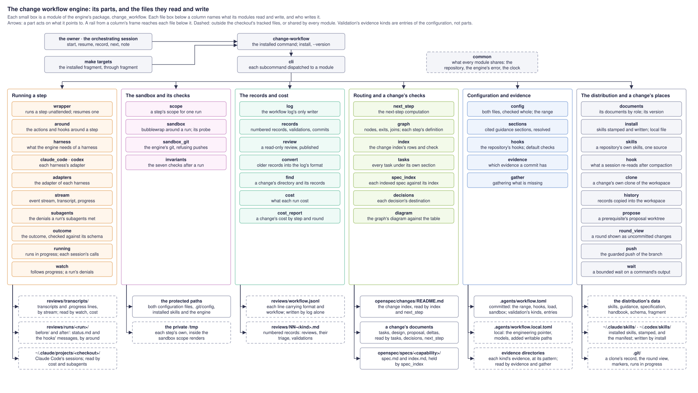
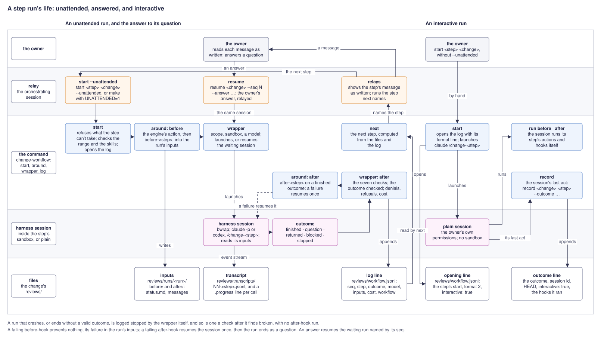
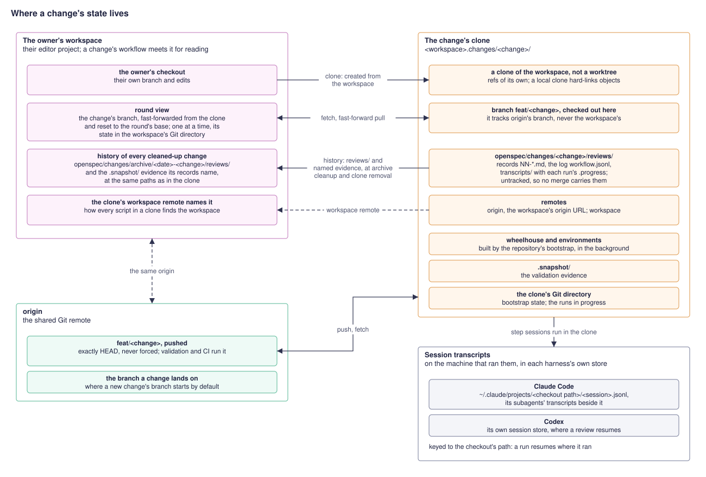
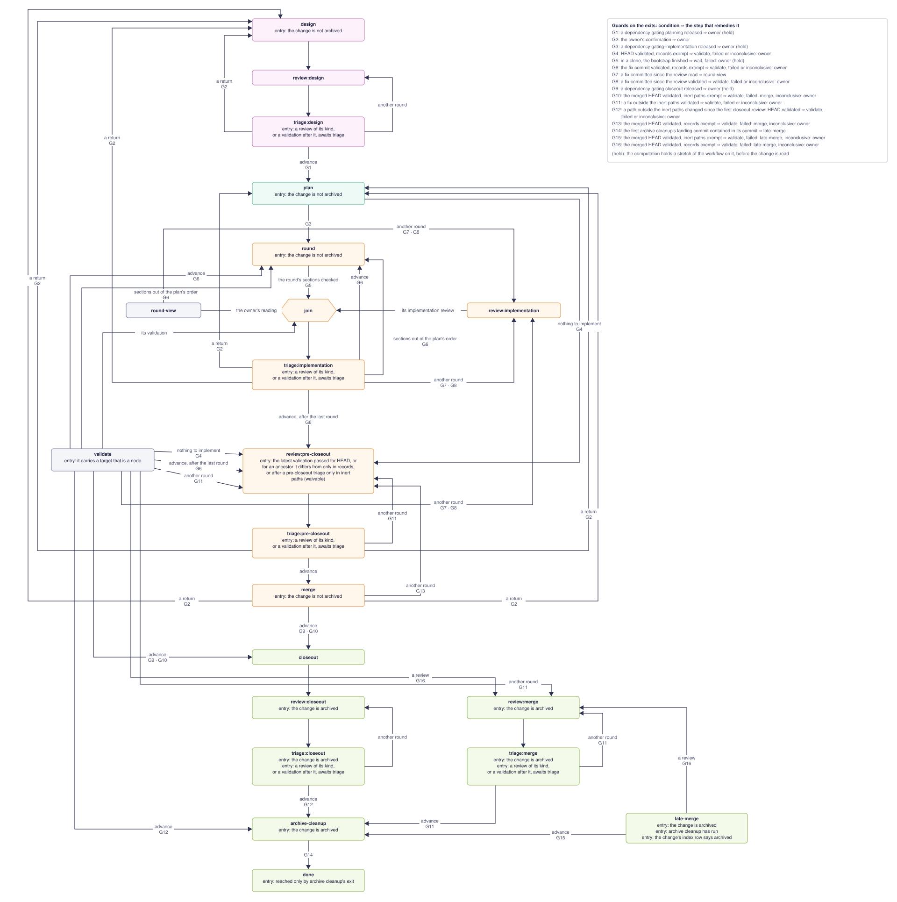

# The change workflow

The [specification](spec.md) defines how an OpenSpec change is worked: the phases it
moves through, its review records, triage, the intervention ledger, validation, the
orchestrating session that advances a change through its steps, the engine that runs
them, and the interfaces an adopting repository may rely on. Its
[index](index.md) organizes the requirements by id into five parts, and this document
follows the same parts: the process; implementation and validation; reviews and
triage; the engine; the public surface. It explains why the workflow is shaped as it
is. How the owner operates it is the
[change workflow handbook](../../../docs/change-workflow-handbook.md); how an
adopting repository fills the roles the workflow leaves to it is that repository's
own statement, kept in its own documents
([What an adopting repository provides](#what-an-adopting-repository-provides)).

A change's design and its guidance are where the repository owner's judgement
matters: deciding what a change does, and refining the rules so later reviews find
less. Everything else around a change is transport — carrying a review from one
agent to another, resuming a session that stalled, running the same validation
sequence before every review, choosing which step runs next. The workflow makes
agents do the transport. Each phase's procedure is written once, as a skill any
agent harness can load; reviews are exchanged as files; validation runs unattended;
an orchestrating session carries the change from one step to the next; and the owner
reads every finding, discussed or reported in a triage's table of default
acceptances, and decides every design question.

## The process

### Phases, triage, and archival

A change moves through design, planning, implementation, and closeout, and a phase
ending in a review is finished only when that review's triage names a step of the
next phase as its exit, or the owner directs one. Planning starts only after the
design review's triage advances it,
so a review that redirects the design never discards a plan; a design question
planning exposes returns the change to design.

### The owner is interrupted only for judgement

A change stops for the owner at four kinds of moment: the design discussion's
questions; the owner's notes on each implementation round, read through the round
view; the triage discussion — each discussed finding's disposition, and, when the
agent recommends another review round, whether the fixes merit it, asked once every
discussed finding is disposed and before any fix, while the owner is still present;
and the interrupts no rule can settle, such as an environmental remedy validation
proposes, a denial that needs a rule, a proposed return, a stopped step, or a
prerequisite to release. Every other transition advances on conditions the
computation checks.

A triage asks only what the owner's answer could change. A review finding the
default rule admits is accepted by default and reported, not asked ([Triage](#triage));
and when the agent recommends advancing, the triage takes the advancing exit without
asking and reports it beside its table of default acceptances. The owner's recorded
answers showed why: at the gates of the triages measured, the owner took the
agent's recommendation to advance 55 times in 56, and its recommendation of another
round 18 times in 20, so the question about advancing cost a turn every round and
almost never changed anything, while disagreement concentrated where another round
was recommended. A recommendation of another round is still argued and asked. The
table rides on the triage's last question when it asks one, so a correction there is
an ordinary disposition made before any fix; a triage that asks nothing gives it in
its final report, and a correction after the fixes revisits the finished triage. The
owner is never made to wait on a confirmation of the table: that would be the
question under another name, leaving the owner's window idle.

Reviews are not gates. A gate at each review would ask the owner a question whose
answer does not vary, and asking it leaves the owner's window idle while their
attention is elsewhere; a routing question at each review would be the same
interruption under another name. A
review's triage chooses its exit among those its node declares — the step that
advances the change, another review of the same kind, or, before the archive, a
return to design or planning — on the owner's disposition, and names it in its
outcome with the records it triaged (`triaged`). Its file's `## Next` keeps the
choice in prose for whoever reads the history, and nothing routes on it, since
routing on free text is a model's reading again. Because the outcome names the
reviews it governs, the log alone says which triage governs a review and which run
a return's confirmation resolves; a fixed token in the file needed files' times to
say either. A triage file no triage outcome names is a triage in progress, whatever
its words. Once the owner confirms a return, that review no longer governs, and what
the return leads to is a round of its own, read, validated, and reviewed afresh —
even a rework of the returned round's own sections, which under the returned round
would reach the next round unread and unreviewed. A declined return is the owner's
to settle, since the triage it ended no longer says what follows. A triage with
nothing to discuss that recommends advancing advances without asking the owner
anything. An implementation round, the merge
before closeout, and the merge after the archive advance only on a `passed`
validation of their final commit,
and after a closeout review a correction
outside the repository's inert paths is validated before archive cleanup, so a code
correction reaches the merge validated unless the owner waives it. The owner's own look at the pull request before merging is outside
the workflow.

An intervention — another review, a validation before a step, a step past a guard,
a confirmed return — is a deliberate, per-change, irregular transition, and the
owner's alone. The owner directs any node of the graph by a decision line `by:
owner` naming its target as an outcome names an exit, with a reason that says what
it skips, and the computation names the directed step until a run of it takes an
exit. A direction checks no exit guard: an exit guard conditions a step's choice,
and a transition the owner made deliberately is not refused by one; a problem it
causes is corrected by another direction. Its target's entry guards are checked,
and the log's writer refuses it, naming the guard, while an unwaivable one of any
node it names is not met — the target nested in a direction to validation
included — so a direction no step could carry out is refused while the owner is
present rather than failing later as a stopped run. A waivable entry guard, the
pre-closeout review's validation, takes the direction as its override, and the
waivers of another design review and of archive cleanup's validation are plain
directions. Interventions declared as owner-only edges of the table were rejected:
each new kind would need an OpenSpec change before it could be used once, and an
intervention is the transition the workflow did not plan for. Only a decision the
log attributes to the owner directs a step or confirms a return, as with the
owner's other decisions — a branch decision, a waiver — so the orchestrating session
directs nothing of its own accord, and never records a step's exit on its behalf.

A waiver skips evidence, so only the owner waives, and no waiver is taken by
default: until how often the owner accepts each kind is measured, a wrong default
would cost a broken pipeline found later. But the owner had been proposing nearly
every waiver themselves, for a few recurring reasons, so a step that meets a guard the
owner may waive recommends a waiver when one of those reasons, written as a criterion,
holds — commits that differ from validated ones only in paths no part of validation
exercises, a failure already diagnosed as environmental in an earlier record, a review
and a validation of commits differing only in records or documentation, or a decision
after a return to design confined to one requirement's wording or a choice the design
review weighed — naming the criterion and its evidence (CW-q3dm); the merge before
closeout keeps its own judgement. Criteria with no recommendation would leave the
owner to spot every waiver. Each recommendation is a ledger line, taken or declined,
so a guidance review can count them by criterion, the evidence a later change would
need to take a criterion's waivers by default.

A step's judgement of the exit it takes is followed without the owner's
confirmation unless the exit needs a waiver. A confirmation of a judgement the owner
almost always shares is a stop with a foregone answer; a waiver skips evidence, and
so stays the owner's. The merge after the archive judges whether its resolutions
need a review on written criteria and takes that exit without asking; the merge
before closeout still asks the owner to confirm another pre-closeout review, until
the workflow's use shows whether it should change too.

The archive is the boundary no direction crosses. An archived change's deltas are
already merged into `openspec/specs/`, so design, planning, and implementation
refuse it; the closeout review, its triage, archive cleanup, the merge after the
archive, the merge review, and its triage need the archive, and archive cleanup
would otherwise mark `archived` a change whose deltas were never merged. No step
after the archive returns the change to an earlier phase either: once the landing
branch's changes are interleaved with the archived deltas, the archive's merge of
them cannot be undone, and archive cleanup's release of dependents would be left
wrong. Where a merge after the archive cannot resolve a conflict so that both sides
hold, or the landing branch has invalidated the change's design, the merge asks the
owner and leaves the merge in progress; the owner resolves it as they direct, lands
the change and follows up in a new change, or takes it off the workflow.

### The merge before closeout

A change is reviewed against the branch it was branched from as it stood then, and
lands on that branch as it stands when it merges, and between the two the branch
moves. A merge of it made whenever the owner thinks of it can fall after the
pre-closeout review, where no
step owns what it breaks: implementation has no section for it and triage no review
of it, so a failed validation of the merge reaches the owner with nowhere to go. So
the merge is a step of the graph, after the pre-closeout triage and before
closeout, and closeout is reached only through it: the validation before closeout is
then a validation of the change merged with what it lands on.

Git merges text, not meaning. Code the change added that calls what that branch
renamed or
removed merges without a conflict and fails only when it runs, and end-to-end
scenarios fail only in the pipeline, which no local suite stands in for. So the
merge reconciles the change's own code with the branch's changes, not only its
conflicts,
and a failed validation of the merged `HEAD` routes back to the merge, which holds
what each side changed, rather than to the owner; an inconclusive one, being missing
evidence, still goes to the owner.

Most merges are mechanical — locks, index rows, version bumps — so the merge is not
a review round of its own. It judges what it needs, and its default is the cheapest
safe route, taken without asking: closeout after a passing validation of the merged
`HEAD`. Each costlier or riskier deviation is the owner's to confirm: another
pre-closeout review, when the merge changed what the change does, and closeout
without that validation, which is the owner's direction past the guard as any
waiver is. After a review of the merge, its triage advances to the merge again,
which finds the branch merged, or merges what it gained meanwhile.

Which branch a change lands on is recorded with its clone: the branch the workspace
had checked out when the orchestrating session made the clone, or the clone's
`--from` (["A change is worked in its own clone"](#a-change-is-worked-in-its-own-clone)).
Each finished merge records in its outcome the branch it brought in, as `landing`
with the remote it fetched from and the commit (["The log, its format, and the
conversion"](#the-log-its-format-and-the-conversion)). `start merge` adds to the
merge's invocation the branch it is given, else the branch the change's last
finished merge recorded, else the clone's, and the skill merges the branch its
invocation names and assumes none. The owner names another, `FROM=<branch>` through
the make fragment, and every later merge of the change — a repair, the merge
repeated after its review, a merge after the archive — brings that branch in again
without the orchestrating session having to remember it: with the clone's branch
first, the merge repeated after its review would bring in a branch other than the
one reviewed whenever the argument was forgotten. A change worked in place, with no
clone and no merge recorded yet, is merged only from a branch given, and the merge
refuses without one. No repository default stands in: a default would be right for
most changes and silently wrong for one branched from elsewhere. The record takes
the branch name alone into `start merge`, never the remote: a merge after the
archive may run in the workspace once the clone is gone, whose remotes are named
otherwise, and it chooses its remote afresh where it runs and records it.

The merge before closeout sits in the implementation phase, since it may change
code, and sets `ready for closeout` as it advances only when the merged `HEAD` is
already validated; closeout accepts a row still `in implementation` once the
computation names it, as it did when a triage advanced before its fix was validated.
A merge of the branch at any other time before the archive stays the owner's
intervention, and does not replace this one.

#### The merge after the archive

The landing branch keeps moving after the merge before closeout: while closeout, its
review, and archive cleanup run, and while the pull request waits. When the
change's branch then conflicts with it or falls behind it, the change is merged
again through the merge after the archive, `late-merge`: a node of its own whose run
is the merge step, with the same skill, mechanics, scope, and target, as `round`
runs implementation. A new step would have needed a second definition beside the
merge's, with its own skill, scope, hook rights, target, and model entry, and had the
owner leave the orchestrating session to run it; a `merge`
qualified by a kind would have needed a permanent rule that a kindless merge is the
one before closeout; and one `merge` node with both sets of exits would declare exits
wrong in every state it can be in. Un-archiving the change into a new round was
rejected for the reasons the archive boundary gives
([The owner is interrupted only for
judgement](#the-owner-is-interrupted-only-for-judgement)), and because the common,
mostly mechanical merge would go through a dozen steps whose resolution the merge has
already made.

It is entered only once archive cleanup has run and while the change's index row
says `archived`: the merge keeps that row, and archive cleanup run again tells itself
from a first run by it, so a change whose row was pruned has the row restored before
the owner directs the merge. It resolves as the merge before closeout does, and also
keeps the change archived. The change's own row stays `archived` and its archived
directory as its branch has them. `openspec/specs/`, each `index.md`, and the
permanent documents keep both sides — every requirement saying what each change
meant, every id unique — since the change's deltas are already merged there and no
later step reads them. A row the landing branch brought that depends on the change
is released as archive cleanup releases a dependent, since archive cleanup run again
releases nothing. The capacity figure kept is the one measured later. The pull
request's drafts are appended to, never redrafted, since the history copy refuses a
file that changed other than by growing.

The merge judges whether its resolutions need a review of their own, a review of kind
`merge`, on criteria its skill writes: a conflict resolved outside the mechanical
files — the change index, other changes' documents, files the hooks rebuild,
version-only bumps, and files an evidence kind's cleanup writes; a reconciliation
of the change's own code or scenarios; a file outside the mechanical files that both
sides changed since the merge base, since two changes' edits to one specification can
merge cleanly into contradiction; and a contract the landing branch changed in
meaning. Several changes on one goal run in parallel and promote into the same
specifications, so such a review is often warranted, and a confirmation of it would
be a foregone stop: the merge names the review or archive cleanup and the
orchestrating session follows it. Always reviewing would spend a review and a triage
on a merge whose only conflict was an index row.

The merged `HEAD` is validated before the review or archive cleanup, as before
closeout, and a failed validation names the merge after the archive again, which
repairs what it found; the end-to-end pipeline is the only check that finds a stale
call in a scenario. Only the owner waives that validation, and the waiver is the
owner's direction to the exit the merge named, so a review the merge chose is not
skipped with the validation; skipping both is a direction to archive cleanup whose
reason says so. A direction checks no exit guard, so a waiver always directed to
archive cleanup would have skipped a chosen review silently. The merge review's
triage advances to archive cleanup, which runs again on the archived row and ends at
`done`, or names another merge review; it does not return to the merge. The owner
reviews the branch before merging the pull request and directs another merge after
the archive when the landing branch has moved again: a loop ending only when the
landing branch gained nothing would go round until the branch paused.

Detection runs by itself only where nothing it moves is under the owner's review.
Archive cleanup fetches the branch the last finished merge recorded, or else the
clone's, and records what it fetched; its first exit to `done`, before the pull
request opens, names the merge after the archive when that commit is not in the
branch, and the orchestrating session runs it without asking. A long closeout is
when the landing branch gains the other changes on the owner's goal, and the check
costs one fetch. After the pull request opens, nothing detects that the landing
branch moved: nothing runs after `done`, a poller or a trigger on pushes would need
infrastructure the workflow lacks, and a merge started by itself would move the
branch the owner is reviewing. The owner then starts the merge by telling the
orchestrating session, which records the direction.

### Closeout and archival

Closeout and archival are one phase. Closeout writes the documents OpenSpec does not
synchronize, then archives the change, which merges its deltas into
`openspec/specs/`, so the closeout review reads the specifications as they will
land rather than inferring them from the delta. The steps after the archive find the
change by name under its dated directory; design, planning, and implementation have
nothing to do with an archived change and refuse it.

Closeout changes only the repository's inert paths, changes' records, and the
archive's own writes — the change's own documents and their move into the archive,
its row of the change index, and its deltas merged into the specifications
(CW-pkug). The code was last reviewed at pre-closeout and the closeout review reads
documentation, so a closeout code edit would go unreviewed as code; comment hygiene
and import placement are therefore done before the pre-closeout review and only
confirmed at closeout, and a part that would change any other path, a citation inside
a skill included, returns the change to implementation. The rule is stated in the
inert paths, the set archive cleanup exempts from validation, rather than as
"documentation", which the workflow never defined, so closeout's own commit is never
one validation would have proved anything about. The archive's own writes are exempt
whatever the declaration: under an empty one no path is inert, and an archive that
returned to implementation could never archive. The merge transcribes delta text
already validated and reviewed with the change's commits; promotion elsewhere follows
the declaration. A code defect a closeout review does find stops for the owner, who
directs the correction and decides whether it needs another reader; reopening the
change for a full round is not required for what is expected to be rare.

What closeout works through is the workflow's guidance
([`closeout.md`](../../../docs/guidance/workflow/closeout.md)): the workflow's parts in
order, archival last, with the repository's own parts — the checks and evidence that
depend on how the repository builds, packages, deploys, or runs its system — at the
position the list gives them, defined where the repository's root guidance names.
Every part is the workflow's, since closeout exists only in the workflow; what a part
confirms may be a rule of any layer, and the command it runs is the repository's, so
the workflow's list names checks by role and names no repository path. A plan, a
skill, or a review cites a part by its heading, never its number, so a part added,
removed, or reordered breaks no citation. Its guidance placement part reads what the
change added, moved, or rewrote in the guidance against the layer test, adjacency,
and exception placement ([The repository's guidance is
layered](#the-repositorys-guidance-is-layered)), after promotion and before the
citations are checked: the mechanical check catches a link to a higher layer, but not
a general rule written with one repository's example.

Archive cleanup follows the closeout review's advancing triage as a step of its own,
with its own entry checks, rather than as the end of triage: it releases the
change's dependents, sets it `archived`, drafts the merge, commits what the cleanup
of every evidence kind that declares one wrote, which the engine ran before its
session, and copies its history into the
owner's workspace, and is the point at which the change lands. Its check that a
correction outside the repository's inert paths
was validated stands even for another change's commit on a shared branch, since the
merge carries every commit on it; the owner may waive it, judging the paths named,
and the waiver is a ledger line.

### The index states what may start

The active-change index is what the next-step computation reads to decide what
starts next, so a row's status names its phase and its state within it (`ready
for`, `in`, `blocked in`), and dependencies on other changes sit in their own column
with the phase each gates. A single word such as `active` cannot carry that
decision; it erases the difference between a change waiting for design and one
waiting for a plan, which separate skills perform.

When a dependency lands, its dependents' designs rest on a codebase it has just
altered, so archive cleanup returns each dependent not yet implementing to design.
That ties reverification to a step that already runs. A dependent already in
implementation, or blocked for its own reason, keeps its status.

Every step that edits the index runs `make check-change-index`. The citation check
cannot see those edits: it is scoped to a change's own documents, and the index's
links are relative directory links. The check covers active changes only; archived
rows are recent history and may be pruned at any time.

### A prerequisite is proposed apart and halts its dependent

A design that cannot proceed without another change shapes that change's
requirements and initial proposal with the owner, and halts. The proposal is written
in a worktree on a new branch from the branch the change lands on, and reaches the
blocked branch only by merging that branch once it lands, so the blocked branch never
holds a copy of its own:
writing it on the blocked branch and cherry-picking it would leave, after the
landing branch is merged back, the unarchived copy beside its archived one without a
conflict, and
stacking the prerequisite on the blocked branch would put two changes in one pull
request and stop the prerequisite landing alone. One change per branch is the rule
this keeps.

The engine makes the worktree, on the owner's word, with `propose <change>
<prerequisite>`: `../<prerequisite>-proposal`, on a new branch
`propose-<prerequisite>` from the landing branch as the remote holds it, without
tracking, since tracking would write `.git/config`, which no step writes. Making a
worktree is mechanical, so the engine does it rather than the design. The resumed
design run's sandbox makes each such worktree registered in its checkout writable,
and nothing else beside the checkout: mounting the checkout's parent would let a
design write every sibling clone, which may only be read. Staging the files for the
engine to place, a worktree inside `.git/`, and leaving the worktree to the owner were
rejected.

The blocked change then stays `in design`, with the prerequisite in `Depends on`
gating design; `blocked in design` is kept for reasons that are not another change.
Starting the prerequisite's workflow is the owner's, as choosing any other work is.
Once the prerequisite is archived and merged in, the dependency names an archived
change, which the index check rejects; the computation recognizes that state, and on
the owner's word the dependency is dropped and design resumes.

## Implementation and validation

### Sections are slices, sessions are the owner's

Compliance with the repository guidance degrades as a session grows, and sharply
once it compacts. `AGENTS.md` is loaded as system context and survives, but the
documents it requires reading enter through tool calls, are ordinary conversation,
and are summarized away; the summary keeps the task state and drops the rules.
Before compaction the same rules sit ever further behind tool output.

A plan nevertheless says nothing of sessions. A `tasks.md` section is a coherent
slice that one verification point proves, sized by what it changes and what proves
it; whether one session implements it, several sessions one each, or a coding
harness at all, is not the plan's concern, so the same plan serves any of them. How
many sessions implement the work, and how much each round covers before it is
reviewed, is the change's implementation cadence, settled in the design discussion:
the order of implementation can bear on the design, and a cadence settled there is
not asked about once the owner's attention has moved on. The design states it in
terms of the work, since section numbers do not exist yet; planning orders its
sections by it and reports, in its outcome rather than in `tasks.md`, the sessions
and rounds that implement them. The orchestrating session records each round from
that mapping as it starts, and asks the owner only for a change with no mapping.

Each session starts with no prior conversation, reads the guidance, the change, and
its sections, and records anything a later session needs in the change's files
before each section is committed. A fresh-context agent checks each section's diff
against the guidance before commit: it does not share the implementer's
degradation. The risk of a growing session stays advice to weigh, not a rule a plan
enforces. The owner may still send the next section, or a fix, to an earlier
implementation session they name by its id — one small enough to carry it, or the
one that made the edits a later finding concerns, which holds their context. The
session is named, never inferred: a rule such as "continue the latest run" could
not reach an earlier session, and would let sessions grow with no one choosing it.
A continued session runs on the model it ran on, since a session cannot move
between harnesses.

A section's verification names only evidence an implementation session can
produce. Evidence only a push produces — a run of a CI workflow that a change
branch's push does not trigger — is written on its own
`Owed by validation:` line, naming the workflow, the job, and what the job must
show, and gates no task; the line names the evidence kind that produces it, `Owed by
validation (ci tests.yml):`, as the kind's guide gives it. A task gated on evidence no
session can produce stays unchecked, and the next-step computation names
implementation for it indefinitely; a round advances only on a passed validation, and
every validation gathers what the change's complete sections owe unless the owner
waived that kind,
so the owed evidence keeps its gate without a checkbox. An older plan that put such evidence inside a
verification task is corrected by the implementation session, which checks the task
on its own evidence and names the rest as owed; closeout records the owed
observations from the latest passing validation, as it records the pipeline run.

Within a Claude Code session, a hook that runs after compaction sends the session
back to the documents themselves. It never injects a digest of their rules: the
hook's context is capped far below the documents' size, and a digest is a second
copy that drifts. Codex has no equivalent.

### The owner reads a round in their own workspace

The owner reads a round as uncommitted changes in their own workspace, because that
is where the owner reads and runs tests: `make round-view` resets the change's
branch to the round's base — the commit recorded as the round started, so commits
landing between rounds are not shown as the round's — with the files unchanged, and
`make round-done` returns it. An editor comparison against a base ref reads as a
comparison, not as the changes being worked, and runs the tests on whatever the
workspace holds; a second editor project per round lacks the owner's test setup.

For a change worked in its own clone, the view is in the owner's workspace, on the
workspace's copy of the branch, fast-forwarded from the clone, and never moves the
branch the clone's steps run on. Validation and the implementation review therefore
start as soon as the round is committed, beside the reading. Reading first was only
ever there because the view moved the one checkout validation describes; with the
view in another repository, validation's premise that its checkout is the commit
holds throughout, and the owner's reading, which takes as long as it takes, comes
off the round's critical path. Triage waits for all three: the review does not read
the owner's notes, which are triaged beside it. A change worked in the workspace
without a clone keeps the reading first, since its view moves the branch its own
steps run on; while that view is open every step that describes or publishes a
commit refuses.

The view never takes a silent risk with the owner's work. It refuses a dirty
workspace, a run in progress there, and an ignored file a move would overwrite,
naming each, rather than stashing or moving anything of the owner's. A commit the
owner makes while the branch sits at the round's base — an editor's "commit all" is
one click — is carried onto the round's head when the view closes, holding exactly
the paths it changed; where the round also changed a path, the commit is carried
only when it holds every change the round made there, since with the index at the
base a missing round change means the owner either left it unstaged or removed it,
and the files cannot say which. Laying such a version over the head would revert
the round's change inside the owner's commit, and merging it would undo a removal
the owner meant, so the view refuses and says how to commit again on the round's
head. Triage pulls the owner's commits into the clone fast-forward only.

When a round's triage records another round over a fix it committed, the repeat
pass is read the same way, as the changes from the commit that triage's review read
to the fix: the commits a repeat round exists for are the ones the owner would
otherwise never see. An answer saved before that triage finished answers only for
the earlier pass. The orchestrating session waits for the owner's notes and saves
them as a numbered record before it closes the view, so a restart cannot lose them.

### Validation observes a committed slice

An implementation slice is committed before it is reviewed, so validation describes
one commit and must not change the checkout: a step that rewrites a tracked file
validates a tree that is not the commit, then pushes and runs end to end against the
commit that was never checked. Validation therefore fails rather than repairs. It
regenerates no tracked file: a regeneration such as relocking would silently repair
the condition a check exists to report, so it belongs to implementation, and the
condition sends the slice back.

Validation's sandbox nonetheless writes the whole checkout: a new attempt builds
environments in directories that do not exist when the run starts, and a list of
them collapses to the checkout through the package directories. That it changes
nothing is held after its session instead: the checks after every run find `HEAD` or
any tracked file changed, and stop the run ([A step run's life](#a-step-runs-life)).
Moving new attempts out of the session through an outcome field would buy prevention
at the cost of the outcome contract and the skill's loop, and a read-only validation
could build nothing.

What evidence a commit needs depends on how the repository builds, deploys, and tests
what it ships, so the workflow knows *evidence kinds*, never a repository's own steps.
Each kind is declared in the repository's configuration
([A repository's configuration](#a-repositorys-configuration)) — whether it is
required, the pattern its evidence is found at, the commands that gather it, the kind
it follows, its cleanup — and explained in a guide, prose telling an agent how to read
the kind's evidence and tell its failures apart. Validation completes the evidence a
commit still lacks and assesses all of it, rather than running every check blindly:
implementation has often just run the same checks on the very tree it commits. The
workflow fixes what every kind shares — its evidence describes the tree or commit
under validation, and the gathering refuses a worktree whose tree is not `HEAD`'s —
and the record names the end-to-end scenarios that exercise the change, each with its
basis. Which kinds a repository declares, and how each is filled, is that
repository's own statement, beside its configuration.

Evidence describes a Git tree, or a commit where its result depends on history. A
kind's pattern holds exactly one of `{tree}` and `{commit}`, so the pattern declares
the identity and no field repeats it. A tree is `git write-tree` of the worktree as
tested, its changes — staged, unstaged, and untracked but not ignored — added to a
temporary copy of the index, never the checkout's own; tree evidence counts for any
commit holding that tree, so the commit implementation makes just after its
functional checks already has their evidence. A kind whose result depends on history
— a run dispatched for the commit, a comparison with a baseline chosen by the commit's
ancestry — describes the commit, `HEAD`'s full object name, and does not count for
another commit sharing its tree, a message amended or a revert; that costs little,
since nearly every new commit changes its tree. A commit for every kind was rejected,
since implementation's evidence, gathered before its commit exists, would never count;
a tree for every kind, since a reused run's head and baseline could describe another
history. Inputs outside the tree — the machine's tools, a cluster's state — are not
captured beyond the preflight.

The tree is only as stable as the worktree's untracked files: a file the workflow
writes that Git does not ignore would change the very tree its evidence describes. So
everything validation, its gathering, or a step hook writes after implementation is
ignored by Git, and the configuration's check refuses an evidence pattern whose fixed
directory Git does not ignore. A tracked file a kind's cleanup writes after the last
validation is committed alone, changing a tree no evidence needs to describe.

Evidence counts by being present at its kind's pattern, whoever wrote it: a step's
functional checks, the engine's gathering, an agent, or whatever placed it from beyond
the checkout, such as a run against a topology no checkout holds. It is its writer's
word; the workflow does not defend against agents misleading each other, who have no
reason to, and fetches nothing itself. Counting only what validation gathered would
leave implementation's evidence unused, and counting only what the engine ran would
be a provenance rule protecting nothing the workflow defends.

`evidence <change>` reports, for `HEAD`'s tree or commit as each pattern keys it,
each required kind — an owed kind once for each owed argument — its filled pattern,
and every match, as present, missing, waived with the decision's `seq`, or not
required. Several matches for one kind and argument, such as a failed attempt and its
rerun, are all listed, the last in path order current: writers name their attempts so
that path order is time order, since a copy from beyond the checkout may carry any
modification time. Before validation's session the engine gathers what is missing and
not waived ([A step run's life](#a-step-runs-life)): it runs the preflight, pushes
`HEAD` through the guarded push, dispatches every missing `start` kind, runs the
missing `run` kinds in order, then collects each started kind. It never touches
present evidence, and a failed preflight gathers nothing, since evidence gathered in
an environment the preflight refused would count as present. The skill reads what the
gathering found and `evidence`, and assesses each kind from its guide as passed,
failed — the commit's or of unknown cause — or environmental. Present failing evidence
is diagnosed, never gathered again for a pass; unreadable evidence is gathered again,
and an environmental failure rerun on the owner's word, each through `gather <change>
--kind <kind> [--owed <argument>]`, a new attempt that becomes current by path order,
its reason written in the record beside its path. Evidence is never gathered again
because another step wrote it or because it is old. The record names the tree beside
the commit, and each kind's result and its source, `present` or `gathered`; the guards
keep reading its commit and result. A machine verdict read from a field each guide
names, with validation skipped when every kind passed, was rejected: it would couple
the engine to each repository's evidence format, could not tell an environmental
failure from the commit's, and would remove the assessment triage reads.

A kind is required `always` or when `owed`. An owed kind is required once for each
argument a complete section's `Owed by validation (<kind> <argument>):` line names,
and its pattern holds `{owed}`, so one argument's evidence never makes another's
present. The argument is one path segment — not empty, `.`, or `..`, and holding no
`/`, whitespace, or glob character — so no argument reaches another's directory; the
owed-line reader refuses any other, naming its section. A line naming no kind reads as
the one owed kind, its first backticked word the argument, so a plan written before
kinds reads as it did, and is refused where several kinds are owed. A repository
whose optional pipeline is owed as a whole names it by the workflow that dispatches
it. A kind of neither requirement, conditioned on the paths a change touches, waits
with identity by declared inputs ([Current limits](#current-limits)).

A kind is one long command, `run`, or a dispatch that returns at once and a wait for
what it started, `start` and `collect`, and it may declare the `cleanup` archive
cleanup runs for it. A `preflight` runs before every kind, and its failure ends
validation as environmental. The skill keeps the workflow's own rules — waivers,
diagnosis, and the result — and learns the kinds from the engine, never from the
file. Every started kind is dispatched first, in declared order, so the slowest
evidence is under way before the long local kinds run, and then the `run` kinds in
declared order, each after the kind its `after` names. A kind's `after` names one
declared before it, and a started kind follows only another started kind, so the
file's check refuses every cycle and every order the dispatches could not keep.
Ordering the kinds topologically instead would have broken the promised order within
each shape to tolerate a mistake the check can refuse.

A declared command promises only its exit status and, for a `start`, that its last
line of standard output is the marker its `collect` waits past, such as the newest
run before its dispatch. The engine keeps that marker keyed by the tree or commit, the
kind, and an owed argument, so owed runs dispatched side by side never share one, and
a retried `start` replaces its key's marker so a collect always waits past the newest
dispatch; it fills `{after}` from it, and the skill passes none. Each kind's gathering
ends with a closing line the engine writes itself, in a fixed form the skills match —
the kind, its owed argument, the tree or commit, the result, the exit status, and the
current evidence — whatever the command printed, so no repository's command has to
print the workflow's wording. Make exits 2 whenever a
recipe fails, so no exit-status convention richer than zero and non-zero would
survive the commonest implementation; classifying a failure as the commit's,
environmental, or of unknown cause stays the skill's, from the evidence. A
structured result each command writes was rejected, since it would move part of the
diagnosis into repository code and ask every adopter to write a format.

Evidence only a push produces is dispatched for the validated commit, never judged
from a sibling run. Every validation gathers what its complete sections owe, unless
the owner waived that kind, because a fix commit can break evidence an earlier commit
produced, as with the pipeline.

"Fixes nothing" protects the commit, not the machine. A failure diagnosed as
environmental is put to the owner with its remedy and its kind gathered again on the
owner's word; only failures the commit caused, or whose cause is unknown, become
findings. A result is `passed`, `failed`, or `inconclusive`, the last meaning no
failure was the commit's but some kind has no evidence.

Any kind may be waived, by the owner alone. The owner can already waive validation
entirely, so forbidding a kind would only push them to that when one kind blocks
them; and a repository's broadest kind is often wider than a change confined to a
few files needs. A waived kind is an omission of evidence, recorded as `waived`:
neither passed, failed, nor inconclusive, and counted in no result, which is judged
on the kinds assessed. Recording it `inconclusive` would stop every validation for a
ruling the owner already gave; an environmental failure the owner waives rather than
remedies is recorded so too. A waiver for later validations — the Helm and pipeline
kinds for the rest of a change, say, while nothing it touches affects what they
validate — is the owner's decision in the change's workflow log, naming the kinds and
the condition, which validation reads before it assesses any kind. An instruction
passed in a validation's invocation is no waiver: a validation started by hand would
miss it, and two places would have to remember it. A standing waiver lapses, and the
kind is gathered, when the commits since the last validation that ran it — or since
the latest validation, when none did — include a merge, which brings in code the
change did not write, or when the commits since it was last assessed break the
condition. The merge is measured from the last run because a run's record of what it
invoked names what its gathering ran, not what it found present; the error is only
toward gathering a waived kind again. A merge the waiver was recorded after is no
lapse, since the owner waived with it in view: the decision records the commit `HEAD`
was at, and an older one is taken at the latest logged line before it naming a
commit. `evidence` reads the lapse, listing a lapsed kind present or missing as if
unwaived, so the report, the gathering, and the record agree. The engine's gathering
skips a waived kind unless such a merge lapses it, which is mechanical; whether the
condition still holds
is the skill's judgement, which gathers a lapsed kind with `gather --kind <kind>
--lapsed`. Waiving every kind is no validation at all, but the owner's direction past
the guard it remedies.

### An implementation round is triaged together, in a fresh session

The owner's reading of a round, the implementation review, and the validation of the
same commit are triaged in one session that is not the implementing one. Validation
results go to triage, not to the reviewer: a reviewer given them would wait an hour
for the pipeline, could fix nothing, and judges the code the same either way; and
fixes for failures and findings often touch the same code. The owner's notes are
saved verbatim and evaluated like any finding, not obeyed, so a note the files
contradict is answered with the evidence.

## Reviews and triage

### Reviews are files

A review is one Markdown file in the change's `reviews/` directory, and the only
record of its findings. Later reviews and triage read earlier findings and their
dispositions from these files rather than from any session's memory, which is what
lets a pre-closeout review ask a different session whether earlier feedback was
addressed, survive compaction, and run under either harness. A structured copy
beside each review would be a second source that can disagree with it.

A re-review continues its own reviewer on the same harness, so the reviewer weighs a
revision with the context that led to its findings; it still reads the triage from
the records. A reviewer's raw session is kept as a transcript, but no review or
triage step reads one: a transcript carries the session context the file exchange
exists to keep out. The reviewer runs read-only and never writes the record itself;
its answer is published, from its first title line, only when it has the review
format, so an error or a truncated answer never becomes history, while narration
before the title is left to the transcript; a run that published nothing is a
failed run however many earlier records exist.

A reviewer that finishes with a draft the format check refuses is sent the problems
in its own session, on the same model, and its answer is checked again — once,
unless `review.format-retries` says otherwise. Refusing outright would lose a whole
review, the costliest run of a round, to a defect of form such as an empty field,
and the rerun would start from nothing; a send-back costs one turn of a session
that still holds the review. Only a format refusal goes back: an unavailable reviewer, a
network failure, or a non-zero exit says nothing a correction could fix. The run's
line records each send-back's problems and its message says the review was sent
back, which the owner is told without being asked anything. A refusal that survives
keeps its draft under `transcripts/`, where no triage reads it, and its line records
the reviewer's session and the problems, so the next review of the kind continues
that session with them rather than starting again; a fresh review starts anew. The
reviewer runs the same check before it answers, `check review <kind> <change>` on
its draft piped on standard input, since it writes no file; the command and the
publisher call the one check, so they cannot disagree.

Every finding states its alternatives: each option a reasonable owner might choose,
with its trade-off, or `none` and why the fix is evident (CW-a2lf). "None" is a
statement, not an omission, and the publishing check refuses a finding without the
field, since an absent line cannot tell "none" from "not considered". The field gives
default acceptance's weakest condition — that no alternative exists — a reading
independent of the triaging agent's, usually by another model, at no cost of a run.

Each review is of a kind — design, implementation, pre-closeout, closeout, or merge
— and each kind asks its own questions and has its own triage, with the exits that
kind's place in the graph allows. The review of the merge before closeout is the
pre-closeout review asking one question more, since its triage's exits — the merge
again, planning, design — are the right ones there. After the archive they are all
wrong, so the merge after the archive has a kind of its own, `merge`: it reads each
resolution against both parents and every commit since the merge's first parent,
each specification and index the merge touched for what both changes meant with no
id duplicated or dropped, and the change's code and end-to-end scenarios against what
the landing branch renamed, removed, moved, or changed in meaning. The closeout
review with those questions added was rejected: built to read documentation, since
closeout edits no code, it would gain a duty to read code, its own questions would
mostly not apply, and its records would mean two things.

`reviews/` is untracked: it is working history, and anything durable in it reaches
permanent documentation through promotion. It moves with the change into the
archive; for a change worked in its own clone, archive cleanup copies it into the
owner's workspace ([History lives in the owner's
workspace](#history-lives-in-the-owners-workspace)), where it stays until an export
flow carries it elsewhere.

The publishing check reads the draft as a review of the kind and the change asked
for, its sections in order, and every finding carrying a lens, a basis, a severity,
evidence, and its alternatives; the run's line lists each send-back's problems as
`sent_back`, and a refusal that survives as `refused`. A review pasted from
elsewhere is saved verbatim as the next record, `NN-<kind>-external.md`, and
triaged with any other review of its kind, the triage assigning its findings' lens,
basis, severity, and alternatives. The directory reads as the change's history:

```text
openspec/changes/<change>/reviews/
  01-design.md                       a review: summary, assessment, questions, findings
  01-design.triage.md                each finding's position and the owner's disposition
  02-implementation.md               an implementation review, run beside 03
  03-validation.md                   validation of the same commit
  04-implementation-owner.md         the owner's notes on the round, verbatim
  02-implementation.triage.md        one triage file beside each record triaged
  03-validation.triage.md
  04-implementation-owner.triage.md
  05-design-external.md              a review pasted from elsewhere
  06-orchestrator.md                 the orchestrating session's observations of the tooling
  pull-request.md                    archive cleanup's merge drafts
  workflow.jsonl                     one line per run, unattended or recorded, and per orchestrator decision
  transcripts/
    01-design.log                    the reviewer's whole session
    07-implement.jsonl               an unattended step's event stream
    07-implement.progress            one line per tool call, as `make change-watch` shows it
```

A run whose answer was still not a review after its send-back publishes nothing,
its draft kept beside its transcript as `transcripts/NN-<kind>.rejected.md`.
`workflow.jsonl` is written by the command alone, which `log <change>` prints: each
run's outcome with its session, commit, model, cost, and denials, an interactive one
marked `interactive`; each `round` line; each `orchestrator` line, a decision naming
the run it resolves or whose denials it read, and, for the owner's direction, its
target; and a conversion's `convert` line.

### A finding has a lens, a basis, and a severity

A flat list of finding classes conflates two questions: what kind of attention a
finding needs, and what it rests on. Test coverage is both a kind of attention and
an application of written guidance, so a `coverage` class and a `compliance` class
overlap. A finding therefore carries a lens (`direction`, `consistency`, `testing`,
`documentation`, `architecture`, `scope`, `readiness`) and a basis
(`specification`, `guidance`, `evidence`, `judgement`) as separate axes, with a
severity beside them.

The basis is what makes the owner's corrections useful. A `guidance` finding that
reached a review means a written rule was not mechanically enforced, and the
question is which check should have caught it. A `judgement` finding the owner
accepts is an unwritten rule, and the question is whether to write it.

### Triage

The implementing agent states a position on every finding — agree, disagree, or
partly — with a reason either way, so that deference to the reviewer is visible
rather than the default. Every finding the triage does not accept by default reaches
the owner, one per message, each after any decision that could change it: a summary
up front invites dispositions before the arguments are read, and a question about
one finding is not acceptance of another. Such a finding is disposed of only when
the owner says so; silence never disposes of it.

A review finding is accepted by default when it meets every condition of the default
rule (CW-d5ac): it comes from a review, not a validation record, the owner's notes,
or the orchestrating session's observations; it is not `blocking`; the agent agrees
and proposes one edit or one fix; neither the reviewer nor the agent lays out an
alternative, and the agent names nothing that would change its recommendation; and
its fix touches no interface or representation, migration or compatibility path, the
change's scope, or the validation environment. Such a finding is reported in the
triage's table, not presented on its own.

The rule comes from the owner's recorded dispositions. Over the 478 findings of the
changes triaged in the period measured, 79% were accepted as proposed; and of the 313
whose full presentation survived, the class the rule describes — measured as Rule E —
covered 23%, with one accepted with a condition and one overridden: 2.7%
intervention overall, about 10% on the later changes held out from the measurement.
Each condition excludes where the owner intervened: findings from a validation
record (62% intervention) or the owner's notes (30%); a finding where the agent laid
out alternatives or named what would change its mind (31% and 36%); and fixes
touching an interface (29%), a migration (50%), the validation environment (50%), or
the change's scope (23%). Wider rules covered more of the earlier changes at about 2%
but rose to 10–14% on the later ones, so the rule is stated in the workflow's own
terms rather than fitted. Its `blocking` exclusion is the one input besides the
record that the agent does not judge, which matters while agents learn the rule, and
the reviewer's alternatives add a second. It starts conservative and is widened only
on evidence a guidance review brings.

A default acceptance's triage entry records its classification — how the finding met
each condition — written as its position is decided, before any finding is
presented, and its disposition reads "accepted by default". A dropped alternative is
invisible in a one-line table, so drift in how agents read "no alternative" across
many triages is the realistic failure, and the recorded classifications are what a
guidance review samples to catch it. An independent check of each triage's
classification by another agent was rejected as a run per triage that narrows the
rule whenever two readings differ, most of whose purpose the reviewer's alternatives
already serve; auditing default acceptances in the next review would be late, and a
workflow duty in a review about the change; watching only how often the owner
revisits is blind to the failure it is meant to catch.

The owner may revisit a default acceptance, or the advancing exit a triage took, at
any time before archive cleanup ends (CW-r8vz). Before the fixes, the table rides on
the triage's last question, so a revisit is an ordinary disposition. After, on the
owner's direction naming the triage's run, that finished triage is resumed with the
owner's words — the only finished run a resume accepts, and only while it is the
latest triage of its reviews: it holds every finding's context, amends its fix in a
new commit, logs the correction, and names its exit again, so a revisit may become
another round or a return. A step started after it is stopped first, and is resolved
rather than resumed, since its tree moved under it. Carrying the revisit into the next
triage as a note was rejected: after a design review, the plan and a round of code
would be built on the wrong edit, and after a closeout review there is no next triage.
Directing the revisit to the step that owns the work was rejected too, since no node
takes a pre-closeout or closeout revisit and that step lacks the triage's reasoning.
A revisit adds no node or edge to the graph: it resumes a step that exists, under the
owner's direction. Should revisits become frequent enough to complicate rounds,
bringing them into the graph is a change a guidance review would propose. Once
archive cleanup reaches `done`, a revisit belongs on the pull request.

### Guidance reviews

The owner's corrections show where the guidance is wrong, missing, or unenforced,
and default acceptance needs watching, so the owner periodically runs a guidance
review (CW-g6ua), through the `guidance-review` skill. It is not a step of any change:
no node, no step-table row, no outcome. It runs interactively in the owner's
workspace, which alone holds every cleaned-up change's records. It reads every
change's ledger, triage records, and workflow log since the last review; reports the
dispositions, the default acceptances and their revisits before and after the fixes,
an audit of a sample of recorded classifications against their findings, the waivers
recommended and taken by criterion, and the terms the owner asked about; groups the
owner's corrections into guidance that is false, rules applied but unwritten, and
rules written but unenforced; and lists candidate edits for the owner to pick, which
it writes as a change's proposal on the owner's word. A skill rather than each review
re-deriving its method; and not a change of its own, since a guidance review has
nothing to land, only a proposal to start.

Every guidance review, whether or not it writes a proposal, appends a line to a
period ledger, `openspec/changes/archive/guidance-reviews.jsonl`, untracked beside the
cleaned-up records it measures: its period and its headline figures. The next review
starts where the last line ends and has the earlier figures to compare with. The
newest proposal could not serve as the cursor, since a review that picks nothing
writes none; a tracked table of periods would commit outside any change; and asking
the owner for a start date each time would keep the history in the owner's memory.
What reaches the repository from a review is aggregates and the principles drawn from
them, never the owner's words.

No numeric threshold narrows or widens the default rule. Each guidance review reports
the period's default acceptances, revisits, and audit beside the rule's measured
baseline — 2.7% intervention overall, about 10% on the held-out changes — and proposes
keeping, narrowing, or widening it, or bringing revisits into the graph; the owner
decides. Fixed thresholds over samples this small would be noise.

### The intervention ledger

The intervention ledger (`interventions.jsonl`, tracked) records the owner's course
corrections: deciding otherwise than the agent proposed, or adding context that
changes the work. Most dispositions accept the proposal and are recorded only in the
triage file; the ledger exists to show where the agents' judgement needed
correcting, and the owner's guidance reviews read it. It is tracked so it travels
with the change through archival.

Two kinds of line need marking for a guidance review to count them. A correction of
a default acceptance, before its fix or after, is an ordinary entry whose disposition
begins `revisits default acceptance:` (CW-v1rk), a revisit of the advancing exit
naming the finding `next`; the workflow log, where a revisit after the fixes has its
direction, says which it was. And a waiver a step recommended is a line whether or
not the owner takes it, its agent's position naming the recommendation and its
criterion, a declined one being a correction like any other (CW-n6wy). A step that
commits nothing leaves the line to the step that next commits: a validation's to the
triage that reads its record, or archive cleanup for a record no triage reads.

Each line is one JSON object:

```json
{"review": "03-design", "finding": "F2", "section": null, "lens": "consistency", "basis": "evidence", "severity": "blocking", "agent_position": "agree: <reason>", "owner_disposition": "<what the owner decided>", "summary": "<one line>"}
```

`review` names the record the finding came from, or `design` for a redirection no
review raised; `section` is the `tasks.md` section, or `null`. An entry revising an
earlier one starts its disposition `revises <review> <finding>:`, a revision of a
revisit included. A standing waiver of validation's kinds given as a triage's
disposition is that triage's line; one given outside a triage, with no step's
recommendation, is the workflow log's decision alone, where a guidance review finds
the waivers no step recommended. The owner's waiver of archive cleanup's validation
of a correction is a line under the closeout review's record, its finding
`validated`.

## The engine

### Its parts

The engine is the tooling that runs a change's steps. A repository and a person reach
it through one command, `change-workflow`, installed on the path, whose subcommands
dispatch to its package, `change_workflow`. The package holds one concern per module,
on the standard library alone, and its modules reach each other by relative import,
so nothing outside it imports any of them. The package ships in one distribution
with the workflow's skills and documents ([The command and its
tiers](#the-command-and-its-tiers)).

- **The command** (`cli`) parses a subcommand and its flags and hands it to the module
  that does the work. Its exit status is one of three categories, and what a program
  may read of its output is its structured form ([The public
  surface](#the-public-surface)).
- **The distribution.** `documents` finds the workflow's own documents beside the
  engine by role, installed or in the source tree it is built from, with its
  version; `install` writes the distribution's skills into each harness's user skill
  directory, stamped with the version beside a manifest, and a checkout's local
  configuration where it has none, and holds the check every other subcommand of an
  installed engine makes first, that the installed skills are its own version's.
- **The repository's configuration.** `config` reads `.agents/workflow.toml` and the
  checkout's `.agents/workflow.local.toml`, checks all of both as they load, the
  version range first, and answers `config`, `config load`, and `check config`;
  `sections` reads the guidance sections a skill cites by name, and whether each
  heads one section beneath the engineering pointer. `hooks` runs the repository's
  hooks through `run`, ends each with the engine's closing line, and runs
  `pre-commit`'s default checks alone (`check change`) and the configured OpenSpec
  command (`openspec`).
- **Evidence.** `evidence` computes a worktree's tree and `HEAD`'s commit and reports
  which evidence each required kind has; `gather` gathers what is missing, keeps a
  dispatch's marker for its collect, and ends each kind with the engine's closing
  line; `around` runs the engine's actions and the repository's step hooks before and
  after a step, into the run's inputs directory.
- **Starting a step.** Each step's definition — its skill, the session it resumes,
  its profile, and its baseline scope — sits in `graph` beside the graph; which
  models a step runs on are the configuration's. `wrapper` runs an unattended step:
  it chooses the first available model, builds the run's prompt, and starts the
  harness through its adapter inside the step's sandbox. `harness` states what the
  engine needs of a harness, what a model is, and the errors a refused write fails
  with; `claude_code` and `codex` are the two adapters, each its harness's command
  lines, the state it writes, the settings it loads, how it says it cannot serve a
  model, and how its events show a refusal; `adapters` finds a harness's. `stream`
  reads a Claude Code run's event stream into a transcript, a progress file, and the
  run's denials and refusals, and `subagents` the denials its subagents met.
- **The sandbox.** `scope` resolves a step's scope for one run — the engine's
  baseline, the adapter's state and protected paths, the repository's `[sandbox]`,
  and the owner's grants — each path with its source. `sandbox` renders a scope as a
  bubblewrap command around any program, probes whether bubblewrap can run, and falls
  back to running unconfined. `sandbox_git` is the engine's `git`, mounted over the
  system's, which refuses every push of an unattended run but the guarded push's.
  `invariants` records the state a session starts from and runs the seven checks
  against it after the session ([A step run's life](#a-step-runs-life)). `outcome` checks the outcome the run ends with against the outcome
  schema. `cost` measures what the run cost. `running` records each run in progress in
  a checkout, and keeps each session's invocations through `run` and the guarded
  push until the session's log line records them. `review` runs a review read-only and publishes its answer as the
  change's next numbered record.
- **The log.** `log` is the change's workflow log's only writer: the wrapper's line
  for each run, an interactive run's recorded outcome, the orchestrating session's
  notes, and the owner's decisions. `convert` brings a change's older records into
  the log's format.
- **Reading a change.** `find` locates a change by name, active or archived, and its
  records, in the checkout or the owner's workspace. `records` reads the numbered
  records under `reviews/` and the commits and results they name. `index` reads the
  change index, its rows' statuses and dependencies, and checks it; `tasks` checks a
  task list's sections; `spec_index` holds each indexed capability's specification to
  its index, a change's deltas counted, and reports the specifications they create;
  `decisions` checks that each decision of a change's design names its destination.
- **Routing.** `graph` is the workflow's graph as one table: its nodes, their exits,
  joins, and guards, and the only list of the steps and review kinds. `next_step`
  reads a change's files and log and names the step that runs next, interpreting the
  graph. `diagram` holds the graph's hand-laid diagram to the table.
- **A change's places.** `clone` creates, reads, and removes a change's own clone of
  the owner's workspace; `history` copies a change's history from its clone into the
  workspace; `propose` makes a prerequisite's proposal worktree beside the checkout;
  `round_view` shows an implementation round as uncommitted changes for the owner to
  read.
- **Guards and support.** `push` is the guarded push of a change's own branch;
  `wait` blocks until a file holds a line matching a pattern, so an unattended step
  waits for a background command inside one call; `skills` checks that every skill a
  repository commits loads from its one source; `hook` tells a Claude
  Code session what to re-read after its context is compacted; `watch` follows the
  steps as they run and reports a run's denials; `cost_report` totals a change's cost
  by step and round; `common` holds what every module shares: the repository a
  command acts on, found from the working directory's Git top level, the engine's
  error, and its clock.

Beside the package, `workflow.mk` is a make fragment whose targets call the command,
for a repository's `Makefile` to include; it sets no value of the repository's, which
the configuration holds, and is a convenience with no compatibility promise.



Its source is
[`change-workflow-engine-parts.drawio`](diagrams/change-workflow-engine-parts.drawio),
its SVG beside it drawn from the same layout. It is maintained by review, like any
other documentation: it is not generated from the package, and no check compares its
boxes with the modules.

### A step run's life

A step starts through the command, `start <step> <change>`, which checks the change,
refuses while a round view is open, and opens the change's log with a line carrying
its format before any step it starts runs. Interactively, it launches the harness on
the step's skill under the owner's own permissions; the session runs the step's
actions and hooks itself, `run before <step> <change>` first and `run after` before
it records its outcome as its last act through `record`; no sandbox confines it and
nothing checks it after. Unattended, the wrapper first runs what comes before the
step — the engine's own action, then the repository's `before-<step>` hook ([The
hooks](#the-hooks)). It then probes the sandbox, resolves the step's scope, creates
what the sandbox mounts that does not yet exist, and records the state the session
starts from: `HEAD` and its reflog, the tracked files of a validation or review, the
workflow log and the ledger, each review record, `refs/stash`, and each remote's
change branch and protected branches, read by listing the remote. It starts the
harness headless inside the sandbox, or unconfined where the probe failed, with the
step's skill, model, and the outcome schema, its prompt ending with the run's inputs
directory; the harness's event stream is written to a transcript and a progress file
under `reviews/` as the run goes. When the session ends, whatever its outcome, the
wrapper runs the seven checks against the recorded state before anything else:

1. `HEAD` is on the change's branch and descends from the start commit;
2. for validation and review, `HEAD` and every tracked file are unchanged;
3. the workflow log was only appended to, since a review runs beside a validation
   and appends its line meanwhile;
4. each existing review record is unchanged, and the ledger only grew at its end;
5. `refs/stash` is unchanged;
6. on each remote, the change's branch is unchanged, at the run's last successful
   guarded push, or at a commit not made in the run, and no protected branch has a
   commit made in the run at its tip; a remote unreadable at either end is not
   checked;
7. for closeout, every path changed since the start, committed or not, is one
   closeout may change ([Closeout and archival](#closeout-and-archival)).

A violation logs the run `stopped`, its reason and an `invariants` field naming each,
the step's own message kept ahead; no action or hook after the session runs, and
nothing is repaired, since a resumed session rarely helps and a violation recorded
beside a standing outcome would route as if nothing happened. Otherwise the wrapper
checks the run's outcome, sets a missing upstream from the run's guarded pushes
([Pushing is guarded, never repaired](#pushing-is-guarded-never-repaired)), runs
`after-<step>` after a `finished` outcome, and appends one line to the log with the
run's session, model, cost, denials, refusals, grants, whether it ran unconfined, and
inputs directory, or a `stopped` line of its own for a run that ended without one.
The next-step computation then reads the change's files and that log and names what
runs next.

Each check stands for a guarantee the sandbox cannot give by itself. Checks 1 and 5
hold history and the stash, which a writable `.git/` lets a step rewrite; check 2 holds validation, whose scope is the checkout; checks 3 and 4
hold the records closeout's archive may move, so no mount can protect them; check 6
is the one backstop for a push to a protected branch by another route than `git`;
check 7 holds closeout, whose README mounts can reach code its review, reading only
documentation, would not see. Check 6 is no guarantee about the remote: a run's
commit someone else built on within the run, or a remote lost between a push and the
check, is no mistake's route, and an offline run is not stopped, since the sandbox
never gates the workflow. Nor does it count the owner's own moves: a round view the
owner opens in the workspace while a review runs in the change's clone puts the
workspace's change branch at the round's base, at no commit of the run's. The
configuration and the harness's settings need no check, since they are mounted
read-only.

Deterministic work belongs to the engine, freeform judgement to the skill. The engine
holds, beside the table of which step may run each hook, a table of its own actions
before and after each step, with two: before validation it gathers the evidence a
commit lacks ([Validation observes a committed slice](#validation-observes-a-committed-slice)),
and before archive cleanup it runs every kind's cleanup. Waiting on a pipeline then
leaves the agent's session, and no adopter rewrites the gathering as a hook of its
own. What only judgement settles — reading the evidence, diagnosing a failure,
judging whether a waiver's condition holds — stays in the skill.

A run's inputs reach its session through a directory under the change's records,
`reviews/runs/<run>/before/` and `…/after/`, named on its log line and given to its
hooks as `{inputs}`. The engine writes `status.md` there — each action's or hook's
closing line, exit status, and log — and keeps everything each printed as a log, read
only to diagnose a failure, so build noise never becomes instructions. Every top-level
Markdown file a hook writes there is a message the session reads in full as it loads;
any other file is data, read where a message directs, so a large artifact never
passes through an argument or the prompt. The gathering's `status.md` says what it
found present or gathered and each kind's result; the evidence stays at its patterns.
The directory is ignored by Git and copied with the rest of the records.

The line also records, as `invoked`, every hook, kind, and command the run or its
actions asked the engine to run through `run`, `gather`, or the guarded push: its owed
argument and phase, the command it resolved to, its exit status, when it started, and
how long it took. The engine keeps these by the session's id until a line takes them
— the wrapper's for an unattended run, the one `record` writes for an interactive run
— and keeps nothing outside a session; what an action runs is kept under a session id
the engine makes for it, so none lands under the session of whoever started the
wrapper. With the validation record and the evidence, that is the durable account of
what ran and how it ended, one the agent cannot write. A hook's output a session runs
stays in its transcript. A clone's bootstrap belongs to no step's
run: the orchestrating session starts it in the background and it outlives the call,
so its record is the clone's bootstrap state, which holds the command it resolved
to beside its log and exit status. The field is optional, and a line without it
reads as one with it, so it is no part of the record set's format version.

A run that ends with a question waits. The owner's answer resumes the same session,
through `resume`, naming the run it answers by its place in the log, and that turn's
outcome is logged in turn. The orchestrating session is a lane beside the runs: it
runs the computation, starts the step it names, shows each outcome's message to the
owner as written, and carries the owner's reply back as a resume, a decision, or a
direction.



Its source is
[`change-workflow-step-run.drawio`](diagrams/change-workflow-step-run.drawio), its
SVG beside it drawn from the same layout, and maintained by review.

### Where a change's state lives

A change's state is spread over four places, each holding what the others cannot.
The checkout the change is worked in — its own clone, or the owner's workspace for a
change worked in place — holds its branch, its tracked files (the change's documents
and the ledger), and its untracked records under `reviews/`: the numbered reviews,
validations, and triage files, the workflow log, and the transcripts and progress
files of its runs, with the validation evidence and the round's base. The owner's
workspace holds the round view the owner reads, and, once archive cleanup has copied
it, the history of every cleaned-up change. The branch's remote holds what the
guarded push sent, which the pipeline and the pull request read. The harness keeps
each session's own transcript on the machine that ran it, which a resume reads; the
workflow's records name each session by its id and never read that transcript.



Its source is [`change-workflow-state.drawio`](diagrams/change-workflow-state.drawio),
exported to the SVG beside it, and maintained by review.

### The command and its tiers

Every operation the engine offers is a subcommand of the one command: starting,
resuming, and stopping steps, recording outcomes and decisions, running a review, finding a change
and its records, the next-step computation, clones and their history, round views,
following runs, cost, the guarded push, the repository's hooks and a step's actions
and hooks (`run`), the evidence a commit has and its gathering (`evidence`, `gather`),
the configuration's resolution (`config`, `config load`), the configured OpenSpec
command (`openspec`), installing the skills (`install`), the make fragment's path
(`fragment`), and the checks of the configuration, a change's default checks, the
index, a task list, the specification indexes, the decisions' destinations, the
push's preconditions, and the skills. The command is the engine's promise; nothing
can import it, so a repository that calls it cannot come to depend on a module. A
repository's own scripts call it too, reading `find --json`, `clone where`, `config
--json`, or `check spec-index --json` rather than the package's functions. The make
fragment's targets, and the repository's own, are conveniences around the command
and carry no promise. Which subcommands and outputs another party may rely on is set
out under [The public surface](#the-public-surface).

The workflow ships as one Python wheel, `arkhai-change-workflow`, built with
Hatchling, whose `change-workflow` entry point carries the engine, the workflow's
skills, its guidance, its specification with its index, companion, and diagrams, the
owner's handbook, the outcome schema, and the make fragment, each document as package
data the engine reads through `importlib.resources`; it installs with `uv tool
install` from an index, a file, or a tag, and `change-workflow --version` prints its
version. The wheel is named for its owner, so it collides with no other project of
the plain name on a public index, while the command, the import package, and the
capability keep the plain name; it is MIT-licensed. `change-workflow install` writes
the version's skills into each supported harness's user skill directory, and every
other subcommand of an installed engine refuses while they are stale or missing
(CW-1rhd); the engine run from the source tree it is built from checks nothing
installed, since its skills are that tree's own sources. `change-workflow fragment`
prints the installed fragment's path, which an adopting `Makefile` includes with
`include $(shell change-workflow fragment)`, saying when the command is missing
rather than failing on an empty include; the fragment's default command is
`change-workflow`, and a repository building the workflow from its own tree points
`CHANGE_WORKFLOW` at the tree's command.

```text
change-workflow start <step> <change> [--unattended] [--write …] [--sections …] [--session …] [--arguments …] [--fresh]
change-workflow next | record | note | review | find | clone | clone-remove [--base …] | clone where | propose <change> <prerequisite>
change-workflow resume | stop | log | watch | denials | round-view | round-done | cost | history | push [--remote …]
change-workflow run <hook> <change> [--base …] | run before|after <step> <change> | run cleanup <change>
change-workflow evidence <change> [--json] | gather <change> [--kind <kind> [--owed <argument>] [--lapsed]]
change-workflow config [--json] | config load <step>|common | openspec <arguments>
change-workflow check config | check change | check index | check tasks | check spec-index [--json] | check decisions | check push | check skills | check review | check round-view | check graph
change-workflow install | fragment | --version | hook post-compaction | convert | wait
```

`start` checks the configuration whole and refuses, naming it, a field the step
needs that is absent, before launching anything (CW-t5hz); it refuses an archived
change for design, planning, and implementation — the merge takes one after the
archive — and refuses implementation and the steps after it while a round view is
open. `find --json` prints the change's `name`, `directory`, `archived`, `records`,
the record set's `format`, and `base`, the landing branch its clone recorded or
`null`; the merge, every review but the design's, and the closing checks read
`base`, an argument overriding it for one run. `clone-remove --base` overrides the
clone's record of the landing branch too, and is needed where it records none.
`wait <file> <pattern> [--timeout <seconds>]` prints the file's first line matching
the pattern as soon as it is there, one written before it began included, and exits
1 after its bound, nine minutes by default, inside a call's ten-minute limit:
following a command's output with `tail -f … | grep -m1` hangs when the matching
line is the command's last, so an unattended step's prompt tells it to wait through
`wait`. `propose <change> <prerequisite>` makes a prerequisite's proposal worktree
([A prerequisite is proposed apart and halts its
dependent](#a-prerequisite-is-proposed-apart-and-halts-its-dependent)). `start
--unattended` and `resume` take `--write <path>`, a writable path granted for that one
run ([Restrictions bind unattended runs only](#restrictions-bind-unattended-runs-only)),
and the step's make target `WRITE=`.

### The orchestrator relays and routes

The orchestrating session starts steps, shows each step's message to the owner as
written, and sends the owner's reply back as written. It reads what routing and
recovery need — the computation and the inputs it names, the workflow log, and the
denials report — and never code, reviews, or change documents to form a view of a
finding or a design question. An orchestrating session that stated its own position
on each finding read again what the step had read, which cost tokens and blurred
whose recommendation the owner was weighing. It runs at medium effort: it needs a
large context for a change's relayed turns, not the effort of judging them. Its
model and effort are the configuration's `orchestrator` entry under `[models]`, and
no sandbox confines it, since the session runs on the owner's own settings.

The orchestrating session is no step, so it has no guide, no hook, and no inputs
directory. A step run without a hook the repository did not declare it reports in one
sentence. A run that ends as a question after its `after-` hook failed twice, or a
review's after a failing `after-review`, it relays as any question, without judging
the failure: a review's names no resume, since no reviewer is resumed, and the
owner's word is their direction. A value of the owner's machine reaches a
repository's command through the environment, never through the session.

The owner can always reach a running step. The orchestrating session starts a long
step in the background and stays free, so the owner can speak to it mid-step, and on
the owner's word it stops the step through the command,
`change-workflow stop`, naming the step when validation and a review run side
by side (CW-k2rv). A message reaches the owner only at a turn's end, and a step
otherwise ends either waiting for the owner or after its fixes are committed and the
next step started; without a stop, an owner who saw a step going wrong could only
wait for it. The run is logged `stopped` with its session, the agent or reviewer it
started is ended, so no orphaned reviewer writes output after the stop, and the
interrupt is recorded as the owner's decision, which resolves no run; the session
then recovers the stop as any stop, as the owner says — resumed with the owner's
words, rerun, or resolved and the change directed elsewhere. A stopped review
publishes nothing and is rerun, and a stop commits nothing (CW-w4ne). The same
procedure stops the step running after a triage when the owner revisits that
triage's default acceptance ([Triage](#triage)).

`stop` signals only a process it verifies is still the recorded run (CW-h7lq). Each
run holds an exclusive lock on its record for as long as it runs, opened so the run's
children do not inherit it, and a record counts as a run only while its lock is held,
for `stop` and the round view alike; the kernel releases the lock however the process
ends, so neither a reused process id nor a surviving child can pass for the run.
`stop` checks the lock as it selects the run and again just before it signals, and
refuses a stale record or a run that ended between the checks. The second check and
the signal are two system calls the lock cannot make atomic, and that window is an
accepted risk: the signal reaches another process only if the kernel hands out its
whole process-id range between them, to a process of the same user, which no test
can trigger, so guarding it would be guard code for a case nobody can describe. A
process's recorded start time and Linux's process handles would each close it for
one platform only, and a control channel per run would add a thread and a protocol to
every runner. The run holds its record from before its agent or reviewer starts
until its line is written, and a stop ends the run only while that process runs; one
held before it starts ends the run as it would start, and one after it has exited
ends nothing, so the run logs the outcome it reached. Killing the run there would
delete a published review, or log `stopped` over a step whose outcome, commits
included, was reached. The harness's own stop of a background command was rejected,
since a SIGKILL leaves no log line, and delivering words into a running session is
not something a headless run accepts.

The owner instructs the orchestrating session rather than leaving it to run a
separate target: a transition the owner starts, such as a merge after the archive,
is the owner's direction, which the session records on their word, and the session
then runs whatever the computation names. A step of its own that the owner ran by
hand would bypass the log, the validation, and the review the session carries.

What only the orchestrating session sees is still reported. Misbehaviour of the
workflow's tooling that shows across steps — an answer delivered to the wrong
session, a denial missing from a line, a table rule several steps trip — it writes
as the change's next numbered record, marked as its own observations, which the
next triage reads like the owner's notes. Defects of that kind were found by the
orchestrating session alone; relaying with no observations would have lost them.

It also maintains the workflow. It creates the change's clone and branch, and on the
owner's word commits skill and permission changes, anything else the owner
explicitly asks for, and merges of the branch the change lands on, in the change's
clone and on its branch, so they take effect for the next step and land with the
feature; committed on the landing branch in the owner's workspace, the clone's step
table would not see them until that branch was merged in. It commits nothing while a
step runs and never writes the change's
feature work of its own accord. Nothing restricts its commits mechanically: it runs
on the owner's interactive permissions, and "when the owner instructs" is not a rule
a table can hold. It commits no step's leftover work: each step commits its own
([Pushing is guarded, never repaired](#pushing-is-guarded-never-repaired)), so
tracked work left after a step ended is that step's defect, brought to the owner.

A merge of the landing branch is made between steps, never while a round view is
open, nor between a round's sections being committed and that round's triage, so it
never moves the commit a round's validation and review describe or falls inside a
round's diff. Conflicts are tiered by who understands them. In the change index,
change documents, the repository's configuration, and skills, the orchestrating
session resolves them
itself: it knows the workflow's files, and there is rarely a real decision in them.
A conflict in code goes to the owner as it stands, and one the owner does not rule
on goes to an implementation run naming the conflicted files, with no planning,
since understanding the code and deciding such a conflict is implementation's
work; that run concludes the merge the orchestrating session began rather than
redoing it. While a merge is in progress, the next-step computation names the owner,
so a restarted session does not route on the change's state alone.

### Steps run headless and resume with the owner's answers

A step the orchestrating session delegates runs as a headless Claude Code process
through one wrapper, `change-workflow start --unattended`, which each
step's `make` target reaches with `UNATTENDED=1`. The wrapper gives the run the step's skill, its
permissions, and the outcome schema, records the run's session, and appends one
line to the change's workflow log. A step the orchestrating session runs and one the
owner runs by hand with `UNATTENDED=1` are the same process, and the owner can take
a stopped step over with `claude --resume <session>`. A subagent of the
orchestrating session would share its process, could not be started through `make`
or taken over from another terminal, and would need a second mechanism beside the
review's.

A question from a step is a resume, never a restart. The step ends its turn with a
`question` outcome; the owner's answer resumes the same session, which keeps its
history and carries on. The resume names the run it answers by its place in the
log, and the wrapper refuses a run that is not waiting, since with validation and a
review running side by side the log's last run is not necessarily the one that
asked. The one finished run it resumes is a triage the owner's direction names for a
revisit, and that direction is spent by the one resume. Design and triage are discussions held this way: each reply is a turn whose
message the orchestrating session shows the owner, and the owner's reply resumes
the step. The step's loading — guidance, specifications, code, reviews — stays in
its own session rather than accumulating in the orchestrating one, at the cost of
every turn replaying its session from the prompt cache. A discussion keeps one
decision or finding per turn: batched turns gave thinner answers, and an earlier
decision can change a later question. Planning resumes the design session, which is
usually still warm and holds the design's context.

Every run ends with an outcome — finished, naming the exit it takes, a question, a
proposed return naming the step it returns to, blocked on a prerequisite, or
stopped — and the wrapper writes a
`stopped` line itself for a run that crashed or ended without one, since a step
writing its own outcome file writes nothing when it fails. A session can take more
turns after it has reported: a background command finishing, or a wake-up it
scheduled, starts another, and that turn's outcome — often "nothing left to wait
for" — would otherwise replace the report. The line is logged from the last turn,
so routing reads what the session ended on, and keeps each earlier turn's outcome
beside it, which the orchestrating session shows the owner first; choosing the
"substantive" outcome would be a guess that hides the later turn. The prompt every
unattended run is given says a background command wakes the session when it ends,
so a step never schedules a wake-up to wait for one.

The files hold a change's state — its index row, records, and task list — and the
log holds the transitions chosen on that state: the exit each run took and the
owner's decisions, beside what the files cannot hold, session ids, rounds, and each
run's cost. Each prevails in its own domain. A status set back by hand changes the
state, and the computation follows it to where its phase starts; a status ahead of
the log is a step that set it and closed before it recorded, so that step is named
as in progress rather than skipped, since only its outcome carries its exit — a
plan's carries its rounds too. A proposed return does not move the status: the owner
confirms it as a decision line, and the step it directs sets its phase's status.

The wrapper writes each run's event stream to a transcript under `reviews/` and a
progress file of one line per tool call, so whether a long step is stuck can be
read rather than waited out; `make change-watch` follows the progress files as each
step starts, into the archive when closeout moves the change there. Run from the
workspace, it follows a change worked in its own clone in that clone, since the
workspace receives the clone's records only when archive cleanup copies them.

### Interactive runs record their own outcome

An interactive run records its own outcome as its last act, through
`change-workflow record`, which appends it with the session's id, read
from the harness's environment (`CLAUDE_CODE_SESSION_ID`), `HEAD`, and
`interactive: true`. Interactive steps so stay plain sessions under the owner's own
permissions; wrapping them too, to record an outcome file when the session exits,
was rejected once the session's id was available to a command the session runs. The
variable is undocumented, so `record` refuses to write a line without a session id
unless given one, failing loudly should the harness stop exporting it, and it
refuses inside an unattended run, which the wrapper marks in its run's environment,
so no outcome is written twice. Nothing records an interactive run's start: only the
owner runs one and knows whether it is open, so a session closed before it recorded
leaves its step named as in progress, to be resumed or recorded by hand; where the
files say what it did — a round's checked sections, a validation's record — only the
session's report is lost. The review is the exception: run interactively it
publishes no record, its text pasted into a triage as an external review, so it has
nothing to record.

An interactive run is launched in no sandbox, and nothing checks its invariants
after it: the owner is present, their own settings and prompts apply, and the
container that will hold every session gives interactive and unattended runs one
boundary. Checking them at `record`, sandboxing the make targets' interactive
launches, and an opt-in flag were rejected.

### The log, its format, and the conversion

The log is written through one module, `log`, by four writers — the wrapper,
`record`, the decision writer (`note`), and `convert` — and every line carries the
log's format marker, `"format": 2`, and the version of the workflow that wrote it,
`workflow`. The computation reads only that format: a log holding a line without the
marker, or numbered records and no log, is brought to the owner with `change-workflow
convert <change>` and read as nothing else. A reader of both formats would have kept
the older routing — triage tokens and file times — inside the code that replaced it,
and detection by an older line's shapes missed an older return, which carries no
`next`, and records with no log. The conversion rewrites the older lines in place,
each keeping its seq, so every decision still names the run it named; appends one
line naming every triaged review; and appends the owner's direction to where the
change stands, which it proposes from the latest routing decision and the owner
confirms or replaces, attesting each triage no marked outcome names, since an
interactive triage closed before it recorded cannot be told from a finished older
one. Where the change stands is the owner's assertion, so it is recorded as a
direction rather than rebuilt as one triage line per older triage, which would have
landed after the runs those triages already led to. All of it is one replacement of
the log under the log's lock, so an interrupted conversion leaves the older log
whole. A lock is held on a file, not on its name, so every reader and appender, once
it holds the lock, compares the file it locked with the one the log's name holds, by
inode, and opens the log again when they differ; an older engine makes no such check,
so the command is run between steps. How the format is versioned, and what a reader
does with a newer one, is part of the public surface ([A change's records carry one
format version](#a-changes-records-carry-one-format-version)).

A merge's finished outcome, and archive cleanup's, records the landing branch the run
fetched as `landing`: the remote as the run's checkout names it, or `.` for a branch
the checkout holds itself, the branch, and the commit, recorded whether or not
anything merged. The branch alone would not say which of two different commits a
merge brought in, since a clone fetches a branch only the workspace holds from its
`workspace` remote. The engine checks it in code rather than leaving it to the
skills. The outcome check refuses a malformed record. The log's writer, which reads
the log, refuses a finished merge without one or naming a remote the checkout lacks
or a commit `HEAD` does not contain, and a finished archive cleanup without the
record whenever a source resolves, or with one other than what it fetched from that
source: its branch, its remote, and the commit the checkout's ref names as the line
is written, since an older commit of the right branch is what `HEAD` would contain
while the branch moved. A merge's question, stop, or return need not carry it: at a
conflict left for the owner the fetched commit is in `MERGE_HEAD`, not `HEAD`. A
repair after a failed validation fetches nothing and carries the record of the merge
it repairs; only a repair, before archive cleanup, of a merge logged before the
record existed omits it. On archive cleanup's line the writer also records whether the
run's commit contains the fetched commit, decided in the checkout that fetched it,
so the guard that reads it needs neither a ref nor the network. A refusal is logged
as the run stopping, its message kept, since a run must leave a line; the rerun
fetches again. The engine never fetches itself, which would put network Git in the
engine: a cleanup that skips its fetch while the ref has not moved since the merge
still passes, and the skill's text governs that. Reading the record is compatible,
since a line without it keeps its meaning; writing it is not, since a skill that does
not record it can no longer finish a merge.

### Routing is code, with the model as backstop

Where a change stands, and what runs next, is computed by `change-workflow next` from
the index row, the reviews and their triage, the task list, the workflow log, and the
round view's state, and printed as data. The transitions are each skill's entry check
and handoff written once as rules, so they can be tested, and the owner can run the
same computation (`make change-next`). Routing by the orchestrating session's own
reading would be only as reliable as the model on a given turn, and least reliable
late in a long session; a transition table written into a skill would still be read
by a model, and untestable. The same division holds around a step: what is
deterministic, such as gathering evidence before validation, is the engine's action,
and judgement stays in the skill ([A step run's life](#a-step-runs-life)).

The workflow's graph is one table in code, the engine's `graph` module, which
the computation interprets: each node a step, qualified by its review kind — a
review by its kind, a triage by the kind of review it triages, since each kind has
other exits — with the exits its step may take, the records a join waits for, the
guards on each exit with the step that satisfies each, and its entry guards. Each
step names the exit it takes, as a target (`{"step": "review", "kind":
"pre-closeout"}`), and the computation checks that exit against the table rather
than inferring it from the phase. The step that finishes knows where the change
goes; inference had to be taught each new path as a token or a special case, and a
path it did not know went through the owner by hand. A target's string form,
`review:pre-closeout`, is drawn in diagrams and documents and never parsed: every
reader would parse it, and the outcome schema's checker could not.

A guard is of one of two kinds. An *exit guard* sits on an edge, a condition on a
step's chosen exit — `HEAD` validated before closeout, a fix committed since a
review, the round's join. One that is not met names its remedy, the step that
satisfies it, carrying the chosen exit as its `target`, so a fix commit's
validation runs without interrupting the owner; one no step can satisfy — a
validation that failed or was inconclusive, an unconfirmed return — names the
owner. An *entry guard* sits on a node: a condition without which its step cannot,
or should not, carry out its work, such as the archive for archive cleanup, checked
on every entry, by a step's exit or a direction. An exit its node does not declare,
or one whose target's entry guard is not met, comes to the owner: a step naming an
exit it does not have is a skill's defect or an intervention, and an intervention
is the owner's. A run resolving a merge's conflicts names `{"step": "round"}`, an
exit implementation does not declare, on purpose: the merge was the owner's
intervention, so where the change goes after it is theirs. The dependency gates and
a clone's bootstrap are *held* rather than checked: the computation holds a whole
stretch of the workflow on them, before it reads where the change stands.

Validation is always named with the target it is for — the round's triage in a
round's join, the exit whose guard it remedies, or what the owner's direction
named — and names that target as its exit, whose guards are checked again, so a
passed validation clears the guard and a failed one names the owner. The target's
entry guards are checked on validation's exit rather than its entry: a round's
validation starts beside the review its target triages, before that review is
published.

The wrapper gives an unattended validation its target: it computes it before the
session starts, passes it in the prompt, records it on the run's line, and logs a
finished validation with that target as its exit, whatever exit the session named. A
session asking the computation itself would meet its own run: once a validation's
question or stop is logged, the computation reads that run and names the owner,
which is no exit, and a validation that passed would be logged stopped. So a resume
takes the target from the line it resumes and never computes it again. An interactive
validation, with no wrapper, reads the target from the computation as it starts,
before any line of its own exists.

The graph declares no exit that is wrong in a state its node can be in. Where one
step runs in two places with different exits, as the merge does before closeout and
after the archive, the table has a node for each, and the computation tells which a
run was from the log alone: a `merge` run logged after an archive cleanup run is a
run of the merge after the archive, which holds because nothing returns an archived
change to an earlier phase. A finished merge after archive cleanup that records no
`landing`, with no finished merge before it recording one, routes nothing: it can
only be a merge run by hand before the merge after the archive was a node, and its
change stays where archive cleanup left it. A result for the merge after the archive
names the step to run, `{"step": "merge"}`, with the node in its reason, so the
orchestrating session's target and the merge skill's own route check need nothing
added.

For an archived change the computation reads the route rather than answering `done`
from the row, so a direction or a guard's remedy after archive cleanup is followed:
`done` is answered while the route ends at archive cleanup's exit to `done`, or the
change has no log. It answers in an order that keeps `done` cheap and correct. A
newer log and an undeclared line are refused first. A change with a live clone is
computed in that clone, where its log is current and the owner's direction is
written, rather than answered `done` from the workspace's copy. Then `done` is
answered before any check of the branch checked out, since an archived change
without a clone has landed and its branch is rarely checked out; only a route with a
step to run goes on to those checks and to the index row, so a directed merge names
the owner until the change's branch is checked out, and one for a change with no row
names the owner as for any change the index does not list.

The guard on archive cleanup's first exit to `done` reads only what the log's writer
recorded on the run's line, never a ref. A guard reading the fetched ref whenever the
route is computed would make the same exit name a merge the owner never asked for
after any later fetch, and would send every change archived before the record
existed, its landing branch long moved on, to a merge. A later archive cleanup run's
exit is not guarded, and a cleanup line with no `landing` reads as checked: the same
check on every exit to `done` would merge again until the landing branch paused,
and stopping it would need a waiver of a node no direction reaches.

A durable change to the workflow is an OpenSpec change, so the table is code,
reviewed as code; a data file of nodes and named guards would trade a code edit for
a data edit and a loader and schema check to keep, with the change reviewed as an
OpenSpec change either way. An intervention in one change's path is the owner's
direction ([The owner is interrupted only for
judgement](#the-owner-is-interrupted-only-for-judgement)), not an edit of the table.

The diagram of the graph, as the table declares it:
each box a node with its entry guards, each edge an exit labelled with what it is
taken on and its guards, numbered in the legend, and the round's join a hexagon.



The diagram is laid out by hand. Its source is
[`change-workflow-graph.drawio`](diagrams/change-workflow-graph.drawio);
the SVG beside it is exported from it in draw.io with the source embedded, so it also
opens in draw.io, and is never edited by hand. A test holds the source to the table's
boxes and edges, whatever their layout, and the copy the export embeds to the
source, so a change to the table redraws the source and exports it again; `make
change-graph` reports each box and edge the source draws otherwise than the table.
The SVG's visible drawing is draw.io's rendering of its embedded source and is not
compared itself. The graph's diagram is the only one held to code, because the table
is a structured source it can be compared with; the workflow's other diagrams are
maintained by review.

The orchestrating session holds no state of its own. On every start and after
compaction it runs the computation and reads the log's last lines, so any session
picks a change up where the last one left it. When the computation errors, cannot
classify a state, or meets files and a log that disagree, the session works out what
happened: it decides routing or recovery itself — a step that died before writing an
outcome, a status set by hand — and brings to the owner anything that would decide
a finding, settle a design question, or change a status. Either way it records an
`orchestrator` line with what it decided and why. Those lines are the evidence for
what the computation should learn next.

A decision line names what it decides — the run it resolves, the run whose denials
it read, the step it directs — because a decision that cleared every run before it
let one decision about a stopped review silence a validation question waiting
beside it. Reading a run's denials and settling its outcome are separate lines: a run
can be denied a call and still end with a question, which is answered after its
denials are read.

### Restrictions bind unattended runs only

The restrictions on an unattended step guard against its mistakes, not against an
agent working around them: they give the owner categorical guarantees about what a
step can and cannot change on their machine, for every run the sandbox confines. A
step keeps the owner's ambient credentials — GitHub, the cloud, the cluster — since
its work needs them, and the sandbox neither scrubs the environment nor refuses the
network; its one change to the environment is `TMPDIR`, which withholds nothing.
Withholding the push credential and the route to the Git host, the engine making
every remote operation itself, was rejected: adversarial containment is not the aim,
and protection against a bad remote write belongs at the Git host's authorization,
where a hosted runner's narrower keys will sit. A Docker socket, reachable by every
writing step, is a way out of any local sandbox; under this threat model it is
accepted. An interactive run is unaffected: the owner's own settings apply, with
prompts.

The guarantees are enforced below the harness, so they hold on any harness. The
engine starts every unattended step's harness process inside an operating-system
sandbox it owns, which confines the harness's file tools, its shell, and every
process they start alike; inside it a step may run any command. A list of permitted
commands could not carry the workflow: it names one repository's commands in the
forms sessions type them, it is one harness's syntax, it leaks at its edges and grows
to patch them, and it bounds commands, not files. Mapping scopes onto each harness's
own sandbox was rejected too, since a harness's sandbox confines only its shell and
the workflow would have to know every harness. There is one implementation, on
Linux, behind the wrapper's launch seam and no backend interface; Ubuntu is
canonical, and the container that will hold an orchestrating session and every
session it starts confines each step inside it by the same mechanism.

The sandbox is bubblewrap: the root file system read-only, the step's writable paths
bound read-write over it, each protected path bound read-only over those, the
engine's `git` bound read-only over the system's two, the network shared, and the
process tree ended with the sandbox, so a background process a step started ends with
the wrapper. A write outside the scope fails as a read-only file system; replacing a
protected file by rename fails as busy, so `git config` cannot rewrite
`.git/config`. A Unix socket on a read-only mount stays connectable, so Docker needs
no setting. Landlock was rejected because its rights only add up per tree, so
`.git/config` could not be protected while Git creates its lock files in `.git/`;
a separate Unix user would take the owner's credentials away. On native Ubuntu 24.04
and later, AppArmor's restriction on unprivileged user namespaces may need an
allowance for `bwrap`.

Each step writes only its scope, stopped rather than caught:

| Step | Writes |
|---|---|
| review | in its checkout, only `.git/change-invocations/` |
| design, plan | `openspec/` and `.git/`; design also each registered `../<prerequisite>-proposal` worktree |
| implement, triage, merge, validate | the checkout |
| closeout | its inert paths and `.git/` |
| archive cleanup | `openspec/changes/` and `.git/` |

Every step, the review included, also writes a private `/tmp`, its adapter's state,
without which its harness cannot run, and `~/.cache`, and every step writes the
repository's additions ([A repository's configuration](#a-repositorys-configuration)),
the review only those outside its checkout, as written and where their links lead, so
the checks it runs for evidence can write their tools' caches. The review writes
nothing it reviews: its harness keeps its session state in its adapter's paths, and
its one path in the checkout is where `run` keeps what a session invoked, so the
checks it runs record themselves. Reads are open everywhere but the host's `/tmp`: an
orchestrating session and its steps may read every change's checkout and write only
their own change. Two coarse profiles, with each step's finer scope checked after the
run, were rejected because a step should be stopped, not caught; a writable checkout
for the review held by a check, because prevention is cheap there. The change's log
is not mount-protected, since closeout's archive moves its directory; the checks
after the run hold it. Archive cleanup's copy of a change's history into the owner's
workspace is the engine's action after its session, so no step writes the workspace.

A file or pattern entry — closeout's `**/README.md` and `AGENTS.md` — mounts each
match's directory writable, since tools replace a file by rename and a single file
cannot be bound writable. Where that exposes code beside a README, or, for a file at
the root, the whole checkout, the checks after the run stop closeout on any path it
may not change: its review reads only documentation and cannot be relied on to see a
code edit. Binding every other entry of such a directory read-only, with a check for
new files, would cost a mount per entry for what the check already catches. An
adapter's state file whose directory is the home directory, Claude Code's
`~/.claude.json`, is mounted alone instead, since its directory would make the whole
home writable: it can be written in place but not replaced by rename, and Claude Code
catches the failed save.

Inside the sandbox's user namespace only the owner's uid is mapped, and every other
uid, root's included, shows as the kernel's overflow uid, 65534. The host's `/tmp`
would show so, world-writable, and a suite trusting only ancestors owned by root or
the caller — the bare-metal working-data helper's — refuses it. So every step gets a
`/tmp` of its own, a tmpfs owned by the owner with mode `0700`, mounted before every
bind, with `TMPDIR` set to it, so a `TMPDIR` the owner set elsewhere does not bring
the failure back. A path under the host's `/tmp` that the scope names — the review's
drafts directory, a grant — is bound at its own path inside the tmpfs, so it names
the same file on both sides; the tmpfs ends with the sandbox and leaves nothing on
the host. The host's `/tmp` is hidden from reads inside the step but for those paths,
an exception to open reads. `/`, `/home`, and `/usr` still show as the overflow uid's,
which the container remedies. A seam in the helper trusting the overflow uid would
change production security code for the workflow; skipping its tests, or running the
suites outside the sandbox, would leave the step's own code unconfined or untested;
and a per-run host directory bound at `/tmp` would need paths translated across the
boundary and leave a directory behind when the engine is killed.

No step writes the protected paths: the workflow's configuration, `.git/config`, the
engine's `git`, every settings file the harness loads, and what the repository's
`protected` adds, each mounted read-only inside every scope. A settings file is
protected present or absent: one absent at launch is created first in its harness's
empty form, `{}` for JSON and an empty file otherwise, and the placeholder stays, so
no step can create one during its run. Each writable and protected path is mounted
where its symlinks lead, and an absent target is created there, so a clone's
`.claude/settings.local.json`, linked to the workspace's, launches, and a write
through it fails; copying the settings into each clone would let them diverge.

A read-only mount protects the file it binds, not its name in the directory around
it. Three routes around a protected mount are boundaries of the threat model, with
the step's review as backstop, and nothing checks them: renaming a writable directory
that holds a protected mount and creating a file at the old name; removing or
replacing a link to a protected file inside a writable directory, as every clone's
`.claude/settings.local.json` is; and a repository's `protected` naming a directory
that holds an engine or adapter writable path, which stays writable inside it. None
is a route a step's ordinary edits take: the harness's edit tools refuse to write
through a link, and its target is read-only. A shell rewrite, `sed -i` or a temporary
file renamed over the link, replaces a link without meeting a refusal, but only after
the step has already broken its skill's rule that no step writes the harness's
settings. An eighth check comparing each protected path's kind, link target, and
content after the run was rejected, and so was mounting each protected path's parent
read-only, which would stop every legitimate write beside it. Likewise Claude Code's
writable `~/.claude` holds what the owner's own sessions load beside its protected
`settings.json` and skills — instructions, agents, commands, and hook scripts — and a
step writing them has broken its skill's rule as one writing settings has.

What is installed is protected as the configuration is (CW-r6kd): each adapter
protects its harness's user skill directory, `~/.claude/skills/` and
`~/.codex/skills/`, the installer's manifest inside it with them, so no step edits a
workflow skill every later step loads; the engine protects its own installed
distribution, its package and its metadata directory beside it, found from its own
location, so no step edits the engine or its documents beneath a writable path the
repository grants, such as a tool directory; and `.agents/workflow.local.toml` is
protected beside `.agents/workflow.toml`. Each is mounted read-only inside whatever
writable directory holds it, and an absent one is created first, the local file
empty, which the installer and the configuration read as no local file. The engine
run from its source tree protects no installed path, a step editing that tree's
engine being an implementation. Review alone was rejected for the files that define
every later step, and installing outside the harnesses' state, since the harnesses do
not look there.

A write the sandbox refused is read from the run's events, never from the step's
message: the harness's adapter finds a read-only file system, or a protected file
busy, and the wrapper records each on the run's line as `refusals`, with its tool,
its command or path, and the error. A push the engine's `git` refused is a refusal
too, read from the engine's own record of it, so every harness reports it alike.
`denials` remain for what the harness itself denies, such as an adapter's command
rule. A step's prompt tells it that such an error is outside its scope: it stops,
naming the path, when it cannot go on, and otherwise says what it did instead. The
orchestrating session reads both and classifies each: the step reaching beyond its
job, a finding for the owner, after which it checks the run's later calls for the
same work done another way; or its scope too narrow, a gap, answered with the
narrowest path from the step's resolved scope. A denial by the harness's own guard
rather than a rule — Claude Code refusing to write through a link — is a finding
where its target makes it one, and otherwise neither, since no path answers it. The
next-step computation treats a line with refusals as one with denials.

A step's scope changes only on the owner's word: as a tracked edit of the
configuration's `[sandbox]`, which the owner commits or the orchestrating session
commits for them, or by a grant for one run, a writable path. `start` and `resume`
take `--write <path>`, the step's make target `WRITE=`; each value is split on `;`,
each part trimmed and empty parts dropped, and each path resolved as a `[sandbox]`
entry is. A grant names a path, never a pattern, since a gap is answered with the
narrowest path; the engine refuses, before launching anything, a value with a glob
character, a path that is or lies under a protected path, as written or where its
links lead, and `/tmp` itself, which would hide the step's private `/tmp` with the
host's. A directory containing a protected path is granted, the protected path
staying read-only inside it, as in every scope. A path absent at launch is created as
a directory before it is mounted. The grant is recorded on the run's line as
`writes_granted` and never kept, since a waiting grant would be state a run nobody
meant could take. It reaches a fresh run as well as a resumed one: otherwise a grant
the owner decides before a run would cost that run a refused turn, and between a
round's sections being committed and its triage, where no configuration edit may be
committed, a fresh run could not be widened at all. A new key, rather than the rules
an older line's `granted` holds, keeps a reader from taking one for the other.

Before launch the engine probes the sandbox. Where it cannot run — no `bwrap`, user
namespaces refused — the step runs unconfined, with a warning and `unconfined: true`
on its line, which the orchestrating session relays to the owner; the checks after
the session run either way. The guarantees hold for the runs logged confined: an
unconfined run has no path bound and no engine `git`, Claude Code runs with its
working tools allowed, and only the checks after it, and an adapter's command rules,
hold it. The sandbox guards against
mistakes and never gates the workflow, so refusing to start, with or without an
override for one run, was rejected; the container remedies the interval, and no
further control is added for it.

Each skill's "never" lines are held by the sandbox and the checks, not by command
rules; only an adapter adds its harness's own, as Claude Code's refuses `git push`
beside the engine's `git`. Rewriting history and stashing are found by the checks
after the run; validation's relock or commit by its tracked files unchanged;
an edit of the harness's settings or the configuration fails on its read-only mount;
a push is the engine's `git`'s to refuse. `round-view` and `round-done` refuse under
the unattended marker, since the round view is the owner's. Waiting on a background
command through `wait` rather than following its output, cleaning the worktree,
opening the pull request, dispatching the pipeline, and pushing an image remain the
skills' text, with the step's review as backstop.

Which hooks a step may run is the workflow's structure, held in the engine beside
the graph, and no repository changes it:

| Hook | Steps |
|---|---|
| `after-functional-change`, `pre-commit-functional` | implement, triage, merge |
| `pre-commit` | design, plan, implement, triage, merge, closeout, archive cleanup, review |
| `pre-archive` | closeout |
| `gather`, validation's preflight and evidence kinds | validate |
| `cleanup`, every kind's cleanup as one list | archive cleanup |
| `test-before`, a test file run against an earlier commit in a throwaway worktree | implement, triage |

`pre-push` and `post-clone` are run by no step, only by the engine's own `push` and
`clone`, and a step's own hooks, `before-<step>` and `after-<step>`, only around its
session; the engine's actions before a step run as that step, so this table holds
them too. The unattended-run marker the wrapper sets names the run's step, and `run`
refuses a hook that step is not listed for, naming both; with no marker, as in an
interactive run or the owner's `make check-change`, nothing is restricted. So
validation, which repairs nothing (CW-af15), cannot ask for the relock a functional
change runs, whatever a repository declares. The table governs what a step asks the
engine to run; what commands it may run inside its sandbox is unrestricted. Per-step
lists in the configuration were rejected, since they would let an adopter give
validation a functional hook, and so was a per-run token matched against the runs in
progress, which a step can read. The marker is an environment variable a step could
unset or forge: that is a step breaking its skill, outside this threat model, and
making forgery impossible would need credentials the step does not hold, which the
threat model rules out; the checks after the run are what hold validation whatever
the marker says.

Each harness has an adapter, internal to the engine, stating its unattended launch
inside the sandbox with its prompts off, the state it writes, the settings files it
loads, which the sandbox protects, how its events show a refusal or a denial, the
steps it can run, and any command rules it adds; the engine reaches a harness only
through it, so coupling to a harness lives in its adapter alone. Claude Code runs in
`dontAsk` mode with every built-in tool a step works with allowed and its own sandbox
off, so nothing prompts a person nobody is watching; a tool that waits for a later
turn — a monitor, a wake-up, a scheduled task — stays denied, since an unattended
turn's end is its outcome, and its one command rule refuses `git push`, so its denial
records mean what the adapter adds; it writes `~/.claude` and `~/.claude.json`, and loads `.claude/settings.json`,
`.claude/settings.local.json`, and `~/.claude/settings.json`. Codex writes `~/.codex`
and loads `~/.codex/config.toml` inside it. Auto mode was rejected because what a
step may do would rest on a classifier's call per action, and a permission-prompt
tool routing prompts to the orchestrating session would leave a long validation
blocked while the owner is away. How Codex runs a review inside the sandbox is
[Models are policy, with no same-vendor fallback](#models-are-policy-with-no-same-vendor-fallback).

### Pushing is guarded, never repaired

Every step that writes tracked work on the change — design, planning,
implementation, triage, closeout, archive cleanup — commits it and pushes it
itself; validation pushes the commit it validates, because the pipeline runs
against the pushed branch. An unattended push needs a mechanical definition of the
change's branch, so the guard refuses a detached `HEAD`, a dirty worktree, the
configuration's `protected-branches`, and an upstream of another name, and the push
sends exactly `HEAD`, never forced. Each refused state means something unexpected
happened; an agent repairing it would hide that. Never forcing also keeps valid the
fast-forward-only pulls between a change's clone and the owner's workspace.

The push goes to the branch's upstream remote, or a remote given as `push --remote`
for that push; a branch with neither is refused, naming the argument. The remote is
Git's to know, so it is no field (P2): a clone gives a new change branch its
upstream before its first push, so the push needs no fallback. Falling back to
`remote.pushDefault`, or to the only remote other than `workspace`, was rejected as
a guess the branch's own configuration makes unnecessary. The `workspace` remote is
refused, so no push goes into the owner's workspace.

Where the configuration declares `pre-push`, the guarded push runs it before it
pushes or reports success, as Git runs a pre-push hook: the remote as `{remote}`,
and one line naming the branch and `HEAD` on its input. A list of commands runs every
one whatever another reports, and a failing command refuses the push with its
reasons, on standard error, so the check's own report stays alone on standard
output. With none declared the push goes on once its own check passes. The engine
runs the hook itself rather than leaving it to Git's own hook, which each checkout
enables by hand: a clone without the hook would otherwise push unchecked. The push's
run of the hook is recorded on the run's line like any other (`invoked`).

During an unattended run no `git push` but the guarded push's leaves the checkout.
The sandbox binds the engine's own `git` read-only over both of the system's Git
executables, the one on `PATH` and the one in Git's exec path, which Git puts first
on `PATH` for its scripted commands and aliases; the real binary sits at a path only
the engine's `git` names. It refuses a `push` while the unattended-run marker is set
and the guarded push's marker is not, whatever the push's options — `--no-verify` and
`-c core.hooksPath=…` among them — records the refusal with its command line among
the session's invocations, and otherwise runs the real `git`. The checkout's hooks and
`core.hooksPath` stay as they are, so the guarded push runs the repository's
pre-push as ever, and the owner's pushes, outside any sandbox, meet nothing of the
engine's. The guarantee is about `git push`, the route a mistake takes: a plain push,
then a retry with the hooks skipped. Other routes to the remote — the real binary
called by its own path, the Git host's API with the ambient credential, the wire
protocol directly, or a push spelled so the engine's `git` misreads its subcommand,
such as an alias defined on the command line — are a step working around the
refusal: the orchestrating session looks for them in a finding's run, the checks
after the run find one that reached a protected branch, and the Git host's
authorization bounds them. A pre-push hook the engine wired through `core.hooksPath`
was rejected, since Git skips it on `--no-verify` and a command-line `-c
core.hooksPath` overrides it without writing `.git/config`; a command rule alone,
since it is one harness's and Codex has none; and the engine pushing at the run's
edge, since once the step holds the credential that buys nothing and loses the
per-section pushes.

Under a run, the guarded push records each push it attempts once Git returns: its
branch, its remote, the commit sent, and Git's exit status. It sets no upstream,
since `.git/config` is protected: where the branch has none and a remote is given, it
pushes without `--set-upstream`, and once the session ends the engine sets the
branch's upstream, outside the sandbox, to the remote of the run's last successful
guarded push of that branch. A failed push, or none, sets nothing, nor does a run
whose checks found a violation. Setting a missing upstream before the run would have
the engine choose the remote for the step, and refusing a push without one would stop
the step for the owner. The record is the push's own, rather than read from the
transcript or the pre-push hook's invocations: the hook's are kept before Git runs,
whatever Git then does, a repository may declare no hook, and a transcript is the
harness's.

Work left uncommitted in a checkout is stranded when no session follows to commit
it, as when the owner is away and steps run in clones, and a dirty checkout blocks
every later step's guarded push. So a step commits its
own work, and partial work only on a return: a run that returns the change records
why, commits what it has as work in progress, and pushes it, since no session is
left to finish it. A stopped run leaves its work uncommitted, since a stop is
usually resumed and its own session finishes the work; one stopped by a refusing
guard or a moved `HEAD` commits nothing. Validation and review commit nothing: each
describes one commit, and a commit of its own would move `HEAD` from under its
evidence. No step resets, checks out, switches, rebases, stashes, or cleans.

The branch is the guard against unfinished work. Only the repository's protected
branches are refused, so a commit known not to work harms nothing while it stays on a
change branch, provided a pushed change branch starts nothing by itself.

### Models are policy, with no same-vendor fallback

The configuration's `[models]` names each step's models in priority order, each with
its harness and effort, and the orchestrating session's model and effort, and the
wrapper runs the first available. They are the repository's preference, so they sit
with its other fields, while each step's skill, scope, and the session it resumes
are the engine's. A model is unavailable when its program is missing, it is not signed in, or it reports a usage
limit. An unset model would inherit the account's default, which ran steps on the
most expensive model without anyone choosing it. Which models a checkout runs is its
local configuration's, a repository's template suggesting them: design, triage,
implementation, and closeout on Opus at high effort caught more problems and
explained their decisions better; validation and archive cleanup, which run commands
and edit a row, need no more than Sonnet at medium.

A repository keeps no list of forbidden models: one it never wants it does not list.
The engine refuses, as the configuration loads and naming the step, a step listing
two models of one vendor: an outage or a usage limit takes both
down, so a second model of the same vendor is no fallback. A model appears only for a
step its harness's adapter can run: Codex's runs only the review, falling back to
Claude Code when Codex is unavailable: a review on a second model reads the work with
another eye, a review on Claude Code is better than none, and halting on a missing
reviewer only costs the owner time. A public adapter interface, through which an
owner supplies a harness the workflow has never heard of and Codex could run writing
steps, is `add-workflow-harness-adapters`'.

Codex's own sandbox and the engine's do not nest: Codex's mounts a fresh `/dev`,
hiding the system's Git where the engine's `git` runs it, so every Git command of a
reviewer inside both would fail. A confined review therefore runs Codex without its
own sandbox, the review's scope keeping every file it reviews read-only, and an
unconfined review, with no engine `git` mounted, keeps Codex's `--sandbox read-only`
as its only guard. Codex names no session in its commands' environment, so the
engine gives each Codex review attempt a run key of its own, distinct from the
starting session's and from Codex's, under which the engine's `git` keeps a refused
push and `run` keeps the checks the reviewer runs, and from which the review's line
reads them. Codex refuses to run in a directory its configuration does not trust, so
a review of a clone outside those directories ends with Codex's error, and does not
fall back to Claude Code. A step whose one model is unavailable stops with
the time its limit resets. A network error is retried, never a reason to fall back.
A waiting run resumes only on the model it ran on, since a session cannot move
between harnesses. The owner may name any model for a review run by hand, outside
the policy on purpose; the record says so, and the orchestrating session never does.

### Every run records its cost

Each log line carries the model and effort that ran and what the run cost: for a
Claude run its own dollars, turns, duration, and tokens, and for a Codex review the
tokens it reports. A resumed session's dollar total is its running total, so a run's
dollars are that total less the session's previous one, and are marked partial when
something intervened — a crashed run, or turns the owner took over. A resumed run
also records the gap since its session's last turn and whether it read the prompt
cache. The figures are the harness's list prices, not an invoice.

`make change-cost` totals them by step, by round, and by whether a run opened its
session, missed the cache, or read it, because a discussion's cost lies in its
replays: a warm turn presenting one decision costs cents, a session's opening or a
cache miss rewrites its whole context. The record is what the open questions of
loading less guidance per session and of a longer cache lifetime wait on; the
account's console shows totals, not which step or turn spent them.

### A change is worked in its own clone

A change can be worked in a clone of the owner's workspace of its own, a sibling
directory under `<workspace>.changes/<change>/`, holding its branch, `reviews/`,
workflow log and transcripts, built artifacts and environments, validation evidence,
and step sessions; a round view's state lives in the workspace, whose branch the view
moves. Almost everything a step touches is per checkout
and mostly untracked, and validation holds `HEAD` for as long as its gathering takes; in
one checkout, working a second change only interleaves the two. The owner's
workspace — their editor project — meets a change's workflow only for reading, when
the owner reads a round.

A clone rather than the alternatives:

- Switching branches in one checkout only interleaves changes, and leaves another
  change's ignored `reviews/` on disk for the change lookup and the index check to
  misread.
- Git refuses one branch in two worktrees, so with a worktree per change the owner
  could read a round only on a detached `HEAD`, with no branch to commit an edit on.
  A clone has refs of its own, so one branch name is checked out in the clone and,
  for reading, in the workspace at once, and commits move between them by fetch
  and fast-forward pull. A local clone hard-links its objects, so it costs little
  disk.
- Worktrees nested under an ignored directory of the workspace would be found by
  tree walkers that ignore `.gitignore`, which would then act on the nested
  checkouts as if they were the repository's own files.
- A container per change, with its own daemon and cluster, isolates everything,
  ports included, but costs an image, privileged nested containers, a cold build
  cache and a cluster per change, and mounted credentials. A clone is what such a
  container would mount.

The clone records the branch the change lands on: the branch the workspace had
checked out when the orchestrating session made it, or the clone's `--from`. `find
--json` prints it as `base`, and the merge, the review's base, the hooks' `{base}`,
and clone removal read it, an argument overriding it for one run. Running
orchestration again from another branch does not move it. The branch is Git's and
the invocation's to know, never committed configuration (P2): a committed value would
be right for most changes and wrong for one branched from elsewhere, and falling back
to the remote's default branch would be wrong here, where it is `main` while changes
land on `dev`. A change worked in place, or started without orchestration, has none
recorded, and a step needing it takes the argument or refuses.

A `workspace` remote names the workspace, which is how every script in the clone
finds it. The clone takes its other remotes from Git's record in the workspace, and
the engine names none of its own: its push remote is the upstream remote of the
workspace's branch of the change, when the workspace has one tracking a remote it
still has, else the landing branch's; it adds that remote and the landing branch's
upstream remote, which the merge fetches from, each under its workspace name and
URL. So a workspace with no `origin` clones, a fork's change branch tracking the fork
keeps it, and a stale branch of the change's name on a remote the landing branch does
not track is ignored. The branch is taken at its furthest point between the
workspace's copy and the push remote's, refused where the two have diverged, since a
stale local landing branch would start a change without its own proposal; it tracks
its own name on the push remote, set before its first push, never the workspace's,
so no push goes into the workspace. The clone is created by the orchestrating
session when feature work begins, and creating it is safe to repeat: it finishes a
clone left incomplete and refuses, deleting nothing, anything that is not such a
clone. Its bootstrap, the configuration's `post-clone`, runs in the background during
design, which needs no environment; implementation and every later step wait for it,
since each runs suites or packaging, and with no `post-clone` the clone is usable at
once. Its state records the command it resolved to beside its log and exit status. A
failed bootstrap goes to the owner rather than being retried, since a bootstrap
failing is almost always the environment, and a silent retry would hide it.

A change already under way in the workspace is not cloned: a clone copies what Git
tracks, and its records are ignored, so the clone would start without them and a
run waiting on an answer, keyed to the workspace's path, could not be resumed there.
It is worked on in the workspace, as before clones, or moved into a clone by hand.

Every resource a step uses is per change, shared safely, or checked. Which resources
those are depends on what the repository builds and deploys, and an adopting
repository states its own.
The owner's workspace holds one round view at a time. Each branch edits its own index
row, and adjacent rows may conflict at a merge, resolved there.

### History lives in the owner's workspace

A change's records and evidence are untracked, so no merge carries them out of its
clone. Once archive cleanup's session finishes, before its outcome is logged, the
engine copies the archived change's `reviews/`, and the validation evidence its
records name, into the owner's workspace at the same paths. The copy is an action
of the engine's after the session, outside the sandbox, because it writes outside
every step's scope: no step writes the owner's workspace. The evidence is what each record cites, with the attempt directory holding a
cited file, and, for each record's tree and commit, what the pattern of each kind
keyed by that identity matches: a match is copied with the directory holding it only
when that directory is whole and no other kind's pattern reaches it, and alone
otherwise, so nothing beside the evidence that no pattern describes — a retired
kind's attempt, a stray file — is copied. The workspace therefore holds the history
of every cleaned-up change, and a
step that reads another change's records looks in its own checkout first, then
there. The copy cannot be the last write: the wrapper appends the cleanup run's
outcome to the log after the skill returns, its transcript is still being written,
and the orchestrating session's lines and another round on the pull request add
more. Those files only grow, so the copy is a synchronization, safe to repeat: it
copies what is missing, extends a workspace file that is a prefix of the clone's,
and refuses, naming it and overwriting nothing, any file that differs otherwise.
The orchestrating session repeats it once cleanup's own line is written, and clone
removal runs it first, so the last copy always follows the last record. Teaching the
wrapper to copy after recording cleanup's outcome would make a generic wrapper learn
one step's special case, and later lines would still need the prefix rule; the
engine's action after the session is the step's, declared beside its other actions. Reports
of a cleaned-up change's log and cost read the history wherever it is.

Archive cleanup runs again after a merge after the archive, on a row already
`archived`. It releases no dependent, leaves the row, and drafts no second pull
request; the engine runs the cleanup of every evidence kind before it again, since
the merge's validation recreated what the first run removed, and it commits what that
cleanup wrote, pushes,
copies the history, and appends what its cleanup reported to the pull request's
drafts. `done` is still reached only by archive cleanup's exit: a merge that cleaned
up and copied itself would duplicate cleanup's steps and need its hook. Records
written after the first copy — the merge's notes, its review, the rerun's own —
reach the workspace by the same synchronization, which is why the drafts are only
appended to.

A clone is removed only on the owner's command, after the merge: archive cleanup
does not, since the pull request may need another round. Removal refuses, deleting
nothing, unless the history is in the workspace with identical contents, the branch
is merged into its recorded landing branch on its upstream's remote, and the clone
holds nothing that remote lacks. A clone that records no landing branch is removed
only with one given, `--base`, which also overrides the recorded branch for a change
the merge brought onto another; an explicit base at every removal was rejected,
since it could disagree with the base the merge used. Named evidence the clone
does not hold is reported and does not refuse removal: deleting the clone cannot
lose it, and refusing would keep a clone forever over evidence held nowhere.

### Leaf skills from one source

Each step is its own skill (`change-design`, `change-plan`, `change-review`,
`change-triage`, `change-implement`, `change-validate`, `change-merge`,
`change-closeout`, `change-archive-cleanup`). A step does one thing and stops, so its failure modes are
visible on their own. The owner may start any step by hand; `change-orchestrate`
starts them in turn, and is built on the leaf skills rather than replacing them, so
a step the orchestrating session runs and a step the owner runs are the same step.
`guidance-review` is a skill of the workflow outside any change's steps, which the
owner runs ([Guidance reviews](#guidance-reviews)).

The skills are shared by every repository that adopts the workflow, so a skill names
no make target or path of one repository's: an edit for one repository would be an
edit for all, and a repository's own copy a fork. Where the workflow has a role, a
skill names the role — the repository's comment check, the section the root guidance
names for its closeout parts, the roadmap `config load design` prints — or the
engine's command, or an evidence kind's guide, which holds what an agent is told
about that kind. What a skill does name is the workflow's own: OpenSpec's tree and
the change index, the make fragment's targets, the engine's command, and the outcome
schema. It cites the workflow's guidance by section name, its specification by
requirement id, and the engineering guidance by section name (CW-n8tr, CW-7x0z), never
a path into either guidance or the engine's package, so a skill reads the same
wherever the documents are installed: a skill needing one of the workflow's own
documents finds it through `config --json`'s `workflow` fields (CW-lm42), and the
distribution's own test fails on a section or id a skill cites that the shipped
guidance or specification does not hold. A test reads every skill and fails on any
other target or path, naming the skill, but for an exemption a repository lists with
the open change that removes it; a change or capability counts as the workflow's only
by a placeholder. Neutrality held by review alone had let such citations accumulate.

A guide or a hook's message may add to or narrow what a skill says; nothing enforces
that it does no more ([A repository's configuration](#a-repositorys-configuration)).
Each step skill's opening reads its run's inputs directory — `status.md` and every
top-level Markdown message in full — says what a failing `before-` hook means for its
step, and names a contradiction it notices between a guide or message and its own
text, following its own text.

The workflow's skills are the installed distribution's: `change-workflow install`
writes them into each supported harness's user skill directory, stamped with the
version, beside a manifest of the names it wrote, so it removes a skill a later
version retired and never overwrites one it did not write (CW-1rhd). No project skill
directory holds an entry of their names, so a harness loads the installed skill
whatever its rule for a project and a user skill of one name. A skill a repository
commits itself, such as OpenSpec's, has one source under `.agents/skills/`, and each
harness loads it through a link (`.claude/skills/`, `.codex/skills/`). Two copies
drift, and the drift is silent: the rule that differs is the one nobody re-reads.
`check skills` holds both (CW-d8de): the installed skills, as every subcommand of an
installed engine checks them first, and a repository's own, failing on a missing
link, a copy, a link that does not resolve, or a project entry of a workflow skill's
name; it asks no project link of the workflow's own sources, which a repository
building the workflow from its tree keeps there for the wheel alone.

## The public surface

The workflow is one versioned distribution, adopted by any repository: the engine,
its skills, and its documents ship together at one version, built from the source
tree that keeps them and installed as a tool. It is managed like any other external
tool a repository pins: one version is installed on a machine, each repository
declares in its committed configuration the range of versions it accepts, and every
command that reads the configuration refuses an installed version outside it, naming
the version, the range, and the fix (CW-f8yy). A session opened by its slash
command never passes through `start`, so the range is checked wherever the
configuration is read, `config load` among them. A change runs whatever version is installed, not its own branch's:
records cross an upgrade only through `format`, and a change that edits the engine is
proven by its tests rather than by running its own steps on the edit. Versions side
by side behind a launcher, each branch kept on the workflow it was written against,
were rejected for the launcher, the version store, and the relinking they need. Each
interface is classified by who may rely on it, and each change to one is judged by
whether it is compatible.

### Interfaces are tiered

An interface is **public** — an adopting repository, a person, or a runner may rely
on it — **provisional** — public, with a named successor expected — or **internal**,
used only by the engine and its shipped skills.

| Interface | Tier |
|---|---|
| The subcommands `start`, `next`, `record`, `note`, `stop`, `review`, `find` (with `--records`, `--next-record`, and `--json`), `clone`, `clone-remove` (with `--base`), `clone where`, `round-view`, `round-done`, `watch`, `cost`, `history`, `run` (with `run before`, `run after`, and `run cleanup`), `evidence` (with `--json`), `gather` (with `--kind`, `--owed`, and `--lapsed`), `config` (with `--json`), `config load`, `openspec`, `check config`, `check change`, `check index`, `check tasks`, `check spec-index` (with `--json`), `check decisions`, `check push`, `check skills`, `install`, `fragment`, `--version`, and `push` (with `--remote`); their flags, exit-status categories, and structured outputs, among them `config --json`'s `local`, `fields` with each status, `missing` among them, `guidance`, `workflow` with each installed document by role, and `roles`, and `check spec-index --json`'s `result`, `problems`, and `created` | public |
| The repository's configuration, `.agents/workflow.toml`, and the checkout's local configuration, `.agents/workflow.local.toml`: their tables, keys, kinds, and placeholders | public input, versioned by the engine's release |
| The engineering guidance's section names the shipped skills cite | provisional: a successor names the guidance by role |
| The closing line a hook or an evidence kind's gathering ends with, and the marker a `start` prints last | internal: the shipped skills match the line, and the engine keeps the marker |
| A run's inputs directory, `reviews/runs/<run>/before/` and `…/after/`, its `status.md`, and the `{inputs}` a hook writes its messages to | public, as part of the record set's layout |
| Those subcommands' report text for a person | outside the promise |
| The skill names `change-<step>`, `change-orchestrate`, and `guidance-review`, and their argument forms (`<change>`, `<change> sections 3-4`, `<change> from <branch>`) | public |
| `hook post-compaction` | provisional: the installer and the harness adapters take its wiring |
| `convert` | provisional: removed once no change needs converting |
| `check graph` | internal: it holds the engine's own graph diagram to the graph table, which no adopter, person, or runner relies on |
| `wait` | internal: the shipped skills' bounded wait on a background command's output |
| The unattended-run marker in a step's environment | internal |
| The make fragment's targets and its `CHANGE_WORKFLOW_*` variables | a convenience outside the surface, with no compatibility promise |

`config --json` and `evidence --json` are the configuration's and the evidence's
structured forms, so a program never reads the file's internals; a skill learns its
documents from `config load`, the evidence kinds and their guides from `config
--json`, which evidence a commit has from `evidence`, and runs OpenSpec through
`openspec`, rather than interpreting the file. Listing the resolution only in `check
config`'s report was rejected, since it gives a program nothing to parse.

What an output promises is what a program reads: its structured form — `find
--json`, `next`'s JSON, `clone where`'s path, `config --json`, `check spec-index
--json`, `fragment`'s path, `--version`'s version — its exit status's category, and its
refusal of a malformed argument. Text written for a person — `history`'s and `cost`'s
reports, a check's messages, `next`'s plain form — is outside the promise, and
rewording it changes no public interface. Freezing every output would freeze wording
no caller parses; freezing only what a repository's files name would leave the
runner's commands internal.

Every subcommand's exit status is one of three categories: 0, success; 1, a refusal
or a failed check, its reason on standard error; 2, a usage error, such as a
malformed or missing argument. `clone where` uses them to tell four cases apart, so
that neither a broken clone nor a misspelled name is taken for a change worked in
place:

| Case | Exit | Output |
|---|---|---|
| The change does not exist | 1 | the change's name, on standard error |
| The change's clone exists and is usable | 0 | the clone's path |
| No clone directory exists: the change is worked in place | 0 | nothing |
| A clone directory exists but is unusable — not a clone of the workspace, its branch not checked out, its bootstrap not succeeded | 1 | the reason, on standard error |

The harness's session id in the environment (`CLAUDE_CODE_SESSION_ID`) is the
harness's, not the engine's; it is an assumption the engine makes, listed below.

### A change's records carry one format version

The log's `format` versions everything the engine writes and reads for one change:
the log lines and the outcomes and decisions they embed, the records' layout and
names, the fields parsed from records, and, where a log exists, the ledger line. It
moves when any of them changes incompatibly, with a migration command. `next`'s and
`find --json`'s output carry the same `format`, and the outcome schema states its
format in its `$id`. One marker for the whole set means a reader never handles
combinations of per-format markers for records it reads together.

Compatibility is owed only by a newer reader to older lines: no older reader is
expected to meet newer records. A field added to a line that a reader without it can
ignore therefore moves no format — the run's `invariants`, `refusals`,
`writes_granted`, and `unconfined` among them — and a reader of an older line takes
its absence as the field's empty value. An older line's `granted` holds rules, not
paths, and no reader takes it for `writes_granted`.

Every line the log's writer appends carries `workflow`, the version of the engine
that wrote it, so which version wrote each line stays known across an upgrade, the
opening line's alone would not say. It is informational: nothing routes on it, and
it moves no format, as any field an older reader can ignore. Records change only
when `format` moves, through `convert`; an upgrade within a format migrates nothing.

A reader tells older, current, and newer formats apart before it routes or writes. A
log line with no `format`, or a lower one, is older, and the owner converts it with
`convert`; a higher one, or a mark that is no whole number, is newer, and both the
reader and `convert` refuse it, naming the format, rather than converting it
backward. The log is the format's only authority, so the engine marks a change's
format before anything else records: `start` opens the log, before any step it
starts runs, with a line carrying the format, which the computation reads for no
route. `start` refuses records of an older format, since its opening line would
otherwise mark them current, and refuses a newer log; the log's appender refuses a
newer log, so no line of this format follows one. With no log, or an empty one,
numbered records under `reviews/` are older; a ledger alone, or nothing, is read as
the reader's format. The orchestrating session is no step, so `start orchestrate`
opens no log.

A ledger with no log carries no format. A step started outside the command, by a
slash command, can append ledger lines before its closing `record` opens the log, or
leave them with no log if its session ends unrecorded, and nothing the engine runs can
make such a session mark the format first. The format therefore versions the ledger
only where a log exists, and the session's closing `record` ends the case, since the
log it opens then governs the ledger.

| Format | Tier |
|---|---|
| Log line, outcome schema, records layout and names, parsed record fields, ledger line (versioned where a log exists), `next` and `find --json` output | public |
| Change index row and status legend, `tasks.md` section layout | public input, versioned by the engine's release |
| Transcripts' and progress files' contents, runs-in-progress records, round-view state, clone bootstrap status | internal |

### Compatibility is judged by semantic versioning

An incompatible change to a public interface bumps the major version, a compatible
one the minor, and a change limited to internals the patch; before 1.0.0, an
incompatible change bumps the minor, as semantic versioning allows for `0.y.z`.
Incompatible: removing or renaming a public subcommand, flag, output field, skill,
argument form, node, or kind, or changing one's meaning; a record-set change an older
engine would misread; removing an obligation adopters rely on, or adding a role an
adopter must provide. A provisional interface may change when its named successor
lands. A change to the make fragment or to a repository's own targets never moves the
engine's version. Until the engine is extracted and versioned, each workflow change's
proposal names the public interfaces it changes and whether each change is
compatible, and review checks it.

### The graph's vocabulary is closed

The graph's node names, its review kinds, and the shape of a target are public:
renaming or removing one is incompatible, adding one compatible. The graph's
structure — exits, joins, guards — changes only by an OpenSpec change of the
workflow, never by an adopting repository. A reader meeting a node or kind it does
not know reports it by name rather than routing: the computation names the owner at
the first line of the current format naming a step, node, or kind the graph does not
declare, before it reads any branch decision, and routes on no line at all; the log's
writer refuses such a line. The target shape admits new values of `step` and `kind`,
so a later extension is additive. Extension by a repository's declaration would turn
the code table into data with no caller, and treating the graph as internal is ruled
out by its presence in every outcome and log line.

### A repository's configuration

What the workflow assumes about a repository it reads from two files: the committed
`.agents/workflow.toml`, which holds the commands it runs, the documents its skills
load, and the repository's values, and each checkout's own `.agents/workflow.local.toml`,
which Git ignores. A setting is local exactly when developers using the workflow on
the same repository should be able to give it different values, and otherwise it is
committed: the engineering-guidance pointer, the models each step and the
orchestrating session run on, and writable sandbox paths a developer adds are local;
everything else, the version range included, is committed. Teams share guidance, but
it sits in a different place on each developer's machine. Each key has one home, and
a key in the wrong file is refused, naming the file it belongs in; writable sandbox
paths alone extend from both, the local ones adding to the committed. `change-workflow
install` writes the local file where a checkout has none, from the repository's
committed `.agents/workflow.local.template.toml` or as a skeleton naming each required
local field, and never overwrites one; the sandbox protects it as it protects the
committed file, and a change's clone links it to the workspace's. The whole
configuration local was rejected, since it would lose the coupling of hooks to the
branch that changes their targets, review of a configuration change, and CI's checks;
everything committed, since it would commit each developer's values. Four principles
shape the configuration:

- **Inversion of control.** Each field configures one operation of a skill or the
  engine, and exists only where something uses it.
- **Nothing committed that runtime can supply.** A value Git or the invocation can
  supply is never a field: the branch a change lands on, the remote, the kube context.
- **The workflow provides the hooks.** It offers a hook at every point a repository
  would reasonably intervene; an adopter changes what a hook runs and adds no hook
  key.
- **Removal is deliberate.** A repository removes a safeguard of the workflow only by
  a deliberate, visible act, never by omission.

A repository injects into the workflow two ways. Its configuration is the engine's
injection: it holds every value the engine reads — what it runs, computes, orders,
copies, or checks. Its guides are the skill's: prose telling an agent what it needs to
know of the repository, an evidence kind's guide saying how to read that kind's
evidence, how its failures are told apart, what its section of the validation record
adds, what its cleanup writes, and what a plan names for it. A value both need lives
in the configuration, and a skill learns it from the engine's structured output,
never from the file; a guide restates nothing the configuration holds, which review
holds it to, so one fact never has two places to go stale. Guides live under
`.agents/evidence/`, beside the skills they extend: they are extensions to steps, not
guidance, carry no layer tag, and are not loaded by `load.common`; a step reads the
guides of the kinds it handles, and a review reads them wherever it reads a validation
record. The guide as the whole declaration, TOML frontmatter above its prose, was
rejected, since it would put what the engine reads in the skill's injection; so was an
optional guide with a fallback assessment, which would need a result format every
writer shares.

The workflow does not defend its obligations against its own repository. A guide or
a hook's message may add to or narrow what a skill says, and nothing enforces that it
does no more: injected text can always steer a model, and whoever controls the
repository controls the files that would enforce it — a hook could replace a skill
outright. A skill that notices a guide or message contradicting its own text says so
in its report and follows its own text, which surfaces an accidental contradiction,
such as a guide left stale. A deviation declared per requirement was rejected as
ceremony around an honour system.

A value is a field when another adopting repository could reasonably need a
different one and neither Git nor the invocation supplies it. The workflow's own
conventions stay fixed in the engine, as [the engine's own
assumptions](#the-engines-own-assumptions) list: a change's `reviews/` layout,
versioned by the record set's format; each step's definition and baseline scope; the
`workspace` remote; the harness's session id and local settings; OpenSpec's tree and
the change index; and the model rules. The workflow's own documents — its guidance,
its specification with its index, companion, and diagrams, the handbook, the outcome
schema, and the make fragment — are no field either: they ship in the distribution
beside the engine, belong to the same version as the skills that cite them, and
`config --json` names each by its role under `workflow`, never a directory a caller
looks inside, so the package's layout stays internal. A pointer for them was
rejected, since it would version them apart from the skills citing them. The file is
TOML, read on the standard library, which carries each field's reason in a
comment; its keys are kebab-case, as Git's hook names are.

| Table | Fields | Who uses it |
|---|---|---|
| `[workflow]` | `version`, required: the range of workflow versions the repository accepts | every subcommand that reads the configuration, before anything else in it |
| `[repository]` | `protected-branches`, required; `inert-paths` | the guarded push; the next-step computation and `run pre-commit`'s tier |
| `[hooks]` | `after-functional-change`, `pre-commit`, `pre-commit-functional` (required), `pre-archive`, `pre-push`, `post-clone`; `before-<step>` and `after-<step>` for each step | `run`, by the steps the engine's hook table lists; `push`; `clone`; the wrapper and the review around a step's session, and `run before\|after` |
| `[defaults]` | `disable`: each default check turned off, with its reason | `run pre-commit` and `check change` |
| `[openspec]` | `command` | the default validation, closeout's archive, `openspec` |
| `[load]` | `common`, and a key per step | `config load`, every skill, the post-compaction hook |
| `[sandbox]` | `writable.common`, and `writable.<step>` for a step but the review, each a list of paths, also declared locally to add a developer's own; `protected`, committed alone | the scope of each step's sandbox, through `scope`; `config` |
| `[models]`, local | `orchestrator`, and a key per step, each an ordered list of a harness, a model, and an effort | `start orchestrate`, the wrapper, the review |
| `[guidance]`, local | `engineering`, required: `{ path = "<directory>" }`, or `{ none = "<reason>" }` | `config load`, the post-compaction hook, `check config`, `start`, the review |
| `[review]` | `format-retries`: how many times a draft the format check refuses is sent back to its reviewer, 1 when absent, 0 never | the review |
| `[validation]` | `preflight`; `evidence.<kind>` with `required` (`always` or `owed`), `evidence`, a pattern holding `{tree}` or `{commit}`, `run`, or `start` and `collect`, `guide`, and optionally `after` and `cleanup`; at least one kind required | `evidence`, `gather`, `run cleanup`, history; the skills, through `config --json` |

A field is required or optional. A required field's absence refuses the steps that
need it, before `start` launches anything, naming the field and, for a local one,
`change-workflow install`: the version range, which every subcommand reading the file
asks; the engineering-guidance pointer, which every session reads; the functional
checks, since a repository has to decide how a functional change is checked; at least
one evidence kind, since a round advances only on a passed validation; the protected
branches; and the models of each step run unattended and of the orchestrating
session. `check config` and `config --json` report a required local field the
checkout lacks as `missing`, distinct from an optional field's `absent`, and succeed,
so CI, which has no local file, checks every committed field, and a program reads
`roles` and the distribution's documents, which never depend on it. An explicit empty
value counts as declared, so a repository can say "nothing here" on purpose. Every
other field is optional, skipped when absent with the run saying so. Permissive
defaults for every hook were rejected: they would let a repository adopt the workflow
without deciding how a functional change is checked.

Every subcommand that reads the file checks all of it as it loads, and refuses, naming the field, an unknown
table or key — an adopter adds none, so one is a typo or a newer workflow's — a value
of the wrong type, a kind of neither or both shapes, an `after` it could not keep, and
a placeholder unavailable where it is used; `check config` runs the same check alone.
Of an evidence kind it also refuses a `required` other than `always` or `owed`; a
pattern holding neither or both of `{tree}` and `{commit}`, absolute, climbing with
`..`, or with no fixed directory; a fixed directory Git does not ignore, asked of Git
once for every kind as the file loads, and nothing outside a Git checkout; an owed
kind's pattern without `{owed}`, or `{owed}` in another; and no guide, or one naming
a missing or empty file, failing closed as a missing `load` directory does. A hook
key other than `before-` or `after-` a step is refused as naming no step. A guide
restating the configuration is review's to catch, since the configuration is the one
place a guide is named and no separate check of guides is needed. Checking only at
`start` was rejected, since `push` or `next` would then read a malformed file. With
no file, every field is absent.

The version range is a comma-separated subset of PEP 440's specifiers — `>=`, `<=`,
`>`, `<`, `==`, `!=`, `~=` — over release numbers, parsed on the standard library,
and is read before the rest of the file is checked, so a newer workflow's table is
reported as a version mismatch rather than an unknown key. `install` and `--version`
are exempt, being how a mismatch is fixed. An exact pin was rejected, since it needs
a commit per release, and a local range, since the range would vary between
developers.

The engineering guidance is the user's, not the workflow's: each user brings their
own, and the workflow reaches it through the local pointer, `[guidance] engineering`,
one key naming its source — `{ path = "<directory>" }`, relative to the checkout's
root or beginning with `~`, or `{ none = "<reason>" }` for a repository applying
none, the reason required as `defaults.disable` requires one. The pointer is a table
of one key naming its source, so another kind of source, such as a distribution of
the guidance with a version range, is a compatible addition. The check refuses a
missing directory, one holding no Markdown file, an empty reason, and a `load` entry
that is the pointer's directory, lies beneath it, or holds it, so nothing is read
twice. `config --json` gives the pointer as `guidance.engineering`, mirroring its one
key — `{"path": "<the resolved directory>"}`, `{"none": "<reason>"}` — or `null`
while the local file lacks it. A bare path, which commits no version and invites a
machine path, and a Git source the engine fetches, which puts network Git in the
engine, were rejected; so was shipping engineering guidance with the workflow, which
would make the workflow its home.

`config` lists every field and how it resolved — declared, default, disabled, or
absent — with the command it resolves to, each evidence kind's guide, and each step
hook, and each step's resolved scope, its writable and protected paths each named by
its source — the engine, the adapter, or the repository — so the orchestrating
session can propose the narrowest path for a gap; the private `/tmp` is listed as
the private `/tmp`. `config --json` gives the same as structured output.

`[sandbox]` extends a step's scope and never narrows it, as `[load]` adds documents:
`writable.common` is every step's, the review taking only its paths outside the
checkout, as written and where their links lead; `writable.<step>` one step's; and
`protected` only adds to the paths no step writes. A relative path is from the
checkout's root and `~` is the home directory; a pattern matches the checkout's files,
so a `~` or absolute entry, and any `protected` entry, which is mounted whole, holds
none. The check refuses a writable path that is or lies under a protected one, the
engine's, an adapter's, or the configuration's own, compared as written and where its
links lead, since the sandbox could not honour it; `/tmp` itself, which every step
writes as its own; `writable.review`, since the review writes nothing it reviews; and
an unknown step. A writable directory containing a protected path is admitted, the
protected path mounted read-only inside it, as the engine's own scopes hold
`.agents/workflow.toml` inside the checkout and Codex's `config.toml` inside
`~/.codex`: refusing it would hold a repository to a stricter rule than the engine's
scopes for no protection the read-only mount does not give. Each step's skill, the
session it resumes, and its baseline scope live in the engine beside the graph, in
the workflow's own terms, as the hook table does: in the configuration a repository
could rename a step's skill or loosen a baseline, and a second file beside it would
split what the configuration declares. A `writable.review` key for the review's
caches was rejected as carrying what `writable.common` already declares.

#### The hooks

A repository's commands are hooks on the workflow's lifecycle, each named by the
moment it runs, as Git names its hooks: `after-functional-change`, after a step's
last functional change and before its pre-commit hooks; `pre-commit`, before every
commit; `pre-commit-functional`, also before a commit with a functional change;
`pre-archive`, before closeout's archive; `pre-push`, before the guarded push sends;
`post-clone`, as a clone is made; and `before-<step>` and `after-<step>`, around
each step's session. Validation's preflight and evidence kinds, and a kind's cleanup,
are hooks of validation's own
([Validation observes a committed slice](#validation-observes-a-committed-slice)).
Operations named by what they do — `test`, `lock`, a packaging check — were rejected:
in another repository they do more or less than their names. A hook the workflow
adds later is a compatible change.

The step hooks are the repository's dependency injection onto the workflow, for the
nine steps a run is logged as — design, review, triage, plan, implement, validate,
merge, closeout, archive cleanup; the merge and the merge after the archive run one
step and share its hooks. A `before-` hook runs after the engine's own action before
that step, and a review's and a triage's hooks are given `{kind}`. None has a
default: an absent or empty hook runs nothing, and the orchestrating session says in
one sentence that it ran the step without it. The engine probes for no make target,
so a declared target that is missing fails like any command and a typo fails loudly,
and it assumes no build tool; the make fragment documents each hook as a commented
target, where an adopter looks. Every hook defaulting to a target the repository must
implement was rejected, since it starts each adopter with failing hooks and adds
`make` to the engine's assumptions.

A failure before a step informs that step and gates nothing, as a failing test must
reach the triage that fixes it: a failing `before-` hook or gathering starts the
session with the failure in its inputs, and the skill says what it means —
validation diagnoses it, and implementation whose environment refresh failed stops
and asks. A hook the configuration's check refuses refuses the step. A failure after
a step goes back to the step that can fix it: an `after-` hook runs only after a
`finished` outcome, before that outcome is logged as final; on failure the wrapper
resumes the same session once with the failure, and a second failure ends the run as
a question to the owner naming the hook, so routing reads one outcome. Validation,
which cannot act on a failure, explains it in the resumed turn. A failure carried to
the next session, which may not be able to fix it, or brought straight to the owner,
was rejected.

A review runs through its own runner, read-only, not the wrapper, so the runner holds
its hooks. It runs `before-review` before it starts the reviewer, naming the run's
inputs directory in the reviewer's first prompt, which is all a read-only reviewer
needs — a coordinator can hand it there what it knows of another repository — and
`after-review` once it has published the record, so a hook may read the record. A
failing `after-review` resumes no reviewer, whose final message would be taken for a
second review and who can fix nothing: the run ends at once as a question to the
owner naming the hook, the published record standing and never published again. A
review run interactively is no run — it logs nothing and has no inputs directory — so
it runs no hooks, and says so.

A hook holds one command or a list. A list runs every command in order, whatever an
earlier one reported, and the hook fails if any failed, so one call reports every
failure; composing a hook in the repository's own targets instead was rejected, since
lists are clearer and adopters need only not add keys. Each command is a shell
command, run with `sh -c` from the repository's root, so the contract holds whatever
the repository's language. It names the values it needs as placeholders the engine
fills in, each shell-quoted: `{change}` and `{base}`, the landing branch; `{remote}`
in `pre-push` only, where the push has no change to give; `{owed}` in an owed kind
only, the owed argument; `{after}` in a `collect` only; `{tree}` and `{commit}` in a
kind's commands and pattern and in the functional hooks, the tree read from the
worktree as each functional hook starts, so `pre-commit-functional` sees what
`after-functional-change` rebuilt; `{kind}` in a review's and a triage's hooks; and
`{inputs}` in the step hooks. Environment variables
the workflow exported would make the repository's own code read the workflow's
names, and positional arguments would be read by make as targets. A value of the
owner's machine is no placeholder and no field: it reaches the command through the
environment.

The workflow's default checks for a hook run before its declared commands, which add
to them. `pre-commit`'s are `index`, the change index; `tasks`, the task list;
`skills`; `spec-index`, each indexed capability's specification against its index,
the change's deltas counted; `decisions`, each decision of the change's design naming
its destination in the proposal's knowledge to promote; and `openspec`, the strict
OpenSpec validation — of the change, or of every specification once it is archived —
through `openspec.command`, or `openspec` on the path. Each enforces a rule of the
workflow's own and holds nothing of one repository's, so each runs once, as the
engine's, rather than every adopter writing it again; `check spec-index <change>
--json` reports beside its result the specification paths the change's deltas create,
which a repository's own citation check reads rather than reading the deltas. The
comment-hygiene and guidance checks enforce workflow rules too, but hold a
repository's file types, exemptions, and guidance layout, so they are a repository's
checks. A repository turns
one off only by naming it under `defaults.disable` with a reason, which `config`
lists. A declared hook replacing the default, kept only by listing it, was rejected,
and so was a token the list must contain: either removes a safeguard by omission.
`check change <change>` runs the defaults alone. No `pre-commit` check changes the
worktree, so a review may run them.

Which `pre-commit` hooks a commit runs follows from the paths it changes, not from
the step: `run pre-commit` reads the worktree's changes against `HEAD` — staged,
unstaged, and untracked — and, when any lies outside the inert paths, runs
`after-functional-change`, then `pre-commit-functional`, then `pre-commit`; any
other commit runs `pre-commit` alone. The skill then stages what the hooks rebuilt,
such as a lock. One line for every commit would make every design commit build and
test the whole repository; tiers keyed by step would put back in the skills the
knowledge the configuration takes out. Only implementation, triage, and the merge
make functional commits. A tracked file a kind's cleanup writes is the exception:
archive cleanup commits it on its own with no hook before it, before any other check,
since it is the
repository's own record, made by its declared command, and running every suite after
the archive to commit one measured figure would cost far more than it proves.

#### Inert paths and the documents a step loads

`repository.inert-paths` names the paths a change to which alters nothing validation
or a code check would prove — documentation, and in another repository images or
metadata. They tier the pre-commit hooks, and after a pre-closeout review a commit
changing only inert paths or changes' records needs no new validation. An entry
names a directory or file whole, or, with a glob character, is a pattern over the
whole path, as `**/README.md` marks every README. A path belongs in the list only
where the closing checks cover what it can break. A document a test checks for
currency, such as the run instructions `e2e-tests/README.md` must name, stays inert:
a commit to it alone skips `make test`, and the next full run of the suites catches
what it broke. With none
declared, the workflow's default applies: `openspec/` and every Markdown file,
`**/*.md`, whose changes alter nothing validation or a code check would prove but a
test of a document's currency. A declaration, an empty one included, replaces the
default; with an empty one no path is inert, and only changes' records and the
archive's own writes are exempt, where a requirement exempts them (CW-n7ra). A
repository that declares nothing has its documents exempt, as almost every adopter
would want; one that wants none exempt says so by declaring an empty list, a visible
act rather than an omission.

`load.common` lists the documents every step's skill reads as it starts, and
`load.<step>` a step's additions; `config load <step>` prints the two together, so no
skill merges them, and `config load common` prints the first alone for a session no
step runs, the orchestrating session or a guidance review. The post-compaction hook,
not knowing the session's step, re-reads `load.common`. A single list for every step
was rejected, since steps already read different documents.

An entry is a path. One ending in `/` names a directory and stands for every
Markdown file beneath it, in sorted path order, each printed once, so a guidance file
added or moved within it is read without editing the configuration. The trailing `/` tells a missing directory from a missing
file, and a directory entry fails closed: `config load` refuses, naming the entry,
one that is missing, unreadable, or holds no Markdown file, rather than reading it as
nothing, and the post-compaction hook then tells the session its documents are
unknown. A literal entry is not checked for its file, so an adopting repository's
existing configuration means what it meant, and an absent or empty list still means no
documents. The expansion selects nothing by tag: listing every file was rejected,
since a forgotten entry is silently unread, and loading by tag is a loader of its own.

### The repository's guidance is layered

What a repository adopting the workflow tells its agents divides into three layers,
by what each piece of guidance depends on: **engineering**, which holds in a
repository using neither the workflow nor OpenSpec; **workflow**, which holds in any
adopting repository, OpenSpec included, and names nothing of one; and **repository**,
which names the adopting repository's own packages, services, tools, documents, or
targets (CW-g7lt). A rule that would hold without the workflow is engineering even
when written with one repository's example, and is stated with a neutral one, the
repository's statement being its instance. OpenSpec's documentation model is
workflow material, since the workflow requires OpenSpec and an adopter takes both. A
lower layer never links to a higher one (CW-d2rw) — the package direction rule applied
to documents — so lifting a layer out of a repository is a move rather than a rewrite,
and where workflow guidance needs something a repository supplies it names it by role.
The workflow's guidance states the layers for whoever works a change
([`docs/guidance/workflow/README.md`, "The layers of guidance"](../../../docs/guidance/workflow/README.md#the-layers-of-guidance)).

The workflow ships its own guidance but no engineering guidance: users of the workflow
bring their own, and the engine reaches it through the local pointer ([A repository's
configuration](#a-repositorys-configuration)), printing its Markdown files first, then
the installed workflow guidance, then the repository's `load` entries, lower layer
first (CW-l7hn). The workflow relies on what it needs of that guidance — its
sections — not on how it is organized: the skills and the workflow's guidance cite
engineering guidance by section name, wherever the section sits beneath the pointer,
never by a file's path or name (CW-7x0z, CW-d2rw), and the cited names are a
provisional interface whose successor names the guidance by role. `check config`
reports a cited name that heads no section beneath the pointer, or heads several,
naming the files, and refuses neither, since refusing would hold every user's
guidance to one repository's headings. File names as the interface were rejected,
since they impose how a user organizes their guidance, and so were adopters keeping
copies at one path, which forks them, and folding the rules the workflow needs into
its own guidance, which states each rule twice.

Within the workflow, a statement is placed by what it constrains: the
specification what the engine and skills do, the guidance what a change's work must
produce, and the handbook what the owner does.

Each guidance file states its layer in YAML frontmatter, its `tags` holding exactly
one layer tag and otherwise only tags from its layer's vocabulary table or a lower
layer's, so a file can carry a topic, a tool, and its layer at once, which no
directory structure allows. A file's tags name what it covers, and content on another
subject goes in another file; no selection formula is assumed, since how a loader
selects by tag is undecided ([Current limits](#current-limits)). The vocabularies are
Markdown tables, each layer's in its own README, its layer tag the first row, and a
tag no file carries is not kept. Directories carry no meaning (CW-n6dm): they organize
guidance for people, start flat with each file named by its subject, and may nest once
a layer grows too large to navigate; the frontmatter alone states the layer, so a
lift-out selects files by tag and a reorganization changes nothing the workflow does.
Tags were preferred to the path as the tag, which forces every section into one
place, and to a marker beside each heading, which needs a section extractor in any
loader.

Repository guidance sits beside the system it pertains to (CW-p9sa): what pertains to
one capability is a guidance file in its directory under `openspec/specs/`, read
wherever its specification and companion are read (CW-r8cg), and what spans several
systems sits in the repository's cross-system documents. A capability's guidance is
found by its place — every Markdown file in its directory but its specification, its
companion, and its index — so an untagged guide is still read and still checked.
Naming capability files in the configuration's load lists was rejected, since it
would reload every capability's guidance into every step.

A repository's exception to shared guidance — selecting a case the guidance leaves
open, or overriding one of its rules — is a row of a table headed "Exceptions to
shared guidance", beside the component it applies to, or in the root guidance when it
spans several systems (CW-x4ex). An inline note beside each affected rule cannot
survive a lift-out and cannot be audited, and one root table for every exception would
load every capability's exceptions into every step. Narrowing a shared rule is an
ordinary repository rule, and work not yet meeting a shared rule is deferred work,
not an exception. Engineering guidance describes what may enter a private repository
as well as a public one, because the workflow runs in both; a repository's root
guidance selects its case as an exception row.

### What an adopting repository provides

The workflow runs in a repository that fills a set of roles: commands it runs,
documents it reads, branches and remotes it relies on. Each is stated here by what
it does, with the skills that use it and what provides it: a field of the
repository's configuration ([A repository's
configuration](#a-repositorys-configuration)), a value Git or the invocation
supplies, a convention the workflow fixes, or, for the make fragment, the
repository's `Makefile`. How a repository fills each is its own statement, kept in
its own documents.
The roles are also structured output: `config --json` lists them as `roles`, each by
the name this table gives it with the configuration fields that provide it, and the
distribution's own test fails when the two differ, so a repository reads them with no
local configuration and parses no document of the workflow's. A test fails when a
make target or repository path the make fragment names, the fragment's own targets
among them, is missing from that statement and from the commands the repository's
workflow configuration declares, or when a role `roles` lists has no provision
there, or one there no role; the skills name none
([Leaf skills from one source](#leaf-skills-from-one-source)). The configuration's
own check holds the rest: a field it does not define, or a command in the wrong
shape, is refused as the file loads. Validation's roles are evidence kinds, each with
the guide its steps read. Beside the roles, a repository may hook any step, before
and after its session ([The hooks](#the-hooks)); no step hook is required, so none is
a role.

| Role | Used by | Provided through |
|---|---|---|
| Local validation of a commit: the repository's own checks and suites against the commit, built from it | `change-validate` | a `run` kind of `validation.evidence`, keyed by tree, after `validation.preflight`, its evidence also left by `hooks.pre-commit-functional` where the repository's functional checks write at its pattern |
| Validation in a deployed environment: the change's services built and run as the repository deploys them | `change-validate`, `change-plan` | a kind of `validation.evidence` and its guide |
| The end-to-end pipeline: a run whose head is the commit, its logs fetched | `change-validate`, `change-implement`, `change-merge`, `change-plan` | a `start` and `collect` kind of `validation.evidence`, keyed by commit, whose guide says where its scenarios are named |
| CI evidence only a push produces: the workflows validation may dispatch, from a fixed list | `change-validate`, `change-implement`, `change-plan` | an `owed` kind of `validation.evidence`, keyed by commit and gathered once per owed argument, whose guide says what may be owed |
| Removing a change's validation resources, and recording what they used, at archive cleanup | `change-archive-cleanup` | each kind's `cleanup` in `validation.evidence`, run by the engine before archive cleanup's session and again by `run cleanup`, its guide saying what it writes |
| The repository's tests and environments: the suites, locks, builds, and environment refreshes a change's work runs | `change-implement`, `change-triage`, `change-merge`, `change-validate`, `change-plan` | `hooks.after-functional-change` and `hooks.pre-commit-functional`; `sandbox.writable.common`, and `sandbox.writable.<step>`, for the tool state they write outside the checkout |
| The packaging check before closeout | `change-implement`, `change-triage`, `change-merge`, `change-closeout`, `change-validate` | `hooks.pre-commit-functional` and `hooks.pre-archive` |
| The closing checks a step ends with | every step that commits | `hooks.pre-commit`, after the workflow's default checks, which only `defaults.disable` turns off |
| The change index at a known path | every step | fixed by the workflow, beside OpenSpec's tree |
| The guidance documents every step reads | every step | the engineering guidance beneath `guidance.engineering`, then `load.common` and `load.<step>`, through `config load` |
| Where specifications and documentation live | every step | OpenSpec's tree, fixed; `repository.inert-paths` names what a commit there leaves to the closing checks |
| Protected branches the guarded push refuses | every step that pushes | `repository.protected-branches` |
| A pre-push check the guarded push runs over what it would send, where the repository provides one | every step that pushes | `hooks.pre-push` |
| The remote a change's branch is pushed to, its upstream's, from which the pipeline runs | every step that pushes, `change-validate` | Git: the branch's upstream, which the clone sets; `push --remote` for one push |
| The branch a change lands on, merged before closeout and reviewed against | `change-design`, `change-implement`, `change-merge`, `change-review`, `change-validate`, `change-orchestrate` | the clone's record, `find --json`'s `base`; an argument for one run |
| The clone's bootstrap: one command that readies a fresh clone | `change-orchestrate` | `hooks.post-clone` |
| The make fragment's targets, included by the repository's `Makefile` | `change-orchestrate` and every skill naming a target | the repository's `Makefile`; outside the configuration and the surface |

#### The engine's own assumptions

What the engine itself holds about the repository it runs in, beside the roles: the
workflow's own conventions, which another adopting repository has no reason to
change, and the configuration's own place. The test reads a repository's statement
of these as provisions too, but whether this table names everything the engine
holds is kept by review: a module's constant or a tool it invokes is not collected.

| Assumption | Where the engine holds it |
|---|---|
| The change index's path | `index.INDEX` |
| Its command, `change-workflow`, on the path | the distribution's entry point; the skills, the make fragment, and the post-compaction hook name it |
| The repository's committed and local workflow configuration, each at a fixed path, checked whenever it is read | `config.CONFIGURATION`, `config.LOCAL` |
| The workflow's own documents, the outcome schema and the graph diagram among them, beside the engine | `documents`, which `outcome` and `diagram` read |
| The workflow's skills in each harness's user skill directory, and a repository's own skills' one source, linked into each harness's directory | `install` and each adapter's user skill directory; `skills` |
| The harness's local settings and the local configuration, which a clone links to the workspace's | `clone.LINKED`; the sandbox protects each where the link leads |
| The changes' directory, its archive, and each change's records under `reviews/` | `common.CHANGES`, `find`, `records` |
| The `workspace` remote a clone names the owner's workspace by | `find.WORKSPACE_REMOTE` |
| The harness's session id in the environment, `CLAUDE_CODE_SESSION_ID` | `common.SESSION_ID` |
| The tools it invokes, `git`, `claude`, `codex`, `bwrap`, which confines every unattended step, and `sh`, which runs every command the configuration declares | `claude_code` and `codex` for the harnesses, `sandbox` for `bwrap`, which its probe finds or the step runs unconfined, `clone`, `push`, and `sandbox_git` for `git`, which the engine's `git` runs from a path of its own, `hooks` and `clone` for `sh` |
| Inside the sandbox only the owner's uid is mapped, so a root-owned path shows as the overflow uid, 65534 | `sandbox`, which gives every step a private `/tmp` of the owner's |

## Current limits

- One orchestrating session advances one change. Several changes run at once, each
  in its own clone, but each needs a session of its own; orchestrating several from
  one session is not built.
- The round view resets the branch to the round's base, so a merge of the landing
  branch made inside a round shows that branch's changes as uncommitted beside the
  round's own, with nothing to tell them apart.
- Side work running beside the critical-path goal is chosen to stay clear of that
  goal's files: clones keep changes apart while they are worked, not when they merge.
- The computation's check for a merge in progress runs in whichever checkout
  computes, so an unrelated merge in progress in the owner's workspace makes the
  workspace's computation name the owner rather than the change's clone.
- Leaf steps other than the review run on Claude Code only, and the two adapters are
  internal: an owner supplying a harness's adapter, and Codex running writing steps,
  are not built. A Codex review of a clone outside the directories Codex's configuration trusts ends
  with Codex's error rather than as unavailable, and does not fall back to Claude
  Code.
- The sandbox's guarantees hold for the runs it confines. Where `bwrap` cannot run, a
  step runs unconfined, held only by the checks after it and an adapter's command
  rules, until the harness runs in a container of its own, which a hosted runner
  would supply. Inside the sandbox root-owned paths but `/tmp` show as the overflow
  uid's, which that container remedies too.
- A protected path's name is not guarded, and Claude Code's writable `~/.claude`
  holds instructions, agents, and hook scripts the owner's own sessions load beside
  its protected settings and skills: a step writing them, or replacing a protected
  link by a shell rewrite, has broken its skill's rule, and its review is the
  backstop ([Restrictions bind unattended runs only](#restrictions-bind-unattended-runs-only)).
- The installed engine's protection is its package and its metadata directory. A
  step whose writable paths hold the tool environment it is installed in can still
  add a `.pth` file there, or replace the entry script or the environment's
  interpreter beside them; protecting the environment's root would also protect a
  shared environment the engine is installed into.
- Choosing what to work on next across changes, and starting a prerequisite's
  workflow, stay with the owner.
- Following a wrapper run from inside the orchestrating session is not built: the
  harness's task panel does not show it, and the owner follows it with
  `make change-watch` in another terminal.
- Review and step transcripts persist only in the untracked `reviews/` directory
  until an export flow exists.
- An archived change is not returned to an earlier phase: no direction crosses the
  archive, and a step reverting the archive commit is not built, since it raises
  questions of its own — which commit to revert once later commits touched the same
  specifications, what becomes of the closeout review's records. A closeout triage
  that needs a code correction stops for the owner. An archived change's branch
  merges its landing branch again through the merge after the archive, whose
  unresolvable conflicts are the owner's.
- Nothing notices that the landing branch moved while the pull request is open: the
  owner directs the merge after the archive then. A poller or a trigger on pushes to
  the landing branch is infrastructure a hosted runner would supply.
- A direction may name a node that makes no sense from where the change stands;
  only its unwaivable entry guards and the owner hold it.
- `change-workflow convert` and the computation's detection of a change not yet
  converted stay until every change not yet cleaned up has taken the code that reads
  the log's format; then they go, and the format marker stays.
- `record` reads the session's id from `CLAUDE_CODE_SESSION_ID`, which the harness
  exports and does not document; if a release drops it, `record` refuses until it is
  given `--session`.
- A ledger with no log carries no format: an older release reading the ledger of a
  newer change worked only through slash commands cannot tell it is newer, until the
  session's closing `record` opens the log and the log's format governs the ledger.
- No layer or scope rule governs the engine's own modules.
- The workflow's own conventions stay fixed in the engine, not in the configuration:
  the configuration's own path, the outcome schema's, each step's definition, the
  changes' directory and its `reviews/`, the change index, the `workspace` remote, and
  the rest of the engine's own assumptions above. Another adopting repository has no
  reason to change them; one that needed to would be a case for a field.
- An evidence kind's command reports only its exit status and its marker; a kind that
  could say its own failure was environmental has no way to, and the skill diagnoses
  it from the evidence as its guide says. An optional placeholder for a structured
  result would add it compatibly.
- Evidence is identified by the whole tree or the commit, and a kind is required
  always or when owed: a commit touching only the engine still needs a deployment's
  evidence anew. A kind might declare the paths it depends on, its evidence identified
  by their digest and its requirement conditioned on a change touching them, but a
  missing declaration would then reuse stale evidence or skip a kind silently; it
  would be reopened once a mapping from paths to suites with a check on undeclared
  reads exists.
- A repository hooks the nine steps, not each node: a review or triage of one kind,
  the merge after the archive, the round view, and `done` share their step's hooks or
  have none. Hooks keyed by node would be reopened with the first caller needing one.
- Tree evidence is only as stable as what Git ignores: a file the workflow writes
  after implementation that Git does not ignore, outside an evidence pattern's
  directory, which the check covers, would change the tree its evidence describes.
- `[load]` lists paths and directories, and selects nothing by tag: every step reads
  every guidance file under a directory entry, and a capability's guidance with its
  specification. Which tags a session carries, how they select files, and whether the
  loader is the workflow's or a repository's are undecided, and no change owns them
  yet; until one does, the skills keep restating the guidance they apply, since only
  such a loader can promise a harness without a post-compaction hook the rule again.
  Moving the shared layers out of the repository, and how a permanent document cites
  guidance held elsewhere, are likewise unowned.
- The graph is closed to adopters: no adopting repository may add a node or a review
  kind. Its closed vocabulary keeps a later extension additive; it would be reopened
  when an adopter needs a node or kind an extension point cannot express.
- The graph's diagram is laid out by hand and compared with the table, not generated
  from it. Generating it would be reopened when a deterministic layout from the table
  reads as well as the hand-laid one.
