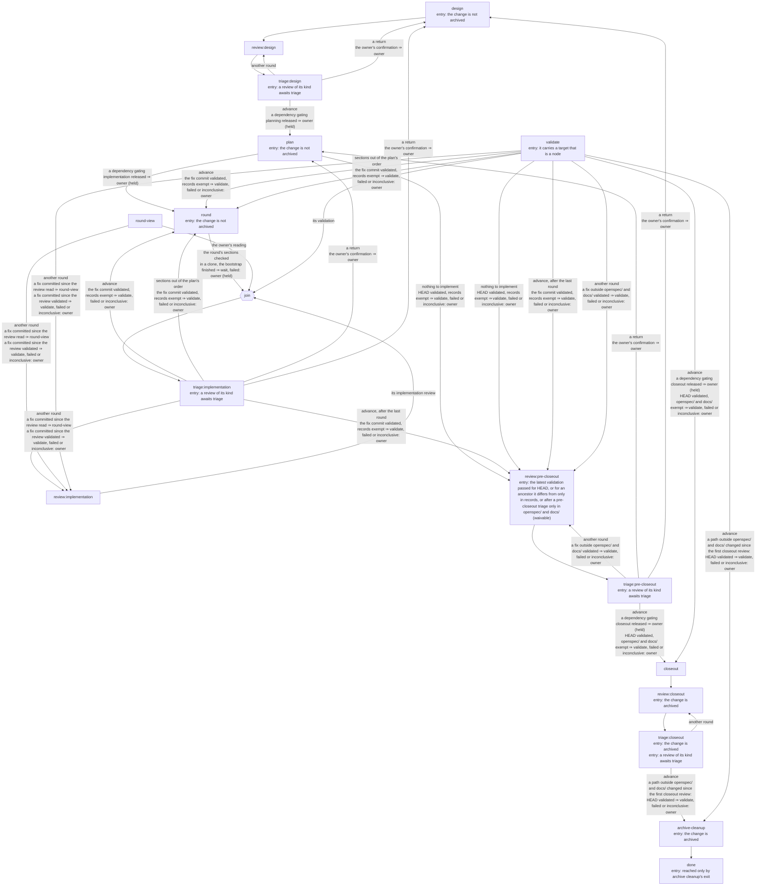

# Change Workflow Architecture

The [normative contract](spec.md) defines the phases a change moves through, its
review records, triage, the intervention ledger, validation, the push guard, the
orchestrating session that advances a change through its steps, and the clones and
validation namespaces that let several changes be worked at once. This document
explains why the workflow is shaped as it is. How to run each step is in
[`docs/agents/change-workflow.md`](../../../docs/agents/change-workflow.md).

## What the workflow is for

A change's design and its guidance are where the repository owner's judgement
matters: deciding what a change does, and refining the rules so later reviews find
less. Everything else around a change is transport — carrying a review from one
agent to another, resuming a session that stalled, running the same validation
sequence before every review, choosing which step runs next. The workflow makes
agents do the transport. Each phase's procedure is written once, as a skill any
agent harness can load; reviews are exchanged as files; validation runs unattended;
an orchestrating session carries the change from one step to the next; and the owner
reads every finding and decides every design question.

## Leaf skills from one source

Each step is its own skill (`change-design`, `change-plan`, `change-review`,
`change-triage`, `change-implement`, `change-validate`, `change-closeout`,
`change-archive-cleanup`). A step does one thing and stops, so its failure modes are
visible on their own. The owner may start any step by hand; `change-orchestrate`
starts them in turn, and is built on the leaf skills rather than replacing them, so
a step the orchestrating session runs and a step the owner runs are the same step.

A skill has one source under `.agents/skills/`, and each harness loads it through a
link (`.claude/skills/`, `.codex/skills/`). Two copies drift, and the drift is
silent: the rule that differs is the one nobody re-reads. `make check-agent-skills`
fails on a missing link, a copy, or a link that does not resolve.

## Sections are slices, sessions are the owner's

Compliance with the repository guidance degrades as a session grows, and sharply
once it compacts. `AGENTS.md` is loaded as system context and survives, but the
documents it requires reading enter through tool calls, are ordinary conversation,
and are summarized away; the summary keeps the task state and drops the rules.
Before compaction the same rules sit ever further behind tool output.

A plan nevertheless says nothing of sessions. A `tasks.md` section is a coherent
slice that one verification point proves, sized by what it changes and what proves
it; whether one session implements it, several sessions one each, or a coding
harness at all, is not the plan's concern, so the same plan serves any of them. How
many sessions implement the work, and how much each round covers before it is
reviewed, is the change's implementation cadence, settled in the design discussion:
the order of implementation can bear on the design, and a cadence settled there is
not asked about once the owner's attention has moved on. The design states it in
terms of the work, since section numbers do not exist yet; planning orders its
sections by it and reports, in its outcome rather than in `tasks.md`, the sessions
and rounds that implement them. The orchestrating session records each round from
that mapping as it starts, and asks the owner only for a change with no mapping.

Each session starts with no prior conversation, reads the guidance, the change, and
its sections, and records anything a later session needs in the change's files
before each section is committed. A fresh-context agent checks each section's diff
against the guidance before commit: it does not share the implementer's
degradation. The risk of a growing session stays advice to weigh, not a rule a plan
enforces. The owner may still send the next section, or a fix, to an earlier
implementation session they name by its id — one small enough to carry it, or the
one that made the edits a later finding concerns, which holds their context. The
session is named, never inferred: a rule such as "continue the latest run" could
not reach an earlier session, and would let sessions grow with no one choosing it.
A continued session runs on the model it ran on, since a session cannot move
between harnesses.

A section's verification names only evidence an implementation session can
produce. Evidence only a push produces — a run of a CI workflow, such as
`tests.yml`, that a change branch's push does not trigger — is written on its own
`Owed by validation:` line, naming the workflow, the job, and what the job must
show, and gates no task. A task gated on evidence no session can produce stays
unchecked, and the next-step computation names implementation for it
indefinitely; a round advances only on a passed validation, and every validation
dispatches what the change's complete sections owe, so the owed evidence keeps its
gate without a checkbox. An older plan that put such evidence inside a
verification task is corrected by the implementation session, which checks the task
on its own evidence and names the rest as owed; closeout records the owed
observations from the latest passing validation, as it records the pipeline run.

Within a Claude Code session, a hook that runs after compaction sends the session
back to the documents themselves. It never injects a digest of their rules: the
hook's context is capped far below the documents' size, and a digest is a second
copy that drifts. Codex has no equivalent.

## Steps run headless and resume with the owner's answers

A step the orchestrating session delegates runs as a headless Claude Code process
through one wrapper, `scripts/run_change_step.py`, which each step's `make` target
reaches with `UNATTENDED=1`. The wrapper gives the run the step's skill, its
permissions, and the outcome schema, records the run's session, and appends one
line to the change's workflow log. A step the orchestrating session runs and one the
owner runs by hand with `UNATTENDED=1` are the same process, and the owner can take
a stopped step over with `claude --resume <session>`. A subagent of the
orchestrating session would share its process, could not be started through `make`
or taken over from another terminal, and would need a second mechanism beside the
review's.

A question from a step is a resume, never a restart. The step ends its turn with a
`question` outcome; the owner's answer resumes the same session, which keeps its
history and carries on. The resume names the run it answers by its place in the
log, and the wrapper refuses a run that is not waiting, since with validation and a
review running side by side the log's last run is not necessarily the one that
asked. Design and triage are discussions held this way: each reply is a turn whose
message the orchestrating session shows the owner, and the owner's reply resumes
the step. The step's loading — guidance, specifications, code, reviews — stays in
its own session rather than accumulating in the orchestrating one, at the cost of
every turn replaying its session from the prompt cache. A discussion keeps one
decision or finding per turn: batched turns gave thinner answers, and an earlier
decision can change a later question. Planning resumes the design session, which is
usually still warm and holds the design's context.

Every run ends with an outcome — finished, a question, a proposed return to an
earlier phase, blocked on a prerequisite, or stopped — and the wrapper writes a
`stopped` line itself for a run that crashed or ended without one, since a step
writing its own outcome file writes nothing when it fails. A session can take more
turns after it has reported: a background command finishing, or a wake-up it
scheduled, starts another, and that turn's outcome — often "nothing left to wait
for" — would otherwise replace the report. The line is logged from the last turn,
so routing reads what the session ended on, and keeps each earlier turn's outcome
beside it, which the orchestrating session shows the owner first; choosing the
"substantive" outcome would be a guess that hides the later turn. The prompt every
unattended run is given says a background command wakes the session when it ends,
so a step never schedules a wake-up to wait for one. The log is the wrapper's
alone and holds only what the files cannot: session ids, rounds, decisions, the last
outcome of each run, and its cost. Where the log and the change's files disagree,
the files win. A proposed return does not move the status: the owner confirms it as
a decision line, and the step it directs sets its phase's status as it always has.

The wrapper writes each run's event stream to a transcript under `reviews/` and a
progress file of one line per tool call, so whether a long step is stuck can be
read rather than waited out; `make change-watch` follows the progress files as each
step starts, into the archive when closeout moves the change there.

## Routing is code, with the model as backstop

Where a change stands, and what runs next, is computed by
`scripts/change_next_step.py` from the index row, the reviews and their triage, the
task list, the workflow log, and the round view's state, and printed as data. The
transitions are each skill's entry check and handoff written once as rules, so they
can be tested under `scripts/tests`, and the owner can run the same computation
(`make change-next`). Routing by the orchestrating session's own reading would be
only as reliable as the model on a given turn, and least reliable late in a long
session; a transition table written into a skill would still be read by a model, and
untestable.

The workflow's graph, as `make change-graph` draws it from the table in
`scripts/change_workflow/graph.py`:

The orchestrating session holds no state of its own. On every start and after
compaction it runs the computation and reads the log's last lines, so any session
picks a change up where the last one left it. When the computation errors, cannot
classify a state, or meets files and a log that disagree, the session works out what
happened: it decides routing or recovery itself — a step that died before writing an
outcome, a status set by hand — and brings to the owner anything that would decide
a finding, settle a design question, or change a status. Either way it records an
`orchestrator` line with what it decided and why. Those lines are the evidence for
what the computation should learn next.

A decision line names what it decides — the run it resolves, the run whose denials
it read, the step it directs — because a decision that cleared every run before it
let one decision about a stopped review silence a validation question waiting
beside it. Reading a run's denials and settling its outcome are separate lines: a run
can be denied a call and still end with a question, which is answered after its
denials are read.

## Restrictions bind unattended runs only

An unattended run uses Claude Code's `dontAsk` permission mode with its step's allow
and deny rules from `.claude/change-steps.toml`, so a tool it was not given is
denied and recorded rather than prompting a person nobody is watching. The rules
turn each skill's "never" lines into rules the harness enforces: validation's
"never changes the commit" stops being an instruction only. The table lives in
Claude Code's own directory because its rules are that harness's syntax, and it is
TOML because the scripts run on the standard library and its comments carry each
row's reason. No step may edit it or the project's Claude Code settings, so no step
widens its own or a later step's permissions; a step's permissions change as a
tracked edit the owner commits, or the orchestrating session commits on the owner's
word, or by a grant for one run. An interactive run is unaffected: the owner's own
settings apply, with prompts.

A grant reaches a fresh run as well as a resumed one. A fresh run is started
through its step's `make` target, which checks the change, refuses while a round
view is open, and translates the target's variables, so the grant travels as
`ALLOW` on that target, several rules separated by `;`; a rule holding `;` could
never match, since the harness matches each command of a chain on its own. Without
it, a grant the owner decides before a run costs that run a refused turn before its
resume carries the grant, and between a round's sections being committed and its
triage, where no table edit may be committed, a fresh run could not be granted at
all. The grant is recorded on the run's log line and never kept for a later run: a
waiting grant would be state a run nobody meant could take.

Auto mode was rejected because what a step may do would rest on a classifier's call
per action, unreviewable in advance; a permission-prompt tool routing prompts to the
orchestrating session would leave an hour-long validation blocked on a prompt while
the owner is away, where a denial ends cleanly and resumably; bypass is ruled out by
validation driving Docker, the cluster, and the push.

A denial is read from the run's own record, never from the step's message: the
record names the call, while the message generalizes ("Bash is not allowed" for a
chain missing one utility). The harness's reason classifies it: `mode` is a gap in
the table, `rule` met a deny rule — a forbidden action — and `subcommandResults`
refused a shell command by one of its parts without saying which way, so the
command's parts are matched against the step's deny rules. A step that cannot go on without a
denied call stops naming it; one that can goes on, and every denial is recorded on
its outcome either way. After a `mode` denial, the same work done by a tool the
step's rules allow for it — the Edit tool for a shell write — is the rules being
used, not a workaround, and the orchestrating session reads it as a gap; after a
deny-rule denial, no other tool may do the work. A gap is answered with the
narrowest rule that matches the call. A deny rule is matched against the command as
typed, so it holds the plain and quoted forms of an option but not a word a shell
assembles from pieces: the deny rules stop a step's mistakes, and its skill stops
the rest.

## A prerequisite is proposed from dev and halts its dependent

A design that cannot proceed without another change shapes that change's
requirements and initial proposal with the owner, and halts. The proposal is written
in a worktree on a new branch from dev and reaches the blocked branch only by
merging dev once it lands, so the blocked branch never holds a copy of its own:
writing it on the blocked branch and cherry-picking it would leave, after dev is
merged back, the unarchived copy beside dev's archived one without a conflict, and
stacking the prerequisite on the blocked branch would put two changes in one pull
request and stop the prerequisite landing alone. One change per branch is the rule
this keeps.

The blocked change then stays `in design`, with the prerequisite in `Depends on`
gating design; `blocked in design` is kept for reasons that are not another change.
Starting the prerequisite's workflow is the owner's, as choosing any other work is.
Once the prerequisite is archived and merged in, the dependency names an archived
change, which the index check rejects; the computation recognizes that state, and on
the owner's word the dependency is dropped and design resumes.

## The owner is interrupted only for judgement

A change stops for the owner at four kinds of moment: the design discussion's
questions; the owner's notes on each implementation round, read through the round
view; the triage discussion — each finding's disposition, and, once every finding is
disposed and before any fix, whether the fixes merit another review round, asked
while the owner is still present; and the interrupts no rule can settle, such as an
environmental remedy validation proposes, a denial that needs a rule, a proposed
return, a stopped step, or a prerequisite to release. Every other transition
advances on conditions the computation checks.

Reviews are not gates. A gate at each review would ask the owner a question whose
answer does not vary, and asking it leaves the owner's window idle while their
attention is elsewhere; a routing question at each review would be the same
interruption under another name. A
review's triage records, under `## Next`, whether the change advances or another
round runs, its first word a fixed token the computation reads alone, since routing
on free text is a model's reading again. A triage that returns the change to design
or planning records `Returned`, so its file says the triage ended rather than
reading as one still running; once the owner confirms the return, that review no
longer governs, and what the return leads to is a round of its own, read,
validated, and reviewed afresh — even a rework of the returned round's own
sections, which under the returned round would reach the next round unread and
unreviewed. A declined return is the owner's to settle, since the triage it ended
no longer says what follows. A triage run's log line does not name the review it
triaged, so a confirmation counts for a review only when it was recorded after that
review's triage file was last written, which a triage file, never rewritten after
`## Next`, makes the time of the return. Only a decision the log attributes to the
owner confirms a return, as with the owner's other decisions — a branch decision, a
waiver — so a confirmation the orchestrating session records without the owner's
name is refused when written and confirms nothing when read. A triage with nothing
to dispose of advances without the owner. An implementation or pre-closeout round advances only on a
`passed` validation of its final commit, and after a closeout review a correction
outside `openspec/` and `docs/` is validated before archive cleanup, so a code
correction reaches the merge validated unless the owner waives it. The owner's own look at the pull request before merging is outside
the workflow.

## The orchestrator relays and routes

The orchestrating session starts steps, shows each step's message to the owner as
written, and sends the owner's reply back as written. It reads what routing and
recovery need — the computation and the inputs it names, the workflow log, and the
denials report — and never code, reviews, or change documents to form a view of a
finding or a design question. An orchestrating session that stated its own position
on each finding read again what the step had read, which cost tokens and blurred
whose recommendation the owner was weighing. It runs at medium effort: it needs a
large context for a change's relayed turns, not the effort of judging them.

What only the orchestrating session sees is still reported. Misbehaviour of the
workflow's tooling that shows across steps — an answer delivered to the wrong
session, a denial missing from a line, a table rule several steps trip — it writes
as the change's next numbered record, marked as its own observations, which the
next triage reads like the owner's notes. Defects of that kind were found by the
orchestrating session alone; relaying with no observations would have lost them.

It also maintains the workflow. It creates the change's clone and branch, and on the
owner's word commits skill and permission changes, anything else the owner
explicitly asks for, and merges of `dev`, in the change's clone and on its branch,
so they take effect for the next step and land with the feature; committed on `dev`
in the owner's workspace, the clone's step table would not see them until `dev` was
merged in. It commits nothing while a step runs and never writes the change's
feature work of its own accord. Nothing restricts its commits mechanically: it runs
on the owner's interactive permissions, and "when the owner instructs" is not a rule
a table can hold. It commits no step's leftover work: each step commits its own
("Pushing is guarded, never repaired"), so tracked work left after a step ended is
that step's defect, brought to the owner.

A merge of `dev` is made between steps, never while a round view is open, nor
between a round's sections being committed and that round's triage, so it never
moves the commit a round's validation and review describe or falls inside a round's
diff. Conflicts are tiered by who understands them. In the change index, change
documents, the step table, and skills, the orchestrating session resolves them
itself: it knows the workflow's files, and there is rarely a real decision in them.
A conflict in code goes to the owner as it stands, and one the owner does not rule
on goes to an implementation run naming the conflicted files, with no planning,
since understanding the code and deciding such a conflict is implementation's
work; that run concludes the merge the orchestrating session began rather than
redoing it. While a merge is in progress, the next-step computation names the owner,
so a restarted session does not route on the change's state alone.

## Models are policy, with no same-vendor fallback

Each row of the step table names its step's models in priority order, each with its
harness and effort, and the wrapper runs the first available; a model is
unavailable when its program is missing, it is not signed in, or it reports a usage
limit. An unset model would inherit the account's default, which ran steps on the
most expensive model without anyone choosing it. Design, triage, implementation, and
closeout run on Opus at high effort, which caught more problems and explained its
decisions better; validation and archive cleanup, which run commands and edit a
row, on Sonnet at medium.

The table refuses a row naming Fable or Astra, which the workflow never chooses, and
a row listing two models of one vendor: an outage or a usage limit takes both down,
so a second model of the same vendor is no fallback. Codex appears only where its
sandbox can hold a step to its limits, which is the review alone, falling back to
Claude when Codex is unavailable: a review on a second model reads the work with
another eye, a review on Claude is better than none, and halting on a missing
reviewer only costs the owner time. A step whose one model is unavailable stops with
the time its limit resets. A network error is retried, never a reason to fall back.
A waiting run resumes only on the model it ran on, since a session cannot move
between harnesses. The owner may name any model for a review run by hand, outside
the policy on purpose; the record says so, and the orchestrating session never does.

## Every run records its cost

Each log line carries the model and effort that ran and what the run cost: for a
Claude run its own dollars, turns, duration, and tokens, and for a Codex review the
tokens it reports. A resumed session's dollar total is its running total, so a run's
dollars are that total less the session's previous one, and are marked partial when
something intervened — a crashed run, or turns the owner took over. A resumed run
also records the gap since its session's last turn and whether it read the prompt
cache. The figures are the harness's list prices, not an invoice.

`make change-cost` totals them by step, by round, and by whether a run opened its
session, missed the cache, or read it, because a discussion's cost lies in its
replays: a warm turn presenting one decision costs cents, a session's opening or a
cache miss rewrites its whole context. The record is what the open questions of
loading less guidance per session and of a longer cache lifetime wait on; the
account's console shows totals, not which step or turn spent them.

## Reviews are files

A review is one Markdown file in the change's `reviews/` directory, and the only
record of its findings. Later reviews and triage read earlier findings and their
dispositions from these files rather than from any session's memory, which is what
lets a pre-closeout review ask a different session whether earlier feedback was
addressed, survive compaction, and run under either harness. A structured copy
beside each review would be a second source that can disagree with it.

A re-review continues its own reviewer on the same harness, so the reviewer weighs a
revision with the context that led to its findings; it still reads the triage from
the records. A reviewer's raw session is kept as a transcript, but no review or
triage step reads one: a transcript carries the session context the file exchange
exists to keep out. The reviewer runs read-only and never writes the record itself;
its answer is published only when it has the review format, so an error or a
truncated answer never becomes history, and a run that published nothing is a
failed run however many earlier records exist.

`reviews/` is untracked: it is working history, and anything durable in it reaches
permanent documentation through promotion. It moves with the change into the
archive; for a change worked in its own clone, archive cleanup copies it into the
owner's workspace ("History lives in the owner's workspace"), where it stays until
an export flow carries it elsewhere.

## A finding has a lens, a basis, and a severity

A flat list of finding classes conflates two questions: what kind of attention a
finding needs, and what it rests on. Test coverage is both a kind of attention and
an application of written guidance, so a `coverage` class and a `compliance` class
overlap. A finding therefore carries a lens (`direction`, `consistency`, `testing`,
`documentation`, `architecture`, `scope`, `readiness`) and a basis
(`specification`, `guidance`, `evidence`, `judgement`) as separate axes, with a
severity beside them.

The basis is what makes the owner's corrections useful. A `guidance` finding that
reached a review means a written rule was not mechanically enforced, and the
question is which check should have caught it. A `judgement` finding the owner
accepts is an unwritten rule, and the question is whether to write it.

## Triage

The implementing agent states a position on every finding — agree, disagree, or
partly — with a reason either way, so that deference to the reviewer is visible
rather than the default. Every finding reaches the owner, one per message, each
after any decision that could change it: a summary up front invites dispositions
before the arguments are read, and a question about one finding is not acceptance
of another. A finding is disposed of only when the owner says so.

The intervention ledger (`interventions.jsonl`, tracked) records only the owner's
course corrections: deciding otherwise than the agent proposed, or adding context
that changes the work. Most dispositions accept the proposal and are recorded only
in the triage file; the ledger exists to show where the agents' judgement needed
correcting, and the owner's periodic guidance reviews read it. It is tracked so it
travels with the change through archival.

## Validation observes a committed slice

An implementation slice is committed before it is reviewed, so validation describes
one commit and must not change the checkout: a step that rewrites a tracked file
validates a tree that is not the commit, then pushes and runs end to end against the
commit that was never checked. Validation therefore fails rather than repairs. It
never relocks: `make lock` would silently repair the stale lock `make
check-packaging` exists to report, so relocking belongs to implementation, and a
stale lock sends the slice back.

The wheelhouse in `.dist` is shared by every branch built in the checkout, and
environments sync internal packages with an upgrade, so a higher version another
branch left behind is installed in place of the one the commit builds. Each part
that builds therefore starts from `make dist-clean`; the `ci` part builds nothing.

Validation has a local part, a Helm part, the end-to-end pipeline, which starts
first because it is the slowest, and a `ci` part for evidence owed by validation.
The Helm part runs the pipeline scenarios the default charts can serve, reporting
every other one as not run against Helm rather than as passed. It never starts from
state another commit wrote, and never reaches another change's deployment.

**The change's namespace.** Each change's Helm part deploys into a namespace of its
own, `validate-<change>`, so two changes' validations never uninstall each other's
release. A namespace alone does not isolate images: every image the chart deploys
is pulled `IfNotPresent` from the one Docker daemon the development cluster reads,
so the part builds every image under a tag fixed per change, the bare tag with
`-<change>` appended, and deploys those tags. A tag per change, never per commit:
a rebuilt image under a fixed tag rolls out by restarting pods, and two changes never
write one tag, so no build lock is needed. A namespace per validated commit was
rejected because they accumulate; one per change is bounded by the active changes.

The release is replaced by upgrading it from zero rather than uninstalling it: the
part scales the release's workloads to zero if a crashed run left any up, deletes
its volume claims and the out-of-band test volume, waits until they are gone,
creates the namespace's Secrets from development values, and upgrades the release,
which restores the replica counts, so every pod starts new on the images just built
against empty volumes. Uninstalling every time is needless work, and cycling pods
over kept volumes would start the new code on databases the previous commit
migrated. An upgrade the chart refuses falls back to uninstalling and installing,
said in the step's detail. The scenarios run as a pod inside the namespace, from the
change's own test image and the release's in-cluster configuration, reaching
services by name as the pipeline's lanes do on their compose network; no local port
is involved, since forwarding free ports per validation would need every
scenario's addresses and the registry's published address overridden. Afterwards
the part keeps every pod's log, the namespace's events, the other namespaces'
replica counts, and the rendered requests and limits beside the previous
validation's, then scales the namespace to zero, keeping objects and volumes:
leaving releases running would grow resident memory with the active changes.
Without a change named, the part deploys into `default` on bare tags, refusing a
release volume an earlier install kept, as before namespaces existed.

**Memory is shared, and checked by estimate.** The node's memory is the one
resource the namespaces still share. A preflight compares the releases that would
then be running, times the memory one release was last measured to need, with the
node's allocatable memory, and fails a deployment that would not fit as
environmental. It is an estimate that reserves nothing: two preflights can pass
together. A reservation held from preflight to scale-to-zero would bring back the
cross-change coordination per-change namespaces and tags removed, and recovery of a
lease a crashed validation left, to prevent a failure that costs one rerun. A pod
that then fails for memory is classified from the evidence the part kept, as any
failure is, since a commit that raises a request, lowers a limit, or leaks fails
the same way: unscheduled or evicted while another change's release was up is
contention, environmental whatever the resources, with any resource change named
beside the remedy; killed at its own limit, with the limit in the rendered
resources and no node pressure, is the commit's; anything else is of unknown cause.
The figure, in `helm/validation-capacity.toml`, is written by archive cleanup from
the change's latest validation, and only when that validation measured memory, so
a cluster with no metrics source leaves it absent and the preflight warns that it
skipped its check; installing a metrics source cluster-wide for an advisory check
was rejected. The figure is advisory and expected to be overwritten often — no
branch's measurement is of the merged code, branches differ little, and it creeps
up as the code grows — so a merge conflict over it keeps the later measurement.

**Evidence only a push produces.** The `ci` part dispatches, on the change's
branch, each workflow a complete section owes, and judges the owed job and its
observation from the run of the validated commit. It dispatches only workflows on
a fixed list in its script, which holds `tests.yml`: three workflows that accept a
dispatch publish, so a plan line naming one would publish from a feature branch,
and a list in the script binds interactive runs too, which the step table does not.
Only the owner extends the list. `tests.yml` fails on `dev` in jobs unrelated to
any change, so judging the run's conclusion would fail every such validation, and
judging the owed jobs alone would let a job the commit broke pass unseen. Every
other failing job is therefore compared, failure by failure, with the same job in
the latest completed run of the workflow on `dev` whose commit the branch contains:
by each failing test's ID and exception type, read from the line pytest already
prints, or by the failing step and its error lines where no test is printed. A job
status cannot show a failure inherited, since the branch can break another test in
a job already failing; a test ID alone cannot either, since a test failing on `dev`
with a timeout can fail on the branch another way; the exception type is compared
mechanically, so a timeout whose wording varies raises nothing. A failure the
baseline shows too is reported as already failing on `dev`; any other is diagnosed
like any failure, and one with no baseline to compare is of unknown cause. Every
validation dispatches what its complete sections owe, because a fix commit can
break evidence an earlier commit produced, as with the pipeline.

"Fixes nothing" protects the commit, not the machine. A failure diagnosed as
environmental is put to the owner with its remedy and its part rerun on the owner's
word; only failures the commit caused, or whose cause is unknown, become findings.
A result is `passed`, `failed`, or `inconclusive`, the last meaning no failure was
the commit's but some part produced no evidence.

## An implementation round is triaged together, in a fresh session

The owner's reading of a round, the implementation review, and the validation of the
same commit are triaged in one session that is not the implementing one. Validation
results go to triage, not to the reviewer: a reviewer given them would wait an hour
for the pipeline, could fix nothing, and judges the code the same either way; and
fixes for failures and findings often touch the same code. The owner's notes are
saved verbatim and evaluated like any finding, not obeyed, so a note the files
contradict is answered with the evidence.

The owner reads a round as uncommitted changes in their own workspace, because that
is where the owner reads and runs tests: `make round-view` resets the change's
branch to the round's base — the commit recorded as the round started, so commits
landing between rounds are not shown as the round's — with the files unchanged, and
`make round-done` returns it. An editor comparison against a base ref reads as a
comparison, not as the changes being worked, and runs the tests on whatever the
workspace holds; a second editor project per round lacks the owner's test setup.

For a change worked in its own clone, the view is in the owner's workspace, on the
workspace's copy of the branch, fast-forwarded from the clone, and never moves the
branch the clone's steps run on. Validation and the implementation review therefore
start as soon as the round is committed, beside the reading. Reading first was only
ever there because the view moved the one checkout validation describes; with the
view in another repository, validation's premise that its checkout is the commit
holds throughout, and the owner's reading, which takes as long as it takes, comes
off the round's critical path. Triage waits for all three: the review does not read
the owner's notes, which are triaged beside it. A change worked in the workspace
without a clone keeps the reading first, since its view moves the branch its own
steps run on; while that view is open every step that describes or publishes a
commit refuses.

The view never takes a silent risk with the owner's work. It refuses a dirty
workspace, a run in progress there, and an ignored file a move would overwrite,
naming each, rather than stashing or moving anything of the owner's. A commit the
owner makes while the branch sits at the round's base — an editor's "commit all" is
one click — is carried onto the round's head when the view closes, holding exactly
the paths it changed; where the round also changed a path, the commit is carried
only when it holds every change the round made there, since with the index at the
base a missing round change means the owner either left it unstaged or removed it,
and the files cannot say which. Laying such a version over the head would revert
the round's change inside the owner's commit, and merging it would undo a removal
the owner meant, so the view refuses and says how to commit again on the round's
head. Triage pulls the owner's commits into the clone fast-forward only.

When a round's triage records another round over a fix it committed, the repeat
pass is read the same way, as the changes from the commit that triage's review read
to the fix: the commits a repeat round exists for are the ones the owner would
otherwise never see. An answer saved before that triage finished answers only for
the earlier pass. The orchestrating session waits for the owner's notes and saves
them as a numbered record before it closes the view, so a restart cannot lose them.

## Pushing is guarded, never repaired

Every step that writes tracked work on the change — design, planning,
implementation, triage, closeout, archive cleanup — commits it and pushes it
itself; validation pushes the commit it validates, because the pipeline runs
against the pushed branch. An unattended push needs a mechanical definition of the
change's branch, so the guard refuses a detached `HEAD`, a dirty worktree, `main` or
`dev`, and an upstream of another name, and the push sends exactly `HEAD`, never
forced. Each refused state means something unexpected happened; an agent repairing
it would hide that. Never forcing also keeps valid the fast-forward-only pulls
between a change's clone and the owner's workspace.

Work left uncommitted in a checkout is stranded when no session follows to commit
it, as when the owner is away and steps run in clones, and a dirty checkout blocks
every later step's guarded push. So a step commits its
own work, and partial work only on a return: a run that returns the change records
why, commits what it has as work in progress, and pushes it, since no session is
left to finish it. A stopped run leaves its work uncommitted, since a stop is
usually resumed and its own session finishes the work; one stopped by a refusing
guard or a moved `HEAD` commits nothing. Validation and review commit nothing: each
describes one commit, and a commit of its own would move `HEAD` from under its
evidence. No step resets, checks out, switches, rebases, stashes, or cleans.

The branch is the guard against unfinished work. Only `dev` is protected, and `dev`
is not deployed at every commit, so a commit known not to work harms nothing while
it stays on a change branch. A pushed change branch starts nothing by itself: the
pipeline runs on dispatch and nightly, and `tests.yml` on `dev`, `staging`, and pull
requests into them.

## A change is worked in its own clone

A change can be worked in a clone of the owner's workspace of its own, a sibling
directory under `<workspace>.changes/<change>/`, holding its branch, `reviews/`,
workflow log and transcripts, wheelhouse and environments, `.snapshot/`, round-view
state, and step sessions. Almost everything a step touches is per checkout and
mostly untracked, and validation holds `HEAD` for about an hour; in one checkout,
working a second change only interleaves the two. The owner's workspace — their
editor project — meets a change's workflow only for reading, when the owner reads a
round.

A clone rather than the alternatives:

- Switching branches in one checkout only interleaves changes, and leaves another
  change's ignored `reviews/` on disk for the change lookup and the index check to
  misread.
- Git refuses one branch in two worktrees, so with a worktree per change the owner
  could read a round only on a detached `HEAD`, with no branch to commit an edit on.
  A clone has refs of its own, so one branch name is checked out in the clone and,
  for reading, in the workspace at once, and commits move between them by fetch
  and fast-forward pull. A local clone hard-links its objects, so it costs little
  disk.
- Worktrees nested under an ignored directory of the workspace would be found by the
  scripts' tree walkers, which ignore `.gitignore`: `make lock` would relock the
  nested projects, and the comment and architecture checks would scan them twice.
- A container per change, with its own Docker daemon and cluster, isolates
  everything, ports included, but costs an image, privileged Docker in Docker, a
  cold build cache and a cluster per change, and mounted credentials. A clone is what
  such a container would mount.

The clone's `origin` is the workspace's `origin`, so the push guard's same-named
upstream holds, and a `workspace` remote names the workspace, which is how every
script in the clone finds it. The branch is taken at its furthest point between the
workspace's copy and `origin`'s, refused where the two have diverged, since a stale
local `dev` would start a change without its own proposal; it tracks `origin`'s
branch, never the workspace's, so no push goes into the workspace. The clone is
created by the orchestrating session when feature work begins, and creating it is
safe to repeat: it finishes a clone left incomplete and refuses, deleting nothing,
anything that is not such a clone. Its `make init` runs in the background during
design, which needs no environment; implementation and every later step wait for it,
since each runs suites or packaging. A failed bootstrap goes to the owner rather
than being retried, since `make init` failing is almost always the environment, and
a silent retry would hide it.

A change already under way in the workspace is not cloned: a clone copies what Git
tracks, and its records are ignored, so the clone would start without them and a
run waiting on an answer, keyed to the workspace's path, could not be resumed there.
It is worked on in the workspace, as before clones, or moved into a clone by hand.

Every resource a step uses is per change, shared safely, or checked. The branch,
checkout, records, sessions, wheelhouse, environments, evidence, port-forward
state, and chart packages are the clone's; image tags, the namespace, its releases,
volumes, and Secrets are the change's ("Validation observes a committed slice").
The Docker build cache and the uv and bun caches are shared, each tool locking its
own. Validation forwards no port; a manual forward serves one namespace at a time.
Node memory is shared and checked by the capacity preflight. CPU and CI runners are
shared, so slower, never wrong. The Git remote, `gh`, and the Claude and Codex
accounts are shared, and a usage limit stops every change's runs at once. The owner's
workspace holds one round view at a time. Each branch edits its own index row, and
adjacent rows may conflict at a merge, resolved there. No step runs the local
compose lanes.

## History lives in the owner's workspace

A change's records and evidence are untracked, so no merge carries them out of its
clone. As its last act archive cleanup copies the archived change's `reviews/`, and
the validation evidence its records name, into the owner's workspace at the same
paths; the workspace therefore holds the history of every cleaned-up change, and a
step that reads another change's records looks in its own checkout first, then
there. The copy cannot be the last write: the wrapper appends the cleanup run's
outcome to the log after the skill returns, its transcript is still being written,
and the orchestrating session's lines and another round on the pull request add
more. Those files only grow, so the copy is a synchronization, safe to repeat: it
copies what is missing, extends a workspace file that is a prefix of the clone's,
and refuses, naming it and overwriting nothing, any file that differs otherwise.
The orchestrating session repeats it once cleanup's own line is written, and clone
removal runs it first, so the last copy always follows the last record. Teaching the
wrapper to copy after recording cleanup's outcome would make a generic wrapper learn
one step's special case, and later lines would still need the prefix rule. Reports
of a cleaned-up change's log and cost read the history wherever it is.

A clone is removed only on the owner's command, after the merge: archive cleanup
does not, since the pull request may need another round. Removal refuses, deleting
nothing, unless the history is in the workspace with identical contents, the branch
is merged, and the clone holds nothing its `origin` lacks. Named evidence the clone
does not hold is reported and does not refuse removal: deleting the clone cannot
lose it, and refusing would keep a clone forever over evidence held nowhere.

## Phases, triage, and archival

A change moves through design, planning, implementation, and closeout, and a phase
ending in a review is finished only when that review's triage records that the
change advances. Planning starts only after the design review's triage advances it,
so a review that redirects the design never discards a plan; a design question
planning exposes returns the change to design.

Closeout and archival are one phase. Closeout writes the documents OpenSpec does not
synchronize, then archives the change, which merges its deltas into
`openspec/specs/`, so the closeout review reads the specifications as they will
land rather than inferring them from the delta. The steps after the archive find the
change by name under its dated directory; design, planning, and implementation have
nothing to do with an archived change and refuse it.

Closeout changes documentation only. The code was last reviewed at pre-closeout and
the closeout review reads documentation, so a closeout code edit would go unreviewed
as code; comment hygiene and import placement are therefore done before the
pre-closeout review and only confirmed at closeout. A code defect a closeout review
does find stops for the owner, who directs the correction and decides whether it
needs another reader; reopening the change for a full round is not required for what
is expected to be rare.

Archive cleanup follows the closeout review's advancing triage as a step of its own,
with its own entry checks, rather than as the end of triage: it releases the
change's dependents, sets it `archived`, drafts the merge, records the capacity
figure its latest validation measured, tears down its validation namespace and
images, and copies its history into the owner's workspace, and is the point at
which the change lands. Its check that a correction outside `openspec/` and `docs/`
was validated stands even for another change's commit on a shared branch, since the
merge carries every commit on it; the owner may waive it, judging the paths named,
and the waiver is a ledger line.

## The index states what may start

The active-change index is what the next-step computation reads to decide what
starts next, so a row's status names its phase and its state within it (`ready
for`, `in`, `blocked in`), and dependencies on other changes sit in their own column
with the phase each gates. A single word such as `active` cannot carry that
decision; it erases the difference between a change waiting for design and one
waiting for a plan, which separate skills perform.

When a dependency lands, its dependents' designs rest on a codebase it has just
altered, so archive cleanup returns each dependent not yet implementing to design.
That ties reverification to a step that already runs. A dependent already in
implementation, or blocked for its own reason, keeps its status.

Every step that edits the index runs `make check-change-index`. The citation check
cannot see those edits: it is scoped to a change's own documents, and the index's
links are relative directory links. The check covers active changes only; archived
rows are recent history and may be pruned at any time.

## Current limits

- One orchestrating session advances one change. Several changes run at once, each
  in its own clone with its own validation namespace, but each needs a session of
  its own; orchestrating several from one session is not built.
- A container per change, with its own Docker daemon and cluster, is not built:
  clones and per-change namespaces have kept every step and validation apart, at a
  fraction of its cost. It would be reopened when a validation fails because two
  changes' releases contend for one node, or two changes need cluster-scoped
  resources a namespace cannot separate; when side-by-side validations become
  routine, with several changes orchestrated from one session; or when unattended
  steps are to be sandboxed from the owner's files.
- An unattended step's Read, Glob, and Grep reach any file the owner can read — the
  workspace's records, which history needs, and equally another clone's or the
  owner's own files — while its shell reads stay in its checkout. The step table
  bounds commands, not the files a step may read.
- The round view resets the branch to the round's base, so a merge of `dev` made
  inside a round shows `dev`'s changes as uncommitted beside the round's own, with
  nothing to tell them apart.
- Side work running beside the critical-path goal is chosen to stay clear of that
  goal's files: clones keep changes apart while they are worked, not when they merge.
- Two releases at once may exhaust the node's memory: the capacity preflight is an
  estimate, and stays inactive on a cluster with no metrics source, which has no
  recorded figure.
- The computation's check for a merge in progress runs in whichever checkout
  computes, so an unrelated merge in progress in the owner's workspace makes the
  workspace's computation name the owner rather than the change's clone.
- Leaf steps other than the review run on Claude Code only. Codex can hold only the
  review to its step's limits; running other steps on Codex with the step table's
  guarantees and its record of denials is not built.
- Choosing what to work on next across changes, and starting a prerequisite's
  workflow, stay with the owner.
- The Helm run serves only the scenarios the default charts can: the charts lack the
  pipeline's full topology, which `helm-e2e-pipeline-parity` owns.
- Following a wrapper run from inside the orchestrating session is not built: the
  harness's task panel does not show it, and the owner follows it with
  `make change-watch` in another terminal.
- Review and step transcripts persist only in the untracked `reviews/` directory
  until an export flow exists.
